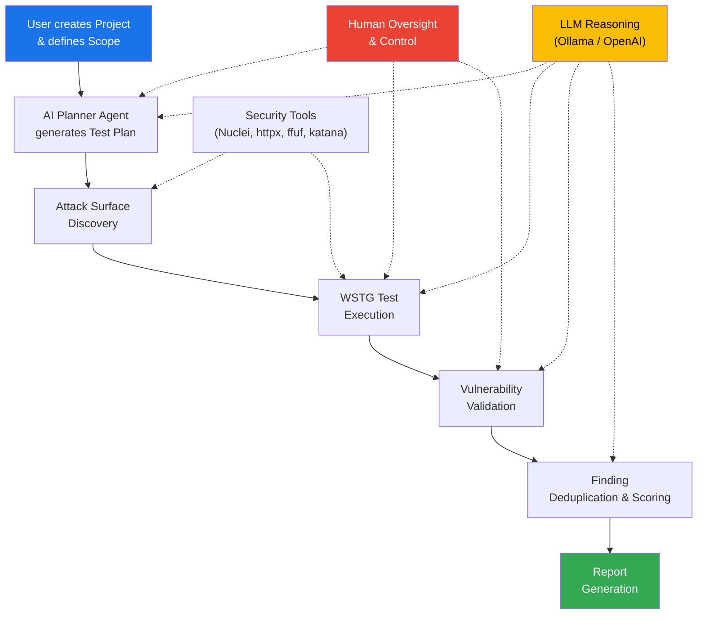

# Pentesa — Product Vision

> **AI-Powered Autonomous Web Application Penetration Testing**

**Document Version:** 1.0
**Last Updated:** 2026-11-03
**Status:** Approved
**Owner:** Product & Security Architecture

---

## Table of Contents

- [1. Tagline & Mission Statement](#1-tagline--mission-statement)
- [2. Problem Statement](#2-problem-statement)
- [3. Solution Overview](#3-solution-overview)
- [4. Target Users](#4-target-users)
- [5. Core Value Propositions](#5-core-value-propositions)
- [6. Key Differentiators](#6-key-differentiators)
- [7. Product Principles](#7-product-principles)
- [8. Success Metrics & KPIs](#8-success-metrics--kpis)
- [9. Out of Scope for V1](#9-out-of-scope-for-v1)
- [10. Future Vision (V2+)](#10-future-vision-v2)

---

## 1. Tagline & Mission Statement

### Tagline

**"Autonomous penetration testing, guided by intelligence, grounded in evidence."**

### Mission Statement

Pentesa exists to democratize expert-level web application penetration testing by combining the rigor of established security methodologies — OWASP WSTG, PTES, and OWASP Top 10 — with the reasoning capabilities of modern AI agents. Our mission is to deliver an autonomous, self-hosted penetration testing platform that produces reproducible, evidence-backed findings at a fraction of the cost and time of traditional manual assessments, while never compromising on accuracy, auditability, or ethical testing boundaries.

We believe that every organization, regardless of size or security budget, deserves access to thorough, methodology-driven penetration testing. Pentesa makes this possible by replacing the inconsistency and bottleneck of purely manual testing with an AI-orchestrated workflow that plans, executes, validates, and reports — all under human oversight and within strictly authorized scope.

---

## 2. Problem Statement

### The Current State of Web Application Penetration Testing

Web application penetration testing remains one of the most critical security activities an organization can undertake. Yet, the practice suffers from systemic challenges that limit its effectiveness and accessibility:

#### 2.1 Manual, Labor-Intensive Process

Traditional penetration testing is overwhelmingly manual. A qualified penetration tester must individually plan the engagement, enumerate the attack surface, test each vulnerability class, validate findings, and write a detailed report. A single web application assessment can consume 40–160 hours of expert labor. This creates significant bottlenecks:

- **Talent scarcity:** The global shortage of qualified penetration testers means that many organizations cannot hire or retain the expertise needed for regular assessments.
- **Slow cadence:** Most organizations can only afford annual or semi-annual penetration tests, leaving long windows where new vulnerabilities go undetected.
- **Tester fatigue:** Repetitive, tedious testing tasks (e.g., checking every endpoint for IDOR, testing every input for XSS) lead to human error, omissions, and inconsistent coverage.

#### 2.2 Expensive and Inaccessible

The cost of a professional web application penetration test ranges from $5,000 to $50,000+ depending on scope and complexity. For startups, SMBs, and organizations with large application portfolios, this cost is prohibitive for frequent testing. The result is that security testing is often deferred, skipped, or limited to only the most critical applications.

#### 2.3 Inconsistent Quality and Coverage

The quality of a penetration test is directly proportional to the skill, experience, and methodology adherence of the individual tester. Without enforced methodology coverage tracking:

- Different testers produce different results on the same application.
- Coverage gaps go unnoticed — entire OWASP WSTG categories may be skipped without detection.
- There is no systematic way to ensure that all relevant test cases have been executed.
- Findings severity ratings vary based on individual judgment, without standardized CVSS scoring.

#### 2.4 Poor Coverage Tracking and Auditability

Most penetration testing engagements produce a PDF report at the end of the engagement. There is typically:

- No real-time visibility into what has been tested and what remains.
- No machine-readable record of individual test executions, tool outputs, and decision points.
- No traceability from a finding back to the specific test that discovered it, the evidence collected, and the validation steps performed.
- No systematic way to compare coverage across engagements or track remediation progress over time.

#### 2.5 Tool Sprawl Without Integration

Penetration testers use dozens of tools — Burp Suite, Nmap, Nuclei, ffuf, sqlmap, and many more. These tools operate independently with no unified workflow:

- Results must be manually correlated across tools.
- There is no shared context or intelligence between tool executions.
- Duplicate findings from different tools create noise and require manual deduplication.
- Tool configuration and execution is ad-hoc, not reproducible.

#### 2.6 Existing Automated Scanners Are Insufficient

Commercial DAST scanners (e.g., Burp Suite Pro scanner, Qualys WAS, Acunetix) and open-source alternatives (OWASP ZAP) provide automated vulnerability scanning but have fundamental limitations:

- **High false positive rates:** Automated scanners routinely produce 30–70% false positive rates, requiring extensive manual triage.
- **No reasoning capability:** Scanners execute predefined checks without understanding the application's business logic, authentication model, or data flow.
- **Limited vulnerability classes:** Scanners excel at finding injection flaws and misconfigurations but struggle with authorization bugs, business logic flaws, race conditions, and chained exploits.
- **No methodology tracking:** Scanners do not map their checks to OWASP WSTG or other methodologies, making it impossible to assess coverage completeness.
- **No evidence validation:** Scanner findings are presented as-is, without automated re-validation or proof-of-concept generation.

### The Gap

There is no tool that combines:

1. The depth and reasoning of a human penetration tester.
2. The speed and consistency of automated scanning.
3. The rigor and traceability of formal methodology adherence (OWASP WSTG, PTES).
4. The cost-effectiveness and accessibility needed for frequent, continuous testing.

**Pentesa fills this gap.**

---

## 3. Solution Overview

### What Pentesa Is

Pentesa is a **self-hosted, AI-powered autonomous web application penetration testing platform** that conducts full-scope security assessments by orchestrating AI agents that follow established penetration testing methodologies.

### How It Works

1. **Project & Scope Definition:** The user creates a project for the target application, defining authorized domains, URL patterns, authentication credentials, and testing boundaries. Pentesa enforces these boundaries throughout the engagement.

2. **AI-Driven Planning:** An AI Planner Agent analyzes the target scope and generates a comprehensive test plan mapped to OWASP WSTG categories and test cases. The plan considers the application's technology stack, authentication model, and attack surface.

3. **Automated Attack Surface Discovery:** Pentesa automatically discovers the application's attack surface — subdomains, endpoints, parameters, API routes, technologies, and authentication mechanisms — using integrated tools (httpx, subfinder, katana) augmented by AI analysis.

4. **Methodology-Driven Test Execution:** AI Testing Agents execute individual WSTG test cases against discovered targets. Each agent:
   - Understands the test case objective and methodology.
   - Selects and configures appropriate tools (Nuclei, ffuf, custom scripts).
   - Analyzes tool output using LLM reasoning.
   - Determines findings and collects evidence (requests, responses, screenshots).
   - Records detailed execution logs.

5. **Vulnerability Validation:** Every potential finding undergoes automated validation to confirm exploitability and eliminate false positives. The AI generates reproducible proof-of-concept steps.

6. **Intelligent Finding Management:** Findings are deduplicated, mapped to CWE and OWASP Top 10 categories, scored using CVSS 3.1/4.0, and enriched with remediation guidance.

7. **Comprehensive Reporting:** Pentesa generates professional reports (PDF and web-based) with executive summaries, technical details, evidence, remediation recommendations, and methodology coverage tracking.

### Architecture Philosophy

- **Local-first, self-hosted:** All data stays on the user's infrastructure. No cloud dependencies for core functionality.
- **AI agents, not scripts:** Pentesa uses LangGraph-orchestrated AI agents that reason about test results, adapt their approach, and chain findings — not rigid, pre-scripted automation.
- **Tools as capabilities:** Security tools (Nuclei, httpx, ffuf) are invoked by AI agents as needed, with strict subprocess controls and scope enforcement. The AI decides when, how, and why to use each tool.
- **Human in the loop:** Users can review test plans, pause/resume testing, override AI decisions, and manually add findings at any point.

---

## 4. Target Users

### Primary Users

| Persona | Description | Key Needs |
|---|---|---|
| **Security Engineer** | Hands-on practitioner conducting regular security assessments of web applications. May be a dedicated pentester or a security generalist. | Fast, thorough assessments; reproducible evidence; methodology coverage tracking; tool integration. |
| **Penetration Test Lead** | Senior tester managing multiple engagements, reviewing findings, and ensuring quality. | Engagement management; finding review and validation; coverage reporting; team coordination. |
| **AppSec Manager** | Manages the application security program, sets policy, tracks risk across a portfolio of applications. | Portfolio-level risk visibility; compliance reporting; trend analysis; coverage metrics. |
| **Security-Aware Developer** | Developer responsible for the security of their application, running tests in CI/CD or on-demand. | Easy-to-use interface; clear remediation guidance; integration with development workflows. |

### Secondary Users

| Persona | Description |
|---|---|
| **Compliance Officer** | Needs evidence of security testing for regulatory and compliance requirements (PCI DSS, SOC 2, ISO 27001). |
| **CISO / Security Leadership** | Needs executive-level dashboards and risk summaries across the application portfolio. |
| **Red Team Operator** | Experienced offensive security professional who wants to augment manual testing with AI-assisted automation for repetitive tasks. |

---

## 5. Core Value Propositions

### VP1: Methodology-Complete Testing

Pentesa maps every test to the OWASP Web Security Testing Guide (WSTG v4.2), ensuring complete coverage across all 12 WSTG categories and 91+ individual test cases. Users can see exactly which tests have been executed, which passed, which found vulnerabilities, and which remain untested. No more coverage gaps or "trust me, I tested everything."

### VP2: AI-Powered Reasoning, Not Just Scanning

Unlike traditional DAST scanners that execute predefined checks, Pentesa's AI agents understand application context, reason about findings, chain discoveries, and adapt their testing approach. This enables detection of complex vulnerability classes that scanners miss — authorization bypasses, business logic flaws, insecure workflows, and multi-step attack chains.

### VP3: Reproducible, Evidence-Based Findings

Every finding includes complete evidence: the exact HTTP requests and responses, tool output, step-by-step reproduction instructions, and AI reasoning. No finding is reported without validation. False positives are actively identified and flagged. This eliminates the "scanner noise" problem that plagues traditional tools.

### VP4: Radical Transparency and Auditability

Every action Pentesa takes is logged — every tool invocation, every AI decision, every scope check, every finding. Users have full visibility into what the system did, why it did it, and what it found. This audit trail is essential for compliance, quality assurance, and trust.

### VP5: Self-Hosted, Data-Sovereign

Pentesa runs entirely on the user's infrastructure. Application data, credentials, findings, and reports never leave the user's network. This is non-negotiable for organizations with strict data sovereignty requirements, classified environments, or regulatory constraints.

### VP6: Accessible Expert-Level Testing

By automating the methodology-driven workflow of an expert penetration tester, Pentesa makes thorough security assessments accessible to organizations that cannot afford or staff a dedicated pentest team. A security engineer with moderate experience can achieve coverage that previously required a senior specialist.

### VP7: Continuous and Repeatable

Pentesa assessments are fully reproducible. The same test plan can be re-executed after remediation to verify fixes. Tests can be scheduled for regular cadence, enabling continuous security validation rather than point-in-time assessments.

### VP8: Intelligent False Positive Reduction

AI-driven validation significantly reduces false positive rates compared to traditional scanners. Each potential finding undergoes automated re-testing and contextual analysis before being reported. Findings are classified with confidence scores, and known false positive patterns are learned over time.

---

## 6. Key Differentiators

### Pentesa vs. Existing Tools

| Capability | Burp Suite Pro | OWASP ZAP | Commercial DAST Scanners | **Pentesa** |
|---|---|---|---|---|
| Automated scanning | ✅ | ✅ | ✅ | ✅ |
| AI-powered reasoning | ❌ | ❌ | Limited | ✅ Full LLM-driven agents |
| OWASP WSTG mapping | ❌ | Partial | ❌ | ✅ Complete mapping |
| Methodology coverage tracking | ❌ | ❌ | ❌ | ✅ Real-time coverage dashboard |
| Automated finding validation | ❌ | ❌ | Limited | ✅ AI re-validation |
| False positive identification | Manual | Manual | Basic | ✅ AI-driven |
| Business logic testing | Manual only | ❌ | ❌ | ✅ AI-assisted |
| Authorization testing | Manual only | ❌ | Limited | ✅ Automated AuthZ testing |
| Complete audit trail | Partial | Partial | Varies | ✅ Full execution logs |
| Self-hosted / local-first | ✅ Desktop | ✅ Desktop | Mostly cloud | ✅ Docker Compose |
| Reproducible evidence | Manual | Manual | Partial | ✅ Automated |
| Adaptive testing strategy | Manual | ❌ | ❌ | ✅ AI adapts based on results |
| Multi-tool orchestration | Manual | ❌ | Proprietary engine | ✅ Nuclei, httpx, ffuf, katana |
| CVSS scoring | Manual | ❌ | Partial | ✅ Automated CVSS 3.1/4.0 |
| Professional reporting | ✅ (paid) | Basic | ✅ (paid) | ✅ Built-in |

### Unique Differentiators

1. **Methodology-as-Code:** OWASP WSTG test cases are encoded as structured, executable specifications that AI agents interpret and execute. This ensures consistent coverage regardless of which LLM backend is used.

2. **Agent Observability:** Unlike black-box scanners, every AI agent decision is transparent. Users can inspect the agent's reasoning chain, see why a particular test was selected, and understand how a finding was validated.

3. **Scope Enforcement as a First-Class Concept:** Every tool invocation and HTTP request is validated against the authorized scope before execution. This is not an afterthought — it is architecturally enforced at the proxy layer.

4. **Finding Quality Over Quantity:** Pentesa optimizes for high-confidence, validated findings rather than maximizing the number of reported issues. A finding with a 95% confidence score and full reproduction steps is worth more than 50 unvalidated scanner alerts.

5. **Local LLM Support:** Pentesa defaults to local LLM inference via Ollama, enabling operation in air-gapped or classified environments without any external API dependencies.

---

## 7. Product Principles

The following twelve principles guide every design decision, feature prioritization, and architectural choice in Pentesa. They are non-negotiable and must be upheld across all releases.

### Principle 1: Authorized Testing Only

Pentesa must never perform any testing activity against a target that has not been explicitly authorized by the user. Authorization is captured through project scope definitions and enforced programmatically at every layer of the system.

### Principle 2: Explicit Scope Enforcement

The scope of every engagement is defined by the user through domain allowlists, URL pattern rules, IP ranges, and port specifications. Every HTTP request, DNS lookup, and tool invocation is validated against the active scope before execution. Out-of-scope activity is blocked and logged.

### Principle 3: Every Scan Belongs to a Project

There is no concept of an "unattached" scan or test in Pentesa. Every scan, test execution, finding, and report is associated with a project. Projects provide the organizational context, scope definition, and access control boundary for all testing activities.

### Principle 4: Every Finding Has Reproducible Evidence

No vulnerability finding is reported without complete, reproducible evidence. This includes the exact HTTP request(s) and response(s) that demonstrate the vulnerability, step-by-step reproduction instructions, tool output, and AI reasoning. A finding without evidence is not a finding.

### Principle 5: Every Test Has Execution Logs

Every test case execution produces a detailed log capturing: the test case ID and methodology reference, tool(s) used and their configurations, raw tool output, AI agent reasoning, decisions made, scope checks performed, and the test outcome. These logs are immutable and retained for the configured retention period.

### Principle 6: AI Agents Must Not Fabricate Vulnerabilities

AI agents are explicitly instructed and architecturally constrained to report only vulnerabilities that are supported by concrete evidence from actual tool execution and HTTP interaction with the target. Hallucinated, assumed, or extrapolated vulnerabilities are prohibited. Confidence scoring and validation workflows enforce this principle.

### Principle 7: False Positives Must Be Identified

The system must actively work to identify and flag false positives. This includes automated re-validation of findings, contextual analysis of responses, comparison with known false positive patterns, and confidence scoring. Users can mark findings as false positives, and these decisions feed back into the system's accuracy over time.

### Principle 8: All Actions Must Be Auditable

Every action taken by the system — user actions, API calls, AI agent decisions, tool invocations, scope checks, finding creation, report generation — is captured in an immutable audit log. This log supports compliance requirements, forensic analysis, and quality assurance.

### Principle 9: Local-First, Self-Hosted

Pentesa is designed to run entirely on the user's infrastructure using Docker Compose. No external cloud services are required for core functionality. Application data, credentials, findings, and reports never leave the user's environment. External LLM APIs (e.g., OpenAI) are supported but optional — local LLM inference via Ollama is the default.

### Principle 10: Methodology-Driven Testing

All testing activities are organized around and mapped to established security testing methodologies, primarily the OWASP Web Security Testing Guide (WSTG v4.2). This ensures comprehensive, consistent coverage and provides a structured framework for test planning, execution, and reporting.

### Principle 11: Human Oversight and Control

While Pentesa automates testing execution, the human user retains full control. Users can review and modify test plans, pause and resume scans, override AI decisions, manually add or dismiss findings, and configure testing intensity. The AI assists and accelerates — it does not replace human judgment.

### Principle 12: Security of the Platform Itself

Pentesa, as a security tool that handles sensitive data (credentials, vulnerabilities, network topology), must itself be built with rigorous security practices. This includes secure credential storage, least-privilege access, input validation, secure defaults, and regular dependency updates.

---

## 8. Success Metrics & KPIs

### Product Quality Metrics

| Metric | Target | Measurement Method |
|---|---|---|
| **Finding Accuracy (True Positive Rate)** | ≥ 90% validated findings are true positives | Manual review of random sample per release |
| **False Positive Rate** | ≤ 10% of reported findings | User feedback + validation results |
| **WSTG Coverage Completeness** | ≥ 85% of applicable WSTG test cases executed per assessment | Coverage tracking dashboard |
| **Finding Reproducibility** | 100% of reported findings include reproduction steps that can be independently verified | QA verification |
| **Evidence Completeness** | 100% of findings include HTTP request/response evidence | Automated validation |

### Operational Metrics

| Metric | Target | Measurement Method |
|---|---|---|
| **Mean Time to Complete Assessment** | ≤ 4 hours for a medium-complexity web application (50 endpoints) | Scan completion timestamps |
| **Platform Availability** | 99.5% uptime for self-hosted deployment | Health check monitoring |
| **Scan Completion Rate** | ≥ 95% of initiated scans complete without unrecoverable errors | Task completion tracking |
| **Agent Error Recovery Rate** | ≥ 90% of transient agent errors auto-recovered | Error log analysis |
| **Concurrent Scan Capacity** | ≥ 3 simultaneous assessments on reference hardware | Load testing |

### User Experience Metrics

| Metric | Target | Measurement Method |
|---|---|---|
| **Time to First Scan** | ≤ 15 minutes from installation to first scan result | User journey tracking |
| **Report Generation Time** | ≤ 60 seconds for a complete PDF report | Performance monitoring |
| **User Satisfaction (SUS Score)** | ≥ 70 (Good) | System Usability Scale survey |
| **Documentation Completeness** | 100% of features documented with examples | Documentation audit |

### Security Metrics

| Metric | Target | Measurement Method |
|---|---|---|
| **Scope Violation Rate** | 0% — zero out-of-scope requests | Scope enforcement audit logs |
| **Credential Exposure** | 0 instances of credentials in logs or reports | Automated secret scanning |
| **Dependency Vulnerabilities** | 0 critical/high CVEs in production dependencies | Dependency scanning (pip-audit, npm audit) |
| **Audit Log Integrity** | 100% of actions captured in audit log | Log completeness verification |

---

## 9. Out of Scope for V1

The following capabilities are explicitly **out of scope** for the initial release (V1) of Pentesa. They may be considered for future releases based on user feedback and product roadmap.

### Testing Scope Limitations

- **Network penetration testing:** Pentesa V1 focuses exclusively on web application testing. Network-layer testing (port scanning, service exploitation, network pivoting) is not included.
- **Mobile application testing:** Testing of native mobile applications (iOS, Android) and their backend APIs beyond standard web endpoints is not supported.
- **Thick client testing:** Desktop applications, rich client applications, and non-web protocols are not supported.
- **IoT / embedded device testing:** Testing of IoT devices, firmware, or embedded systems is not included.
- **Social engineering:** Phishing, vishing, and other social engineering assessments are not included.
- **Physical security testing:** Physical access testing is not included.
- **Source code analysis (SAST):** Static analysis of source code is not included. Pentesa operates as a black-box/grey-box dynamic testing tool.

### Platform Limitations

- **Multi-tenancy:** V1 supports a single organization deployment. Multi-tenant SaaS operation is not supported.
- **Cloud-hosted offering:** V1 is self-hosted only. A managed cloud offering is not provided.
- **CI/CD pipeline integration:** While the API supports automation, dedicated CI/CD plugins (Jenkins, GitHub Actions, GitLab CI) are not provided in V1.
- **SIEM/SOAR integration:** Direct integration with SIEM (Splunk, Elastic) and SOAR platforms is not provided.
- **Ticket system integration:** Direct integration with Jira, ServiceNow, or other ticketing systems for finding tracking is not provided.
- **Custom vulnerability check authoring:** Users cannot create custom AI-driven test cases in V1. Custom Nuclei templates are supported.
- **Collaborative multi-user workflows:** V1 supports multiple user accounts but does not include advanced collaboration features (finding assignment, review workflows, comments).

---

## 10. Future Vision (V2+)

### V2: Integration & Collaboration

- **CI/CD Integration:** Native plugins for GitHub Actions, GitLab CI, Jenkins, and Azure DevOps to embed Pentesa scans in development pipelines with quality gates.
- **Ticketing System Integration:** Bi-directional sync with Jira, ServiceNow, and Linear for finding-to-ticket lifecycle management.
- **Collaborative Workflows:** Multi-user finding review, assignment, commenting, and approval workflows for team-based engagements.
- **SIEM/SOAR Export:** Real-time finding and event export to Splunk, Elastic Security, and common SOAR platforms.
- **Custom Test Case Authoring:** A UI-driven workflow for creating custom AI-driven test cases beyond the built-in WSTG coverage.

### V3: Intelligence & Scale

- **Portfolio Risk Dashboard:** Aggregate risk scoring, trend analysis, and compliance tracking across an entire application portfolio.
- **Continuous Monitoring Mode:** Persistent, low-intensity monitoring of applications for new vulnerabilities, with alerts on regression or new findings.
- **Attack Surface Change Detection:** Automated detection of changes in the target application's attack surface (new endpoints, removed controls, changed technologies) with differential analysis.
- **Finding Correlation Engine:** Cross-application and cross-engagement correlation to identify systemic vulnerabilities and patterns.
- **Advanced Business Logic Testing:** Deep AI-driven analysis of multi-step workflows, state machines, and transaction integrity.

### V4: Ecosystem & Enterprise

- **Multi-Tenancy / SaaS Offering:** Optional cloud-hosted deployment with tenant isolation for managed service providers and large enterprises.
- **API Security Testing (OpenAPI/GraphQL):** First-class support for API specification-driven testing with OpenAPI 3.x and GraphQL schema analysis.
- **Mobile Backend Testing:** Specialized testing for mobile application backends, including certificate pinning bypass coordination and mobile-specific vulnerability classes.
- **Compliance Mapping:** Direct mapping of findings and coverage to compliance frameworks (PCI DSS 4.0, SOC 2 Type II, NIST 800-53, ISO 27001 Annex A).
- **LLM Fine-Tuning:** Domain-specific fine-tuning of the AI model on penetration testing knowledge, tool usage patterns, and vulnerability reasoning for improved accuracy and reduced reliance on large general-purpose models.
- **Plugin Marketplace:** Community-driven ecosystem for sharing custom test modules, report templates, tool integrations, and AI agent strategies.

### Long-Term Vision

Pentesa aspires to become the **de facto standard for automated penetration testing** — a platform where the combined knowledge of the security community's methodologies, tools, and expertise is operationalized into an intelligent, autonomous system that any organization can deploy and trust. We envision a world where:

- Every web application is tested against a comprehensive security methodology before every release.
- Security findings are always validated, reproducible, and actionable.
- The gap between the security "haves" and "have-nots" is closed through accessible, affordable, expert-level automated testing.
- Human penetration testers are freed from repetitive testing tasks to focus on creative, high-value security research.

---

*This document is maintained by the Pentesa Product & Security Architecture team. For questions or feedback, refer to the project's internal communication channels.*
