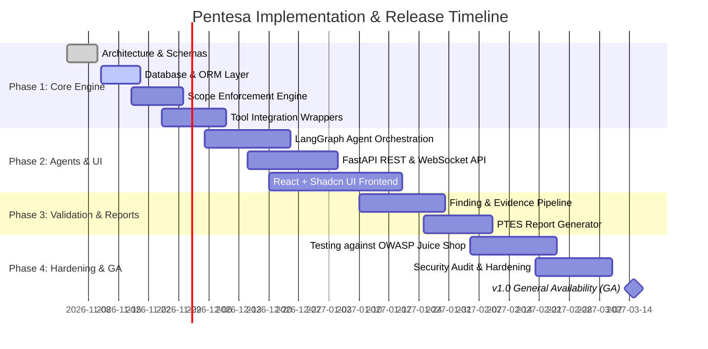

# Pentesa — Product Requirements Document (PRD)

> **Document Version:** 1.0  
> **Last Updated:** 2026-11-03  
> **Status:** Approved for Architecture & Design  
> **Target Release:** Pentesa v1.0 (Local-First MVP)  

---

## Table of Contents

1. [Executive Summary](#1-executive-summary)
2. [Target Personas](#2-target-personas)
3. [Product Principles](#3-product-principles)
4. [Functional Requirements by Module](#4-functional-requirements-by-module)
   - [4.1 Project Management](#41-project-management)
   - [4.2 Scope Management & Enforcement](#42-scope-management--enforcement)
   - [4.3 Attack Surface Discovery & Endpoint Inventory](#43-attack-surface-discovery--endpoint-inventory)
   - [4.4 OWASP WSTG Test Planning & Coverage Engine](#44-owasp-wstg-test-planning--coverage-engine)
   - [4.5 Automated Security Testing Integration](#45-automated-security-testing-integration)
   - [4.6 AI Agent System](#46-ai-agent-system)
   - [4.7 Vulnerability Validation & Evidence Collection](#47-vulnerability-validation--evidence-collection)
   - [4.8 Authorization & Business Logic Testing](#48-authorization--business-logic-testing)
   - [4.9 Findings Management & Remediation Tracking](#49-findings-management--remediation-tracking)
   - [4.10 PTES Reporting Engine](#410-ptes-reporting-engine)
5. [User Stories and Acceptance Criteria](#5-user-stories-and-acceptance-criteria)
6. [Non-Functional Requirements (NFRs)](#6-non-functional-requirements-nfrs)
7. [Prioritization (MoSCoW Matrix)](#7-prioritization-moscow-matrix)
8. [Release Milestones](#8-release-milestones)
9. [Assumptions, Dependencies & Constraints](#9-assumptions-dependencies--constraints)
10. [Open Architectural & Product Questions](#10-open-architectural--product-questions)

---

## 1. Executive Summary

Modern web application security assessments face a triple dilemma: manual penetration testing is labor-intensive, scarce, and expensive; traditional vulnerability scanners suffer from high false-positive rates and zero contextual understanding; and rapid continuous delivery requires frequent, verifiable security validation.

**Pentesa** is an AI-powered, autonomous, local-first web application penetration testing platform. It combines industry standards—**OWASP Web Security Testing Guide (WSTG v4.2)**, **Penetration Testing Execution Standard (PTES)**, **OWASP Top 10**, and **CVE vulnerability intelligence**—with deterministic tool integrations and multi-agent AI reasoning.

Unlike unconstrained "AI hackers" that hallucinate exploits or execute destructive scripts, Pentesa enforces **strict target scope boundaries at both the network proxy and application layers**, adheres to **human-in-the-loop safety gates**, uses **deterministic tools** for critical actions, and produces **100% reproducible evidence** for every confirmed vulnerability.

Pentesa is fully self-hosted, keeping target data, sensitive vulnerability disclosures, test credentials, and intellectual property strictly on-premises.

---

## 2. Target Personas

| Persona ID | Role Title | Key Motivations | Pain Points | Usage Patterns in Pentesa |
|---|---|---|---|---|
| **PER-1** | **Senior Penetration Tester** | Accelerate repetitive reconnaissance and boilerplate checks; focus on deep creative logic flaws. | Spending 60% of test hours on subdomain discovery, parameter fuzzing, and manual reporting. | Launches autonomous reconnaissance, reviews generated test plans, overrides validation steps, reviews evidence. |
| **PER-2** | **AppSec / DevSecOps Engineer** | Integrate regular penetration tests before major releases; ensure zero regressions in critical apps. | Third-party pentests cost \$15k–\$40k and happen once a year; commercial scanners generate hundreds of false alerts. | Configures scheduled scans, reviews verified findings, maps remediation tickets to engineering backlog. |
| **PER-3** | **Head of Security / CISO** | Complete auditability, compliance alignment (SOC2, ISO27001, PCI-DSS), measurable risk reduction. | Inconsistent tester quality, lack of test coverage metrics, liability risk of out-of-scope testing. | Reads PTES executive summaries, tracks WSTG coverage KPIs, reviews project authorization records. |
| **PER-4** | **Software Engineering Lead** | Fast, clear, reproducible bugs with exact `curl` commands and remediation guidance; no bogus noise. | Vague scanner reports ("Potential Header Missing") that waste developer triage time. | Consumes reproduction scripts, reviews before/after retest verification, confirms patch effectiveness. |

---

## 3. Product Principles

1. **Authorized Testing Only:** No scan or agent action may execute without explicit project authorization, defined ROE (Rules of Engagement), and valid time windows.
2. **Explicit Scope Enforcement:** Dual-layer enforcement (network proxy + application level). Requests outside approved hosts, IP ranges, or ports are immediately dropped.
3. **Every Scan Belongs to a Project:** Complete project-level isolation of targets, credentials, telemetry, logs, and artifacts.
4. **Reproducible Evidence for Every Finding:** A finding cannot be marked `Confirmed` without full request/response pairs, reproduction commands (`curl`/Python), and cryptographic hashes of evidence.
5. **Traceable Test Execution Logs:** Every packet sent and received, tool exit code, agent thought process, and tool invocation is recorded in an immutable audit ledger.
6. **WSTG Coverage Traceability:** Every test case has an explicit status (`Passed`, `Failed`, `Not Applicable`, `Blocked`, `Needs Manual Review`). Coverage is calculated mathematically, not estimated by LLM.
7. **Zero Fabricated Vulnerabilities:** AI agents suggest hypotheses, but deterministic execution tools and validators must verify indicators before an alert is raised.
8. **Explicit False Positive Triage:** Any candidate finding refuted by reproduction logic is tagged `False Positive` with recorded justification.
9. **Human-in-the-Loop for Sensitive Actions:** Destructive tests, high-volume fuzzing, credential stuffing, and state-modifying business logic tests require operator approval.
10. **Full Auditability:** Every action by humans or agents is preserved in tamper-evident logs.
11. **Reproducibility Guarantee:** Any security engineer with access to the raw evidence and reproduction script can verify the finding independently.
12. **Local-First & Self-Hosted:** No telemetry or confidential customer data leaves the self-hosted environment; LLM backends can run completely offline via Ollama or via secure on-premises API endpoints.

---

## 4. Functional Requirements by Module

### 4.1 Project Management
- **FR-PM-01:** Create and manage distinct penetration testing projects with unique IDs, names, descriptions, and designated engagement owners.
- **FR-PM-02:** Define Rules of Engagement (RoE) including authorized testing windows (start date, end date, permitted hours of day), emergency contacts, and authorization sign-offs.
- **FR-PM-03:** Store authentication profiles (Session Cookies, Bearer Tokens, Basic Auth, OAuth2/OIDC, Multi-Role credential pairs) with AES-256-GCM encryption at rest.
- **FR-PM-04:** Enforce automatic project expiration: scans automatically pause and will not execute past the engagement end date.
- **FR-PM-05:** Maintain project-level audit history recording all configuration changes, scan launches, findings approvals, and report exports.

### 4.2 Scope Management & Enforcement
- **FR-SC-01:** Allow definition of in-scope domains, exact subdomains, wildcard subdomains (`*.example.com`), specific IP addresses, CIDR blocks, and ports.
- **FR-SC-02:** Allow definition of excluded hosts, regex URL path exclusions (`/admin/delete.*`, `/logout`), and sensitive endpoints.
- **FR-SC-03:** Dual-layer scope check:
  - *Layer 1 (Application Level):* Engine validates URLs before dispatching HTTP tasks or subagent commands.
  - *Layer 2 (Network Egress Proxy):* An egress proxy interceptor validates DNS resolution and destination IP against allowed CIDR blocks before TCP socket connection.
- **FR-SC-04:** Redirect protection: Validate every redirect hop (`301`, `302`, `307`, `308`). If a redirect targets an out-of-scope domain (e.g., third-party identity provider or CDN), the redirect is blocked or marked non-traversable.
- **FR-SC-05:** Prevent DNS rebinding attacks: Pins resolved IP address during validation and forces outbound requests to connect to that validated IP with the original `Host` header.
- **FR-SC-06:** Scope change audit trail: Any modification to scope invalidates current cached targets and records the authorizing user.

### 4.3 Attack Surface Discovery & Endpoint Inventory
- **FR-DS-01:** Passive and active subdomain enumeration using integrated tools (`subfinder`, passive DNS cache, cert transparency).
- **FR-DS-02:** Scope-aware web crawling (`katana`, headless browser crawler) supporting single-page applications (SPA), JavaScript execution, and DOM crawling.
- **FR-DS-03:** Endpoint extraction from HTML forms, JavaScript bundles, inline source maps, API specifications (`OpenAPI v2/v3`, `Swagger`, `GraphQL schema`).
- **FR-DS-04:** Hidden path and content discovery (`ffuf`) with rate-limited, curated wordlists, respecting excluded paths.
- **FR-DS-05:** Centralized Endpoint Inventory storing: URL, HTTP Method, Parameter schema (Query, Body, Path, Header), Content-Type, Authentication requirements, Discovery source, Testing status, and Findings.
- **FR-DS-06:** Technology fingerprinting (`httpx`, Wappalyzer rules) identifying server frameworks, languages, frontend libraries, CDN, and WAF presence.

### 4.4 OWASP WSTG Test Planning & Coverage Engine
- **FR-WP-01:** Comprehensive test catalog covering all 12 WSTG v4.2 categories (Information Gathering, Config/Deploy, Identity, Authentication, Authorization, Session, Input Validation, Error Handling, Cryptography, Business Logic, Client-side, API).
- **FR-WP-02:** Project-specific test plan generation: Maps discovered endpoints to relevant WSTG test cases based on technology stack and endpoint type.
- **FR-WP-03:** Explicit test statuses: `Not Applicable`, `Not Started`, `Planned`, `Running`, `Passed`, `Failed`, `Needs Manual Review`, `Blocked`, `Error`.
- **FR-WP-04:** Mathematical coverage calculation:
  $$\text{Coverage \%} = \frac{\text{Passed} + \text{Failed} + \text{Needs Manual Review} + \text{Not Applicable}}{\text{Total Catalog Tests}} \times 100$$
- **FR-WP-05:** Manual override: Allows security engineers to mark test cases as `Not Applicable` with mandatory justification notes.

### 4.5 Automated Security Testing Integration
- **FR-ST-01:** Tool execution wrapper for `Nuclei`: runs vetted templates against discovered endpoints with scope validation and JSON stream parsing.
- **FR-ST-02:** Tool execution wrapper for `httpx` (probing), `katana` (crawling), and `ffuf` (fuzzing).
- **FR-ST-03:** Custom Python security check harness for checks not covered by standard CLI tools (e.g., specific CSRF token entropy checks, JWT signature manipulation, CORS misconfigurations).
- **FR-ST-04:** Strict process sandboxing: Zero dynamic shell execution from LLM strings. All tool invocations use structured subprocess execution with explicit argument lists, sanitized flags, memory limits, and timeouts.
- **FR-ST-05:** Global and per-target rate limiting (configurable requests per second, concurrency limit, error threshold backoff).

### 4.6 AI Agent System
- **FR-AG-01:** Multi-agent architecture built on stateful graph workflows (LangGraph).
- **FR-AG-02:** 15 dedicated agents with distinct responsibilities:
  1. Project Planning Agent
  2. Scope Validation Agent
  3. Reconnaissance Agent
  4. Attack Surface Mapping Agent
  5. WSTG Test Planning Agent
  6. Authentication Testing Agent
  7. Authorization Testing Agent
  8. Input Validation Agent
  9. Vulnerability Detection Agent
  10. Fuzzing Agent
  11. Vulnerability Validation Agent
  12. False Positive Analysis Agent
  13. Evidence Collection Agent
  14. Business Logic Analysis Agent
  15. Reporting Agent
- **FR-AG-03:** Strict Agent-Tool boundary: Agents output structured intent schemas (tool name + typed arguments); the deterministic Execution Engine validates scope and executes the tool.
- **FR-AG-04:** Full agent observability: Record all agent thoughts, plans, tool calls, and LLM token usage to the database.

### 4.7 Vulnerability Validation & Evidence Collection
- **FR-VV-01:** 10-step finding lifecycle: `Detected` $\to$ `Initial Triage` $\to$ `Scope Verification` $\to$ `Reproduction Planning` $\to$ `Safe Reproduction` $\to$ `Evidence Capture` $\to$ `False Positive Assessment` $\to$ `Confidence Scoring` $\to$ `Human Review` $\to$ `Confirmed`.
- **FR-VV-02:** Evidence artifact collection: Raw HTTP request bytes, raw HTTP response bytes, request/response headers, response timings, DOM screenshots (via headless browser), and reproduction `curl` command.
- **FR-VV-03:** Evidence integrity: Calculate SHA-256 hash for every captured request/response pair and screenshot artifact.
- **FR-VV-04:** Sensitive data masking: Automatically redact credit card numbers, passwords, authorization tokens, and PII from response evidence before persistence and reporting.
- **FR-VV-05:** Automated reproduction harness: Executes minimal payloads to confirm bug repeatability before marking as `Confirmed`.

### 4.8 Authorization & Business Logic Testing
- **FR-AB-01:** Multi-identity test execution: Support running tests across pairs of accounts (e.g., User A vs User B, Admin vs Member, Anonymous vs Authenticated).
- **FR-AB-02:** Automated BOLA/IDOR detection: Replay authenticated object identifiers discovered in User A's session using User B's authentication credentials.
- **FR-AB-03:** Horizontal and Vertical Privilege Escalation testing: Test administrative API routes with standard user credentials.
- **FR-AB-04:** Business logic anomaly detection: Identify state-machine bypasses (e.g., skipping checkout step 2) and price/quantity tampering without executing destructive financial transactions.
- **FR-AB-05:** Anomaly flagging: Flag suspicious responses as `Needs Manual Review` rather than auto-exploiting.

### 4.9 Findings Management & Remediation Tracking
- **FR-FM-01:** Findings dashboard with multi-dimensional filtering (Severity: Critical/High/Medium/Low/Info, Status, WSTG category, OWASP Top 10, Endpoint, CVSS score).
- **FR-FM-02:** Intelligent deduplication: Cluster findings based on endpoint path, HTTP parameter, and CWE identifier to prevent reporting the same flaw 50 times across endpoints.
- **FR-FM-03:** False positive management: Document reason for marking finding as false positive; feed back into project context to suppress re-detections.
- **FR-FM-04:** One-click retest capability: Re-execute exact reproduction recipe against remediated endpoint to verify fix.

### 4.10 PTES Reporting Engine
- **FR-RP-01:** Generate comprehensive Penetration Testing Execution Standard (PTES) aligned reports in PDF and standalone HTML formats.
- **FR-RP-02:** Report sections: Cover Page, Executive Summary, Scope & RoE, Methodology, Attack Surface Overview, WSTG Testing Coverage Matrix, Findings Summary Table, Detailed Technical Findings, Reproduction Steps, Evidence Artifacts, Remediation Roadmap, Limitations, Appendices.
- **FR-RP-03:** Customization: Custom company logo, client details, tester signatures, and section inclusion/exclusion toggles.
- **FR-RP-04:** Report versioning: Lock and freeze report instances; preserve immutable snapshot of data at the time of publication.

---

## 5. User Stories and Acceptance Criteria

### US-01: Defining Project Scope with Hard Boundaries
- **As a** Senior Penetration Tester,
- **I want to** configure approved target hostnames, CIDR ranges, and specific URL exclusions for a client engagement,
- **So that** no test packet is ever transmitted to an unapproved server or destructive administrative endpoint.
- **Acceptance Criteria:**
  1. Entering a wildcard domain `*.client.com` adds it to allowed domains.
  2. Entering an excluded path `/admin/purge-database` prevents all tools and agents from requesting URLs matching that prefix.
  3. Attempting to initiate a scan against `https://thirdparty-analytics.com` fails validation with an explicit `OUT_OF_SCOPE` error code.
  4. Outbound network proxy drops connections to IPs resolving outside the approved scope even if DNS points to an unapproved IP (DNS rebinding defense).

### US-02: Autonomous Surface Discovery with Centralized Inventory
- **As an** AppSec Engineer,
- **I want to** trigger surface discovery against our staging environment,
- **So that** I get an exhaustive catalog of endpoints, parameters, and technologies without manual crawling.
- **Acceptance Criteria:**
  1. Katana and headless crawler discover both standard HTML links and dynamic JavaScript endpoints.
  2. All found endpoints appear in the Central Endpoint Inventory with HTTP method, discovered parameters, and authentication requirements.
  3. The inventory deduplicates endpoints with matching path structures while preserving parameter variations.
  4. Technology detection tags frameworks (e.g., Express.js, React, PostgreSQL) on the project overview.

### US-03: Generating and Tracking WSTG v4.2 Coverage
- **As a** Pentest Team Lead,
- **I want** the platform to map discovered endpoints to all applicable OWASP WSTG v4.2 test cases,
- **So that** we can guarantee thorough coverage and provide auditable compliance documentation.
- **Acceptance Criteria:**
  1. The project initializes all 12 WSTG categories containing official WSTG test IDs (e.g., `WSTG-ATHN-01`, `WSTG-INPV-05`).
  2. Endpoints lacking authentication skip session-specific tests with status `Not Applicable` and recorded reasoning.
  3. The coverage dashboard displays real-time execution progress calculated strictly from actual test outcomes.
  4. Any test flagged as `Failed` links directly to one or more verified findings.

### US-04: Evidence-Based Vulnerability Validation
- **As an** Application Security Architect,
- **I want** the AI agent to reproduce a detected vulnerability before flagging it as confirmed,
- **So that** our developers never waste time triaging false positives or scanner hallucinations.
- **Acceptance Criteria:**
  1. When Nuclei or a custom check reports an SQL injection indicator on `/api/search?q=`, the Vulnerability Validation Agent creates a minimal reproduction request.
  2. The agent executes the request, verifies the differential response or error signature, and captures the exact raw HTTP request and response.
  3. The finding is saved with a generated, working `curl` command, SHA-256 evidence hash, and CVSS v3.1 vector.
  4. If the reproduction fails to trigger the vulnerability, the finding is categorized as `Needs Manual Review` or `False Positive`, never `Confirmed`.

### US-05: Multi-Role Authorization & IDOR Assessment
- **As a** Security Engineer,
- **I want to** provide credentials for two separate user tiers (Tenant A User vs Tenant B User),
- **So that** the platform can autonomously test for Broken Object Level Authorization (BOLA/IDOR).
- **Acceptance Criteria:**
  1. User enters two authentication profiles labeled `Role: Tenant-A` and `Role: Tenant-B`.
  2. The Authorization Agent captures resource IDs discovered while crawling as Tenant-A (e.g., `/api/documents/1042`).
  3. The agent accesses `/api/documents/1042` using Tenant-B's token.
  4. If the server returns `HTTP 200` with Tenant-A's document body, the agent flags an IDOR vulnerability, captures the proof, and assigns `WSTG-ATHZ-04`.

### US-06: Exporting a Professional PTES Report
- **As a** Head of Security,
- **I want to** generate a client-ready PTES penetration testing report in PDF,
- **So that** I can present an executive summary to leadership and technical details to engineering.
- **Acceptance Criteria:**
  1. Generates a PDF via WeasyPrint using a clean, dark-accented executive template.
  2. Includes an executive summary with risk charts, findings table by severity, and methodology disclaimer.
  3. Each technical finding includes description, affected URL, parameter, CVSS, reproduction steps, sanitized request/response evidence, and remediation advice.
  4. The report includes an appendix listing tested endpoints and WSTG coverage checklist.

---

## 6. Non-Functional Requirements (NFRs)

| NFR ID | Category | Requirement Description | Target Metric |
|---|---|---|---|
| **NFR-SEC-01** | Security | All credentials (cookies, passwords, tokens, API keys) must be encrypted at rest using AES-256-GCM. | 0 plaintext credentials on disk or database. |
| **NFR-SEC-02** | Security | Egress proxy must enforce target whitelist with DNS rebinding protection on all outbound HTTP/TCP traffic. | 100% of out-of-scope connections dropped at socket level. |
| **NFR-SEC-03** | Security | No arbitrary shell command generation or unvetted script execution from LLM responses. | 0 shell injections; 100% structured subprocess calls. |
| **NFR-REL-01** | Reliability | Long-running scans and crawling jobs must survive worker restarts via persistent state checkpoints in PostgreSQL. | State resumption within 15 seconds of worker restart. |
| **NFR-REL-02** | Reliability | Inability of a single tool or agent to complete must not crash the overall project scan workflow. | Graceful error capture, test marked `Error`, workflow proceeds. |
| **NFR-PERF-01**| Performance | API response time for endpoint inventory queries and dashboard views under 5,000 items. | P95 latency $< 200\text{ ms}$. |
| **NFR-PERF-02**| Performance | Outbound scan rate control: configurable concurrency and requests per second. | Enforced to within $\pm 5\%$ of configured target RPS. |
| **NFR-SCAL-01**| Scalability | Support large web applications with up to 10,000 discovered endpoints per project. | Database query optimizations, indexed JSONB, cursor pagination. |
| **NFR-AUD-01** | Auditability | Append-only audit log recording user logins, scan triggers, scope updates, finding approvals, and report generations. | Immutable ledger; tamper-evident checksums. |
| **NFR-DEP-01** | Deployment | Single-command local deployment on developer workstation or private server via Docker Compose. | `docker compose up -d` brings up all services in $< 180\text{ s}$. |
| **NFR-PRIV-01**| Privacy | Local-first architecture: zero telemetry, zero cloud callbacks, support for 100% offline LLMs (Ollama). | Zero outbound network packets except to explicitly authorized targets. |

---

## 7. Prioritization (MoSCoW Matrix)

```mermaid
quadrantChart
    title Feature Prioritization Matrix (Pentesa v1.0)
    x-axis Low Implementation Effort --> High Implementation Effort
    y-axis Low Value / Impact --> High Value / Impact
    quadrant-1 High Effort / High Value (Strategic Core)
    quadrant-2 Low Effort / High Value (Quick Wins)
    quadrant-3 Low Effort / Low Value (Nice to Have)
    quadrant-4 High Effort / Low Value (Defer to v2)
    "Scope Enforcement Engine": [0.45, 0.95]
    "WSTG Test Catalog & Coverage": [0.35, 0.90]
    "Nuclei & Tool Subprocess Wrappers": [0.30, 0.85]
    "PTES PDF/HTML Reporting": [0.35, 0.80]
    "Multi-Agent LangGraph Core": [0.70, 0.92]
    "Vulnerability Validation & Reproduction": [0.65, 0.90]
    "Multi-Role IDOR Testing": [0.60, 0.85]
    "Local Docker Deployment": [0.25, 0.82]
    "Centralized Endpoint Inventory": [0.40, 0.88]
    "Client-Side DOM XSS Taint Engine": [0.85, 0.40]
    "Full CI/CD Pull Request Comments": [0.55, 0.35]
    "Distributed Cloud Worker Mesh": [0.90, 0.25]
```

### Must Have (v1.0 MVP)
- Project creation with RoE, authorization dates, and emergency contacts.
- Dual-layer Scope Enforcement Engine (application checks + DNS/IP egress proxy).
- Attack surface discovery: Subdomain enumeration (`subfinder`), scope-aware crawling (`katana`), tech fingerprinting (`httpx`).
- Centralized Endpoint Inventory with CRUD and status tracking.
- WSTG v4.2 test catalog with 12 categories, test planning, and coverage calculation.
- Tool wrappers for Nuclei, Katana, Httpx, and Ffuf with strict argument validation.
- Multi-Agent Orchestrator (LangGraph) for planning, surface discovery, scanning, validation, and reporting.
- Vulnerability validation lifecycle with proof-of-concept capture and `curl` command generation.
- False positive tagging with rationale tracking.
- Findings dashboard with filtering, deduplication, and evidence preview.
- PTES-compliant PDF and HTML report generation via WeasyPrint.
- Docker Compose deployment package with PostgreSQL, Redis, Celery, and Web UI.

### Should Have (v1.1)
- Multi-role BOLA/IDOR automated permutation testing.
- Custom Python security check authoring UI and hot-reloading.
- Headless browser screenshot capture for DOM-based findings.
- Retest verification workflow with before/after diff comparison.
- Webhook alerts (Slack, Discord, Email) on Critical finding confirmation.

### Could Have (v1.2)
- Interactive terminal replay of captured HTTP flows.
- Jira / GitHub Issues bi-directional ticket synchronization.
- Complex business logic multi-step state graph exploration.
- Local LLM performance profiling and prompt auto-tuning.

### Won't Have (v1.0 - Deferred to v2.0)
- Cloud SaaS multi-tenant hosting.
- Native mobile application testing (iOS/Android binaries).
- Binary reverse engineering or buffer overflow fuzzing.
- Network infrastructure port scanning beyond web services (e.g., raw Nmap SYN scanning across non-web ports).

---

## 8. Release Milestones



---

## 9. Assumptions, Dependencies & Constraints

### Assumptions
1. Target application owners provide authorized testing windows and written permission.
2. The user has Docker and Docker Compose installed on their workstation or host server.
3. The host machine has at least 16GB RAM and 4 CPU cores (recommended 32GB RAM if running local Ollama 14B models).
4. Internet access is available during scans for public targets, or internal routing is established for intranet targets.

### Dependencies
- **CLI Security Binaries:** Pre-compiled binaries for `nuclei`, `katana`, `subfinder`, `httpx`, `ffuf` packaged within the worker Docker image.
- **Python Ecosystem:** Python 3.12, FastAPI, SQLAlchemy 2.0, Celery, LangGraph, LangChain, Pydantic v2, WeasyPrint.
- **Frontend Stack:** Node.js 20, React 18, TypeScript, Tailwind CSS, Lucide React, Shadcn/UI primitives.
- **Datastores:** PostgreSQL 16 (with `pgcrypto`), Redis 7 (task queue and pub/sub).

### Constraints
- Testing must never exceed configured rate limits to avoid denial-of-service on target applications.
- Zero network traffic may escape outside of approved CIDR/DNS boundaries.
- The platform will not attempt destructive exploit payloads (e.g., dropping database tables, deleting accounts) during automated tests.

---

## 10. Open Architectural & Product Questions

1. **Local LLM Model Sizing vs. Accuracy:** Should v1.0 mandate an external API key (e.g. OpenAI/Anthropic compatible endpoint) for complex reasoning tasks (Business Logic & False Positive Triage) while using local Ollama (Llama 3.1 8B / Qwen 2.5 14B) for routine parameter analysis?
2. **Egress Proxy Implementation:** Should the network-level egress proxy be implemented as an internal Squid/Envoy sidecar container, or a custom Python `asyncio` streaming proxy embedded directly in the worker? (Current recommendation: lightweight custom Python proxy with DNS pinning).
3. **Headless Browser Resource Footprint:** Crawling heavy SPAs via Chromium/Playwright consumes substantial memory (~300MB per tab). Should SPA DOM crawling be a toggleable scan profile (e.g. `Lightweight Katana` vs `Deep SPA Playwright`)?

