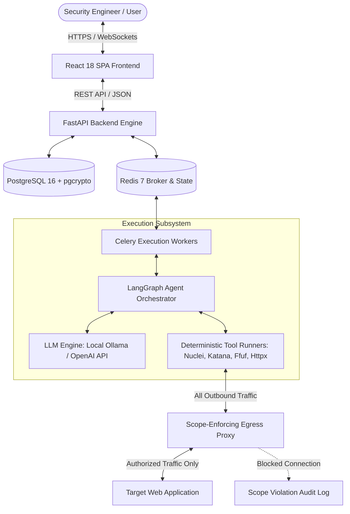

# Pentesa — Software Requirements Specification (SRS)

> **Document Identifier:** PENTESA-SRS-V1.0  
> **Status:** Draft / Approved for Technical Specification  
> **Standard Compliance:** IEEE 830-1998 / ISO/IEC/IEEE 29148  
> **Release Target:** Version 1.0  

---

## Table of Contents

1. [Introduction](#1-introduction)
   - [1.1 Purpose](#11-purpose)
   - [1.2 Scope of System](#12-scope-of-system)
   - [1.3 Definitions, Acronyms, and Abbreviations](#13-definitions-acronyms-and-abbreviations)
   - [1.4 References](#14-references)
   - [1.5 Overview](#15-overview)
2. [Overall Description](#2-overall-description)
   - [2.1 Product Perspective](#21-product-perspective)
   - [2.2 Product Functions](#22-product-functions)
   - [2.3 User Classes and Characteristics](#23-user-classes-and-characteristics)
   - [2.4 Operating Environment](#24-operating-environment)
   - [2.5 Design and Implementation Constraints](#25-design-and-implementation-constraints)
   - [2.6 User Documentation](#26-user-documentation)
   - [2.7 Assumptions and Dependencies](#27-assumptions-and-dependencies)
3. [External Interface Requirements](#3-external-interface-requirements)
   - [3.1 User Interfaces](#31-user-interfaces)
   - [3.2 Hardware Interfaces](#32-hardware-interfaces)
   - [3.3 Software Interfaces](#33-software-interfaces)
   - [3.4 Communications Interfaces](#34-communications-interfaces)
4. [System Features & Functional Requirements](#4-system-features--functional-requirements)
   - [4.1 Module A: Project Management (SRS-FR-PM)](#41-module-a-project-management-srs-fr-pm)
   - [4.2 Module B: Scope Enforcement Engine (SRS-FR-SC)](#42-module-b-scope-enforcement-engine-srs-fr-sc)
   - [4.3 Module C: Attack Surface Discovery (SRS-FR-DS)](#43-module-c-attack-surface-discovery-srs-fr-ds)
   - [4.4 Module D: OWASP WSTG Test Planning (SRS-FR-WT)](#44-module-d-owasp-wstg-test-planning-srs-fr-wt)
   - [4.5 Module E: Automated Security Testing (SRS-FR-ST)](#45-module-e-automated-security-testing-srs-fr-st)
   - [4.6 Module F: AI Agent Subsystem (SRS-FR-AG)](#46-module-f-ai-agent-subsystem-srs-fr-ag)
   - [4.7 Module G: Vulnerability Validation & Evidence (SRS-FR-VV)](#47-module-g-vulnerability-validation--evidence-srs-fr-vv)
   - [4.8 Module H: Authorization & Business Logic (SRS-FR-AB)](#48-module-h-authorization--business-logic-srs-fr-ab)
   - [4.9 Module I: Findings Management (SRS-FR-FM)](#49-module-i-findings-management-srs-fr-fm)
   - [4.10 Module J: Reporting & Export Engine (SRS-FR-RP)](#410-module-j-reporting--export-engine-srs-fr-rp)
5. [Non-Functional Requirements](#5-non-functional-requirements)
   - [5.1 Performance Requirements (SRS-NFR-PERF)](#51-performance-requirements-srs-nfr-perf)
   - [5.2 Safety & Protection Requirements (SRS-NFR-SAFE)](#52-safety--protection-requirements-srs-nfr-safe)
   - [5.3 Security Requirements (SRS-NFR-SEC)](#53-security-requirements-srs-nfr-sec)
   - [5.4 Software Quality Attributes](#54-software-quality-attributes)
6. [Data Requirements & Schema Definitions](#6-data-requirements--schema-definitions)
7. [Traceability Matrix](#7-traceability-matrix)

---

## 1. Introduction

### 1.1 Purpose
This Software Requirements Specification (SRS) provides a complete and formal description of the behavior, functional capabilities, interface specifications, performance parameters, and security constraints for **Pentesa**, an autonomous, local-first web application penetration testing platform. It serves as the contract between product management, system architects, software engineers, and quality assurance teams.

### 1.2 Scope of System
Pentesa executes authorized web application penetration testing engagements. The system ingests target definitions and authorization certificates, autonomously executes surface reconnaissance, calculates formal OWASP WSTG test plans, coordinates deterministic command-line tools and multi-agent LLM reasoning workflows, safely replicates candidate vulnerabilities, captures cryptographically hashed evidence, and compiles PTES-standard reports.

### 1.3 Definitions, Acronyms, and Abbreviations
- **BOLA:** Broken Object Level Authorization (OWASP API Security Top 10 #1).
- **CIDR:** Classless Inter-Domain Routing notation for IP address blocks.
- **CWE:** Common Weakness Enumeration.
- **CVSS:** Common Vulnerability Scoring System (v3.1 specification).
- **DAST:** Dynamic Application Security Testing.
- **IDOR:** Insecure Direct Object Reference.
- **LLM:** Large Language Model.
- **PTES:** Penetration Testing Execution Standard.
- **RoE:** Rules of Engagement.
- **WSTG:** OWASP Web Security Testing Guide (v4.2).

### 1.4 References
- OWASP Web Security Testing Guide v4.2 (https://owasp.org/www-project-web-security-testing-guide/)
- Penetration Testing Execution Standard (PTES) (http://www.pentest-standard.org/)
- Common Weakness Enumeration (CWE) Specification v4.13
- Common Vulnerability Scoring System v3.1: Specification Document (FIRST.org)

### 1.5 Overview
The remainder of this document outlines the operational environment, external interfaces, granular functional requirements categorized by identifier (`SRS-FR-XXX`), non-functional attributes (`SRS-NFR-XXX`), and the requirement-to-module traceability matrix.

---

## 2. Overall Description

### 2.1 Product Perspective
Pentesa is an autonomous, self-contained software suite deployed via containerized architecture. It interacts with target web applications over standard TCP/IP protocols (HTTP/HTTPS) exclusively through a dedicated, scope-enforcing egress proxy.

### 2.2 Product Functions
1. **Scope and Authorization Management:** Rigid validation of network boundaries and authorization windows.
2. **Surface Reconnaissance:** Passive and active domain, route, endpoint, and parameter mapping.
3. **WSTG Orchestration:** Mapping target components to 12 OWASP WSTG categories with real-time test state machines.
4. **Agent-Guided Vulnerability Testing:** Coordinating automated tools and targeted LLM payload generation.
5. **Deterministic Validation:** Automated reproduction of potential issues to filter false positives before disclosure.
6. **PTES Reporting:** Dynamic generation of executive and technical findings reports in PDF and HTML formats.

### 2.3 User Classes and Characteristics
- **Lead Penetration Tester:** Expert in security concepts, CVSS scoring, and tool configurations. Uses advanced parameter fuzzing, overrides test statuses, and reviews raw HTTP traces.
- **AppSec Engineer:** Focuses on CI/CD integration, regular scheduled assessments, and verifying developer remediation.
- **Security Auditor / Executive:** Inspects executive summaries, compliance checklists, and auditable proof of test authorization.

### 2.4 Operating Environment
- **Operating Systems:** Linux (Ubuntu 22.04 LTS / Debian 12 recommended), macOS 13+, Windows 11 with WSL2.
- **Container Runtime:** Docker Engine 24.0+ and Docker Compose v2.20+.
- **Hardware Minimum:** 4 x86_64 or ARM64 CPU Cores, 16 GB RAM, 50 GB NVMe Storage.
- **Hardware Recommended (for Local LLM):** 8+ CPU Cores, 32 GB RAM, NVIDIA GPU with 12GB+ VRAM (e.g. RTX 3060/4070 or Apple Silicon M2/M3 Max).

### 2.5 Design and Implementation Constraints
1. **Local-First & Self-Hosted:** No reliance on cloud-hosted SaaS control planes; all test telemetry remains within the local network perimeter.
2. **Deterministic Shell Execution:** The system shall strictly prohibit arbitrary command generation (e.g. `system(cmd)` or `eval()`) from LLM outputs. All binary executions must map to strongly-typed parameter schemas.
3. **Scope Enforced at Socket Layer:** In addition to application routing checks, outbound traffic must route through a dedicated proxy enforcing DNS pinning and CIDR filtering.

---

## 3. External Interface Requirements

### 3.1 User Interfaces
- Modern responsive Web UI built in React 18, TypeScript, and Tailwind CSS.
- Color theme: Dark mode optimized for security operations (slate/zinc neutral tones, high-contrast severity accents: Red=Critical, Orange=High, Amber=Medium, Blue=Low, Gray=Info).
- Interactive Components: Real-time scan log terminal, visual WSTG coverage matrix, interactive HTTP request/response comparison viewer, and report preview modal.

### 3.2 Hardware Interfaces
No direct custom hardware interfaces required. Interacts with standard network interface cards (NICs) via the host operating system's network stack.

### 3.3 Software Interfaces
- **PostgreSQL 16:** Relational persistence for projects, scope, discovery inventory, WSTG state, findings, and audit trails.
- **Redis 7:** Celery task broker, rate limiting key-value store, and WebSocket real-time pub/sub.
- **Ollama / Local LLM Runner:** Standard OpenAI-compatible HTTP REST endpoint (e.g., `http://localhost:11434/v1`).
- **External Security Binaries:** Pre-compiled statically linked binaries for `nuclei`, `katana`, `subfinder`, `httpx`, `ffuf`.
- **WeasyPrint / Cairo:** Headless rendering engine for converting HTML+CSS into standard PDF reports.

### 3.4 Communications Interfaces
- Inbound: HTTPS (port 443 / 8443) and WebSockets (`wss://`) for UI-to-API communication.
- Outbound: HTTP/1.1 and HTTP/2 over TLS (ports 80, 443, or custom target ports) directed exclusively through the Scope-Enforcing Egress Proxy.

---

## 4. System Features & Functional Requirements

### 4.1 Module A: Project Management (SRS-FR-PM)

- **SRS-FR-PM-001 (Project Creation):** The system shall allow users to create an assessment project with unique ID, name, description, client name, and primary operator.
- **SRS-FR-PM-002 (Authorization Configuration):** The system shall record explicit authorization credentials: authorized signer name, signer email, authorization timestamp, scan window start date/time, and scan window end date/time.
- **SRS-FR-PM-003 (Engagement Window Enforcement):** The system shall refuse to dispatch any active probing or testing tasks if the current system time is outside the project's authorized start and end dates.
- **SRS-FR-PM-004 (Authentication Profiles):** The system shall securely store target authentication profiles supporting: Cookie session strings, Bearer tokens, HTTP Basic Auth credentials, and multi-user credential pairs for role-based testing.
- **SRS-FR-PM-005 (Credential Encryption):** The system shall encrypt all stored credentials at rest using AES-256-GCM authenticated encryption before writing to PostgreSQL.
- **SRS-FR-PM-006 (Project Archival & Deletion):** The system shall provide project archival and permanent deletion workflows. Deletion shall sanitize all related findings, raw logs, and captured evidence artifacts.
- **SRS-FR-PM-007 (Audit History):** The system shall automatically append an entry to the project audit ledger upon every configuration update, target change, scan trigger, or report generation.

### 4.2 Module B: Scope Enforcement Engine (SRS-FR-SC)

- **SRS-FR-SC-001 (Target Definition):** The system shall allow users to specify in-scope targets as: Fully Qualified Domain Names (FQDN), Wildcard domains (`*.domain.tld`), Single IPv4/IPv6 addresses, CIDR notation blocks (e.g. `192.168.1.0/24`), and specific ports.
- **SRS-FR-SC-002 (Exclusion Rules):** The system shall allow users to specify exclusions including specific subdomains, IP addresses, and regex-based URL path patterns (e.g. `/api/v1/logout`, `/admin/billing/charge`).
- **SRS-FR-SC-003 (Pre-Execution Validation):** Prior to initiating any network transmission, the application layer shall resolve the target URL and assert that the destination domain or IP resides in the approved scope list and is not in the exclusion list.
- **SRS-FR-SC-004 (Network-Level Egress Filtering):** All outbound traffic from security tools and agents shall be forced through an internal egress proxy. The proxy shall inspect the destination IP address of every TCP connect request against the project's authorized CIDRs.
- **SRS-FR-SC-005 (DNS Rebinding Defense):** The system shall resolve domain names prior to HTTP dispatch, validate the resulting IP against the scope whitelist, pin the connection to that specific IP, and pass the original domain in the HTTP `Host` header.
- **SRS-FR-SC-006 (Redirect Scope Traversal):** When following HTTP redirects (`301`, `302`, `307`, `308`), the system shall evaluate the `Location` header against the scope engine before dispatching the subsequent request. If the redirect points out of scope, the client shall terminate navigation and log a `SCOPE_REDIRECT_BLOCKED` event.
- **SRS-FR-SC-007 (Scope Change Invalidation):** If a user alters the project scope during an active engagement, any queued or running tasks shall be immediately paused or cancelled, and target inventories shall be re-evaluated.

### 4.3 Module C: Attack Surface Discovery (SRS-FR-DS)

- **SRS-FR-DS-001 (Passive Subdomain Enumeration):** The system shall discover subdomains using passive certificate transparency logs and search caches via the `subfinder` engine without directly probing target infrastructure.
- **SRS-FR-DS-002 (Scope-Constrained Web Crawling):** The system shall spider discovered web applications using `katana`, crawling HTML hyperlinks, form action URLs, and DOM references strictly within the scope boundaries to a user-configurable depth (default: 3).
- **SRS-FR-DS-003 (JavaScript Endpoint Extraction):** The system shall download discovered `.js` script bundles, parse ASTs, and extract relative API endpoints, query strings, and hidden routes.
- **SRS-FR-DS-004 (API Specification Ingestion):** The system shall parse and ingest OpenAPI v2/v3, Swagger, and Postman collection files provided by the user or discovered at standard discovery paths (`/openapi.json`, `/swagger.json`, `/api-docs`).
- **SRS-FR-DS-005 (Centralized Endpoint Inventory):** The system shall store every discovered route in an `endpoints` table containing: URL path, HTTP method (`GET`, `POST`, `PUT`, `DELETE`, `PATCH`), parameter list, content-type, authentication requirement, and discovery provenance.
- **SRS-FR-DS-006 (Parameter Inventory):** The system shall parse and register all discovered parameter names categorized by location: query parameters, JSON body keys, form fields, headers, and path parameters.
- **SRS-FR-DS-007 (Technology Fingerprinting):** The system shall inspect HTTP response headers (`Server`, `X-Powered-By`), cookies, HTML meta tags, and TLS certificates using `httpx` to determine the underlying operating system, web server, application framework, and client libraries.

### 4.4 Module D: OWASP WSTG Test Planning (SRS-FR-WT)

- **SRS-FR-WT-001 (WSTG Test Catalog):** The system shall maintain an embedded master catalog of all 12 OWASP WSTG v4.2 categories and their respective test IDs (e.g., `WSTG-INFO-01` through `WSTG-APIT-10`).
- **SRS-FR-WT-002 (Test Plan Generation):** Upon conclusion of the discovery phase, the system shall instantiate a project-specific test plan mapping relevant endpoints to applicable WSTG test cases based on technology stack and endpoint capabilities.
- **SRS-FR-WT-003 (State Machine Tracking):** Each WSTG test instance shall maintain an explicit state machine:
  $$\text{State} \in \{\text{Not Started}, \text{Planned}, \text{Running}, \text{Passed}, \text{Failed}, \text{Needs Manual Review}, \text{Not Applicable}, \text{Blocked}, \text{Error}\}$$
- **SRS-FR-WT-004 (Mathematical Coverage Metric):** The system shall compute overall and category-level coverage percentages strictly using validated test states:
  $$\text{Coverage} = \frac{\sum(\text{Passed} + \text{Failed} + \text{Needs Manual Review} + \text{Not Applicable})}{\text{Total Applicable Tests}} \times 100$$
- **SRS-FR-WT-005 (Manual Applicability Override):** The system shall permit operators to manually mark any test case as `Not Applicable` or `Passed`, requiring an immutable text explanation stored in the audit trail.

### 4.5 Module E: Automated Security Testing (SRS-FR-ST)

- **SRS-FR-ST-001 (Nuclei Integration):** The system shall execute vetted Nuclei templates categorized by vulnerability class (misconfigurations, known CVEs, exposed panels) against scope-validated endpoints.
- **SRS-FR-ST-002 (Controlled Parameter Fuzzing):** The system shall execute controlled parameter fuzzing via `ffuf` using curated wordlists, enforcing strict rate limits and error-rate circuit breakers.
- **SRS-FR-ST-003 (Deterministic Binary Execution):** All CLI tool executions shall be wrapped in Python `asyncio.subprocess` routines with explicitly typed arguments, zero shell interpolation (`shell=False`), and environment isolation.
- **SRS-FR-ST-004 (Custom Python Checks):** The system shall provide an extensible framework for running standalone Python security checks for complex checks (e.g. JWT algorithm confusion, CORS reflection with credentials).
- **SRS-FR-ST-005 (Rate Limiting and Concurrency):** The execution engine shall enforce configurable requests-per-second (RPS) limits (default: 15 RPS) and concurrent worker limits per target domain.
- **SRS-FR-ST-006 (Timeout & Cancellation):** Every tool execution shall specify a hard timeout (default: 300 seconds). The operator shall have the ability to terminate any running scan job instantly via the UI or API.

### 4.6 Module F: AI Agent Subsystem (SRS-FR-AG)

- **SRS-FR-AG-001 (Multi-Agent Architecture):** The system shall implement 15 specialized agents orchestrated via stateful directed acyclic graphs (DAGs) using LangGraph.
- **SRS-FR-AG-002 (Planning Agent):** The Project Planning Agent shall analyze project scope, target technologies, and rules of engagement to synthesize an optimal execution DAG.
- **SRS-FR-AG-003 (Recon & Discovery Agents):** The Reconnaissance and Attack Surface Mapping agents shall orchestrate discovery tools, ingest streaming findings, and update the endpoint inventory.
- **SRS-FR-AG-004 (Vulnerability Testing Agents):** Specialized testing agents (AuthN, AuthZ, Input Validation, Fuzzing, Business Logic) shall analyze specific endpoint schemas and propose targeted test hypotheses.
- **SRS-FR-AG-005 (Validation & False Positive Agents):** The Vulnerability Validation Agent and False Positive Analysis Agent shall scrutinize every potential defect, attempting clean reproductions before creating a finding.
- **SRS-FR-AG-006 (Reporting Agent):** The Reporting Agent shall synthesize verified findings, business context, CVSS scores, and remediation recommendations into PTES report structures.
- **SRS-FR-AG-007 (Agent Tool Contract):** Agents shall interact with tools solely through Pydantic JSON schemas. Agents are strictly prohibited from generating raw shell commands.
- **SRS-FR-AG-008 (Agent Observability):** The system shall record all agent thoughts, tool invocation inputs, execution outputs, and token counts in the database for complete visibility.

### 4.7 Module G: Vulnerability Validation & Evidence (SRS-FR-VV)

- **SRS-FR-VV-001 (10-Step Validation Lifecycle):** Every vulnerability candidate shall transition through the mandatory validation lifecycle:
  1. Detection $\to$ 2. Initial Triage $\to$ 3. Scope Verification $\to$ 4. Reproduction Planning $\to$ 5. Safe Reproduction $\to$ 6. Evidence Capture $\to$ 7. False Positive Assessment $\to$ 8. Confidence Scoring $\to$ 9. Human Review $\to$ 10. Finding Confirmation.
- **SRS-FR-VV-002 (Evidence Collection Package):** A confirmed finding must include:
  - Exact raw HTTP request sent.
  - Exact raw HTTP response received.
  - Reproducible `curl` command line with exact flags and headers.
  - Timestamp and round-trip response time in milliseconds.
  - SHA-256 cryptographic hash of the raw request and response data.
- **SRS-FR-VV-003 (Sensitive Data Masking):** The evidence pipeline shall automatically mask sensitive tokens, passwords, authorization headers, session cookies, and credit card numbers prior to database storage and report compilation.
- **SRS-FR-VV-004 (Confidence Scoring):** The system shall assign an algorithmic confidence rating (`Confirmed`, `High`, `Medium`, `Low`) based on reproduction success, signature match, and false-positive indicators.
- **SRS-FR-VV-005 (Human Review Gate):** Any vulnerability detected with confidence $< 90\%$ or involving potential business logic impacts shall be routed to the `Needs Manual Review` state before inclusion in official reports.

### 4.8 Module H: Authorization & Business Logic (SRS-FR-AB)

- **SRS-FR-AB-001 (Multi-Identity Account Management):** The system shall maintain multiple distinct user session identities (e.g., Tenant-A Admin, Tenant-A User, Tenant-B User, Unauthenticated) for automated access-control testing.
- **SRS-FR-AB-002 (BOLA / IDOR Testing):** The system shall identify object IDs (e.g., `/api/user/101/orders`) accessed by Identity A, replay the identical request utilizing Identity B's session credentials, and inspect responses for unauthorized data leakage or object modification.
- **SRS-FR-AB-003 (Function-Level Access Control Testing):** The system shall test administrative endpoints discovered during crawling using standard user and unauthenticated session tokens.
- **SRS-FR-AB-004 (Business Logic Anomaly Detection):** The system shall test multi-step workflows (e.g. registration, password reset, checkout) for state transition skips, step reordering, and parameter tampering (negative quantities, altered prices).
- **SRS-FR-AB-005 (Non-Destructive Principle):** Business logic testing shall strictly avoid destructive operations (e.g. final credit card charges, bulk data deletion). Identified logic anomalies shall be captured as differential evidence and flagged for human review.

### 4.9 Module I: Findings Management (SRS-FR-FM)

- **SRS-FR-FM-001 (Findings Catalog):** The system shall maintain a centralized findings repository recording: Finding UUID, Title, Vulnerability Class (CWE), OWASP Top 10 category, WSTG reference, CVSS v3.1 vector and score, Severity, Affected Endpoint, Detection Source, Status, and Remediation Guidance.
- **SRS-FR-FM-002 (Intelligent Deduplication):** The system shall automatically group duplicate detections originating from different tools or iterations based on endpoint URI, HTTP method, affected parameter, and CWE ID.
- **SRS-FR-FM-003 (Status Workflow):** Findings shall follow a defined state machine:
  $$\text{Status} \in \{\text{Detected}, \text{Triaged}, \text{Validating}, \text{Confirmed}, \text{False Positive}, \text{Remediated}, \text{Retested}, \text{Accepted Risk}\}$$
- **SRS-FR-FM-004 (Automated Retest):** The system shall provide a one-click retest capability that re-executes the exact saved reproduction request against the target endpoint to verify if a patch successfully resolved the vulnerability.

### 4.10 Module J: Reporting & Export Engine (SRS-FR-RP)

- **SRS-FR-RP-001 (PTES Report Generation):** The system shall compile formal penetration testing reports structured according to the Penetration Testing Execution Standard (PTES).
- **SRS-FR-RP-002 (Format Support):** The system shall export reports in both standalone, printable PDF format (via WeasyPrint) and interactive self-contained HTML format.
- **SRS-FR-RP-003 (Executive & Technical Sections):** Reports shall contain:
  1. Executive Summary with risk posture charts and key metrics.
  2. Scope & Rules of Engagement.
  3. Assessment Methodology & Tooling Disclosure.
  4. Attack Surface & Endpoint Summary.
  5. OWASP WSTG Coverage Matrix.
  6. Findings Summary Table.
  7. Detailed Technical Finding Sheets with Evidence and Reproduction steps.
  8. Prioritized Remediation Roadmap.
- **SRS-FR-RP-004 (Report Versioning & Freezing):** When a report is finalized, the system shall create an immutable, timestamped snapshot of the report data, preventing subsequent project modifications from retroactively changing historical records.

---

## 5. Non-Functional Requirements

### 5.1 Performance Requirements (SRS-NFR-PERF)
- **SRS-NFR-PERF-001 (API Latency):** The REST API shall respond to 95% of standard CRUD requests within 200 milliseconds under a nominal load of 25 concurrent user requests.
- **SRS-NFR-PERF-002 (Real-Time Updates):** WebSocket event streaming (scan logs, agent state transitions) shall have an end-to-end latency of less than 500 milliseconds from worker generation to client browser render.
- **SRS-NFR-PERF-003 (Inventory Capacity):** The system database and UI shall handle at least 10,000 discovered endpoints and 1,000 findings per project without client browser performance degradation.

### 5.2 Safety & Protection Requirements (SRS-NFR-SAFE)
- **SRS-NFR-SAFE-001 (Scope Breach Prevention):** 100% of outbound HTTP/TCP requests initiated by any subsystem shall be verified by the scope engine prior to transmission. A single unapproved outbound request constitutes a critical defect.
- **SRS-NFR-SAFE-002 (Rate Limit Compliance):** Outbound request throughput shall never exceed the operator-configured requests-per-second threshold by more than 5% over any 5-second moving average window.
- **SRS-NFR-SAFE-003 (Circuit Breaker):** If target HTTP responses yield $\ge 20\%$ `500 Internal Server Error` or connection dropouts over 60 seconds, the engine shall automatically pause scan execution and notify the operator.

### 5.3 Security Requirements (SRS-NFR-SEC)
- **SRS-NFR-SEC-001 (Authentication):** Local platform access shall require authentication using JSON Web Tokens (JWT) with password hashing backed by `bcrypt` (work factor 12).
- **SRS-NFR-SEC-002 (Role-Based Access Control):** The system shall enforce role-based access control with four distinct roles: `Admin`, `Lead Tester`, `Tester`, `Viewer`.
- **SRS-NFR-SEC-003 (Secret Protection):** Target application credentials and API keys stored in the database shall be encrypted using AES-256-GCM. Decryption keys shall never be logged or exposed via API.
- **SRS-NFR-SEC-004 (Input Sanitization):** All user-provided strings and external tool outputs shall be strictly validated using Pydantic schemas before persistence and sanitized prior to HTML/PDF report rendering to prevent secondary Cross-Site Scripting (XSS) or template injection.
- **SRS-NFR-SEC-005 (Command Sandboxing):** All system tool calls shall invoke binaries directly using parameter arrays; raw shell interpolation (`shell=True`) is strictly prohibited throughout the entire codebase.

### 5.4 Software Quality Attributes
- **SRS-NFR-MNT-001 (Maintainability):** Codebase shall adhere to PEP 8 standards for Python and ESLint/Prettier standards for TypeScript, with static type coverage exceeding 90%.
- **SRS-NFR-REL-001 (Fault Tolerance):** Failure of an individual security tool or LLM inference timeout shall be trapped, logged, and isolated without halting other ongoing tests or the parent scan workflow.
- **SRS-NFR-AUD-001 (Auditability):** All project modifications, scan starts/stops, scope additions, and findings approvals shall be recorded in an immutable, append-only audit log with user attribution and timestamp.

---

## 6. Data Requirements & Schema Definitions

The platform shall maintain relational integrity across all entities in PostgreSQL 16. Key core entities:
1. `users` (id, email, password_hash, role, created_at)
2. `projects` (id, name, description, auth_start, auth_end, client_name, status, created_at)
3. `scope_targets` (id, project_id, target_type, value, is_wildcard, port, created_at)
4. `scope_exclusions` (id, project_id, exclusion_type, value, created_at)
5. `endpoints` (id, project_id, url_path, http_method, parameter_schema, content_type, auth_required, discovery_source, status)
6. `wstg_test_instances` (id, project_id, wstg_id, status, execution_order, notes, updated_at)
7. `findings` (id, project_id, title, cwe_id, severity, cvss_vector, cvss_score, endpoint_id, status, confidence, evidence_hash, created_at)
8. `finding_evidence` (id, finding_id, raw_request, raw_response, curl_command, screenshot_url, captured_at)
9. `audit_logs` (id, project_id, user_id, action, resource_type, details_json, created_at)

---

## 7. Traceability Matrix

| Requirement ID | Module | User Story Mapping | Verification Method | Priority |
|---|---|---|---|---|
| **SRS-FR-PM-001..007** | Project Management | US-01, US-06 | Unit + API Tests | Must Have |
| **SRS-FR-SC-001..007** | Scope Enforcement | US-01 | Unit + Network Socket Tests | Must Have |
| **SRS-FR-DS-001..007** | Attack Surface Discovery | US-02 | Integration Tests with Mock Apps | Must Have |
| **SRS-FR-WT-001..005** | WSTG Test Planning | US-03 | Unit + Coverage Algorithm Tests | Must Have |
| **SRS-FR-ST-001..006** | Automated Testing | US-02, US-04 | Subprocess Sandboxing Tests | Must Have |
| **SRS-FR-AG-001..008** | AI Agent Subsystem | US-04, US-05 | LangGraph State Machine Tests | Must Have |
| **SRS-FR-VV-001..005** | Vulnerability Validation | US-04 | End-to-End Reproduction Tests | Must Have |
| **SRS-FR-AB-001..005** | Authorization & Logic | US-05 | Multi-identity Matrix Tests | Should Have |
| **SRS-FR-FM-001..004** | Findings Management | US-04, US-06 | Deduplication & State Tests | Must Have |
| **SRS-FR-RP-001..004** | Reporting & Export | US-06 | PDF Render & Checksum Tests | Must Have |
| **SRS-NFR-SEC-001..005** | Non-Functional Security | All | Static Analysis + Penetration Tests | Must Have |
| **SRS-NFR-PERF-001..003**| Performance | All | Load Tests with Locust | Must Have |
