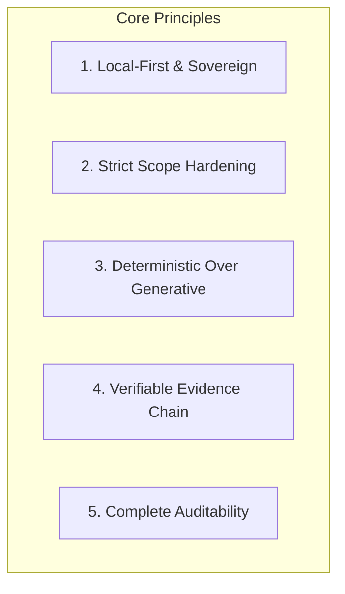
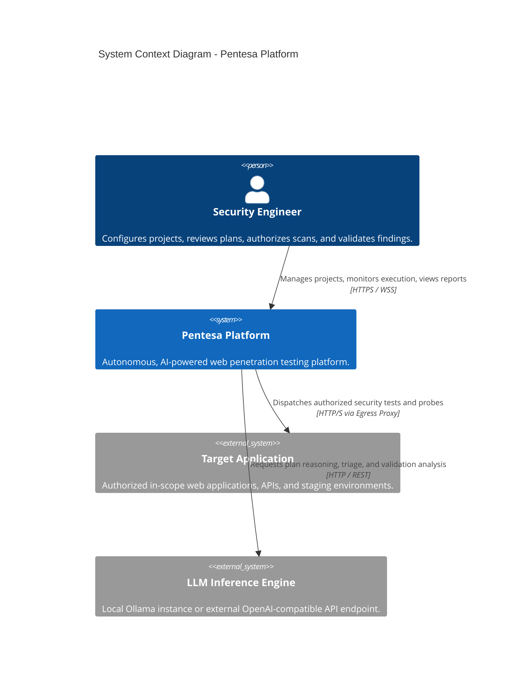
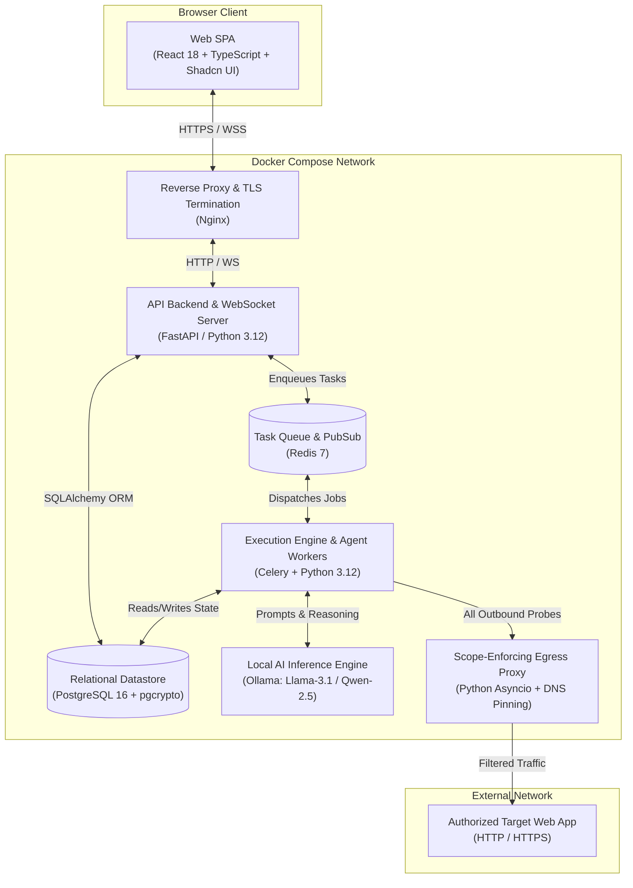
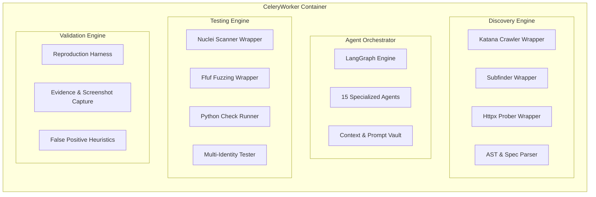
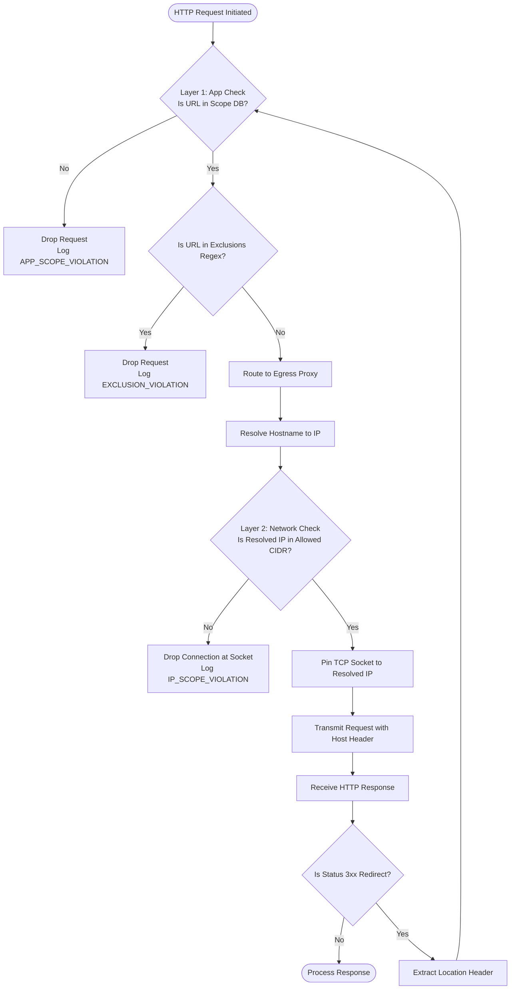
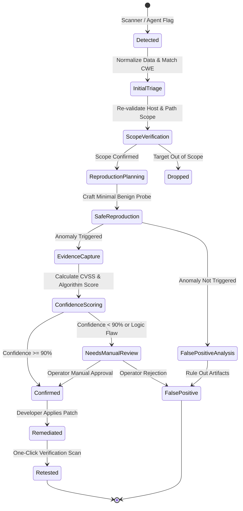
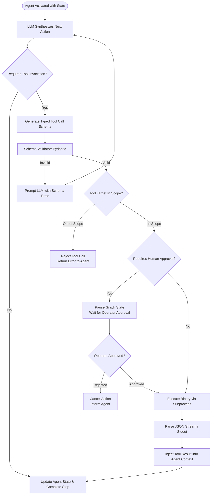

# Pentesa — System Architecture Document

> **Document Identifier:** PENTESA-ARCH-V1.0  
> **Status:** Approved for Implementation  
> **Architecture Pattern:** Modular Monolith (Local-First Containerized Platform)  
> **Target Release:** v1.0  

---

## Table of Contents

1. [Architectural Overview & Principles](#1-architectural-overview--principles)
2. [System Context & Container Architecture](#2-system-context--container-architecture)
   - [2.1 C4 Level 1: System Context Diagram](#21-c4-level-1-system-context-diagram)
   - [2.2 C4 Level 2: Container Diagram](#22-c4-level-2-container-diagram)
   - [2.3 C4 Level 3: Component Decomposition](#23-c4-level-3-component-decomposition)
3. [Core Subsystem Specifications](#3-core-subsystem-specifications)
   - [3.1 API Gateway & Presentation Layer](#31-api-gateway--presentation-layer)
   - [3.2 Scope Enforcement & Egress Security Layer](#32-scope-enforcement--egress-security-layer)
   - [3.3 Attack Surface Discovery Engine](#33-attack-surface-discovery-engine)
   - [3.4 WSTG Orchestration & Coverage Engine](#34-wstg-orchestration--coverage-engine)
   - [3.5 Tool Execution & Sandboxing Layer](#35-tool-execution--sandboxing-layer)
   - [3.6 AI Multi-Agent Orchestrator (LangGraph)](#36-ai-multi-agent-orchestrator-langgraph)
   - [3.7 Vulnerability Validation & Evidence Pipeline](#37-vulnerability-validation--evidence-pipeline)
   - [3.8 Findings Repository & Retest Engine](#38-findings-repository--retest-engine)
   - [3.9 PTES Report Generator](#39-ptes-report-generator)
   - [3.10 Audit, Telemetry & Event Streaming](#310-audit-telemetry--event-streaming)
4. [Data Flow & Sequence Diagrams](#4-data-flow--sequence-diagrams)
   - [4.1 End-to-End Pentest Execution Flow](#41-end-to-end-pentest-execution-flow)
   - [4.2 Dual-Layer Scope Validation Flow](#42-dual-layer-scope-validation-flow)
   - [4.3 Vulnerability Detection to Confirmation Pipeline](#43-vulnerability-detection-to-confirmation-pipeline)
   - [4.4 Agent Decision & Tool Execution Flow](#44-agent-decision--tool-execution-flow)
5. [Cross-Cutting Architectural Concerns](#5-cross-cutting-architectural-concerns)
   - [5.1 Authentication, RBAC & Secret Management](#51-authentication-rbac--secret-management)
   - [5.2 Concurrency, Rate Limiting & Queue Strategy](#52-concurrency-rate-limiting--queue-strategy)
   - [5.3 Fault Isolation & State Checkpointing](#53-fault-isolation--state-checkpointing)
   - [5.4 Observability, Structured Logging & Auditing](#54-observability-structured-logging--auditing)
6. [Technology Stack Justification & Trade-Offs](#6-technology-stack-justification--trade-offs)
7. [Architecture Decision Records (ADR) Summary](#7-architecture-decision-records-adr-summary)

---

## 1. Architectural Overview & Principles

Pentesa is engineered as a **local-first, self-hosted modular monolith** deployed via container composition. While microservice architectures introduce excessive deployment friction and network overhead for on-premises security tooling, an unconstrained monolith risks spaghetti dependencies. Pentesa addresses this by enforcing **strict internal boundaries, domain-driven modules, explicit service interfaces, and asynchronous message-driven queues**.



### Key Architectural Guidelines
1. **Local-First & Self-Contained:** The platform operates entirely on the operator's infrastructure. Scans, credentials, telemetry, and vulnerability reports remain strictly within the operator's physical or VPC perimeter.
2. **Dual-Layer Defense for Scope:** Scope enforcement is implemented at both the application logic layer and the low-level network egress proxy.
3. **Deterministic Over Pure Generative:** Critical security actions (port checks, packet injection, evidence parsing) are performed by deterministic, vetted binaries (`nuclei`, `katana`, `ffuf`, `httpx`). AI agents provide reasoning, contextual hypothesis generation, and triage, but never emit unvetted raw shell commands.
4. **Reproducible Evidence Chain:** Every finding stores an immutable snapshot of raw request/response byte streams, reproduction commands (`curl`), and cryptographic hashes.
5. **Stateful Graph Execution:** Multi-agent workflows are modeled as stateful directed graphs (LangGraph) backed by durable checkpoints in PostgreSQL.

---

## 2. System Context & Container Architecture

### 2.1 C4 Level 1: System Context Diagram



### 2.2 C4 Level 2: Container Diagram



### 2.3 C4 Level 3: Component Decomposition



---

## 3. Core Subsystem Specifications

### 3.1 API Gateway & Presentation Layer
- **Technology:** FastAPI (Python 3.12) with asynchronous ASGI worker (`uvicorn`).
- **Responsibilities:**
  - Exposes RESTful endpoints for projects, scope, inventory, tests, findings, and reports.
  - Implements JWT bearer authentication, session refresh, and granular RBAC middleware.
  - Manages WebSocket channels (`/ws/scans/{project_id}`) for streaming execution logs, agent thoughts, and real-time status updates to the UI.
  - Validates all inbound JSON payloads with strict Pydantic v2 schemas.

### 3.2 Scope Enforcement & Egress Security Layer
- **Architecture:** Dual-layer defense mechanism.
  1. *Layer 1 (Application Guard):* An interceptor inside the API and worker code parses URLs before job dispatch. Validates FQDNs, wildcards, and path exclusion regexes.
  2. *Layer 2 (Network Socket Proxy):* A dedicated local egress proxy binds all outbound HTTP connections. Prior to opening any TCP socket:
     - Performs DNS resolution with local caching.
     - Tests the destination IP against approved CIDR blocks and IP addresses.
     - Pins the TCP connection to that validated IP address, passing the original hostname in HTTP `Host` headers to neutralize DNS rebinding attacks.
     - Inspects HTTP `Location` headers on `3xx` redirects before initiating subsequent requests.

### 3.3 Attack Surface Discovery Engine
- **Components:**
  - `SubfinderRunner`: Runs passive subdomain discovery without direct target packet transmission.
  - `KatanaRunner`: Runs headless and fast crawling with scope-constrained depth, URL filtering, and form discovery.
  - `SpecIngestionEngine`: Parses user-supplied or discovered OpenAPI/Swagger JSON/YAML documents and extracts route definitions.
  - `JSEndpointExtractor`: Fetches discovered `.js` files, parses script bodies with regex and AST tokenizers, and registers referenced API routes.
  - `EndpointRegistry`: Stores normalized endpoints in PostgreSQL with automatic path variable deduction (e.g., converting `/users/42` and `/users/99` into `/users/{id}`).

### 3.4 WSTG Orchestration & Coverage Engine
- **Data Model:** Master catalog storing all 12 categories and 100+ test IDs of OWASP WSTG v4.2.
- **Planner:** The WSTG Test Planning Agent inspects the endpoint inventory, technology fingerprints, and authentication parameters to instantiate a project test matrix.
- **Coverage Calculator:** Calculates real-time coverage deterministically:
  $$\text{Coverage} = \frac{\text{Passed} + \text{Failed} + \text{Needs Review} + \text{Not Applicable}}{\text{Total Catalog Tests}} \times 100$$
- **Traceability:** Every test execution links to specific tool execution logs and resulting finding IDs.

### 3.5 Tool Execution & Sandboxing Layer
- **Security Rule:** **Zero shell command generation from LLM strings.**
- **Implementation:** Tools (`nuclei`, `katana`, `subfinder`, `httpx`, `ffuf`) are invoked using `asyncio.create_subprocess_exec` passing strictly typed argument arrays:
  ```python
  # Safe Subprocess Invocation Pattern
  args = ["nuclei", "-target", target_url, "-t", template_path, "-jsonl", "-rate-limit", str(rps)]
  proc = await asyncio.create_subprocess_exec(*args, stdout=asyncio.subprocess.PIPE, stderr=asyncio.subprocess.PIPE)
  ```
- **Lifecycle Management:** Enforces timeouts, memory thresholds, execution cancellation, rate limits, and output stream parsers.

### 3.6 AI Multi-Agent Orchestrator (LangGraph)
- **Framework:** LangGraph (stateful graph workflow) backed by LangChain.
- **Structure:** Hierarchical state machine with a Planning Supervisor coordinating specialized worker agents.
- **State Persistence:** Execution checkpoints are saved to PostgreSQL after every agent transition, enabling scan pause, resume, and step-by-step human review.
- **Tool Protocol:** Agents communicate with tools via typed Pydantic JSON contracts. Tools perform deterministic actions and return structured data to the agent context.

### 3.7 Vulnerability Validation & Evidence Pipeline
- **Validation Mandate:** An alert from a scanner or agent is classified as a *Candidate Defect* until verified.
- **Reproduction Pipeline:**
  1. Parse detected anomaly (e.g., reflected payload, SQL error, timing discrepancy).
  2. Synthesize minimal verification request (benign proof-of-concept).
  3. Dispatch verification request through the scope proxy.
  4. Compare baseline response with probe response.
  5. If validated: capture raw request/response bytes, calculate SHA-256 hash, generate reproducible `curl` command, and assemble finding entity.
  6. If refutation occurs: flag as False Positive with contextual analysis.

### 3.8 Findings Repository & Retest Engine
- **Deduplication:** Hashing tuple `(project_id, endpoint_path, http_method, parameter, cwe_id)` to group repeated tool detections into a single actionable finding.
- **Lifecycle Engine:** Enforces valid state transitions (`Detected` $\to$ `Triaged` $\to$ `Validating` $\to$ `Confirmed` $\to$ `Remediated` $\to$ `Retested`).
- **Retest Execution:** Automatically loads original reproduction parameters and dispatches a verification probe to confirm vulnerability closure.

### 3.9 PTES Report Generator
- **Engine:** Headless HTML-to-PDF rendering via WeasyPrint using Jinja2 templates.
- **Output Formats:** Standalone PDF and interactive HTML.
- **Report Contents:** Executive Summary, Scope & RoE, Methodology, Attack Surface Breakdown, WSTG Coverage Table, Categorized Findings with CVSS v3.1, Reproduction Steps, Evidence Dumps, Remediation Guidance.
- **Immutability:** Generates locked, timestamped snapshots with cryptographic signing hashes.

### 3.10 Audit, Telemetry & Event Streaming
- **Structured Audit Ledger:** Append-only PostgreSQL table tracking every administrative action, user login, scope modification, scan trigger, and report generation.
- **Log Streaming:** Worker subprocesses stream stdout/stderr lines into Redis pub/sub, which FastAPI broadcasts over WebSockets to client monitors.

---

## 4. Data Flow & Sequence Diagrams

### 4.1 End-to-End Pentest Execution Flow

```mermaid
sequenceDiagram
    autonumber
    actor User as Security Engineer
    participant UI as Web Frontend
    participant API as FastAPI Backend
    participant Worker as Celery Worker
    participant Graph as LangGraph Orchestrator
    participant Tool as Tool Runners
    participant Proxy as Scope Egress Proxy
    participant Target as Target Web App

    User->>UI: Configure Project, RoE & Scope Targets
    UI->>API: POST /api/v1/projects & /scope
    API->>API: Validate RoE Dates & Encrypt Credentials
    User->>UI: Click "Start Automated Assessment"
    UI->>API: POST /api/v1/projects/{id}/scan
    API->>Worker: Enqueue Assessment Task (Redis)
    Worker->>Graph: Initialize Pentest Workflow Graph
    
    rect rgb(30, 41, 59)
        note over Graph, Target: Phase 1: Attack Surface Discovery
        Graph->>Tool: Execute subfinder, katana, httpx
        Tool->>Proxy: Forward Discovery Probes
        Proxy->>Proxy: Validate Scope & DNS
        Proxy->>Target: Transmit HTTP Probes
        Target-->>Proxy: Return HTTP Responses
        Proxy-->>Tool: Return Raw Data
        Tool-->>Graph: Ingest Discovered Endpoints & Tech
        Graph->>API: Save 48 Endpoints to Inventory
    end

    rect rgb(15, 23, 42)
        note over Graph, Target: Phase 2: WSTG Planning & Scanning
        Graph->>Graph: Map Endpoints to WSTG Test Plan
        Graph->>Tool: Dispatch Nuclei & Ffuf Fuzzing
        Tool->>Proxy: Outbound Probes (Rate Limited)
        Proxy->>Target: Execute Security Tests
        Target-->>Proxy: Return Responses
        Proxy-->>Tool: Stream Test Outputs
        Tool-->>Graph: Anomaly Detected (e.g. Reflected XSS)
    end

    rect rgb(30, 41, 59)
        note over Graph, Target: Phase 3: Validation & Evidence
        Graph->>Graph: Validation Agent Synthesizes Minimal Reproduction
        Graph->>Proxy: Dispatch Reproduction Probe
        Proxy->>Target: Send Verification Payload
        Target-->>Proxy: Return Vulnerability Signature
        Proxy-->>Graph: Confirm Bug & Capture Raw Stream
        Graph->>API: Register Confirmed Finding with SHA-256 Hash
    end

    API-->>UI: WebSocket Broadcast: Finding Confirmed (High Severity)
    User->>UI: Review Finding & Generate Report
    UI->>API: POST /api/v1/reports/generate
    API-->>UI: Download Completed PTES Report (PDF)
```



### 4.2 Dual-Layer Scope Validation Flow



### 4.3 Vulnerability Detection to Confirmation Pipeline



### 4.4 Agent Decision & Tool Execution Flow



---

## 5. Cross-Cutting Architectural Concerns

### 5.1 Authentication, RBAC & Secret Management
- **Internal Authentication:** FastAPI provides OAuth2 password bearer authentication issuing short-lived JWT access tokens (15-minute expiration) and rotating refresh tokens (7-day expiration).
- **Password Hashing:** Passwords hashed with `bcrypt` (work factor 12).
- **Role-Based Access Control (RBAC):**
  - `Admin`: Full system configuration, user management, global tool configurations.
  - `Lead Tester`: Create projects, modify scope, launch scans, approve findings, sign reports.
  - `Tester`: Launch authorized scans, view findings, add manual review notes.
  - `Viewer`: Read-only access to dashboards, coverage metrics, and generated reports.
- **Target Credentials Encryption:** All target cookies, tokens, and basic auth headers stored in PostgreSQL are encrypted using `AES-256-GCM` via `pgcrypto` or application-level cryptography (`cryptography.fernet` / custom master key from environment).

### 5.2 Concurrency, Rate Limiting & Queue Strategy
- **Worker Queues (Celery + Redis):**
  - `discovery_queue`: Fast crawling, passive subdomain lookups, technology fingerprinting.
  - `scanning_queue`: Nuclei execution, automated vulnerability probes.
  - `fuzzing_queue`: Parameter discovery and rate-limited directory brute forcing.
  - `agent_queue`: LLM inference, LangGraph state transitions, triage reasoning.
- **Token Bucket Rate Limiting:** Enforced per target hostname via Redis key-value counters to ensure scans never exceed the client's agreed maximum requests per second (RPS).

### 5.3 Fault Isolation & State Checkpointing
- **Worker Crash Resilience:** If a worker container crashes during an active scan, Celery's task acknowledgement policy (`acks_late=True`) ensures tasks are re-queued.
- **Graph Checkpointing:** LangGraph persists agent state after every node transition directly to PostgreSQL. Scans can be halted, reviewed by a human, and resumed without loss of context.
- **Circuit Breaker:** If target error responses (HTTP 500, 502, 503, 504) exceed 20% over a 60-second window, the execution queue triggers an automatic backoff pause to prevent target degradation.

### 5.4 Observability, Structured Logging & Auditing
- **Structured JSON Logging:** All application events logged using `structlog` with correlation IDs linking HTTP requests, Celery jobs, agent actions, and tool subprocesses.
- **Tamper-Evident Audit Ledger:** Every state change (project creation, scope edit, finding verification) writes to an append-only `audit_logs` table containing user ID, IP address, action string, and serialized JSON delta.

---

## 6. Technology Stack Justification & Trade-Offs

| Component | Selected Technology | Alternative Considered | Justification & Trade-Off Analysis |
|---|---|---|---|
| **Backend Framework** | **FastAPI (Python 3.12)** | Django REST / Go (Gin) | FastAPI combines high asynchronous performance, native Pydantic v2 validation, automatic OpenAPI generation, and seamless integration with the Python AI ecosystem (LangChain/LangGraph). Trade-off: Slightly lower raw throughput than Go, but vastly superior AI and security tooling ecosystem. |
| **Agent Framework** | **LangGraph** | AutoGen / CrewAI / Raw Prompts | LangGraph provides deterministic graph-based state machines, cyclical looping, human-in-the-loop pausing, and granular checkpointing. AutoGen is too unconstrained; CrewAI lacks durable state persistence. |
| **Primary Datastore** | **PostgreSQL 16** | MongoDB / SQLite | PostgreSQL offers relational integrity, ACID compliance, mature indexation, native JSONB support for dynamic endpoint/parameter schemas, and `pgcrypto` encryption. SQLite lacks concurrent worker write throughput. |
| **Task Queue** | **Celery + Redis 7** | Temporal / RabbitMQ | Celery with Redis is the industry standard for Python distributed job execution. Provides task retries, worker routing, rate limiting, and minimal operational complexity for local deployment. |
| **UI Framework** | **React 18 + Shadcn UI** | Vue 3 / Next.js SSR | React 18 with TypeScript and Tailwind/Shadcn delivers a modular, beautiful dark-mode interface with zero external server dependencies, ideal for single-container static file serving. |
| **Security CLI Tools** | **Nuclei, Katana, Ffuf, Httpx** | ZAP Core / Custom Scanners | ProjectDiscovery tools and `ffuf` are state-of-the-art, lightning-fast Go binaries with rich community template ecosystems and JSON output formats. Wrapping these provides immediate enterprise-grade power. |
| **Report Generation** | **WeasyPrint** | Puppeteer / LaTeX | WeasyPrint compiles CSS Paged Media and HTML into pixel-perfect PDF reports without needing a bulky 500MB headless Chromium instance running continuously. |

---

## 7. Architecture Decision Records (ADR) Summary

The following key architectural decisions are documented in detail in `docs/decisions/`:
- **ADR-001:** Adoption of Monolithic-First Modular Architecture for local deployment simplicity.
- **ADR-002:** Selection of LangGraph for State Machine Agent Orchestration.
- **ADR-003:** PostgreSQL 16 with Relational Core and JSONB for Schemaless Endpoint Parameters.
- **ADR-004:** Strict Deterministic Binary Execution over LLM-Generated Dynamic Shell Scripts.
- **ADR-005:** Local-First, Sovereign Deployment Model with Offline Ollama Support.
- **ADR-006:** Dual-Layer Scope Enforcement (Application URL Router + Network Egress Proxy with DNS Pinning).

