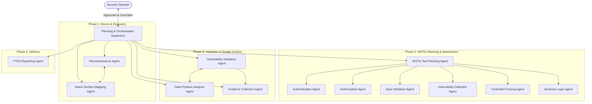
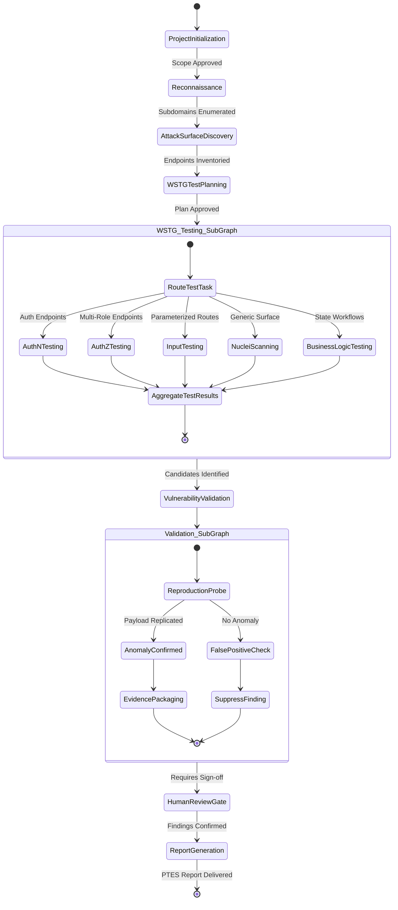
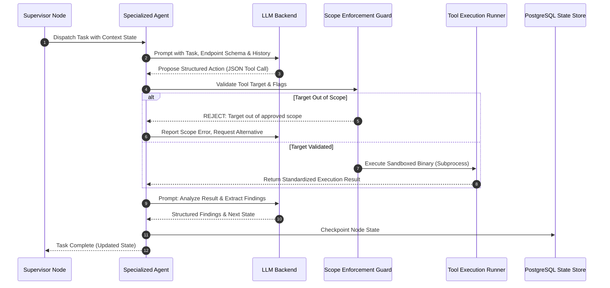

# Pentesa — AI Agent Architecture Document

> **Document Identifier:** PENTESA-AGENT-ARCH-V1.0  
> **Status:** Approved for Implementation  
> **Orchestration Framework:** LangGraph (Stateful Hierarchical Graph Workflows)  
> **Target Release:** v1.0  

---

## Table of Contents

1. [Architectural Philosophy: AI as an Expert Assistant, Not a Rogue Actor](#1-architectural-philosophy-ai-as-an-expert-assistant-not-a-rogue-actor)
2. [Multi-Agent Orchestration Model](#2-multi-agent-orchestration-model)
   - [2.1 Topology & Communication Patterns](#21-topology--communication-patterns)
   - [2.2 Hierarchical Supervisor Pattern](#22-hierarchical-supervisor-pattern)
   - [2.3 Graph Nodes, Edges, and State Transitions](#23-graph-nodes-edges-and-state-transitions)
3. [Agent Lifecycle & Execution Pipeline](#3-agent-lifecycle--execution-pipeline)
   - [3.1 Initialization & Context Ingestion](#31-initialization--context-ingestion)
   - [3.2 Reasoning & Tool Invocation](#32-reasoning--tool-invocation)
   - [3.3 Deterministic Validation & State Checkpointing](#33-deterministic-validation--state-checkpointing)
   - [3.4 Error Recovery & Fallbacks](#34-error-recovery--fallbacks)
4. [Safety, Scope Enforcement & Hallucination Defense](#4-safety-scope-enforcement--hallucination-defense)
   - [4.1 Scope Guarding at Agent Boundaries](#41-scope-guarding-at-agent-boundaries)
   - [4.2 Prohibition of Generative Shell Execution](#42-prohibition-of-generative-shell-execution)
   - [4.3 Evidence-Grounded Vulnerability Verification](#43-evidence-grounded-vulnerability-verification)
   - [4.4 Human-in-the-Loop Approval Interceptors](#44-human-in-the-loop-approval-interceptors)
5. [The Tool Execution Subsystem](#5-the-tool-execution-subsystem)
   - [5.1 Typed Tool Contract Schema (Pydantic)](#51-typed-tool-contract-schema-pydantic)
   - [5.2 Sandboxed Subprocess Wrappers](#52-sandboxed-subprocess-wrappers)
   - [5.3 Tool Registry & Scope Injection](#53-tool-registry--scope-injection)
6. [State Management & Checkpointing](#6-state-management--checkpointing)
   - [6.1 Global Pentest Graph State](#61-global-pentest-graph-state)
   - [6.2 Durable Checkpoints in PostgreSQL](#62-durable-checkpoints-in-postgresql)
   - [6.3 Resume, Rewind, and Human Override](#63-resume-rewind-and-human-override)
7. [Observability & Decision Auditing](#7-observability--decision-auditing)
   - [7.1 Thought Traces & Reasoning Logs](#71-thought-traces--reasoning-logs)
   - [7.2 Token Accounting & Latency Profiling](#72-token-accounting--latency-profiling)
8. [LLM Provider Abstraction Layer](#8-llm-provider-abstraction-layer)
   - [8.1 Unified Interface (OpenAI Compatible)](#81-unified-interface-openai-compatible)
   - [8.2 Local Deployment (Ollama) vs. External API](#82-local-deployment-ollama-vs-external-api)
   - [8.3 Prompt Management & Context Window Packing](#83-prompt-management--context-window-packing)

---

## 1. Architectural Philosophy: AI as an Expert Assistant, Not a Rogue Actor

In modern offensive security, autonomous AI agents are often misrepresented as "magic exploit generators." In production penetration testing, unconstrained generative models fail catastrophically:
- They **hallucinate vulnerabilities** based on trivial pattern matches (e.g., claiming a reflected string is a zero-day XSS without verifying DOM execution context).
- They **violate rules of engagement** by sending requests to third-party endpoints discovered in JavaScript files (e.g., Google Analytics or Stripe).
- They **generate destructive commands** (e.g., `rm -rf`, heavy DoS fuzzing, or DROP TABLE injections).

**Pentesa inverts this paradigm:**
```
                     +---------------------------------------+
                     |       AI Reasoning & Planning        |
                     |  (Hypothesis Generation, Triage,      |
                     |   WSTG Mapping, Context Analysis)     |
                     +-------------------+-------------------+
                                         |
                                         | Emits Typed JSON Intent
                                         v
                     +---------------------------------------+
                     |    Deterministic Security Platform    |
                     |  (Scope Enforcer, Subprocess Sandbox, |
                     |   HTTP Replay, Evidence Hasher)       |
                     +---------------------------------------+
```
1. **The LLM is a reasoning engine, not an execution engine.** The agent plans what should be done, selects parameters, and interprets responses. The platform validates scope, executes the binary, captures the packets, and hashes the evidence.
2. **Every claim requires deterministic proof.** An AI agent cannot mark a finding `Confirmed` simply because a scanner reported a potential indicator. A deterministic reproduction script must execute and succeed.

---

## 2. Multi-Agent Orchestration Model

### 2.1 Topology & Communication Patterns

Pentesa uses a **Hierarchical Supervisor Multi-Agent Architecture** implemented on **LangGraph**. A high-level supervisor agent maintains the overarching pentest state and coordinates specialized subagents organized into functional phases.



### 2.2 Hierarchical Supervisor Pattern
- **Why Hierarchical?** Fully autonomous peer-to-peer agent meshes (e.g. AutoGen) suffer from conversational drift, infinite looping, and unpredictable token consumption. The Hierarchical Supervisor maintains strict phase gates: Phase 2 cannot begin until Phase 1 outputs a frozen endpoint inventory; Phase 4 cannot run until Phase 3 validates findings.
- **The Supervisor Node:**
  - Evaluates global pentest progress.
  - Dynamically activates child agents based on project goals.
  - Pauses execution and alerts the human operator when high-risk actions are required.
  - Manages global timeout and rate-limit allocations.

### 2.3 Graph Nodes, Edges, and State Transitions



---

## 3. Agent Lifecycle & Execution Pipeline



### 3.1 Initialization & Context Ingestion
Each agent is initialized with an isolated, pruned context window containing:
- **Project Identity:** Engagement name, authorized date window, rate limit boundaries.
- **Assigned Target Scope:** Exact domains and CIDRs allowed.
- **Relevant Sub-Inventory:** For example, the `Input Validation Agent` only receives endpoints with user-controllable input vectors (forms, JSON keys, query strings), avoiding irrelevant static assets.
- **System Prompt:** Rigid behavioral persona, safety constraints, and output schema definitions.

### 3.2 Reasoning & Tool Invocation
- Agents utilize **Function Calling / Tool Calling API** formats.
- When an agent decides to probe a target, it outputs a JSON object adhering to Pydantic models.
- The agent does not execute the tool; it yields control back to the LangGraph node executor.

### 3.3 Deterministic Validation & State Checkpointing
- Tool outputs (JSON streams or raw text) are parsed and normalized by deterministic Python parser routines.
- If a tool reports an anomaly, the agent cannot directly create a confirmed finding; it must formulate a reproduction recipe and invoke the `Vulnerability Validation Agent`.
- Upon completing its step, the node's updated state is serialized and persisted to the PostgreSQL checkpoint ledger.

### 3.4 Error Recovery & Fallbacks
- **Schema Validation Errors:** If an LLM emits malformed JSON, the Pydantic validation error is appended to the message history and fed back to the LLM with a correction instruction (max 3 retries).
- **Tool Timeouts:** If a tool exceeds its execution deadline, the subprocess is sent `SIGTERM` followed by `SIGKILL`, and an `EXECUTION_TIMEOUT` error is returned to the agent context.
- **Target Unresponsiveness:** If the target server begins returning 502/503 errors, the supervisor pauses all active agents and prompts the operator.

---

## 4. Safety, Scope Enforcement & Hallucination Defense

### 4.1 Scope Guarding at Agent Boundaries
Every agent action that specifies a network destination is subjected to the Scope Guard before tool invocation:

```python
# Conceptual Agent Guard Pipeline
class ScopeGuard:
    def validate_action(self, tool_name: str, target_url: str, project_id: str) -> ValidationResult:
        # 1. Parse URL Host
        host = urlparse(target_url).hostname
        
        # 2. Check Database Scope Targets
        if not self.is_host_in_scope(project_id, host):
            return ValidationResult(allowed=False, reason="Host not in approved scope")
            
        # 3. Check Exclusions (Paths, Endpoints)
        if self.is_path_excluded(project_id, target_url):
            return ValidationResult(allowed=False, reason="Path matches project exclusion regex")
            
        # 4. Check Rate Limit Threshold
        if not self.rate_limiter.acquire(host):
            return ValidationResult(allowed=False, reason="Target rate limit exceeded; throttling")
            
        return ValidationResult(allowed=True)
```

### 4.2 Prohibition of Generative Shell Execution
Pentesa enforces an absolute architectural constraint:
$$\text{Code Execution from LLM Output} \equiv \emptyset$$
- Agents are never granted access to `bash`, `sh`, `subprocess.Popen(shell=True)`, or Python `eval()`.
- Agents only select pre-registered tool identifiers (e.g., `execute_nuclei`, `execute_katana`, `probe_http`).

### 4.3 Evidence-Grounded Vulnerability Verification
To eliminate hallucinations, every candidate vulnerability must pass through the **Evidence Triad**:
1. **The Probe:** The exact HTTP request payload sent.
2. **The Response Signature:** The raw HTTP response containing the vulnerability reflection, timing anomaly, or cryptographic breakdown.
3. **The Reproducer:** A deterministic, self-contained `curl` command that independent engineers can execute to reproduce the result.

If any element of the triad is absent, the finding status is restricted to `Needs Manual Review` or rejected.

### 4.4 Human-in-the-Loop Approval Interceptors
Certain actions are marked with an `approval_required: true` flag in the graph definition:
- High-volume directory fuzzing ($> 5,000$ requests).
- Authentication brute forcing or password spraying.
- Testing destructive state changes (e.g. `/api/users/delete`, `/api/checkout/pay`).
- Testing out-of-band payloads (SSRF).

When such an action is planned, the LangGraph supervisor transitions to a `SUSPENDED` state and notifies the operator via WebSocket with an "Approve / Reject / Modify" dialog.

---

## 5. The Tool Execution Subsystem

### 5.1 Typed Tool Contract Schema (Pydantic)
All tools register their inputs and outputs as Pydantic models:

```python
class NucleiScanInput(BaseModel):
    project_id: UUID
    target_url: HttpUrl
    tags: List[str] = Field(default=["cve", "misconfig", "exposure"])
    severity: List[str] = Field(default=["medium", "high", "critical"])
    rate_limit: int = Field(default=15, le=50)
    timeout_seconds: int = Field(default=180)

class NucleiFinding(BaseModel):
    template_id: str
    name: str
    severity: str
    matched_url: str
    curl_command: str
    raw_request: str
    raw_response: str
    extracted_results: Optional[List[str]]

class NucleiScanOutput(BaseModel):
    success: bool
    findings: List[NucleiFinding]
    total_requests: int
    duration_ms: int
    error_message: Optional[str] = None
```

### 5.2 Sandboxed Subprocess Wrappers
Tools run inside the Celery worker container using restricted user permissions (`pentesa_runner` without `sudo`). Tool wrappers enforce strict timeouts and stream stdout line-by-line to prevent buffer exhaustion.

### 5.3 Tool Registry & Scope Injection
The tool registry automatically binds project-level scope rules to every execution instance. If an agent calls `execute_fuzzing(url="http://otherdomain.com")`, the tool wrapper rejects the invocation before spawning any system process.

---

## 6. State Management & Checkpointing

### 6.1 Global Pentest Graph State
The shared state dictionary across all nodes in the LangGraph workflow:

```python
class PentestGraphState(TypedDict):
    project_id: str
    current_phase: str
    approved_scope: Dict[str, Any]
    discovered_subdomains: List[str]
    endpoints_inventory: List[Dict[str, Any]]
    wstg_matrix_state: Dict[str, str]
    candidate_findings: List[Dict[str, Any]]
    confirmed_findings: List[Dict[str, Any]]
    false_positives: List[Dict[str, Any]]
    active_agent: str
    execution_logs: List[Dict[str, Any]]
    human_approval_pending: Optional[Dict[str, Any]]
```

### 6.2 Durable Checkpoints in PostgreSQL
LangGraph's `PostgresSaver` records state diffs after every node execution. If the host machine reboots or the container restarts, the supervisor resumes the exact state from the last committed checkpoint.

### 6.3 Resume, Rewind, and Human Override
Operators can:
- **Pause** a scan at any moment.
- **Rewind** to an earlier phase (e.g., re-running discovery with altered depth).
- **Inject Data** directly into the state (e.g., manually adding a hidden endpoint discovered out-of-band).

---

## 7. Observability & Decision Auditing

### 7.1 Thought Traces & Reasoning Logs
Every LLM call logs:
- Exact prompt template and system instructions.
- Raw LLM response string before JSON parsing.
- Parsed intent and arguments.
- Duration and HTTP latency.
- These traces are viewable in the UI under **Agent Monitor** in real time.

### 7.2 Token Accounting & Latency Profiling
The system tracks prompt tokens, completion tokens, and estimated cost per project, per agent, and per scan job to prevent cost overruns on commercial APIs.

---

## 8. LLM Provider Abstraction Layer

```mermaid
flowchart LR
    Agent[Agent Logic] --> ProviderLayer[LLM Provider Abstraction]
    ProviderLayer --> LocalOllama[Local Ollama / vLLM\n(Llama 3.1 8B/70B, Qwen 2.5 14B/32B)]
    ProviderLayer --> OpenAICompat[OpenAI Compatible API\n(Local or On-Premises Gateway)]
    ProviderLayer --> CloudAPI[Commercial Cloud Provider\n(OpenAI, Anthropic, Gemini)]
```

### 8.1 Unified Interface
Built on LangChain's `BaseChatModel`, supporting standardized structured output parsing across all providers.

### 8.2 Local Deployment vs. External API
- **Offline / Sovereign Mode:** Uses local Ollama instance running inside or beside Docker. Zero internet connection required.
- **Cloud / Hybrid Mode:** Uses commercial APIs for complex business logic reasoning, while keeping packet transmission and tool execution strictly local.

### 8.3 Prompt Management & Context Window Packing
- Prompts are maintained in versioned templates.
- Large HTTP response bodies are truncated or summarized using heuristic filters (e.g. stripping binary images or repetitive HTML boilerplate) before being passed to LLM context windows to preserve token budgets.
