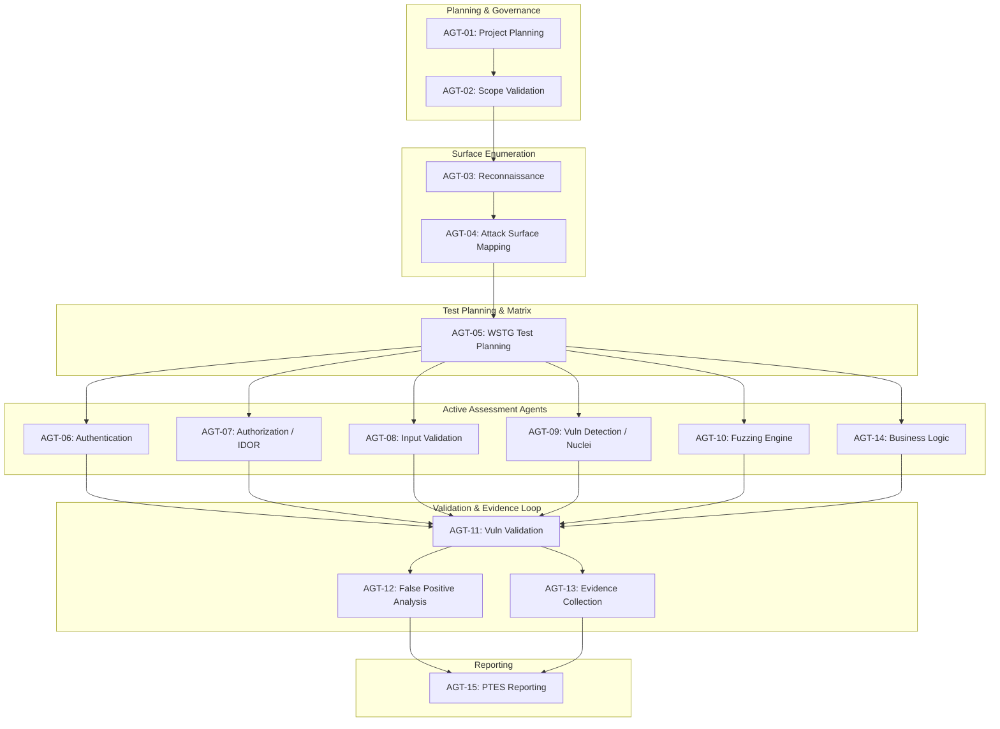

# Pentesa — Agent Specifications

> **Document Identifier:** PENTESA-AGENT-SPEC-V1.0  
> **Status:** Approved for Implementation  
> **Agent Count:** 15 Dedicated Autonomous Security Agents  
> **Target Release:** v1.0  

---

## Table of Contents

1. [Executive Overview & Agent Ecosystem](#1-executive-overview--agent-ecosystem)
2. [Agent Responsibility Matrix](#2-agent-responsibility-matrix)
3. [Agent Interaction & Data Flow Topology](#3-agent-interaction--data-flow-topology)
4. [Granular Agent Specifications (1 to 15)](#4-granular-agent-specifications-1-to-15)
   - [AGT-01: Project Planning Agent](#agt-01-project-planning-agent)
   - [AGT-02: Scope Validation Agent](#agt-02-scope-validation-agent)
   - [AGT-03: Reconnaissance Agent](#agt-03-reconnaissance-agent)
   - [AGT-04: Attack Surface Mapping Agent](#agt-04-attack-surface-mapping-agent)
   - [AGT-05: WSTG Test Planning Agent](#agt-05-wstg-test-planning-agent)
   - [AGT-06: Authentication Testing Agent](#agt-06-authentication-testing-agent)
   - [AGT-07: Authorization Testing Agent](#agt-07-authorization-testing-agent)
   - [AGT-08: Input Validation Agent](#agt-08-input-validation-agent)
   - [AGT-09: Vulnerability Detection Agent](#agt-09-vulnerability-detection-agent)
   - [AGT-10: Fuzzing Agent](#agt-10-fuzzing-agent)
   - [AGT-11: Vulnerability Validation Agent](#agt-11-vulnerability-validation-agent)
   - [AGT-12: False Positive Analysis Agent](#agt-12-false-positive-analysis-agent)
   - [AGT-13: Evidence Collection Agent](#agt-13-evidence-collection-agent)
   - [AGT-14: Business Logic Analysis Agent](#agt-14-business-logic-analysis-agent)
   - [AGT-15: Reporting Agent](#agt-15-reporting-agent)

---

## 1. Executive Overview & Agent Ecosystem

The Pentesa agent subsystem coordinates **15 specialized, role-bounded autonomous agents**. Unlike generic monolithic conversational bots, every agent in Pentesa possesses:
- A strictly delimited functional charter.
- Strongly-typed Pydantic input and output schemas.
- Explicit permissions defining exactly which tools it may invoke.
- Mandatory safety constraints and human approval triggers.
- Immutable auditing of every decision, tool call, and token exchange.

---

## 2. Agent Responsibility Matrix

| Agent ID | Agent Name | Primary Responsibility | Primary Tools | Human Approval Needed? | Risk Tier |
|---|---|---|---|---|---|
| **AGT-01** | Project Planning Agent | Analyzes RoE, scopes test plan DAG, configures rate limits. | `db_query`, `policy_evaluator` | No | Low |
| **AGT-02** | Scope Validation Agent | Resolves DNS, checks CIDR boundaries, inspects redirects. | `dns_resolver`, `cidr_matcher` | No | Low |
| **AGT-03** | Reconnaissance Agent | Discovers passive subdomains, WHOIS, cert transparency. | `subfinder`, `tls_inspector` | No | Low |
| **AGT-04** | Attack Surface Mapping Agent | Crawls applications, extracts endpoints from JS and APIs. | `katana`, `spec_parser`, `js_ast` | No | Low |
| **AGT-05** | WSTG Test Planning Agent | Maps discovered surface to 12 OWASP WSTG categories. | `wstg_catalog_db`, `matrix_builder` | No | Low |
| **AGT-06** | Authentication Testing Agent | Assesses login, lockout, MFA, session token entropy. | `http_prober`, `token_analyzer` | For brute force | Medium |
| **AGT-07** | Authorization Testing Agent | Tests IDOR, BOLA, privilege escalation across identities. | `multi_identity_prober` | No | Medium |
| **AGT-08** | Input Validation Agent | Evaluates XSS, SQLi, command injection, SSRF, SSTI. | `payload_evaluator`, `diff_prober` | For high-risk payloads | High |
| **AGT-09** | Vulnerability Detection Agent | Runs vetted Nuclei templates and custom Python checks. | `nuclei_runner`, `check_runner` | No | Medium |
| **AGT-10** | Fuzzing Agent | Controlled parameter fuzzing and directory discovery. | `ffuf_runner`, `wordlist_manager` | If $> 5,000$ reqs | High |
| **AGT-11** | Vulnerability Validation Agent | Executes safe reproduction scripts to verify defects. | `repro_harness`, `curl_builder` | For state mutations | Medium |
| **AGT-12** | False Positive Analysis Agent | Contextual analysis of scanner outputs to refute noise. | `response_differ`, `fp_heuristic` | No | Low |
| **AGT-13** | Evidence Collection Agent | Captures raw HTTP pairs, SHA-256 hashes, screenshots. | `packet_capture`, `playwright_shot` | No | Low |
| **AGT-14** | Business Logic Analysis Agent | Identifies state machine skips, parameter manipulation. | `workflow_tracer`, `state_tester` | For financial/order ops | High |
| **AGT-15** | Reporting Agent | Synthesizes PTES reports, CVSS scores, remediation. | `weasyprint_runner`, `jinja_compiler` | No | Low |

---

## 3. Agent Interaction & Data Flow Topology



---

## 4. Granular Agent Specifications (1 to 15)

---

### AGT-01: Project Planning Agent
- **Purpose:** Ingests the project engagement definition, client Rules of Engagement (RoE), and configured testing windows, generating the master execution plan DAG and allocating rate budgets.
- **Input Contract:**
  ```json
  {
    "project_id": "UUID",
    "name": "string",
    "roe": { "start_time": "ISO8601", "end_time": "ISO8601", "max_rps": 20, "allowed_windows": ["09:00-18:00"] },
    "target_scope": { "domains": ["example.com"], "ip_ranges": ["192.168.1.0/24"] }
  }
  ```
- **Output Contract:**
  ```json
  {
    "plan_id": "UUID",
    "execution_dag": ["recon", "discovery", "wstg_planning", "testing", "validation", "reporting"],
    "rate_limits": { "default_rps": 15, "burst_rps": 25 },
    "status": "INITIALIZED"
  }
  ```
- **Tools Available:** `db_query`, `policy_evaluator`, `calendar_window_checker`.
- **Permissions:** Read project configuration; write execution schedule; CANNOT execute network probes or shell commands.
- **Safety Constraints:** Fails immediately if current time is outside authorized RoE window.
- **Human Approval:** None required.
- **Dependencies:** None (starts the engagement).
- **Error Handling:** Emits `INVALID_ROE_WINDOW` if dates are expired or inverted.

---

### AGT-02: Scope Validation Agent
- **Purpose:** Acts as the mandatory security guard for all target destinations. Resolves DNS, checks IP CIDRs, normalizes paths, and inspects redirect chains.
- **Input Contract:**
  ```json
  {
    "project_id": "UUID",
    "candidate_url": "https://api.example.com/v1/users",
    "origin_agent": "AGT-04"
  }
  ```
- **Output Contract:**
  ```json
  {
    "is_in_scope": true,
    "resolved_ip": "192.168.1.45",
    "matched_rule_id": "SCOPE-RULE-001",
    "is_excluded": false,
    "sanitized_url": "https://api.example.com/v1/users"
  }
  ```
- **Tools Available:** `dns_resolver` (with cache & rebinding check), `cidr_matcher`, `regex_path_matcher`.
- **Permissions:** Query network DNS; read scope tables; CANNOT send HTTP request bodies.
- **Safety Constraints:** Always fails closed. If DNS fails or IP does not match allowed CIDRs, returns `is_in_scope: false`.
- **Human Approval:** None required.
- **Dependencies:** AGT-01.
- **Error Handling:** Logs `SCOPE_DENIAL_EVENT` in the audit table on any out-of-scope attempt.

---

### AGT-03: Reconnaissance Agent
- **Purpose:** Performs non-intrusive passive and low-impact active reconnaissance to enumerate domain hierarchies, subdomains, DNS records, and SSL/TLS certificate metadata.
- **Input Contract:**
  ```json
  {
    "project_id": "UUID",
    "root_domains": ["example.com"],
    "allow_active_dns": true
  }
  ```
- **Output Contract:**
  ```json
  {
    "discovered_subdomains": [
      { "fqdn": "app.example.com", "source": "cert_transparency", "ip": "192.168.1.10" },
      { "fqdn": "api.example.com", "source": "subfinder", "ip": "192.168.1.11" }
    ],
    "ssl_certificates": [{ "domain": "app.example.com", "issuer": "Let's Encrypt", "expires": "2027-01-01" }]
  }
  ```
- **Tools Available:** `subfinder` runner, `tls_inspector`, `dns_record_fetcher`.
- **Permissions:** Execute passive search; query DNS; CANNOT spider endpoints or execute exploit templates.
- **Safety Constraints:** All discovered subdomains must be verified against AGT-02 before storage.
- **Human Approval:** None required.
- **Dependencies:** AGT-02.
- **Error Handling:** Degrades gracefully if third-party passive sources are unreachable; relies on DNS brute forcing with approved wordlist.

---

### AGT-04: Attack Surface Mapping Agent
- **Purpose:** Crawls web applications, parses HTML forms, analyzes JavaScript scripts for hidden routes, ingests OpenAPI specifications, and compiles the Central Endpoint Inventory.
- **Input Contract:**
  ```json
  {
    "project_id": "UUID",
    "seed_urls": ["https://app.example.com/"],
    "crawl_depth": 3,
    "auth_profile_id": "AUTH-01"
  }
  ```
- **Output Contract:**
  ```json
  {
    "endpoints_discovered_count": 48,
    "endpoints": [
      {
        "url_path": "/api/v1/profile",
        "http_method": "GET",
        "parameters": [{ "name": "user_id", "type": "query", "sample": "104" }],
        "content_type": "application/json",
        "auth_required": true,
        "source": "katana_spider"
      }
    ],
    "technologies": ["React", "Express.js", "Node.js"]
  }
  ```
- **Tools Available:** `katana` wrapper, `httpx` wrapper, `openapi_spec_parser`, `js_ast_analyzer`.
- **Permissions:** Send GET/POST requests strictly within crawl depth; CANNOT submit state-destructive forms (e.g. submit buttons with `delete`, `purge`, `cancel`).
- **Safety Constraints:** Must invoke AGT-02 for every discovered hyperlink before crawling.
- **Human Approval:** None required.
- **Dependencies:** AGT-02, AGT-03.
- **Error Handling:** Drops unparseable binary assets; halts crawling on continuous HTTP 429/503 responses.

---

### AGT-05: WSTG Test Planning Agent
- **Purpose:** Evaluates discovered endpoints and technologies to generate a prioritized, auditable OWASP WSTG v4.2 test plan across all 12 categories.
- **Input Contract:**
  ```json
  {
    "project_id": "UUID",
    "endpoint_inventory_summary": { "total_endpoints": 48, "auth_endpoints": 6, "api_endpoints": 32 },
    "technology_stack": ["Node.js", "Express", "PostgreSQL", "JWT"]
  }
  ```
- **Output Contract:**
  ```json
  {
    "test_plan_id": "UUID",
    "total_tests_planned": 54,
    "category_allocation": {
      "WSTG-INFO": 4, "WSTG-CONF": 6, "WSTG-IDNT": 3, "WSTG-ATHN": 8,
      "WSTG-ATHZ": 4, "WSTG-SESS": 5, "WSTG-INPV": 12, "WSTG-ERRH": 2,
      "WSTG-CRYP": 3, "WSTG-BUSL": 4, "WSTG-CLNT": 2, "WSTG-APIT": 6
    },
    "not_applicable_tests": [
      { "wstg_id": "WSTG-CONF-06", "reason": "No Apache web server detected in fingerprint." }
    ]
  }
  ```
- **Tools Available:** `wstg_catalog_db`, `matrix_builder`.
- **Permissions:** Read endpoint database; create test instances; CANNOT send network traffic.
- **Safety Constraints:** Must supply written technical justification for any test marked `Not Applicable`.
- **Human Approval:** None required (Operator can override results in UI).
- **Dependencies:** AGT-04.
- **Error Handling:** Defaults to including a test if technology relevance is ambiguous.

---

### AGT-06: Authentication Testing Agent
- **Purpose:** Executes tests covering login mechanics, password policies, session token generation, account lockout mechanisms, and multi-factor authentication enforcement.
- **Input Contract:**
  ```json
  {
    "project_id": "UUID",
    "auth_endpoints": ["/api/v1/auth/login", "/api/v1/auth/reset-password"],
    "test_credentials": [{ "username": "test_user_1", "role": "Standard" }]
  }
  ```
- **Output Contract:**
  ```json
  {
    "completed_wstg_tests": ["WSTG-ATHN-01", "WSTG-ATHN-02", "WSTG-ATHN-03"],
    "anomalies": [
      {
        "test_id": "WSTG-ATHN-03",
        "description": "No rate limiting or account lockout observed after 15 invalid login attempts.",
        "severity": "Medium",
        "evidence_request": "POST /api/v1/auth/login HTTP/1.1...",
        "evidence_response": "HTTP/1.1 401 Unauthorized..."
      }
    ]
  }
  ```
- **Tools Available:** `http_prober`, `token_entropy_calculator`, `jwt_header_inspector`.
- **Permissions:** Send rate-limited authentication probes; test credential stuffing with approved max 10 attempts; CANNOT perform dictionary brute-forcing without human approval.
- **Safety Constraints:** Stops immediately if account lockout occurs.
- **Human Approval:** Required if testing $> 15$ login attempts per account.
- **Dependencies:** AGT-05.
- **Error Handling:** Backs off exponentially upon receiving HTTP 429 Too Many Requests.

---

### AGT-07: Authorization Testing Agent
- **Purpose:** Evaluates Horizontal Privilege Escalation, Vertical Privilege Escalation, IDOR, and Broken Object Level Authorization (BOLA) using multi-identity test profiles.
- **Input Contract:**
  ```json
  {
    "project_id": "UUID",
    "identity_a": { "role": "Tenant-A", "token": "Bearer eyJhbGci..." },
    "identity_b": { "role": "Tenant-B", "token": "Bearer eyJhbGci..." },
    "target_resources": [{ "endpoint": "/api/v1/documents/1042", "owner": "Tenant-A" }]
  }
  ```
- **Output Contract:**
  ```json
  {
    "completed_wstg_tests": ["WSTG-ATHZ-01", "WSTG-ATHZ-02", "WSTG-ATHZ-04"],
    "anomalies": [
      {
        "test_id": "WSTG-ATHZ-04",
        "title": "BOLA / IDOR in Document Access",
        "severity": "High",
        "cwe_id": "CWE-639",
        "endpoint": "/api/v1/documents/1042",
        "description": "Tenant-B successfully read private document owned by Tenant-A.",
        "evidence_request": "GET /api/v1/documents/1042 Authorization: Bearer Tenant-B",
        "evidence_response": "HTTP/1.1 200 OK Content-Type: application/json..."
      }
    ]
  }
  ```
- **Tools Available:** `multi_identity_prober`, `token_replacer`, `response_diff`.
- **Permissions:** Replay requests swapping headers and cookies between provided accounts; CANNOT execute state-destructive operations (DELETE/DROP) using unauthorized tokens.
- **Safety Constraints:** Uses only test-tenant identities created for the assessment.
- **Human Approval:** None required.
- **Dependencies:** AGT-05, AGT-01.
- **Error Handling:** Aborts test cycle if authentication token expires; prompts for token refresh.

---

### AGT-08: Input Validation Agent
- **Purpose:** Tests input parameters against injection flaws: SQL Injection (SQLi), Cross-Site Scripting (XSS), Command Injection, Server-Side Template Injection (SSTI), and SSRF.
- **Input Contract:**
  ```json
  {
    "project_id": "UUID",
    "endpoint": "/api/v1/search",
    "http_method": "GET",
    "parameters": [{ "name": "q", "type": "query" }],
    "technology": ["PostgreSQL"]
  }
  ```
- **Output Contract:**
  ```json
  {
    "completed_wstg_tests": ["WSTG-INPV-01", "WSTG-INPV-02", "WSTG-INPV-05"],
    "candidate_anomalies": [
      {
        "type": "SQL_INJECTION",
        "parameter": "q",
        "payload": "1' AND (SELECT 1 FROM pg_sleep(5))--",
        "indicator": "Differential response time: 5040ms vs baseline 120ms"
      }
    ]
  }
  ```
- **Tools Available:** `payload_evaluator`, `diff_prober`, `timing_analyzer`.
- **Permissions:** Transmit benign polyglots, math expressions (`{{7*7}}`), and sleep injections (max 5s); CANNOT transmit data-destructive payloads (`DROP`, `DELETE`, `TRUNCATE`, `UPDATE`).
- **Safety Constraints:** Sleep durations strictly capped at 5 seconds; max 3 timing probes per parameter.
- **Human Approval:** Required before sending out-of-band SSRF payloads to non-local listeners.
- **Dependencies:** AGT-05, AGT-04.
- **Error Handling:** Immediately throttles if endpoint returns HTTP 500 continuously.

---

### AGT-09: Vulnerability Detection Agent
- **Purpose:** Coordinates automated scanner executions via Nuclei and custom Python checks, targeting misconfigurations, known CVEs, exposed panels, and weak cryptographic configurations.
- **Input Contract:**
  ```json
  {
    "project_id": "UUID",
    "targets": ["https://app.example.com/"],
    "template_categories": ["cve", "misconfiguration", "vulnerabilities"],
    "severity_filter": ["medium", "high", "critical"]
  }
  ```
- **Output Contract:**
  ```json
  {
    "nuclei_raw_detections": [
      {
        "template_id": "CVE-2023-XXXX",
        "name": "Outdated Component Remote Code Execution",
        "severity": "critical",
        "matched_url": "https://app.example.com/vendor/framework/",
        "curl_command": "curl -X GET ...",
        "raw_request": "GET /vendor/framework/ HTTP/1.1...",
        "raw_response": "HTTP/1.1 200 OK..."
      }
    ]
  }
  ```
- **Tools Available:** `nuclei_runner`, `custom_python_checks`, `ssl_analyzer`.
- **Permissions:** Execute sandboxed Nuclei binary with vetted community templates; CANNOT load unverified third-party scripts.
- **Safety Constraints:** Disables DoS templates; sets `-rate-limit` strictly according to project configuration.
- **Human Approval:** None required.
- **Dependencies:** AGT-05, AGT-02.
- **Error Handling:** Traps subprocess exit codes; recovers gracefully from corrupted template files.

---

### AGT-10: Fuzzing Agent
- **Purpose:** Executes controlled path, parameter, and header discovery fuzzing using `ffuf` against designated endpoints using curated, rate-limited wordlists.
- **Input Contract:**
  ```json
  {
    "project_id": "UUID",
    "base_url": "https://app.example.com/",
    "fuzz_mode": "DIRECTORY_DISCOVERY",
    "wordlist_size": "medium_5000",
    "rate_limit": 20
  }
  ```
- **Output Contract:**
  ```json
  {
    "discovered_paths": [
      { "path": "/internal/metrics", "status_code": 200, "content_length": 4120 },
      { "path": "/api/v1/debug", "status_code": 403, "content_length": 154 }
    ],
    "total_requests_sent": 5000,
    "elapsed_seconds": 250
  }
  ```
- **Tools Available:** `ffuf_runner`, `wordlist_manager`.
- **Permissions:** Run dictionary permutations; CANNOT exceed 50 requests per second under any circumstances.
- **Safety Constraints:** Drops fuzzing instantly if error rate exceeds 10% of responses.
- **Human Approval:** Required if wordlist exceeds 5,000 words.
- **Dependencies:** AGT-05, AGT-02.
- **Error Handling:** Dynamically calibrates filter flags (`-fc`, `-fs`) to neutralize wildcards and uniform soft-404 pages.

---

### AGT-11: Vulnerability Validation Agent
- **Purpose:** The core verification engine. Takes candidate anomalies from testing agents, generates minimal benign reproduction scripts, re-executes against the target, and confirms true exploitability.
- **Input Contract:**
  ```json
  {
    "project_id": "UUID",
    "candidate": {
      "detection_source": "AGT-08",
      "type": "REFLECTED_XSS",
      "endpoint": "/search",
      "parameter": "q",
      "payload": "\"><script>alert(1)</script>"
    }
  }
  ```
- **Output Contract:**
  ```json
  {
    "is_confirmed": true,
    "confidence_score": 95,
    "validation_status": "Confirmed",
    "evidence": {
      "reproduction_curl": "curl -s -i 'https://app.example.com/search?q=%22%3E%3Cscript%3Ealert(1)%3C%2Fscript%3E'",
      "raw_request": "GET /search?q=... HTTP/1.1",
      "raw_response": "HTTP/1.1 200 OK\r\n\r\n<div>Search: \"><script>alert(1)</script></div>",
      "response_time_ms": 140
    }
  }
  ```
- **Tools Available:** `repro_harness`, `curl_builder`, `http_client`.
- **Permissions:** Re-dispatch singular reproduction HTTP requests; CANNOT execute recursive exploit chains.
- **Safety Constraints:** Must route all requests through the Scope Egress Proxy.
- **Human Approval:** Required for state-modifying POST/PUT/DELETE reproductions.
- **Dependencies:** AGT-06, AGT-07, AGT-08, AGT-09, AGT-10, AGT-14.
- **Error Handling:** Passes candidate to AGT-12 if reproduction output does not match expected vulnerability pattern.

---

### AGT-12: False Positive Analysis Agent
- **Purpose:** Performs contextual analysis on candidate alerts that failed reproduction or display ambiguous indicators, classifying noise and recording false-positive explanations.
- **Input Contract:**
  ```json
  {
    "project_id": "UUID",
    "candidate_finding": {
      "title": "SQL Injection Detected",
      "indicator": "Database error string reflected: 'syntax error in SQL statement'",
      "reproduction_status": "FAILED_TIMING"
    }
  }
  ```
- **Output Contract:**
  ```json
  {
    "is_false_positive": true,
    "classification": "STATIC_STRING_REFLECTION",
    "reasoning": "The application echo-reflects user input verbatim inside an educational error tutorial page; query parameters do not reach any dynamic database execution context.",
    "recommendation": "Mark as False Positive; suppress from PTES report."
  }
  ```
- **Tools Available:** `response_differ`, `fp_heuristic_engine`, `dom_context_analyzer`.
- **Permissions:** Analyze stored response logs; read application source metadata; CANNOT send network requests.
- **Safety Constraints:** Must explain why the scanner output was mistaken.
- **Human Approval:** None required (Operator can re-open finding).
- **Dependencies:** AGT-11.
- **Error Handling:** If determination is uncertain, marks finding as `Needs Manual Review` rather than closing.

---

### AGT-13: Evidence Collection Agent
- **Purpose:** Packages verified findings into forensic-grade evidence artifacts. Captures raw HTTP byte streams, generates SHA-256 integrity hashes, masks sensitive credentials, and captures headless browser screenshots.
- **Input Contract:**
  ```json
  {
    "finding_id": "UUID",
    "raw_request_bytes": "POST /api/login HTTP/1.1\r\nAuthorization: Bearer secret_token_123...",
    "raw_response_bytes": "HTTP/1.1 200 OK\r\n...",
    "capture_screenshot": true,
    "screenshot_url": "https://app.example.com/search?q=payload"
  }
  ```
- **Output Contract:**
  ```json
  {
    "evidence_id": "UUID",
    "sanitized_request": "POST /api/login HTTP/1.1\r\nAuthorization: Bearer [REDACTED]...",
    "sanitized_response": "HTTP/1.1 200 OK\r\n...",
    "request_sha256": "e3b0c44298fc1c149afbf4c8996fb92427ae41e4649b934ca495991b7852b855",
    "response_sha256": "4b227777d4dd1fc61c6f884f48641d02b4d121d3fd328cb08b5531fcacdabf8a",
    "screenshot_path": "/var/pentesa/evidence/UUID_shot.png"
  }
  ```
- **Tools Available:** `packet_capture`, `sha256_hasher`, `pii_redactor`, `playwright_screenshot_engine`.
- **Permissions:** Write to local evidence directory; redact strings; CANNOT send outbound packets except local Playwright navigation.
- **Safety Constraints:** Automatically redacts Authorization headers, cookies, passwords, and credit card numbers.
- **Human Approval:** None required.
- **Dependencies:** AGT-11.
- **Error Handling:** Falls back to text-only evidence if browser screenshot times out.

---

### AGT-14: Business Logic Analysis Agent
- **Purpose:** Evaluates workflow state machines for logical vulnerabilities: step skipping (e.g. bypassing step 2 of checkout), negative value submission, replay anomalies, and race conditions.
- **Input Contract:**
  ```json
  {
    "project_id": "UUID",
    "workflow_definition": {
      "name": "Order Checkout",
      "steps": ["/cart/add", "/cart/shipping", "/cart/payment", "/cart/confirm"],
      "parameters": { "quantity": 1, "price": 49.99 }
    }
  }
  ```
- **Output Contract:**
  ```json
  {
    "completed_wstg_tests": ["WSTG-BUSL-01", "WSTG-BUSL-02", "WSTG-BUSL-04"],
    "logic_anomalies": [
      {
        "type": "STATE_MACHINE_BYPASS",
        "severity": "High",
        "description": "Calling /cart/confirm directly after /cart/add returns HTTP 200 and processes order without payment verification.",
        "evidence_chain": ["POST /cart/add (200)", "POST /cart/confirm (200)"]
      }
    ]
  }
  ```
- **Tools Available:** `workflow_tracer`, `state_tester`, `concurrency_racer`.
- **Permissions:** Reorder sequence requests; submit boundary test values (-1, 0, 999999); CANNOT trigger irreversible third-party payments.
- **Safety Constraints:** Restricts operations to test payment sandbox profiles.
- **Human Approval:** Required prior to any transaction simulation on production environments.
- **Dependencies:** AGT-05, AGT-07.
- **Error Handling:** Halts workflow progression if application returns payment settlement IDs.

---

### AGT-15: Reporting Agent
- **Purpose:** Synthesizes verified findings, scope metadata, attack surface statistics, WSTG coverage calculations, and remediation guidance into formal PTES-compliant PDF and HTML reports.
- **Input Contract:**
  ```json
  {
    "project_id": "UUID",
    "template": "ptes_standard",
    "include_sections": ["executive_summary", "scope", "wstg_matrix", "technical_findings", "remediation"],
    "report_format": ["PDF", "HTML"]
  }
  ```
- **Output Contract:**
  ```json
  {
    "report_id": "UUID",
    "pdf_file_path": "/var/pentesa/reports/Pentesa_Report_ProjectX_20261103.pdf",
    "html_file_path": "/var/pentesa/reports/Pentesa_Report_ProjectX_20261103.html",
    "file_hash_sha256": "a591a6d40bf420404a011733cfb7b190d62c65bf0bcda32b57b277d9ad9f146e",
    "generated_at": "2026-11-03T16:00:00Z"
  }
  ```
- **Tools Available:** `weasyprint_runner`, `jinja_compiler`, `chart_renderer`.
- **Permissions:** Read project, findings, and evidence records; write to reports filesystem; CANNOT initiate network connections.
- **Safety Constraints:** Escapes all user inputs and tool outputs to eliminate cross-site scripting or template injection in generated reports.
- **Human Approval:** None required (Operator approves final publication).
- **Dependencies:** AGT-13, AGT-05, AGT-01.
- **Error Handling:** Validates PDF page rendering; retries with simplified layout if WeasyPrint encounters CSS overflow.
