# Pentesa — Penetration Testing Workflow Specification

> **Document Identifier:** PENTESA-WORKFLOW-V1.0  
> **Status:** Approved for Implementation  
> **Methodology Alignment:** PTES (Penetration Testing Execution Standard) & OWASP WSTG v4.2  
> **Target Release:** v1.0  

---

## Table of Contents

1. [Workflow Philosophy: Structured, Auditable & Safe](#1-workflow-philosophy-structured-auditable--safe)
2. [End-to-End Pentest Lifecycle (15-Phase Flowchart)](#2-end-to-end-pentest-lifecycle-15-phase-flowchart)
3. [Granular Phase Specifications (Phases 1 to 15)](#3-granular-phase-specifications-phases-1-to-15)
4. [Primary Operator Workflows & Sequence Diagrams](#4-primary-operator-workflows--sequence-diagrams)
   - [4.1 Workflow 1: Project Creation & Authorization](#41-workflow-1-project-creation--authorization)
   - [4.2 Workflow 2: Scope Configuration & Network Validation](#42-workflow-2-scope-configuration--network-validation)
   - [4.3 Workflow 3: Attack Surface Reconnaissance & Discovery](#43-workflow-3-attack-surface-reconnaissance--discovery)
   - [4.4 Workflow 4: WSTG Test Plan Review & Customization](#44-workflow-4-wstg-test-plan-review--customization)
   - [4.5 Workflow 5: Real-Time Assessment Monitoring & Log Streaming](#45-workflow-5-real-time-assessment-monitoring--log-streaming)
   - [4.6 Workflow 6: Candidate Finding Triage & Reproduction](#46-workflow-6-candidate-finding-triage--reproduction)
   - [4.7 Workflow 7: False Positive Analysis & Suppression](#47-workflow-7-false-positive-analysis--suppression)
   - [4.8 Workflow 8: PTES Report Generation & Publication](#48-workflow-8-ptes-report-generation--publication)
   - [4.9 Workflow 9: Remediation Tracking & One-Click Retesting](#49-workflow-9-remediation-tracking--one-click-retesting)
   - [4.10 Workflow 10: Engagement Archival & Scope Closure](#410-workflow-10-engagement-archival--scope-closure)
5. [Human-in-the-Loop Approval Gates & Escalation Policies](#5-human-in-the-loop-approval-gates--escalation-policies)
6. [Formal System State Machines](#6-formal-system-state-machines)
   - [6.1 Project State Machine](#61-project-state-machine)
   - [6.2 Finding State Machine](#62-finding-state-machine)
   - [6.3 WSTG Test Case State Machine](#63-wstg-test-case-state-machine)

---

## 1. Workflow Philosophy: Structured, Auditable & Safe

In conventional offensive tooling, automation often operates as an unconstrained loop that sprays payloads indiscriminately. This creates critical operational liabilities:
- Causing denial-of-service on production applications.
- Testing out-of-scope third-party infrastructure.
- Inability to explain why a particular test succeeded or failed.
- Lack of reproducible evidence to prove findings to development teams.

**Pentesa enforces a disciplined 15-phase lifecycle.** Every phase has formal inputs, deterministic entry criteria, safety boundary assertions, explicit human approval gates, and immutable state transitions.

---

## 2. End-to-End Pentest Lifecycle (15-Phase Flowchart)

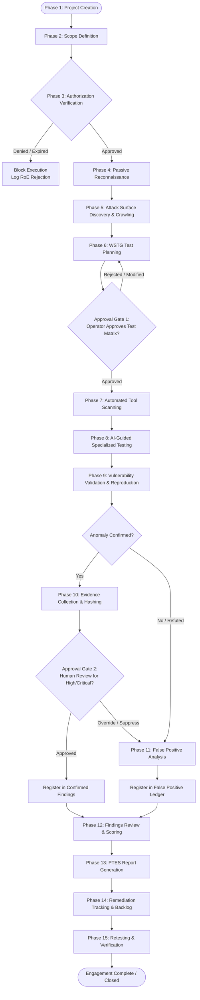

---

## 3. Granular Phase Specifications (Phases 1 to 15)

### Phase 1: Project Creation
- **Objective:** Establish the assessment container with legal ownership, engagement dates, and client context.
- **Inputs:** Project name, client entity, primary operator, engagement description.
- **Outputs:** Unique `project_id`, initialized project record in database.
- **Transition Criteria:** Valid name, non-empty client field, valid UUID generated.

### Phase 2: Scope Definition
- **Objective:** Configure strict network, hostname, IP, and URL boundaries.
- **Inputs:** In-scope domains, wildcard subdomains, IP CIDRs, ports, excluded endpoints, regex exclusion patterns.
- **Outputs:** Populated `scope_targets` and `scope_exclusions` tables.
- **Transition Criteria:** At least one in-scope target configured; exclusions validated for valid regex syntax.

### Phase 3: Authorization Verification
- **Objective:** Ensure all testing activities have verified legal authorization.
- **Inputs:** Authorized signer name, contact email, start date/time, end date/time, signed RoE document reference.
- **Outputs:** Validated `authorization_token`, active authorization window.
- **Transition Criteria:** Current system timestamp falls within `[auth_start, auth_end]`.

### Phase 4: Passive Reconnaissance
- **Objective:** Map target domain infrastructure without transmitting direct packets to the application.
- **Inputs:** Root domains, passive OSINT source credentials.
- **Outputs:** Enumerated subdomains, DNS records, SSL/TLS certificate metadata.
- **Transition Criteria:** Passive enumeration completed; all found subdomains validated against AGT-02.

### Phase 5: Attack Surface Discovery & Crawling
- **Objective:** Map active endpoints, parameters, API routes, and technologies.
- **Inputs:** Seed URLs, crawling depth, authentication profile (optional), rate limits.
- **Outputs:** Populated `endpoints` inventory, technology stack tags, extracted JS routes.
- **Transition Criteria:** Crawler finishes configured depth without unhandled errors; all endpoints cataloged.

### Phase 6: WSTG Test Planning
- **Objective:** Instantiate a complete OWASP WSTG v4.2 test matrix tailored to the discovered surface.
- **Inputs:** Endpoint inventory, technology fingerprints.
- **Outputs:** Instantiated `wstg_test_instances` with mapped endpoint associations and initial statuses.
- **Transition Criteria:** All 12 WSTG categories evaluated; non-applicable tests documented with reasons.

### Phase 7: Automated Tool Scanning
- **Objective:** Run vetted scanner templates (Nuclei, custom Python checks) across endpoints.
- **Inputs:** Scope-validated endpoints, selected template suites, rate limit limits (RPS).
- **Outputs:** Raw tool detection events, candidate vulnerabilities.
- **Transition Criteria:** Scanner subprocesses finish; all output JSON streams parsed into candidate records.

### Phase 8: AI-Guided Specialized Testing
- **Objective:** Deep testing of complex classes: AuthN, AuthZ/IDOR, Input Validation, Business Logic.
- **Inputs:** WSTG test plan, multi-identity authentication profiles, parameter schemas.
- **Outputs:** Candidate anomalies with execution traces and differential responses.
- **Transition Criteria:** Applicable WSTG testing nodes execute; candidate findings submitted to validation.

### Phase 9: Vulnerability Validation & Reproduction
- **Objective:** Replicate candidate vulnerabilities using minimal benign reproduction probes.
- **Inputs:** Candidate finding details, original detection request.
- **Outputs:** Reproduction status (`Confirmed`, `Refuted`, `Inconclusive`), raw HTTP trace.
- **Transition Criteria:** Deterministic probe executed through scope proxy; response signature evaluated.

### Phase 10: Evidence Collection & Hashing
- **Objective:** Create forensic-grade proof artifacts.
- **Inputs:** Confirmed raw HTTP request and response bytes, DOM state.
- **Outputs:** `finding_evidence` record, SHA-256 hashes, reproducible `curl` string, redacted PII.
- **Transition Criteria:** Evidence files written to storage; hashes stored in PostgreSQL.

### Phase 11: False Positive Analysis
- **Objective:** Analyze refuted candidate findings to document why the detection was an artifact.
- **Inputs:** Candidate detection data, failed reproduction traces.
- **Outputs:** `false_positives` record with contextual justification.
- **Transition Criteria:** Heuristic analysis complete; finding suppressed from executive report.

### Phase 12: Human Review & Scoring
- **Objective:** Provide operator governance over findings, CVSS v3.1 vectors, and severity.
- **Inputs:** Validated findings, confidence scores, evidence viewer.
- **Outputs:** Operator-approved findings list, updated CVSS scores.
- **Transition Criteria:** Operator confirms or overrides finding classifications.

### Phase 13: PTES Report Generation
- **Objective:** Assemble formal executive and technical deliverables in PDF and HTML.
- **Inputs:** Project metadata, WSTG coverage calculations, approved findings, evidence artifacts.
- **Outputs:** Immutable `Pentesa_Report_*.pdf` and `*.html` deliverables.
- **Transition Criteria:** WeasyPrint compilation completes without errors; report record frozen.

### Phase 14: Remediation Tracking
- **Objective:** Provide structured guidance to developers and track patch status.
- **Inputs:** Approved findings, remediation recommendations, developer feedback.
- **Outputs:** Remediation status updates (`Open`, `In Progress`, `Ready for Retest`).
- **Transition Criteria:** Developer flags finding as patched.

### Phase 15: Retesting & Verification
- **Objective:** Verify vulnerability remediation via automated re-execution of reproduction probes.
- **Inputs:** Original reproduction recipe (`curl` command and payload parameters).
- **Outputs:** Retest status (`Remediated` or `Still Vulnerable`), differential comparison evidence.
- **Transition Criteria:** Verification probe confirms absence of vulnerability signature.

---

## 4. Primary Operator Workflows & Sequence Diagrams

### 4.1 Workflow 1: Project Creation & Authorization

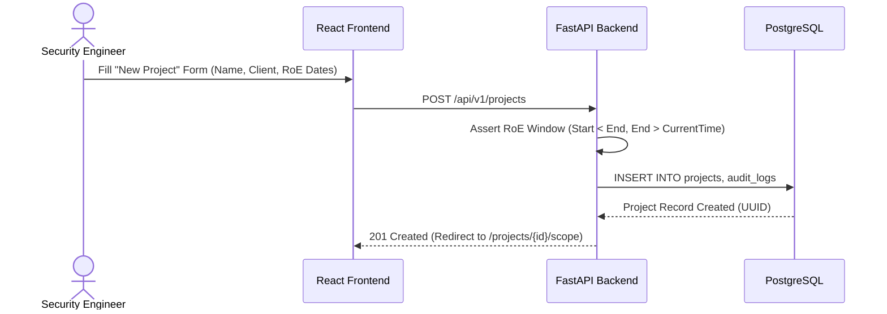

### 4.2 Workflow 2: Scope Configuration & Network Validation

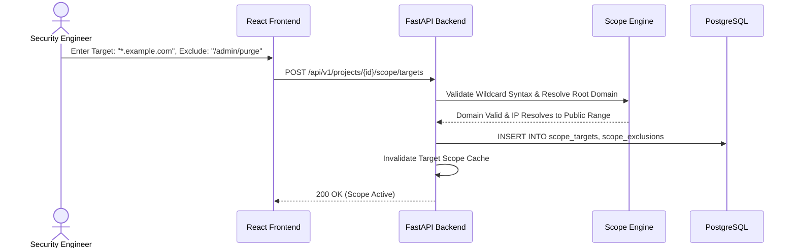

### 4.3 Workflow 3: Attack Surface Reconnaissance & Discovery

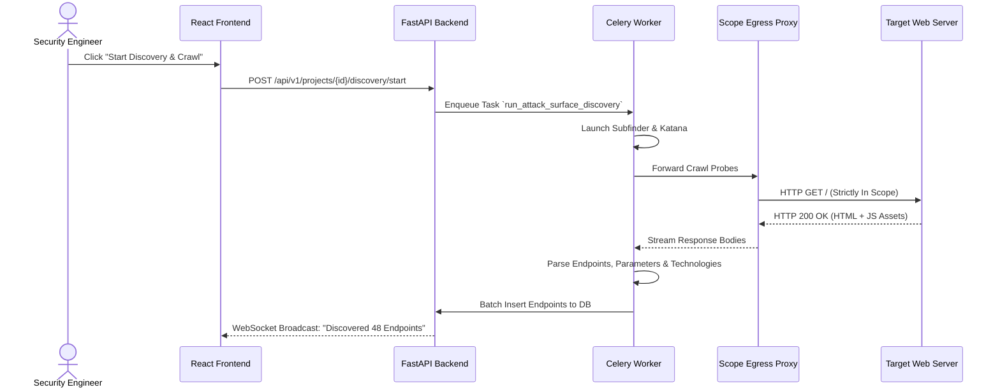

### 4.4 Workflow 4: WSTG Test Plan Review & Customization

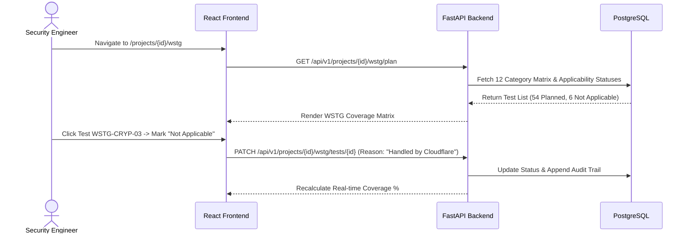

### 4.5 Workflow 5: Real-Time Assessment Monitoring & Log Streaming

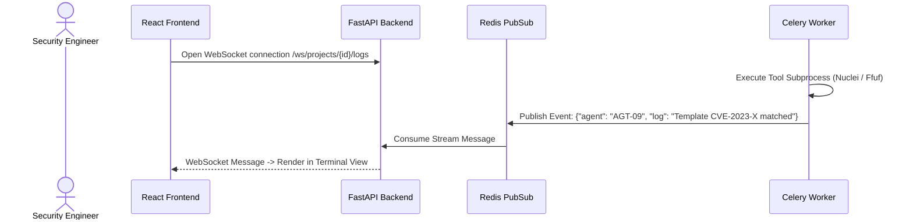

### 4.6 Workflow 6: Candidate Finding Triage & Reproduction

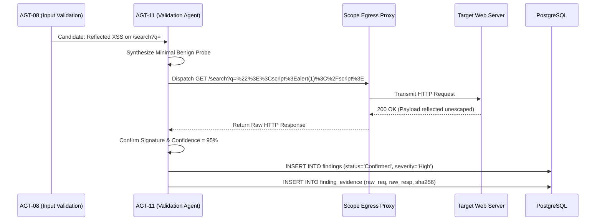

### 4.7 Workflow 7: False Positive Analysis & Suppression

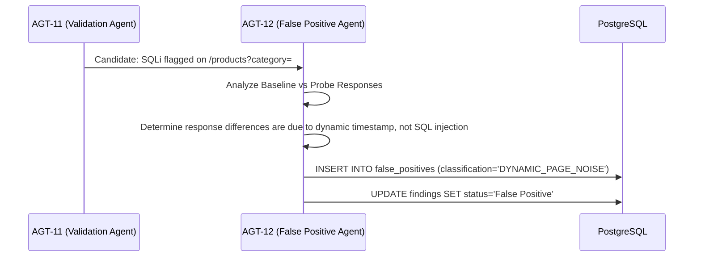

### 4.8 Workflow 8: PTES Report Generation & Publication

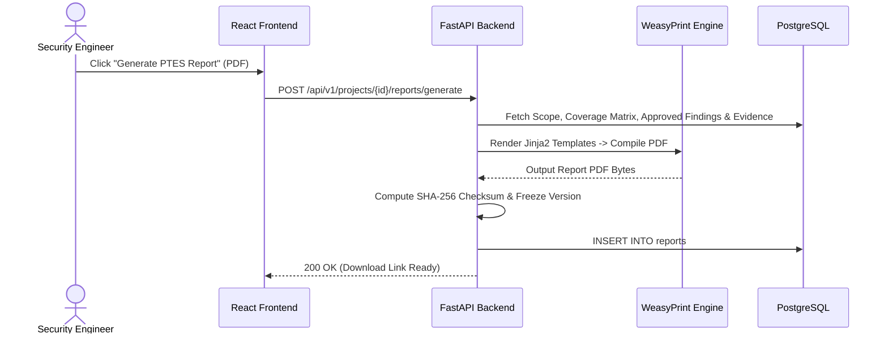

### 4.9 Workflow 9: Remediation Tracking & One-Click Retesting

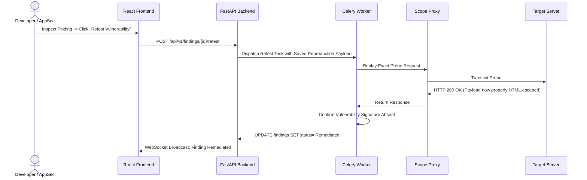

### 4.10 Workflow 10: Engagement Archival & Scope Closure

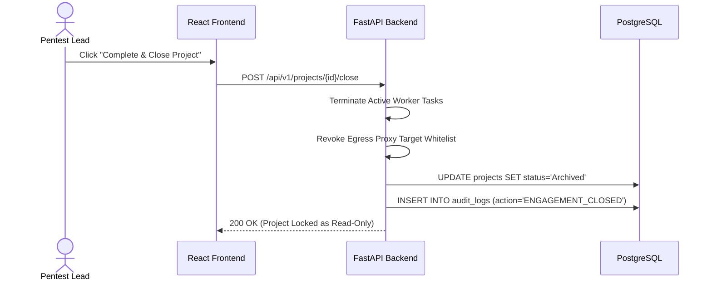

---

## 5. Human-in-the-Loop Approval Gates & Escalation Policies

Pentesa ensures that high-risk offensive actions cannot be executed autonomously without deliberate human authorization:

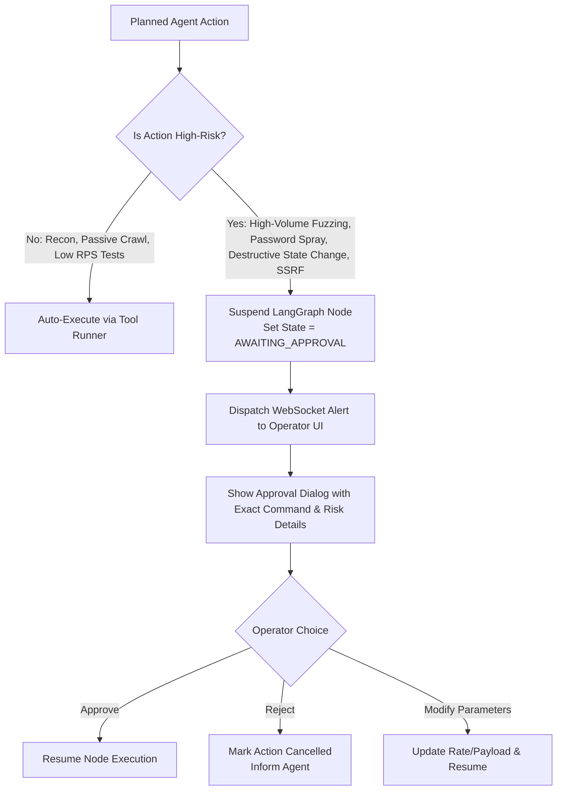

### Policies Requiring Mandatory Human Approval
1. **Directory/Parameter Fuzzing $> 5,000$ Requests:** Prevents unintentional web server CPU exhaustion.
2. **Credential Testing $> 15$ Attempts:** Prevents enterprise Active Directory or Okta account lockouts.
3. **State-Modifying HTTP Operations (POST/PUT/DELETE) on Production Profiles:** Protects existing client database records.
4. **Out-of-Band SSRF Probing:** Prevents unmonitored external network callbacks.
5. **Marking a Critical Finding as "Confirmed":** All Critical and High severity findings require human validation before publication in formal client reports.

---

## 6. Formal System State Machines

### 6.1 Project State Machine

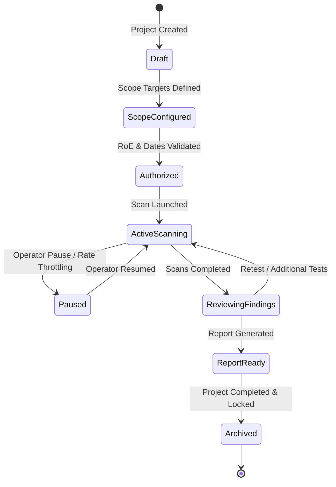

### 6.2 Finding State Machine

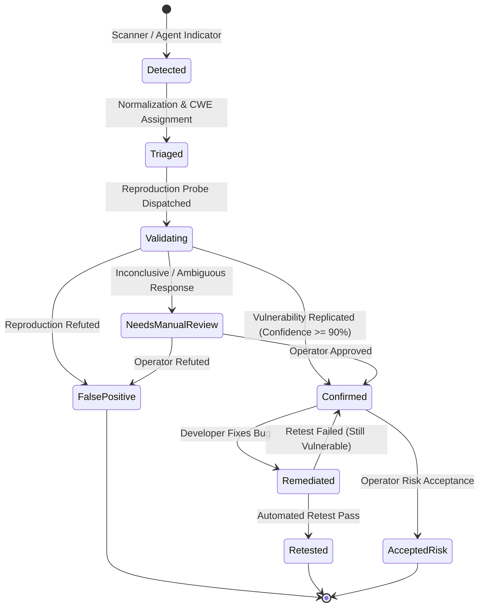

### 6.3 WSTG Test Case State Machine

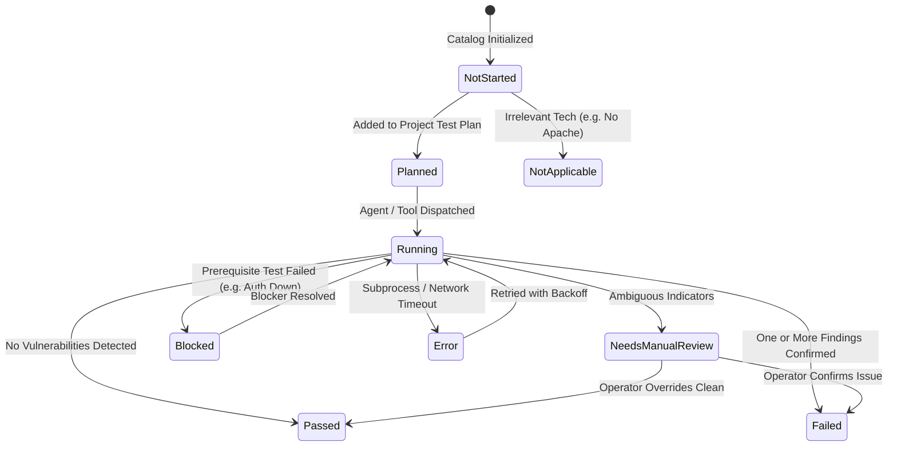
