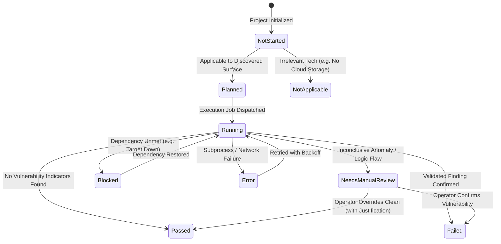

# Pentesa — OWASP WSTG v4.2 Master Test Catalog

> **Document Identifier:** PENTESA-WSTG-CATALOG-V1.0  
> **Status:** Approved for Implementation  
> **Standard:** OWASP Web Security Testing Guide (WSTG) Version 4.2  
> **Target Release:** v1.0  

---

## Table of Contents

1. [Catalog Architecture & Methodology Alignment](#1-catalog-architecture--methodology-alignment)
2. [WSTG Test Status Model & State Transitions](#2-wstg-test-status-model--state-transitions)
3. [Mathematical Coverage Metric Engine](#3-mathematical-coverage-metric-engine)
4. [Master Test Catalog: All 12 WSTG Categories](#4-master-test-catalog-all-12-wstg-categories)
   - [Category 1: Information Gathering (WSTG-INFO-01 to 10)](#category-1-information-gathering-wstg-info)
   - [Category 2: Configuration & Deployment (WSTG-CONF-01 to 11)](#category-2-configuration--deployment-wstg-conf)
   - [Category 3: Identity Management (WSTG-IDNT-01 to 05)](#category-3-identity-management-wstg-idnt)
   - [Category 4: Authentication Testing (WSTG-ATHN-01 to 10)](#category-4-authentication-testing-wstg-athn)
   - [Category 5: Authorization Testing (WSTG-ATHZ-01 to 04)](#category-5-authorization-testing-wstg-athz)
   - [Category 6: Session Management (WSTG-SESS-01 to 09)](#category-6-session-management-wstg-sess)
   - [Category 7: Input Validation (WSTG-INPV-01 to 19)](#category-7-input-validation-wstg-inpv)
   - [Category 8: Error Handling (WSTG-ERRH-01 to 02)](#category-8-error-handling-wstg-errh)
   - [Category 9: Weak Cryptography (WSTG-CRYP-01 to 04)](#category-9-weak-cryptography-wstg-cryp)
   - [Category 10: Business Logic (WSTG-BUSL-01 to 09)](#category-10-business-logic-wstg-busl)
   - [Category 11: Client-Side Testing (WSTG-CLNT-01 to 13)](#category-11-client-side-testing-wstg-clnt)
   - [Category 12: API Testing (WSTG-APIT-01 to 10)](#category-12-api-testing-wstg-apit)
5. [Industry Standard Mapping Tables](#5-industry-standard-mapping-tables)
   - [5.1 WSTG to OWASP Top 10:2021 Mapping](#51-wstg-to-owasp-top-102021-mapping)
   - [5.2 WSTG to CWE (Common Weakness Enumeration) Mapping](#52-wstg-to-cwe-common-weakness-enumeration-mapping)
   - [5.3 WSTG to Responsible Agent Mapping](#53-wstg-to-responsible-agent-mapping)

---

## 1. Catalog Architecture & Methodology Alignment

The **OWASP Web Security Testing Guide (WSTG v4.2)** represents the premier industry standard for web application security assessments. While basic DAST scanners execute arbitrary fuzzing scripts without methodology traceability, **Pentesa treats the WSTG as the core relational backbone** of every pentest engagement.

Every project instantiates a project-specific test matrix derived from this master catalog. Every test has:
- A verified WSTG identifier.
- Explicit endpoint prerequisites and required tools.
- Automation classification: `Full` (fully automated by tools/agents), `Partial` (agent conducts probes, human reviews logic), or `Manual` (operator judgment required).
- Measurable pass/fail criteria grounded in evidence.

---

## 2. WSTG Test Status Model & State Transitions

Each test instance within a project transitions through a rigorous, finite state machine:

### Formal Status Definitions
- `Not Applicable`: The target architecture lacks the tested component (e.g., testing Oracle DB injection on a pure DynamoDB backend). Requires operator justification.
- `Not Started`: Catalog entry loaded but not yet analyzed against discovery surface.
- `Planned`: Identified as applicable and scheduled for agent execution.
- `Running`: Active tools or agents are currently transmitting probes.
- `Passed`: All tests executed; zero vulnerability indicators or anomalies detected.
- `Failed`: At least one confirmed vulnerability has been reproduced and logged.
- `Needs Manual Review`: The agent detected an anomaly (e.g., unusual status code or business flow behavior) requiring human judgment.
- `Blocked`: Execution cannot proceed due to upstream dependency failure (e.g., test credentials expired).
- `Error`: Execution terminated abnormally due to timeout or process crash.

---

## 3. Mathematical Coverage Metric Engine

Coverage is calculated strictly from empirical test executions and auditable applicability determinations—**never estimated or guessed by AI**.

$$\text{Coverage \%} = \frac{\text{Passed} + \text{Failed} + \text{Needs Manual Review} + \text{Not Applicable}}{\text{Total Catalog Tests in Scope}} \times 100$$

$$\text{Testing Health Score} = \frac{\text{Passed} + \text{Not Applicable}}{\text{Total Catalog Tests in Scope}} \times 100$$

---

## 4. Master Test Catalog: All 12 WSTG Categories

---

### Category 1: Information Gathering (WSTG-INFO)

| WSTG ID | Test Name | Automation | Tools | Required Endpoints | Human Review? | Risk if Vulnerable |
|---|---|---|---|---|---|---|
| **WSTG-INFO-01** | Conduct Search Engine Reconnaissance | Full | `subfinder`, OSINT | Root domain | No | Info leakage of staging or test environments. |
| **WSTG-INFO-02** | Fingerprint Web Server | Full | `httpx`, HTTP prober | Any public endpoint | No | Component version disclosure aids targeted exploit selection. |
| **WSTG-INFO-03** | Review Webserver Metafiles for Information Leakage | Full | `katana`, `http_client` | `/robots.txt`, `/sitemap.xml`, `security.txt` | No | Unintended exposure of hidden admin or debug routes. |
| **WSTG-INFO-04** | Enumerate Applications on Webserver | Full | `httpx`, DNS resolver | IP / FQDN | No | Discovery of forgotten virtual hosts or legacy apps. |
| **WSTG-INFO-05** | Review Webpage Content for Information Leakage | Full | `katana`, AST parser | HTML, JS bundles, inline comments | No | Hardcoded developer credentials, internal API keys. |
| **WSTG-INFO-06** | Identify Application Entry Points | Full | `katana`, crawler | Forms, URLs, APIs | No | Lack of visibility into full attack perimeter. |
| **WSTG-INFO-07** | Map Execution Paths Through Application | Partial | `katana`, AGT-04 | User journeys, multi-step flows | Yes | Overlooked state flows and unmonitored logic branches. |
| **WSTG-INFO-08** | Fingerprint Web Application Framework | Full | `httpx`, Wappalyzer rules | Public endpoints | No | Facilitates zero-day or N-day exploit execution. |
| **WSTG-INFO-09** | Fingerprint Web Application Architecture | Partial | AGT-03, AGT-04 | Reverse proxy, WAF, CDN | No | Bypassing filtering layers or targeting origin IPs. |
| **WSTG-INFO-10** | Map Application Architecture | Partial | AGT-04 | API specs, reverse proxy | Yes | Identification of internal microservices and trust boundaries. |

---

### Category 2: Configuration & Deployment (WSTG-CONF)

| WSTG ID | Test Name | Automation | Tools | Required Endpoints | Human Review? | Risk if Vulnerable |
|---|---|---|---|---|---|---|
| **WSTG-CONF-01** | Test Network Infrastructure Configuration | Full | `nuclei`, TLS prober | Web ports, SSL/TLS | No | Weak TLS ciphers, expired certs, exposed admin ports. |
| **WSTG-CONF-02** | Test Application Platform Configuration | Full | `nuclei`, `httpx` | Root, error pages | No | Default admin panels, enabled debug modes. |
| **WSTG-CONF-03** | Test File Extensions Handling for Sensitive Files | Full | `ffuf`, `nuclei` | Paths + backup extensions | No | Source code leakage via `.bak`, `.old`, `.swp`, `.env`. |
| **WSTG-CONF-04** | Review Old, Backup and Unreferenced Files | Full | `ffuf`, wordlists | Sensitive paths | No | Exposure of database dumps or configuration files. |
| **WSTG-CONF-05** | Enumerate Infrastructure and Admin Interfaces | Full | `ffuf`, `nuclei` | Admin paths (`/admin`, `/phpmyadmin`) | No | Unauthorized access to privileged administrative tools. |
| **WSTG-CONF-06** | Test HTTP Methods | Full | `http_client` | API and static routes | No | Insecure methods (`PUT`, `DELETE`, `TRACE`) enabled. |
| **WSTG-CONF-07** | Test HTTP Strict Transport Security (HSTS) | Full | `http_client` | Public HTTPS routes | No | Man-in-the-middle SSL stripping attacks. |
| **WSTG-CONF-08** | Test RIA Cross Domain Policy | Full | `http_client` | `/crossdomain.xml`, `/clientaccesspolicy.xml` | No | Unauthorized cross-domain data access. |
| **WSTG-CONF-09** | Test File Permission | Partial | `nuclei`, `http_client` | Upload and static dirs | No | Unintended read/write permissions on server directories. |
| **WSTG-CONF-10** | Test for Subdomain Takeover | Full | `nuclei`, DNS prober | CNAME records | No | Adversary claims orphaned third-party DNS pointers. |
| **WSTG-CONF-11** | Test Cloud Storage Configuration | Full | `nuclei`, S3 prober | AWS S3, GCP Buckets, Azure Blobs | No | Publicly accessible private enterprise storage buckets. |

---

### Category 3: Identity Management (WSTG-IDNT)

| WSTG ID | Test Name | Automation | Tools | Required Endpoints | Human Review? | Risk if Vulnerable |
|---|---|---|---|---|---|---|
| **WSTG-IDNT-01** | Test Role Definitions | Partial | AGT-07, multi-identity | Role-gated endpoints | Yes | Privilege confusion, undefined access boundaries. |
| **WSTG-IDNT-02** | Test User Registration Process | Partial | AGT-06, form prober | `/register`, `/signup` | Yes | Unrestricted account creation, fake identity spoofing. |
| **WSTG-IDNT-03** | Test Account Provisioning Process | Partial | AGT-06 | Admin user creation | Yes | Insecure onboarding, unauthorized role escalation. |
| **WSTG-IDNT-04** | Testing for Account Enumeration | Full | AGT-06, diff prober | Login, Forgot Password | No | Reconnaissance of valid enterprise email addresses. |
| **WSTG-IDNT-05** | Testing for Weak Username Policy | Full | AGT-06 | Registration form | No | Guessable predictable usernames aid brute force attacks. |

---

### Category 4: Authentication Testing (WSTG-ATHN)

| WSTG ID | Test Name | Automation | Tools | Required Endpoints | Human Review? | Risk if Vulnerable |
|---|---|---|---|---|---|---|
| **WSTG-ATHN-01** | Testing for Credentials Transported over an Encrypted Channel | Full | `http_client` | Login, Password forms | No | Plaintext interception of user passwords on network. |
| **WSTG-ATHN-02** | Testing for Default Credentials | Full | `nuclei`, curated list | Admin interfaces | No | Instant root/admin compromise via `admin/admin`. |
| **WSTG-ATHN-03** | Testing for Weak Lock Out Mechanism | Full | AGT-06, rate limiter | `/login`, `/auth` | Yes | Susceptible to credential stuffing and brute force. |
| **WSTG-ATHN-04** | Testing for Bypassing Authentication Schema | Partial | AGT-06, headers | Auth-gated endpoints | Yes | Accessing sensitive user dashboards without credentials. |
| **WSTG-ATHN-05** | Testing for Vulnerable Remember Password | Full | `http_client`, cookie parser | Post-login cookies | No | Persistent session replay or guessable remember tokens. |
| **WSTG-ATHN-06** | Testing for Browser Cache Weaknesses | Full | `http_client` | Authenticated pages | No | Session data and PII retrieved from shared computer cache. |
| **WSTG-ATHN-07** | Testing for Weak Password Policy | Full | AGT-06 | `/register`, `/change-password` | No | Users set trivial passwords prone to dictionary attacks. |
| **WSTG-ATHN-08** | Testing for Weak Security Question Answers | Partial | AGT-06 | Password reset flows | Yes | Social engineering bypass to take over accounts. |
| **WSTG-ATHN-09** | Testing for Weak Password Change or Reset Functionalities | Partial | AGT-06, token analyzer | `/reset-password` | Yes | Account takeover via predictable reset tokens or lack of auth. |
| **WSTG-ATHN-10** | Testing for Weaker Authentication in Alternative Channel | Partial | AGT-06 | Mobile API, REST endpoints | Yes | Authentication bypass by switching from web UI to legacy API. |

---

### Category 5: Authorization Testing (WSTG-ATHZ)

| WSTG ID | Test Name | Automation | Tools | Required Endpoints | Human Review? | Risk if Vulnerable |
|---|---|---|---|---|---|---|
| **WSTG-ATHZ-01** | Testing Directory Traversal File Include | Full | `nuclei`, `ffuf` | File/path parameters | No | Arbitrary local file read (`/etc/passwd`, app configs). |
| **WSTG-ATHZ-02** | Testing for Bypassing Authorization Schema | Partial | AGT-07, role replacer | Admin / privileged URLs | Yes | Standard users access administrative functions (Vertical PrivEsc). |
| **WSTG-ATHZ-03** | Testing for Privilege Escalation | Partial | AGT-07 | Role assignment APIs | Yes | User upgrades own account to administrative role. |
| **WSTG-ATHZ-04** | Testing for Insecure Direct Object References (IDOR/BOLA) | Partial | AGT-07, multi-identity | Object resource routes (`/api/items/{id}`) | Yes | Tenant A reads or modifies private data of Tenant B. |

---

### Category 6: Session Management (WSTG-SESS)

| WSTG ID | Test Name | Automation | Tools | Required Endpoints | Human Review? | Risk if Vulnerable |
|---|---|---|---|---|---|---|
| **WSTG-SESS-01** | Testing for Session Management Schema | Full | `http_client`, cookie prober | Session cookies | No | Session hijacking via URL token leakage or weak cookies. |
| **WSTG-SESS-02** | Testing for Cookie Attributes | Full | `http_client` | Set-Cookie headers | No | Missing `HttpOnly`, `Secure`, or `SameSite` flags. |
| **WSTG-SESS-03** | Testing for Session Fixation | Full | AGT-06, session tracer | Login flow | No | Pre-authenticated session ID retained post-login. |
| **WSTG-SESS-04** | Testing for Exposed Session Variables | Full | `katana`, regex parser | URLs, Referer headers | No | Session tokens logged in intermediate web proxies. |
| **WSTG-SESS-05** | Testing for Cross Site Request Forgery (CSRF) | Partial | AGT-06, CSRF analyzer | State-changing POST forms | Yes | Unauthorized actions executed in authenticated user session. |
| **WSTG-SESS-06** | Testing for Logout Functionality | Full | AGT-06 | `/logout` endpoint | No | Session tokens remain valid on server after user logs out. |
| **WSTG-SESS-07** | Testing Session Timeout | Full | AGT-06, timer prober | Authenticated session | No | Indefinite sessions enable persistent account abuse. |
| **WSTG-SESS-08** | Testing for Session Puzzling | Partial | AGT-06 | Multi-role apps | Yes | Variable collision grants unauthorized permissions. |
| **WSTG-SESS-09** | Testing for Session Hijacking | Partial | AGT-06 | Session token entropy | No | Predictable session identifiers allow impersonation. |

---

### Category 7: Input Validation (WSTG-INPV)

| WSTG ID | Test Name | Automation | Tools | Required Endpoints | Human Review? | Risk if Vulnerable |
|---|---|---|---|---|---|---|
| **WSTG-INPV-01** | Testing for Reflected Cross Site Scripting | Full | AGT-08, `nuclei`, browser | Parameterized GET/POST | No | Arbitrary JavaScript execution in victim browser. |
| **WSTG-INPV-02** | Testing for Stored Cross Site Scripting | Partial | AGT-08, crawler | Forum, profile inputs | Yes | Persistent malware injection impacting all visitors. |
| **WSTG-INPV-03** | Testing for HTTP Verb Tampering | Full | `http_client` | Protected endpoints | No | Bypassing security controls using unexpected HTTP methods. |
| **WSTG-INPV-04** | Testing for HTTP Parameter Pollution | Full | AGT-08 | Query/body parameters | No | Overriding backend validation logic via duplicate params. |
| **WSTG-INPV-05** | Testing for SQL Injection | Full | AGT-08, `nuclei`, diff prober | Database-backed queries | No | Complete database exfiltration, modification, or RCE. |
| **WSTG-INPV-06** | Testing for LDAP Injection | Full | AGT-08 | Directory lookup inputs | No | Unauthorized authentication bypass or user dump. |
| **WSTG-INPV-07** | Testing for XML Injection | Full | AGT-08 | XML payload endpoints | No | XML entity manipulation and logic disruption. |
| **WSTG-INPV-08** | Testing for SSI Injection | Full | AGT-08 | Server-parsed pages | No | Arbitrary shell command execution on hosting server. |
| **WSTG-INPV-09** | Testing for XPath Injection | Full | AGT-08 | XML data query inputs | No | Unauthorized extraction of structured XML repositories. |
| **WSTG-INPV-10** | Testing for IMAP SMTP Injection | Full | AGT-08 | Contact forms, mail inputs | No | Spam relaying or unauthorized internal email dispatch. |
| **WSTG-INPV-11** | Testing for Code Injection | Full | AGT-08 | Eval/Dynamic inputs | No | Direct execution of PHP/Node/Python code on server. |
| **WSTG-INPV-12** | Testing for Command Injection | Full | AGT-08 | OS utility invocations | No | Full host compromise via shell meta-characters (`;`, `\|`). |
| **WSTG-INPV-13** | Testing for Format String Injection | Full | AGT-08 | Low-level C/C++ backends | No | Application crash or memory disclosure. |
| **WSTG-INPV-14** | Testing for Incubated Vulnerability | Partial | AGT-08 | Multi-tier pipelines | Yes | Delayed execution of malicious inputs in batch processors. |
| **WSTG-INPV-15** | Testing for HTTP Splitting Smuggling | Full | `nuclei`, HTTP prober | HTTP/1.1 proxies | No | Cache poisoning, credential hijacking across users. |
| **WSTG-INPV-16** | Testing for HTTP Incoming Host Header | Full | `http_client` | Cache/Password reset routes | No | Cache poisoning, password reset token interception. |
| **WSTG-INPV-17** | Testing for Server-side Template Injection (SSTI) | Full | AGT-08 | Template render engines | No | Remote code execution via template expressions (`{{...}}`). |
| **WSTG-INPV-18** | Testing for Server-Side Request Forgery (SSRF) | Partial | AGT-08, local listener | Webhook/URL fetchers | Yes | Access to cloud metadata (`169.254.169.254`) or internal VPC. |
| **WSTG-INPV-19** | Testing for Remote File Inclusion (RFI) | Full | AGT-08 | Dynamic include routes | No | Loading malicious external code onto application server. |

---

### Category 8: Error Handling (WSTG-ERRH)

| WSTG ID | Test Name | Automation | Tools | Required Endpoints | Human Review? | Risk if Vulnerable |
|---|---|---|---|---|---|---|
| **WSTG-ERRH-01** | Testing for Improper Error Handling | Full | AGT-08, `nuclei` | Parameterized routes | No | Stack traces disclose database schemas, file paths, versions. |
| **WSTG-ERRH-02** | Testing for Stack Traces | Full | AGT-08 | Exception trigger routes | No | Detailed code line numbers aid exploit development. |

---

### Category 9: Weak Cryptography (WSTG-CRYP)

| WSTG ID | Test Name | Automation | Tools | Required Endpoints | Human Review? | Risk if Vulnerable |
|---|---|---|---|---|---|---|
| **WSTG-CRYP-01** | Testing for Weak Transport Layer Security | Full | `tls_inspector`, `nuclei` | TLS endpoints (443) | No | Vulnerable to BEAST, POODLE, Heartbleed, weak ciphers. |
| **WSTG-CRYP-02** | Testing for Padding Oracle | Full | AGT-08, CBC prober | CBC encrypted cookies/params | No | Plaintext decryption without possessing the secret key. |
| **WSTG-CRYP-03** | Testing for Sensitive Information Sent via Unencrypted Channels | Full | `katana`, traffic analyzer | HTTP links, mixed content | No | Eavesdropping on sensitive customer records in transit. |
| **WSTG-CRYP-04** | Testing for Weak Encryption | Partial | AGT-08, token analyzer | Crypto tokens, hashes | Yes | Use of MD5, SHA1, or hardcoded static encryption keys. |

---

### Category 10: Business Logic (WSTG-BUSL)

| WSTG ID | Test Name | Automation | Tools | Required Endpoints | Human Review? | Risk if Vulnerable |
|---|---|---|---|---|---|---|
| **WSTG-BUSL-01** | Test Business Logic Data Validation | Partial | AGT-14 | Transaction forms | Yes | Negative quantities, decimal tampering in orders. |
| **WSTG-BUSL-02** | Test Ability to Forge Requests | Partial | AGT-14 | State transitions | Yes | Skipping mandatory identity verification or payment steps. |
| **WSTG-BUSL-03** | Test Integrity Checks | Partial | AGT-14 | Hidden price fields | Yes | Client-side tampering of calculated item totals. |
| **WSTG-BUSL-04** | Test for Process Timing | Partial | AGT-14, concurrency tester | Coupon redemption, transfers | Yes | Race conditions allowing double-spending of funds or credits. |
| **WSTG-BUSL-05** | Test Number of Times a Function Can Be Used Limits | Partial | AGT-14 | SMS OTP, voting endpoints | Yes | Denial of wallet via repeated SMS trigger; vote rigging. |
| **WSTG-BUSL-06** | Testing for the Circumvention of Work Flows | Partial | AGT-14 | Multi-step wizards | Yes | Direct access to final approval stages without prior authorization. |
| **WSTG-BUSL-07** | Test Defenses Against Application Mis-use | Partial | AGT-14 | High-frequency API calls | Yes | Scraping, credential stuffing, business metric distortion. |
| **WSTG-BUSL-08** | Test Upload of Unexpected File Types | Full | AGT-08, `nuclei` | File upload forms | No | Malicious `.php`, `.jsp`, or SVG files uploaded to server. |
| **WSTG-BUSL-09** | Test Upload of Malicious Files | Full | AGT-08 | File upload forms | No | Stored XSS via HTML file, zip slip traversal via archive. |

---

### Category 11: Client-Side Testing (WSTG-CLNT)

| WSTG ID | Test Name | Automation | Tools | Required Endpoints | Human Review? | Risk if Vulnerable |
|---|---|---|---|---|---|---|
| **WSTG-CLNT-01** | Testing for DOM-Based Cross Site Scripting | Full | `katana`, headless DOM | Frontend SPAs | No | Execution of malicious JS via `document.location` or hash. |
| **WSTG-CLNT-02** | Testing for JavaScript Execution | Full | Headless browser | Dynamic web pages | No | Insecure client evaluation of unsanitized remote strings. |
| **WSTG-CLNT-03** | Testing for HTML Injection | Full | AGT-08 | Text display pages | No | Defacement or phishing overlays rendered inside trusted site. |
| **WSTG-CLNT-04** | Testing for Client-side URL Redirect | Full | AGT-08 | `redirect_uri` parameters | No | Open redirect phishing users to credential harvesting portals. |
| **WSTG-CLNT-05** | Testing for CSS Injection | Full | AGT-08 | Custom theme inputs | No | Data exfiltration via CSS attribute selectors. |
| **WSTG-CLNT-06** | Testing for Client-side Resource Manipulation | Full | Headless DOM | Dynamic script loaders | No | Client loading untrusted scripts or styling sheets. |
| **WSTG-CLNT-07** | Testing Cross Origin Resource Sharing (CORS) | Full | `http_client`, AGT-08 | API endpoints | No | Arbitrary origin reflection with `Access-Control-Allow-Credentials`. |
| **WSTG-CLNT-08** | Testing for Cross Site Flashing | Full | File analyzer | Flash/ActionScript (legacy)| No | Legacy client-side vulnerability (usually Not Applicable). |
| **WSTG-CLNT-09** | Testing for Clickjacking | Full | `http_client` | Sensitive action pages | No | Missing `X-Frame-Options` or CSP `frame-ancestors`. |
| **WSTG-CLNT-10** | Testing WebSockets | Partial | WebSocket prober | `wss://` endpoints | Yes | Unauthorized messaging, lack of CSRF protection in WS handshake. |
| **WSTG-CLNT-11** | Testing Web Messaging | Full | Headless DOM | `postMessage` handlers | No | Insecure origin validation allows cross-domain script execution. |
| **WSTG-CLNT-12** | Testing for Browser Storage | Full | Headless browser | LocalStorage, IndexedDB | No | Plaintext storage of sensitive JWTs or passwords in browser. |
| **WSTG-CLNT-13** | Testing for Cross Site Script Inclusion (XSSI) | Full | `http_client` | Dynamic JSON scripts | No | Private user JSON data stolen across origins via `<script>` tag. |

---

### Category 12: API Testing (WSTG-APIT)

| WSTG ID | Test Name | Automation | Tools | Required Endpoints | Human Review? | Risk if Vulnerable |
|---|---|---|---|---|---|---|
| **WSTG-APIT-01** | Testing API Input Data Validation | Full | AGT-08 | JSON / XML API endpoints| No | Injection or buffer overruns in backend API parsers. |
| **WSTG-APIT-02** | Testing API Output Encoding | Full | AGT-08 | API responses | No | Raw reflection of unencoded strings in JSON responses. |
| **WSTG-APIT-03** | Testing API Authentication | Full | AGT-06 | `/api/*` routes | No | Unauthenticated access to private microservice endpoints. |
| **WSTG-APIT-04** | Testing API Authorization | Partial | AGT-07 | Multi-tenant routes | Yes | Broken Object Level Authorization (OWASP API Top 10 #1). |
| **WSTG-APIT-05** | Testing API Rate Limiting | Full | AGT-06, AGT-10 | API endpoints | No | Denial of service, brute force, resource exhaustion. |
| **WSTG-APIT-06** | Testing API Error Handling | Full | AGT-08 | Invalid API payloads | No | Sensitive environment or framework leakage in JSON errors. |
| **WSTG-APIT-07** | Testing API Cryptography | Full | TLS prober | API gateways | No | Weak cipher suites protecting sensitive programmatic transfers. |
| **WSTG-APIT-08** | Testing API Business Logic | Partial | AGT-14 | Transactional APIs | Yes | Workflow circumvention via raw direct REST calls. |
| **WSTG-APIT-09** | Testing API File Upload | Full | AGT-08 | Multipart API endpoints | No | Arbitrary file upload without MIME-type or extension checks. |
| **WSTG-APIT-10** | Testing API Cloud Integration | Partial | AGT-09 | Cloud API webhooks | Yes | Serverless function timeout abuse, event injection. |

---

## 5. Industry Standard Mapping Tables

### 5.1 WSTG to OWASP Top 10:2021 Mapping

| OWASP Top 10:2021 Category | Primary Mapped WSTG Categories & Test Identifiers |
|---|---|
| **A01: Broken Access Control** | WSTG-ATHZ-01..04, WSTG-IDNT-01..03, WSTG-APIT-04, WSTG-CONF-05 |
| **A02: Cryptographic Failures** | WSTG-CRYP-01..04, WSTG-ATHN-01, WSTG-SESS-01..02 |
| **A03: Injection** | WSTG-INPV-01..19, WSTG-CLNT-01..03, WSTG-APIT-01 |
| **A04: Insecure Design** | WSTG-BUSL-01..09, WSTG-APIT-08, WSTG-IDNT-02 |
| **A05: Security Misconfiguration** | WSTG-CONF-01..11, WSTG-ERRH-01..02, WSTG-CLNT-07,09 |
| **A06: Vulnerable and Outdated Components** | WSTG-INFO-02,08, WSTG-CONF-01, AGT-09 (Nuclei CVEs) |
| **A07: Identification and Authentication Failures**| WSTG-ATHN-01..10, WSTG-SESS-03,06,07, WSTG-IDNT-04..05 |
| **A08: Software and Data Integrity Failures** | WSTG-BUSL-03, WSTG-CLNT-06, WSTG-INPV-14 |
| **A09: Security Logging and Monitoring Failures** | WSTG-ATHN-03, WSTG-ERRH-01, Audit Trail Logs |
| **A10: Server-Side Request Forgery (SSRF)** | WSTG-INPV-18, WSTG-CONF-11 |

### 5.2 WSTG to CWE (Common Weakness Enumeration) Mapping

| WSTG ID | CWE ID | CWE Weakness Name |
|---|---|---|
| **WSTG-INPV-01** | CWE-79 | Improper Neutralization of Input During Web Page Generation (XSS) |
| **WSTG-INPV-05** | CWE-89 | Improper Neutralization of Special Elements used in an SQL Command (SQLi) |
| **WSTG-INPV-12** | CWE-78 | Improper Neutralization of Special Elements used in an OS Command |
| **WSTG-INPV-17** | CWE-1336 | Improper Neutralization of Special Elements Used in a Template Engine |
| **WSTG-INPV-18** | CWE-918 | Server-Side Request Forgery (SSRF) |
| **WSTG-ATHZ-04** | CWE-639 | Authorization Bypass Through User-Controlled Key (IDOR/BOLA) |
| **WSTG-ATHZ-02** | CWE-285 | Improper Authorization |
| **WSTG-ATHN-02** | CWE-798 | Use of Hard-coded Credentials |
| **WSTG-ATHN-03** | CWE-307 | Improper Restriction of Excessive Authentication Attempts |
| **WSTG-SESS-02** | CWE-1004 | Sensitive Cookie Without 'HttpOnly' Flag |
| **WSTG-SESS-05** | CWE-352 | Cross-Site Request Forgery (CSRF) |
| **WSTG-CLNT-09** | CWE-1021 | Improper Restriction of Rendered UI Layers or Frames (Clickjacking) |
| **WSTG-CONF-04** | CWE-530 | Exposure of Backup File to an Unauthorized Control Sphere |

### 5.3 WSTG to Responsible Agent Mapping

| WSTG Category | Assigned Primary Agent | Secondary / Validation Agent |
|---|---|---|
| **WSTG-INFO** (Information Gathering) | **AGT-03** (Reconnaissance) | **AGT-04** (Attack Surface Mapping) |
| **WSTG-CONF** (Configuration Management) | **AGT-09** (Vulnerability Detection) | **AGT-11** (Vulnerability Validation) |
| **WSTG-IDNT** (Identity Management) | **AGT-06** (Authentication Testing) | **AGT-07** (Authorization Testing) |
| **WSTG-ATHN** (Authentication Testing) | **AGT-06** (Authentication Testing) | **AGT-11** (Vulnerability Validation) |
| **WSTG-ATHZ** (Authorization Testing) | **AGT-07** (Authorization Testing) | **AGT-11** (Vulnerability Validation) |
| **WSTG-SESS** (Session Management) | **AGT-06** (Authentication Testing) | **AGT-08** (Input Validation) |
| **WSTG-INPV** (Input Validation) | **AGT-08** (Input Validation Agent) | **AGT-11** (Vulnerability Validation) |
| **WSTG-ERRH** (Error Handling) | **AGT-08** (Input Validation Agent) | **AGT-12** (False Positive Analysis) |
| **WSTG-CRYP** (Weak Cryptography) | **AGT-09** (Vulnerability Detection) | **AGT-11** (Vulnerability Validation) |
| **WSTG-BUSL** (Business Logic) | **AGT-14** (Business Logic Analysis) | **AGT-11** (Vulnerability Validation) |
| **WSTG-CLNT** (Client-side Testing) | **AGT-04** (Attack Surface Mapping) | **AGT-08** (Input Validation) |
| **WSTG-APIT** (API Testing) | **AGT-04** (Attack Surface Mapping) | **AGT-08** & **AGT-07** |

