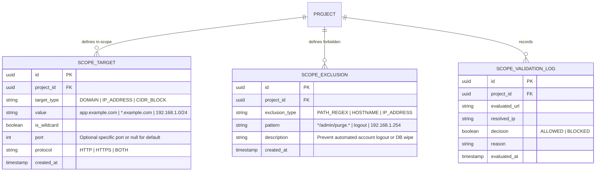
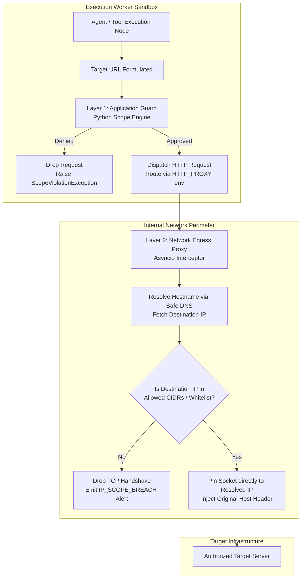
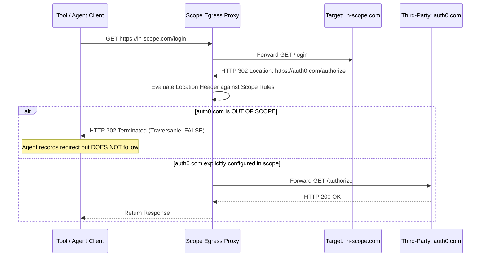

# Pentesa — Scope Enforcement Engine Specification

> **Document Identifier:** PENTESA-SCOPE-SPEC-V1.0  
> **Status:** Approved for Implementation  
> **Security Tier:** Critical (Zero Out-of-Scope Packets Mandate)  
> **Target Release:** v1.0  

---

## Table of Contents

1. [Scope Governance Philosophy & Non-Negotiables](#1-scope-governance-philosophy--non-negotiables)
2. [Comprehensive Scope Data Model](#2-comprehensive-scope-data-model)
3. [Dual-Layer Scope Enforcement Architecture](#3-dual-layer-scope-enforcement-architecture)
   - [3.1 Layer 1: Application-Level Request Interceptor](#31-layer-1-application-level-request-interceptor)
   - [3.2 Layer 2: Network-Level Egress Proxy with DNS Pinning](#32-layer-2-network-level-egress-proxy-with-dns-pinning)
4. [The Scope Validation Algorithm & Decision Flow](#4-the-scope-validation-algorithm--decision-flow)
5. [Redirect Chain Validation & Traversal Control](#5-redirect-chain-validation--traversal-control)
6. [Defense Against Adversarial Scope Bypasses & Edge Cases](#6-defense-against-adversarial-scope-bypasses--edge-cases)
   - [6.1 DNS Rebinding Attack Neutralization](#61-dns-rebinding-attack-neutralization)
   - [6.2 Shared IP Infrastructure, CDNs & Cloud Multi-Tenancy](#62-shared-ip-infrastructure-cdns--cloud-multi-tenancy)
   - [6.3 Dual-Stack IPv4 / IPv6 Resolution](#63-dual-stack-ipv4--ipv6-resolution)
   - [6.4 URL Normalization, Encoding & Path Traversal Bypasses](#64-url-normalization-encoding--path-traversal-bypasses)
7. [Dynamic Scope Change Management & Invalidation](#7-dynamic-scope-change-management--invalidation)
8. [Scope Validation Engine API & Internal Contracts](#8-scope-validation-engine-api--internal-contracts)

---

## 1. Scope Governance Philosophy & Non-Negotiables

In authorized penetration testing, **exceeding scope is a critical legal and ethical violation**. Sending test traffic or aggressive payloads to an unauthorized domain, shared third-party microservice, or external payment gateway creates legal liability, potential contract breach, and risk of disrupting production infrastructure.

**Pentesa enforces a zero-tolerance policy regarding scope violations:**
$$\text{Out-of-Scope Packets Transmitted} \equiv 0$$
- Application-level routing checks are necessary, but insufficient on their own (an attacker can spoof DNS or leverage DNS rebinding).
- Network-level firewalls alone are insufficient (they cannot parse URL paths or regex exclusions).
- **Pentesa mandates a Dual-Layer Architecture:** Every request is scrutinized by both the application-level pre-routing logic and an active, DNS-pinning egress proxy interceptor.

---

## 2. Comprehensive Scope Data Model

Every project maintains two distinct collections of scope rules: **Allowed Targets** and **Exclusions**.



---

## 3. Dual-Layer Scope Enforcement Architecture



### 3.1 Layer 1: Application-Level Request Interceptor
- **Mechanism:** Implemented as an asynchronous middleware hook (`ScopeEnforcer`) wrapping `httpx.AsyncClient` and Celery worker dispatchers.
- **Validations Performed:**
  1. **URL Scheme Check:** Ensures scheme is strictly `http` or `https` (rejects `file://`, `gopher://`, `ftp://`).
  2. **Hostname Matching:** Evaluates FQDN against explicit and wildcard targets.
  3. **Port Enforcement:** Verifies destination port matches project specifications (default: 80, 443, 8080, 8443).
  4. **Path Exclusion Matching:** Tests normalized path against compiled regular expressions (e.g., preventing crawls of `/logout` or destructive endpoints).

### 3.2 Layer 2: Network-Level Egress Proxy with DNS Pinning
- **Mechanism:** A lightweight, non-caching forward proxy embedded within the Docker network composition. All security tools (`nuclei`, `katana`, `ffuf`, `httpx`) are configured with `HTTP_PROXY=http://pentesa-egress-proxy:8080` and `HTTPS_PROXY=http://pentesa-egress-proxy:8080`.
- **Validations Performed:**
  1. Intercepts `CONNECT` requests for HTTPS and raw requests for HTTP.
  2. Independently resolves the requested domain using an isolated local resolver.
  3. Asserts the destination IP address against the project's authorized IP and CIDR table.
  4. **Socket Pinning:** Opens the TCP socket directly to the validated IP address, overriding operating system DNS resolution for that socket.

---

## 4. The Scope Validation Algorithm & Decision Flow

```mermaid
flowchart TD
    In([Candidate URL Input]) --> Parse[Parse URL Scheme, Host, Port, Path]
    
    Parse --> SchemeCheck{Scheme in ['http', 'https']?}
    SchemeCheck -- No --> DenyScheme[DENY: Invalid Protocol Scheme]
    
    SchemeCheck -- Yes --> HostExcl{Host in Excluded Hosts?}
    HostExcl -- Yes --> DenyHostExcl[DENY: Host explicitly excluded]
    
    HostExcl -- No --> PathExcl{Path matches Excluded Regex?}
    PathExcl -- Yes --> DenyPathExcl[DENY: Path matches exclusion regex]
    
    PathExcl -- No --> DomainMatch{Host matches Allowed Targets\nor Wildcards?}
    DomainMatch -- Yes --> ResolveDNS[Resolve Host to IP Address]
    DomainMatch -- No --> DenyDomain[DENY: Hostname not in scope targets]
    
    ResolveDNS --> DNSValid{DNS Resolution Succeeded?}
    DNSValid -- No --> DenyDNS[DENY: Unable to resolve hostname]
    
    DNSValid -- Yes --> IPExcl{Resolved IP in Excluded IPs?}
    IPExcl -- Yes --> DenyIPExcl[DENY: Resolved IP is explicitly excluded]
    
    IPExcl -- No --> PrivateCheck{Is IP Private / Loopback?}
    PrivateCheck -- Yes --> AllowPrivate{Project Scope explicitly\nallows Internal CIDR?}
    AllowPrivate -- No --> DenySSRF[DENY: Private IP Blocked (Anti-SSRF)]
    AllowPrivate -- Yes --> CheckTargetCIDR
    
    PrivateCheck -- No --> CheckTargetCIDR{IP falls within Allowed\nCIDRs or Host Target IPs?}
    CheckTargetCIDR -- Yes --> Allow[ALLOW: Request Validated & Scope Confirmed]
    CheckTargetCIDR -- No --> DenyCIDR[DENY: Destination IP outside allowed CIDR]
```

---

## 5. Redirect Chain Validation & Traversal Control

Redirects (`301 Moved Permanently`, `302 Found`, `307 Temporary Redirect`, `308 Permanent Redirect`) represent a common vector for inadvertent scope leakage. For example:
$$\text{https://in-scope.com/login} \xrightarrow{\text{302}} \text{https://auth0.thirdparty.com/authorize} \xrightarrow{\text{302}} \text{https://in-scope.com/callback}$$



### Redirect Traversal Rules
1. Automatic redirect following is disabled by default across all tool wrappers (`-follow-redirects=false`).
2. The agent inspects `Location` headers programmatically.
3. If an agent determines that following a redirect is required, it must submit the destination URL to `ScopeEnforcer.validate()` before requesting the next hop.

---

## 6. Defense Against Adversarial Scope Bypasses & Edge Cases

### 6.1 DNS Rebinding Attack Neutralization
- **Threat:** An attacker-controlled web server returns a low TTL (1 second) DNS response pointing to an authorized target IP initially, then quickly flips the domain to resolve to an internal infrastructure IP (`169.254.169.254` or `127.0.0.1`).
- **Mitigation:** **DNS Pinning.** The egress proxy performs resolution once, validates the IP against the whitelist, and explicitly opens the TCP socket to that specific IP string (e.g. `connect("192.168.1.10", 443)`). The original hostname is passed solely in the HTTP `Host` header and TLS SNI (Server Name Indication).

### 6.2 Shared IP Infrastructure, CDNs & Cloud Multi-Tenancy
- **Threat:** Multiple organizations share Cloudflare, Akamai, or AWS CloudFront IP addresses. Whitelisting a Cloudflare IP range (`104.16.0.0/12`) could permit connections to unrelated third-party websites hosted on the same CDN.
- **Mitigation:** **Dual Hostname + IP Conjunction.** For cloud CDN targets, both criteria must be satisfied simultaneously:
  $$\text{Allowed} \iff (\text{Hostname} \in \text{AllowedDomains}) \land (\text{ResolvedIP} \in \text{CDN\_CIDR})$$

### 6.3 Dual-Stack IPv4 / IPv6 Resolution
- **Rule:** If a target resolves to both `A` (IPv4) and `AAAA` (IPv6) records, both addresses are validated against scope rules. If IPv6 is not explicitly included in the project scope, the system forces IPv4 socket resolution.

### 6.4 URL Normalization, Encoding & Path Traversal Bypasses
- **Threat:** URL path obfuscation (e.g., `/admin/..%2f..%2fdelete`, `//admin/purge`, `%2e%2e/billing`) intended to bypass path regex filters.
- **Mitigation:** All URLs undergo full RFC 3986 normalization:
  - Canonical decoding of multi-byte hex representations.
  - Resolving relative dot-segments (`.` and `..`).
  - Stripping double slashes (`//` $\to$ `/`).
  - Normalizing lowercase schemes and hostnames.

---

## 7. Dynamic Scope Change Management & Invalidation

If an operator adds or removes targets during an active penetration test:
1. **Immediate Task Pausing:** Celery workers receive an administrative pause signal.
2. **Cache Eviction:** Redis scope resolution caches and DNS lookup tables are flushed instantly.
3. **Inventory Re-Validation:** All previously discovered endpoints in `endpoints` table are re-evaluated against the new scope rules. Any endpoints now outside scope are marked `Status: Scope_Invalidated`.
4. **Audit Log Recording:** An entry is written to `audit_logs` capturing: user who changed scope, timestamp, old scope snapshot, and new scope snapshot.

---

## 8. Scope Validation Engine API & Internal Contracts

### 8.1 Scope Evaluation API Endpoint
`POST /api/v1/projects/{project_id}/scope/validate`

#### Request Schema:
```json
{
  "urls": [
    "https://app.example.com/api/v1/users",
    "https://payment.stripe.com/checkout",
    "https://app.example.com/admin/delete"
  ]
}
```

#### Response Schema:
```json
{
  "project_id": "9b1deb4d-3b7d-4bad-9bdd-2b0d7b3dcb6d",
  "evaluated_at": "2026-11-03T16:05:00Z",
  "results": [
    {
      "url": "https://app.example.com/api/v1/users",
      "allowed": true,
      "resolved_ip": "192.168.1.10",
      "reason": "Matches wildcard target *.example.com"
    },
    {
      "url": "https://payment.stripe.com/checkout",
      "allowed": false,
      "resolved_ip": "54.187.205.23",
      "reason": "Host payment.stripe.com not in approved project scope"
    },
    {
      "url": "https://app.example.com/admin/delete",
      "allowed": false,
      "resolved_ip": "192.168.1.10",
      "reason": "Path matches exclusion regex: ^/admin/delete.*"
    }
  ]
}
```

### 8.2 Internal Python Interface Contract
```python
class ScopeEnforcer:
    async def is_url_allowed(self, project_id: UUID, url: str) -> Tuple[bool, str]:
        """
        Returns (True, "Allowed") if the destination passes all Layer 1 and Layer 2 checks.
        Returns (False, reason) if rejected.
        """
        ...
```
