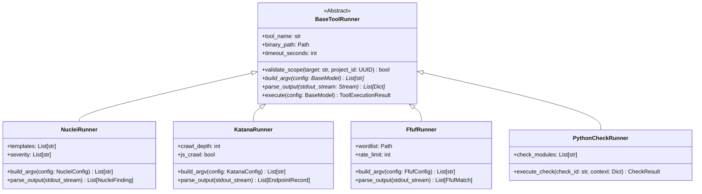
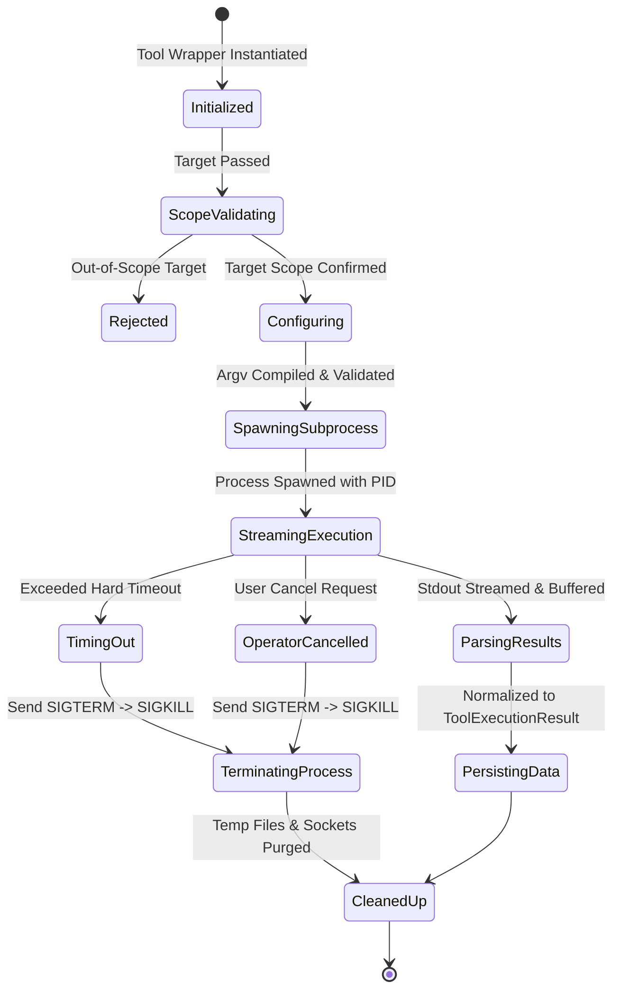

# Pentesa — Security Tool Integration Specifications

> **Document Identifier:** PENTESA-TOOL-INT-V1.0  
> **Status:** Approved for Implementation  
> **Execution Model:** Deterministic Sandboxed Subprocesses (Zero LLM Shell Execution)  
> **Target Release:** v1.0  

---

## Table of Contents

1. [Tool Integration Architecture & Design Principles](#1-tool-integration-architecture--design-principles)
2. [Tool Lifecycle State Machine](#2-tool-lifecycle-state-machine)
3. [Execution Security & Subprocess Sandboxing](#3-execution-security--subprocess-sandboxing)
4. [Unified Tool Execution Result Schema](#4-unified-tool-execution-result-schema)
5. [Granular Tool Specifications](#5-granular-tool-specifications)
   - [5.1 Nuclei (Known CVEs & Misconfiguration Scanner)](#51-nuclei-known-cves--misconfiguration-scanner)
   - [5.2 Katana (Next-Generation Web Crawler & Spider)](#52-katana-next-generation-web-crawler--spider)
   - [5.3 Subfinder (Passive Subdomain Enumerator)](#53-subfinder-passive-subdomain-enumerator)
   - [5.4 Httpx (Fast Multi-Purpose HTTP Prober)](#54-httpx-fast-multi-purpose-http-prober)
   - [5.5 Ffuf (Fast Web Fuzzer)](#55-ffuf-fast-web-fuzzer)
   - [5.6 Custom Python Security Check Engine](#56-custom-python-security-check-engine)
   - [5.7 SSL/TLS Configuration Analyzer](#57-ssltls-configuration-analyzer)
   - [5.8 HTTP Security Header Analyzer](#58-http-security-header-analyzer)
6. [Cross-Tool Orchestration: Rate Limiting & Concurrency Controls](#6-cross-tool-orchestration-rate-limiting--concurrency-controls)
7. [Process Cancellation & Resource Cleanup](#7-process-cancellation--resource-cleanup)

---

## 1. Tool Integration Architecture & Design Principles

Pentesa integrates industry-standard offensive security tools to perform active reconnaissance and vulnerability detection. To guarantee stability, security, and reproducibility, the tool integration layer adheres to strict architectural principles:

1. **Zero Shell Command Interpolation:** All binaries are invoked via Python's `asyncio.create_subprocess_exec` passing strongly-typed argument arrays (`argv: List[str]`). Shell strings (`sh -c`, `bash`, `cmd.exe`) and `shell=True` are strictly prohibited.
2. **Scope-Aware Execution Wrappers:** No tool wrapper spawns a process without first validating target arguments against the project's authorized scope.
3. **Structured Streaming Output:** Tool outputs are parsed as line-delimited JSON streams (`JSONL`), preventing massive in-memory buffering and enabling real-time UI log streaming.
4. **Normalized Output Schema:** Heterogeneous tool outputs are transformed into a unified `ToolExecutionResult` schema before persisting to the database or passing to AI agents.



---

## 2. Tool Lifecycle State Machine



---

## 3. Execution Security & Subprocess Sandboxing

All CLI tool subprocesses execute within the worker container under strict sandboxing controls:

1. **Non-Root Execution:** Tools run under an unprivileged system user (`pentesa_worker`, UID 1001).
2. **Read-Only Root Filesystem:** Subprocesses write only to dedicated temporary scratch directories (`/tmp/pentesa/runs/{execution_id}`) mounted with `noexec` flags.
3. **Memory & CPU Limits:** Subprocesses are constrained using Linux cgroups (configurable max memory: 1024MB per process).
4. **Zero-Leakage Environment Sanitization:** Environment variables are strictly constructed from an allowlist. Platform secrets (`PENTESA_MASTER_KEY`, `POSTGRES_PASSWORD`, `JWT_SECRET_KEY`, database URLs) are completely excluded:
   ```python
   # Explicit allowlist environment construction
   clean_env = {
       "PATH": os.environ.get("PATH", "/usr/local/bin:/usr/bin:/bin"),
       "HOME": f"/tmp/pentesa/runs/{execution_id}",
       "HTTP_PROXY": "http://pentesa-egress-proxy:8080",
       "HTTPS_PROXY": "http://pentesa-egress-proxy:8080",
       "NO_PROXY": "localhost,127.0.0.1,pentesa-callback-sink",
       "TMPDIR": f"/tmp/pentesa/runs/{execution_id}"
   }
   ```
5. **Output Buffer Caps:** Stdout/stderr streams are limited to a maximum of 100MB per execution to prevent disk and memory exhaustion attacks.
6. **Local Out-of-Band (OAST) Callback Sink:** For blind SSRF and blind injection testing, instead of relying on external third-party services (`interact.sh`), Pentesa provisions a dedicated local container (`pentesa-callback-sink`). The sink captures HTTP and DNS interaction callbacks locally, correlates the unique payload token with the test execution, and reports confirmed blind vulnerabilities without data leakage.

---

## 4. Unified Tool Execution Result Schema

```json
{
  "$schema": "http://json-schema.org/draft-07/schema#",
  "title": "ToolExecutionResult",
  "type": "object",
  "required": [
    "execution_id", "project_id", "tool_name", "status", 
    "target_url", "start_time", "end_time", "exit_code", "findings_count"
  ],
  "properties": {
    "execution_id": { "type": "string", "format": "uuid" },
    "project_id": { "type": "string", "format": "uuid" },
    "tool_name": { "type": "string", "enum": ["nuclei", "katana", "subfinder", "httpx", "ffuf", "python_check", "ssl_analyzer", "header_analyzer"] },
    "status": { "type": "string", "enum": ["SUCCESS", "FAILED", "TIMEOUT", "CANCELLED", "SCOPE_REJECTED"] },
    "target_url": { "type": "string", "format": "uri" },
    "argv": { "type": "array", "items": { "type": "string" } },
    "start_time": { "type": "string", "format": "date-time" },
    "end_time": { "type": "string", "format": "date-time" },
    "duration_ms": { "type": "integer" },
    "exit_code": { "type": "integer" },
    "stdout_summary": { "type": "string" },
    "stderr_summary": { "type": "string" },
    "findings_count": { "type": "integer" },
    "raw_artifacts_path": { "type": "string" },
    "parsed_findings": { "type": "array", "items": { "type": "object" } }
  }
}
```

---

## 5. Granular Tool Specifications

---

### 5.1 Nuclei (Known CVEs & Misconfiguration Scanner)
- **Role:** Fast template-based vulnerability scanner for known CVEs, outdated components, exposed admin dashboards, and cloud storage misconfigurations.
- **Input Parameters:**
  ```python
  class NucleiConfig(BaseModel):
      project_id: UUID
      target_url: HttpUrl
      template_tags: List[str] = ["cve", "misconfig", "exposure", "panel"]
      severity: List[str] = ["medium", "high", "critical"]
      rate_limit: int = 20
      timeout_seconds: int = 300
      custom_headers: Optional[Dict[str, str]] = None
  ```
- **Constructed Command Line (Safe Argv):**
  ```bash
  nuclei \
    -target https://app.example.com \
    -tags cve,misconfig,exposure \
    -severity medium,high,critical \
    -rate-limit 20 \
    -timeout 5 \
    -jsonl \
    -no-interactsh \
    -stats-interval 10 \
    -proxy http://pentesa-egress-proxy:8080
  ```
- **Output Parsing:** Parses line-delimited JSON stream into individual finding objects containing: `template-id`, `name`, `severity`, `matched-at`, `curl-command`, `extracted-results`, `request`, and `response`.

---

### 5.2 Katana (Next-Generation Web Crawler & Spider)
- **Role:** Scope-constrained web crawler to discover endpoints, query parameters, HTML forms, and API routes.
- **Input Parameters:**
  ```python
  class KatanaConfig(BaseModel):
      project_id: UUID
      seed_urls: List[HttpUrl]
      crawl_depth: int = Field(default=3, le=5)
      crawl_duration_minutes: int = Field(default=10, le=30)
      headless: bool = False
      rate_limit: int = 15
  ```
- **Constructed Command Line (Safe Argv):**
  ```bash
  katana \
    -u https://app.example.com \
    -depth 3 \
    -crawl-duration 10m \
    -rate-limit 15 \
    -jsonl \
    -proxy http://pentesa-egress-proxy:8080 \
    -extension-filter png,jpg,jpeg,gif,svg,css,woff,woff2
  ```
- **Output Parsing:** Extracts discovered URLs, HTTP methods, and parameter names. Normalizes endpoints and writes to the `endpoints` inventory.

---

### 5.3 Subfinder (Passive Subdomain Enumerator)
- **Role:** Passive OSINT discovery of subdomains via Certificate Transparency logs and search engines without sending packets to target infrastructure.
- **Input Parameters:**
  ```python
  class SubfinderConfig(BaseModel):
      project_id: UUID
      domain: str
      timeout_seconds: int = 120
  ```
- **Constructed Command Line (Safe Argv):**
  ```bash
  subfinder \
    -d example.com \
    -json \
    -silent \
    -timeout 10
  ```
- **Output Parsing:** Reads JSON objects containing `host` and `source`. Validates every found subdomain against AGT-02 before writing to `discovered_domains`.

---

### 5.4 Httpx (Fast Multi-Purpose HTTP Prober)
- **Role:** Probes active HTTP/HTTPS services, extracts technology fingerprints, validates status codes, inspects SSL/TLS certificates, and checks response headers.
- **Input Parameters:**
  ```python
  class HttpxConfig(BaseModel):
      project_id: UUID
      targets: List[str]
      title: bool = True
      tech_detect: bool = True
      status_code: bool = True
      rate_limit: int = 25
  ```
- **Constructed Command Line (Safe Argv):**
  ```bash
  httpx \
    -l /tmp/pentesa/targets.txt \
    -title \
    -tech-detect \
    -status-code \
    -json \
    -rate-limit 25 \
    -proxy http://pentesa-egress-proxy:8080
  ```
- **Output Parsing:** Ingests technologies (e.g. `["Express", "React", "Nginx"]`), response times, and web server banners into project metadata.

---

### 5.5 Ffuf (Fast Web Fuzzer)
- **Role:** Performs controlled path discovery and parameter fuzzing using rate-limited, curated wordlists.
- **Input Parameters:**
  ```python
  class FfufConfig(BaseModel):
      project_id: UUID
      url_template: str  # e.g. "https://app.example.com/FUZZ"
      wordlist_path: Path
      rate_limit: int = Field(default=20, le=50)
      filter_status: List[int] = [404]
      timeout_seconds: int = 180
  ```
- **Constructed Command Line (Safe Argv):**
  ```bash
  ffuf \
    -u https://app.example.com/FUZZ \
    -w /app/wordlists/common_paths.txt \
    -rate 20 \
    -fc 404 \
    -o /tmp/pentesa/ffuf_out.json \
    -of json \
    -x http://pentesa-egress-proxy:8080
  ```
- **Output Parsing:** Normalizes discovered paths with `HTTP 200`, `HTTP 403`, or `HTTP 301` into candidate endpoints.

---

### 5.6 Custom Python Security Check Engine
- **Role:** Runs extensible, native Python security checks for complex assessment logic not cleanly covered by external CLI tools.
- **Included Check Modules:**
  1. `Check_CORS_Misconfiguration`: Tests arbitrary `Origin` reflection with credentials.
  2. `Check_JWT_Algorithm_Confusion`: Tests changing `RS256` to `HS256` using the server's public key.
  3. `Check_Cookie_Security_Attributes`: Verifies `HttpOnly`, `Secure`, and `SameSite` flags.
  4. `Check_Open_Redirect`: Tests URL parameters against out-of-scope redirection bypasses.
- **Architecture:** Check modules inherit from `BasePythonCheck` and yield `CheckFinding` objects with raw HTTP requests and responses.

---

### 5.7 SSL/TLS Configuration Analyzer
- **Role:** Evaluates transport layer security posture against WSTG-CRYP-01.
- **Capabilities:**
  - Enumerates supported TLS versions (`TLSv1.0`, `TLSv1.1`, `TLSv1.2`, `TLSv1.3`).
  - Detects deprecated ciphers (RC4, 3DES, CBC-mode ciphers).
  - Validates certificate trust chain, expiration date, and SAN (Subject Alternative Name).
  - Flags weak configurations as medium/low severity findings.

---

### 5.8 HTTP Security Header Analyzer
- **Role:** Evaluates defensive security headers across discovered endpoints (WSTG-CONF-07).
- **Inspected Headers:**
  - `Content-Security-Policy` (checks for `unsafe-inline`, missing `default-src`).
  - `Strict-Transport-Security` (checks `max-age` $\ge 31536000$ and `includeSubDomains`).
  - `X-Frame-Options` (checks for `DENY` or `SAMEORIGIN`).
  - `X-Content-Type-Options` (checks for `nosniff`).
  - `Referrer-Policy` (checks for leak-resistant policies).

---

## 6. Cross-Tool Orchestration: Rate Limiting & Concurrency Controls

To protect target systems from resource exhaustion:
1. **Global Target Rate Limiter:** Built on Redis Token Bucket algorithm. Regardless of whether 1 or 5 tools are executing simultaneously, total requests dispatched to `target.com` cannot exceed the project's configured RPS (default: 20 RPS).
2. **Circuit Breaker:** If target error responses (`HTTP 500`, `502`, `503`, `504`) or network timeouts exceed 15% over any 30-second window, the orchestrator:
   - Immediately throttles tool rates by 50%.
   - Pauses execution and alerts the operator if error rates persist.

---

## 7. Process Cancellation & Resource Cleanup

If an operator halts a scan or a tool exceeds its execution deadline:
```python
async def cancel_subprocess(proc: asyncio.subprocess.Process, timeout: int = 5):
    try:
        proc.terminate() # SIGTERM
        await asyncio.wait_for(proc.wait(), timeout=timeout)
    except asyncio.TimeoutError:
        proc.kill()      # SIGKILL
        await proc.wait()
```
- **Cleanup Guarantee:** All temporary files, wordlist extracts, and socket buffers are deleted automatically in an asynchronous `finally` block.

