# Pentesa — Database Schema & Data Architecture Document

> **Document Identifier:** PENTESA-DB-DESIGN-V1.0  
> **Status:** Approved for Implementation  
> **Engine:** PostgreSQL 16 (with `pgcrypto` & `uuid-ossp`)  
> **ORM / Migrations:** SQLAlchemy 2.0 (Async) + Alembic  
> **Target Release:** v1.0  

---

## Table of Contents

1. [Database Architectural Principles](#1-database-architectural-principles)
2. [Global Entity-Relationship Diagram (ERD)](#2-global-entity-relationship-diagram-erd)
3. [Comprehensive Table Specifications (33 Tables)](#3-comprehensive-table-specifications-33-tables)
   - [3.1 Core Identity & Project Tables (1 to 4)](#31-core-identity--project-tables-1-to-4)
   - [3.2 Scope Governance Tables (5 to 8)](#32-scope-governance-tables-5-to-8)
   - [3.3 Attack Surface & Discovery Tables (9 to 13)](#33-attack-surface--discovery-tables-9-to-13)
   - [3.4 OWASP WSTG Testing Tables (14 to 17)](#34-owasp-wstg-testing-tables-14-to-17)
   - [3.5 Findings & Evidence Management Tables (18 to 22)](#35-findings--evidence-management-tables-18-to-22)
   - [3.6 Tool Integration Tables (23 to 24)](#36-tool-integration-tables-23-to-24)
   - [3.7 AI Agent Observability Tables (25 to 27)](#37-ai-agent-observability-tables-25-to-27)
   - [3.8 Reporting Subsystem Tables (28 to 29)](#38-reporting-subsystem-tables-28-to-29)
   - [3.9 Target Authentication & Credential Vault (30 to 31)](#39-target-authentication--credential-vault-30-to-31)
   - [3.10 Scan Scheduling & Jobs (32 to 33)](#310-scan-scheduling--jobs-32-to-33)
4. [Indexing & Query Optimization Strategy](#4-indexing--query-optimization-strategy)
5. [Data Integrity, Cascade Rules & Constraints](#5-data-integrity-cascade-rules--constraints)
6. [Data Retention, Sanitization & Purge Policies](#6-data-retention-sanitization--purge-policies)
7. [Alembic Migration Architecture & Evolution](#7-alembic-migration-architecture--evolution)

---

## 1. Database Architectural Principles

Pentesa uses **PostgreSQL 16** as its single source of truth. The schema combines relational rigor (strict foreign keys, enum constraints, cascade rules) with unstructured flexibility via native `JSONB` columns for dynamic parameter schemas and tool outputs.

### Core Database Guidelines
1. **UUID Primary Keys:** All primary identifiers are generated via `uuid_generate_v4()` to eliminate enumeration risks and facilitate distributed data merging.
2. **Encrypted Columns:** Target credentials (passwords, JWT tokens, cookies) are encrypted at rest using AES-256-GCM prior to SQL persistence.
3. **Immutable Audit Ledger:** The `audit_logs` table is append-only; update and delete operations are rejected via SQL triggers.
4. **Relational Traceability:** A verified finding must trace back to the exact test execution, tool run, and raw network evidence that discovered it.

---

## 2. Global Entity-Relationship Diagram (ERD)

```mermaid
erDiagram
    USERS ||--o{ PROJECTS : "creates"
    USERS ||--o{ PROJECT_MEMBERS : "participates"
    PROJECTS ||--o{ PROJECT_MEMBERS : "has"
    PROJECTS ||--o{ AUDIT_LOGS : "logs"
    
    PROJECTS ||--o{ SCOPE_TARGETS : "bounds"
    PROJECTS ||--o{ SCOPE_EXCLUSIONS : "excludes"
    PROJECTS ||--o{ SCOPE_VALIDATIONS : "verifies"
    PROJECTS ||--o{ SCOPE_CHANGES : "tracks"
    
    PROJECTS ||--o{ DISCOVERED_DOMAINS : "enumerates"
    PROJECTS ||--o{ ENDPOINTS : "catalogs"
    ENDPOINTS ||--o{ TECHNOLOGIES : "utilizes"
    ENDPOINTS ||--o{ COOKIES : "sets"
    ENDPOINTS ||--o{ HEADERS : "exposes"
    
    WSTG_CATALOG ||--o{ WSTG_INSTANCES : "instantiates"
    PROJECTS ||--o{ WSTG_INSTANCES : "tracks"
    WSTG_INSTANCES ||--o{ TEST_EXECUTIONS : "runs"
    TEST_EXECUTIONS ||--o{ TEST_EXECUTION_LOGS : "streams"
    
    PROJECTS ||--o{ FINDINGS : "contains"
    ENDPOINTS ||--o{ FINDINGS : "affected_by"
    FINDINGS ||--o{ FINDING_EVIDENCE : "evidenced_by"
    FINDINGS ||--o{ FINDING_REPRODUCTIONS : "reproduced_by"
    FINDINGS ||--o{ FINDING_STATUS_HISTORY : "transitions"
    FINDINGS ||--o{ FALSE_POSITIVES : "refuted_as"
    
    PROJECTS ||--o{ TOOL_CONFIGURATIONS : "configures"
    PROJECTS ||--o{ TOOL_EXECUTIONS : "executes"
    
    PROJECTS ||--o{ AGENT_EXECUTIONS : "spawns"
    AGENT_EXECUTIONS ||--o{ AGENT_DECISIONS : "reasons"
    AGENT_EXECUTIONS ||--o{ AGENT_TOOL_CALLS : "invokes"
    
    PROJECTS ||--o{ REPORTS : "publishes"
    REPORT_TEMPLATES ||--o{ REPORTS : "formats"
    
    PROJECTS ||--o{ AUTH_PROFILES : "authenticates"
    AUTH_PROFILES ||--o{ TEST_CREDENTIALS : "contains"
    
    PROJECTS ||--o{ SCAN_SCHEDULES : "schedules"
    SCAN_SCHEDULES ||--o{ SCAN_JOBS : "dispatches"
```

---

## 3. Comprehensive Table Specifications (33 Tables)

---

### 3.1 Core Identity & Project Tables (1 to 4)

#### Table 1: `users`
Represents local platform operators and administrators.
- `id` (UUID, PK, default: `uuid_generate_v4()`)
- `email` (VARCHAR(255), UNIQUE, NOT NULL)
- `password_hash` (VARCHAR(255), NOT NULL) — bcrypt work factor 12
- `full_name` (VARCHAR(150), NOT NULL)
- `role` (VARCHAR(50), NOT NULL) — `Admin`, `Lead_Tester`, `Tester`, `Viewer`
- `is_active` (BOOLEAN, default: TRUE)
- `created_at` (TIMESTAMPTZ, default: `clock_timestamp()`)
- `updated_at` (TIMESTAMPTZ, default: `clock_timestamp()`)

#### Table 2: `projects`
Penetration testing engagement containers.
- `id` (UUID, PK)
- `name` (VARCHAR(200), NOT NULL)
- `description` (TEXT)
- `client_name` (VARCHAR(200), NOT NULL)
- `created_by` (UUID, FK $\to$ `users.id`, ON DELETE RESTRICT)
- `auth_signer_name` (VARCHAR(150), NOT NULL)
- `auth_signer_email` (VARCHAR(255), NOT NULL)
- `auth_start_date` (TIMESTAMPTZ, NOT NULL)
- `auth_end_date` (TIMESTAMPTZ, NOT NULL)
- `status` (VARCHAR(50), NOT NULL) — `Draft`, `Authorized`, `Active`, `Paused`, `Completed`, `Archived`
- `max_rps` (INT, default: 20)
- `created_at` (TIMESTAMPTZ, default: `clock_timestamp()`)

#### Table 3: `project_members`
User associations to individual pentest projects.
- `id` (UUID, PK)
- `project_id` (UUID, FK $\to$ `projects.id`, ON DELETE CASCADE)
- `user_id` (UUID, FK $\to$ `users.id`, ON DELETE CASCADE)
- `role_in_project` (VARCHAR(50), NOT NULL) — `Lead`, `Analyst`, `Observer`
- `assigned_at` (TIMESTAMPTZ, default: `clock_timestamp()`)
- *Unique Constraint:* `(project_id, user_id)`

#### Table 4: `audit_logs`
Immutable tamper-evident ledger of all system actions.
- `id` (UUID, PK)
- `project_id` (UUID, FK $\to$ `projects.id`, ON DELETE SET NULL, NULLABLE)
- `user_id` (UUID, FK $\to$ `users.id`, ON DELETE SET NULL, NULLABLE)
- `action` (VARCHAR(100), NOT NULL) — e.g. `SCOPE_CREATED`, `SCAN_STARTED`, `FINDING_CONFIRMED`
- `resource_type` (VARCHAR(50), NOT NULL) — e.g. `Project`, `ScopeTarget`, `Finding`
- `resource_id` (VARCHAR(100))
- `details_json` (JSONB, NOT NULL)
- `ip_address` (INET)
- `user_agent` (VARCHAR(255))
- `created_at` (TIMESTAMPTZ, default: `clock_timestamp()`)

---

### 3.2 Scope Governance Tables (5 to 8)

#### Table 5: `scope_targets`
Authorized domains, wildcards, and CIDRs.
- `id` (UUID, PK)
- `project_id` (UUID, FK $\to$ `projects.id`, ON DELETE CASCADE)
- `target_type` (VARCHAR(50), NOT NULL) — `DOMAIN`, `WILDCARD`, `IP_ADDRESS`, `CIDR`
- `value` (VARCHAR(255), NOT NULL) — e.g. `*.example.com`, `192.168.1.0/24`
- `port` (INT, NULLABLE)
- `protocol` (VARCHAR(20), default: `BOTH`) — `HTTP`, `HTTPS`, `BOTH`
- `created_at` (TIMESTAMPTZ, default: `clock_timestamp()`)

#### Table 6: `scope_exclusions`
Forbidden endpoints, paths, and hosts.
- `id` (UUID, PK)
- `project_id` (UUID, FK $\to$ `projects.id`, ON DELETE CASCADE)
- `exclusion_type` (VARCHAR(50), NOT NULL) — `PATH_REGEX`, `HOSTNAME`, `IP_ADDRESS`
- `pattern` (VARCHAR(500), NOT NULL) — e.g. `^/admin/purge.*`
- `description` (TEXT)
- `created_at` (TIMESTAMPTZ, default: `clock_timestamp()`)

#### Table 7: `scope_validations`
Validation event history for every destination checked.
- `id` (UUID, PK)
- `project_id` (UUID, FK $\to$ `projects.id`, ON DELETE CASCADE)
- `evaluated_url` (TEXT, NOT NULL)
- `resolved_ip` (INET)
- `is_allowed` (BOOLEAN, NOT NULL)
- `rejection_reason` (TEXT)
- `created_at` (TIMESTAMPTZ, default: `clock_timestamp()`)

#### Table 8: `scope_changes`
Audit trail of scope revisions over time.
- `id` (UUID, PK)
- `project_id` (UUID, FK $\to$ `projects.id`, ON DELETE CASCADE)
- `modified_by` (UUID, FK $\to$ `users.id`)
- `old_state_json` (JSONB, NOT NULL)
- `new_state_json` (JSONB, NOT NULL)
- `change_summary` (TEXT, NOT NULL)
- `created_at` (TIMESTAMPTZ, default: `clock_timestamp()`)

---

### 3.3 Attack Surface & Discovery Tables (9 to 13)

#### Table 9: `discovered_domains`
Enumerated hostnames and subdomains.
- `id` (UUID, PK)
- `project_id` (UUID, FK $\to$ `projects.id`, ON DELETE CASCADE)
- `fqdn` (VARCHAR(255), NOT NULL)
- `resolved_ips` (JSONB) — array of IPv4/IPv6 strings
- `discovery_source` (VARCHAR(50), NOT NULL) — `subfinder`, `tls_san`, `crawler`
- `is_active` (BOOLEAN, default: TRUE)
- `created_at` (TIMESTAMPTZ, default: `clock_timestamp()`)
- *Unique Constraint:* `(project_id, fqdn)`

#### Table 10: `endpoints`
The centralized endpoint inventory.
- `id` (UUID, PK)
- `project_id` (UUID, FK $\to$ `projects.id`, ON DELETE CASCADE)
- `domain_id` (UUID, FK $\to$ `discovered_domains.id`, ON DELETE SET NULL, NULLABLE)
- `url_path` (TEXT, NOT NULL) — e.g. `/api/v1/users/{id}`
- `http_method` (VARCHAR(10), NOT NULL) — `GET`, `POST`, `PUT`, `DELETE`, `PATCH`
- `parameter_schema` (JSONB) — structured list of query/body/header parameters
- `content_type` (VARCHAR(100))
- `auth_required` (BOOLEAN, default: FALSE)
- `discovery_source` (VARCHAR(50), NOT NULL)
- `testing_status` (VARCHAR(50), default: `Discovered`) — `Discovered`, `Testing`, `Tested`
- `created_at` (TIMESTAMPTZ, default: `clock_timestamp()`)
- *Unique Constraint:* `(project_id, url_path, http_method)`

#### Table 11: `technologies`
Discovered framework and software stacks.
- `id` (UUID, PK)
- `project_id` (UUID, FK $\to$ `projects.id`, ON DELETE CASCADE)
- `name` (VARCHAR(100), NOT NULL) — e.g. `React`, `Express`, `PostgreSQL`
- `version` (VARCHAR(50))
- `confidence` (INT) — 1 to 100
- `detected_on_url` (TEXT)
- `created_at` (TIMESTAMPTZ, default: `clock_timestamp()`)

#### Table 12: `cookies`
Discovered cookies and security attributes.
- `id` (UUID, PK)
- `project_id` (UUID, FK $\to$ `projects.id`, ON DELETE CASCADE)
- `name` (VARCHAR(255), NOT NULL)
- `domain` (VARCHAR(255), NOT NULL)
- `path` (VARCHAR(255), NOT NULL)
- `is_secure` (BOOLEAN, NOT NULL)
- `is_httponly` (BOOLEAN, NOT NULL)
- `samesite` (VARCHAR(20)) — `Strict`, `Lax`, `None`
- `created_at` (TIMESTAMPTZ, default: `clock_timestamp()`)

#### Table 13: `headers`
Observed HTTP response security headers.
- `id` (UUID, PK)
- `project_id` (UUID, FK $\to$ `projects.id`, ON DELETE CASCADE)
- `endpoint_id` (UUID, FK $\to$ `endpoints.id`, ON DELETE CASCADE)
- `header_name` (VARCHAR(100), NOT NULL)
- `header_value` (TEXT, NOT NULL)
- `is_secure_standard` (BOOLEAN)
- `created_at` (TIMESTAMPTZ, default: `clock_timestamp()`)

---

### 3.4 OWASP WSTG Testing Tables (14 to 17)

#### Table 14: `wstg_test_catalog`
Master reference catalog of all OWASP WSTG v4.2 tests.
- `id` (VARCHAR(50), PK) — e.g. `WSTG-INPV-05`
- `category` (VARCHAR(50), NOT NULL) — e.g. `Input Validation`
- `name` (VARCHAR(200), NOT NULL)
- `description` (TEXT, NOT NULL)
- `automation_capability` (VARCHAR(20), NOT NULL) — `Full`, `Partial`, `Manual`
- `default_risk` (VARCHAR(20), NOT NULL) — `Critical`, `High`, `Medium`, `Low`, `Info`
- `cwe_id` (VARCHAR(20))

#### Table 15: `wstg_test_instances`
Project-specific instantiation of WSTG test cases.
- `id` (UUID, PK)
- `project_id` (UUID, FK $\to$ `projects.id`, ON DELETE CASCADE)
- `wstg_id` (VARCHAR(50), FK $\to$ `wstg_test_catalog.id`)
- `status` (VARCHAR(50), NOT NULL, default: `Not Started`) — `Not Started`, `Planned`, `Running`, `Passed`, `Failed`, `Needs Manual Review`, `Not Applicable`, `Blocked`, `Error`
- `notes` (TEXT)
- `updated_at` (TIMESTAMPTZ, default: `clock_timestamp()`)
- *Unique Constraint:* `(project_id, wstg_id)`

#### Table 16: `test_executions`
Individual automated execution runs.
- `id` (UUID, PK)
- `project_id` (UUID, FK $\to$ `projects.id`, ON DELETE CASCADE)
- `wstg_instance_id` (UUID, FK $\to$ `wstg_test_instances.id`, ON DELETE CASCADE)
- `endpoint_id` (UUID, FK $\to$ `endpoints.id`, ON DELETE CASCADE)
- `status` (VARCHAR(50), NOT NULL)
- `start_time` (TIMESTAMPTZ, default: `clock_timestamp()`)
- `end_time` (TIMESTAMPTZ)
- `exit_code` (INT)

#### Table 17: `test_execution_logs`
Streaming execution output and debugging lines.
- `id` (BIGSERIAL, PK)
- `execution_id` (UUID, FK $\to$ `test_executions.id`, ON DELETE CASCADE)
- `log_level` (VARCHAR(20), default: `INFO`)
- `message` (TEXT, NOT NULL)
- `created_at` (TIMESTAMPTZ, default: `clock_timestamp()`)

---

### 3.5 Findings & Evidence Management Tables (18 to 22)

#### Table 18: `findings`
Confirmed and candidate security vulnerabilities.
- `id` (UUID, PK)
- `project_id` (UUID, FK $\to$ `projects.id`, ON DELETE CASCADE)
- `endpoint_id` (UUID, FK $\to$ `endpoints.id`, ON DELETE CASCADE)
- `wstg_id` (VARCHAR(50), FK $\to$ `wstg_test_catalog.id`)
- `title` (VARCHAR(255), NOT NULL)
- `description` (TEXT, NOT NULL)
- `severity` (VARCHAR(20), NOT NULL) — `Critical`, `High`, `Medium`, `Low`, `Informational`
- `cvss_score` (NUMERIC(3, 1))
- `cvss_vector` (VARCHAR(150))
- `cwe_id` (VARCHAR(20))
- `owasp_category` (VARCHAR(50))
- `affected_parameter` (VARCHAR(150))
- `detection_source` (VARCHAR(50), NOT NULL)
- `status` (VARCHAR(50), NOT NULL, default: `Detected`) — `Detected`, `Triaged`, `Validating`, `Confirmed`, `False Positive`, `Needs Manual Review`, `Remediated`, `Retested`, `Accepted Risk`
- `confidence` (VARCHAR(20), NOT NULL) — `Confirmed`, `High`, `Medium`, `Low`
- `remediation_guidance` (TEXT)
- `created_at` (TIMESTAMPTZ, default: `clock_timestamp()`)
- `updated_at` (TIMESTAMPTZ, default: `clock_timestamp()`)

#### Table 19: `finding_evidence`
Forensic raw HTTP and screenshot artifacts.
- `id` (UUID, PK)
- `finding_id` (UUID, FK $\to$ `findings.id`, ON DELETE CASCADE)
- `raw_request` (TEXT, NOT NULL) — with sensitive tokens redacted
- `raw_response` (TEXT, NOT NULL)
- `reproduction_curl` (TEXT, NOT NULL)
- `request_hash_sha256` (VARCHAR(64), NOT NULL)
- `response_hash_sha256` (VARCHAR(64), NOT NULL)
- `screenshot_path` (VARCHAR(500))
- `captured_at` (TIMESTAMPTZ, default: `clock_timestamp()`)

#### Table 20: `finding_reproductions`
Automated and manual reproduction attempts.
- `id` (UUID, PK)
- `finding_id` (UUID, FK $\to$ `findings.id`, ON DELETE CASCADE)
- `reproduced_by` (VARCHAR(50), NOT NULL) — Agent ID or User UUID
- `success` (BOOLEAN, NOT NULL)
- `response_status_code` (INT)
- `duration_ms` (INT)
- `created_at` (TIMESTAMPTZ, default: `clock_timestamp()`)

#### Table 21: `finding_status_history`
Audit trail of finding status transitions.
- `id` (UUID, PK)
- `finding_id` (UUID, FK $\to$ `findings.id`, ON DELETE CASCADE)
- `previous_status` (VARCHAR(50), NOT NULL)
- `new_status` (VARCHAR(50), NOT NULL)
- `changed_by` (UUID, FK $\to$ `users.id`, NULLABLE)
- `justification` (TEXT)
- `created_at` (TIMESTAMPTZ, default: `clock_timestamp()`)

#### Table 22: `false_positives`
Records documenting refuted candidate detections.
- `id` (UUID, PK)
- `finding_id` (UUID, FK $\to$ `findings.id`, ON DELETE CASCADE)
- `classification` (VARCHAR(100), NOT NULL) — e.g. `STATIC_PAGE_REFLECTION`, `WAF_BLOCK_PAGE`
- `justification` (TEXT, NOT NULL)
- `created_at` (TIMESTAMPTZ, default: `clock_timestamp()`)

---

### 3.6 Tool Integration Tables (23 to 24)

#### Table 23: `tool_executions`
Records of all executed tool subprocesses.
- `id` (UUID, PK)
- `project_id` (UUID, FK $\to$ `projects.id`, ON DELETE CASCADE)
- `tool_name` (VARCHAR(50), NOT NULL)
- `argv` (JSONB, NOT NULL)
- `status` (VARCHAR(30), NOT NULL) — `SUCCESS`, `FAILED`, `TIMEOUT`, `CANCELLED`
- `duration_ms` (INT)
- `exit_code` (INT)
- `created_at` (TIMESTAMPTZ, default: `clock_timestamp()`)

#### Table 24: `tool_configurations`
Per-project custom tool flags and rate limits.
- `id` (UUID, PK)
- `project_id` (UUID, FK $\to$ `projects.id`, ON DELETE CASCADE)
- `tool_name` (VARCHAR(50), NOT NULL)
- `config_json` (JSONB, NOT NULL)
- *Unique Constraint:* `(project_id, tool_name)`

---

### 3.7 AI Agent Observability Tables (25 to 27)

#### Table 25: `agent_executions`
Lifecycle records for each agent dispatch.
- `id` (UUID, PK)
- `project_id` (UUID, FK $\to$ `projects.id`, ON DELETE CASCADE)
- `agent_id` (VARCHAR(50), NOT NULL) — e.g. `AGT-08`
- `status` (VARCHAR(30), NOT NULL)
- `prompt_tokens` (INT)
- `completion_tokens` (INT)
- `started_at` (TIMESTAMPTZ, default: `clock_timestamp()`)
- `completed_at` (TIMESTAMPTZ)

#### Table 26: `agent_decisions`
Reasoning and thought logs from LLMs.
- `id` (UUID, PK)
- `agent_execution_id` (UUID, FK $\to$ `agent_executions.id`, ON DELETE CASCADE)
- `thought_trace` (TEXT, NOT NULL)
- `intent` (VARCHAR(150), NOT NULL)
- `created_at` (TIMESTAMPTZ, default: `clock_timestamp()`)

#### Table 27: `agent_tool_calls`
Structured tool calls emitted by agents.
- `id` (UUID, PK)
- `agent_execution_id` (UUID, FK $\to$ `agent_executions.id`, ON DELETE CASCADE)
- `tool_name` (VARCHAR(50), NOT NULL)
- `input_arguments` (JSONB, NOT NULL)
- `output_result` (JSONB)
- `created_at` (TIMESTAMPTZ, default: `clock_timestamp()`)

---

### 3.8 Reporting Subsystem Tables (28 to 29)

#### Table 28: `reports`
Published, immutable penetration test reports.
- `id` (UUID, PK)
- `project_id` (UUID, FK $\to$ `projects.id`, ON DELETE CASCADE)
- `title` (VARCHAR(255), NOT NULL)
- `format` (VARCHAR(10), NOT NULL) — `PDF`, `HTML`
- `file_path` (VARCHAR(500), NOT NULL)
- `file_hash_sha256` (VARCHAR(64), NOT NULL)
- `is_finalized` (BOOLEAN, default: TRUE)
- `generated_by` (UUID, FK $\to$ `users.id`)
- `created_at` (TIMESTAMPTZ, default: `clock_timestamp()`)

#### Table 29: `report_templates`
Custom styling and section templates for reports.
- `id` (UUID, PK)
- `name` (VARCHAR(100), NOT NULL)
- `jinja_template` (TEXT, NOT NULL)
- `css_styles` (TEXT, NOT NULL)
- `is_default` (BOOLEAN, default: FALSE)

---

### 3.9 Target Authentication & Credential Vault (30 to 31)

#### Table 30: `auth_profiles`
Authentication schemes for target applications.
- `id` (UUID, PK)
- `project_id` (UUID, FK $\to$ `projects.id`, ON DELETE CASCADE)
- `name` (VARCHAR(100), NOT NULL) — e.g. `Admin Profile`, `Tenant-A User`
- `auth_type` (VARCHAR(50), NOT NULL) — `BEARER_TOKEN`, `COOKIE_SESSION`, `BASIC_AUTH`
- `login_url` (TEXT)
- `created_at` (TIMESTAMPTZ, default: `clock_timestamp()`)

#### Table 31: `test_credentials`
AES-256-GCM encrypted credential secrets.
- `id` (UUID, PK)
- `auth_profile_id` (UUID, FK $\to$ `auth_profiles.id`, ON DELETE CASCADE)
- `credential_key` (VARCHAR(100), NOT NULL) — e.g. `session_cookie`, `jwt_token`, `password`
- `encrypted_value` (BYTEA, NOT NULL)
- `encryption_iv` (BYTEA, NOT NULL)
- `created_at` (TIMESTAMPTZ, default: `clock_timestamp()`)

---

### 3.10 Scan Scheduling & Jobs (32 to 33)

#### Table 32: `scan_schedules`
Recurring scan policies.
- `id` (UUID, PK)
- `project_id` (UUID, FK $\to$ `projects.id`, ON DELETE CASCADE)
- `cron_expression` (VARCHAR(50), NOT NULL) — e.g. `0 2 * * 0` (Weekly at 2 AM)
- `is_active` (BOOLEAN, default: TRUE)
- `created_at` (TIMESTAMPTZ, default: `clock_timestamp()`)

#### Table 33: `scan_jobs`
Individual dispatched scan job runs.
- `id` (UUID, PK)
- `project_id` (UUID, FK $\to$ `projects.id`, ON DELETE CASCADE)
- `schedule_id` (UUID, FK $\to$ `scan_schedules.id`, ON DELETE SET NULL, NULLABLE)
- `status` (VARCHAR(50), NOT NULL) — `Queued`, `Running`, `Completed`, `Failed`, `Cancelled`
- `celery_task_id` (VARCHAR(100))
- `started_at` (TIMESTAMPTZ)
- `completed_at` (TIMESTAMPTZ)

---

## 4. Indexing & Query Optimization Strategy

1. **Foreign Key Indexes:** Standard B-tree indexes placed on all foreign keys (`project_id`, `endpoint_id`, `wstg_id`) to accelerate cascade deletions and relational joins.
2. **Composite Indexes for Deduplication:**
   - `CREATE UNIQUE INDEX idx_endpoints_unique ON endpoints(project_id, url_path, http_method);`
   - `CREATE UNIQUE INDEX idx_wstg_instances_unique ON wstg_test_instances(project_id, wstg_id);`
   - `CREATE INDEX idx_findings_cwe_endpoint ON findings(project_id, endpoint_id, cwe_id);`
3. **JSONB GIN Indexes:**
   - `CREATE INDEX idx_endpoints_params_gin ON endpoints USING GIN (parameter_schema);`
   - Accelerates filtering endpoints by specific parameter names.
4. **Full-Text Search Index:**
   - `CREATE INDEX idx_findings_fts ON findings USING GIN (to_tsvector('english', title || ' ' || description));`
   - Accelerates real-time finding searches in the dashboard.

---

## 5. Data Integrity, Cascade Rules & Constraints

- **Restricted Deletions on Critical Entities:** A user account cannot be deleted if it owns active projects (`ON DELETE RESTRICT`).
- **Cascade Deletions on Projects:** When a project is permanently purged, all child entities (`endpoints`, `findings`, `evidence`, `tool_executions`, `agent_executions`) are cascaded cleanly.
- **Check Constraints:**
  - `CONSTRAINT check_cvss_range CHECK (cvss_score >= 0.0 AND cvss_score <= 10.0)`
  - `CONSTRAINT check_date_window CHECK (auth_end_date > auth_start_date)`

---

## 6. Data Retention, Sanitization & Purge Policies

- **Live Engagement:** Raw execution logs, streaming outputs, and request/response bytes retained in full.
- **Post-Engagement Retention (Configurable default: 90 days):**
  - Project summary, confirmed findings, and PDF reports preserved permanently.
  - Granular raw subprocess stdout logs (`test_execution_logs`) purged automatically after 90 days to conserve disk space.
- **Permanent Purge Operation:** Cryptographically wipes encrypted credentials and drops raw evidence files from local storage upon explicit operator request.

---

## 7. Alembic Migration Architecture & Evolution

- Migrations are versioned sequentially: `migrations/versions/001_initial_core.py`, `002_scope_engine.py`, etc.
- All migrations must supply both `upgrade()` and `downgrade()` routines tested against a disposable PostgreSQL testcontainer before deployment.
