# Pentesa — Comprehensive UI/UX Specification & Design System

> **Document Identifier:** PENTESA-UIUX-SPEC-V2.0  
> **Status:** Superseded by v3.0 ([docs/24-enterprise-ui-ux-redesign-spec.md](24-enterprise-ui-ux-redesign-spec.md) and [docs/decisions/ADR-009](decisions/ADR-009-enterprise-light-theme-and-lifecycle-navigation.md))  
> **Notice:** The design system and navigation model have transitioned from Dark-Mode First to Enterprise Light Theme (OKLCH Tokens), Progressive PTES Lifecycle Stepper, Inset Dark Live Terminal, and Strict Project Breadcrumbs. Refer to Document 24 for the authoritative v3.0 standard.  
> **Architecture Pattern:** Enterprise Light Theme with Inset Dark High-Contrast Terminal  
> **Frontend Stack:** Next.js 14 App Router + React 18 + TypeScript + Tailwind CSS + Lucide Icons  
> **Target Release:** v1.0 GA  

---

## Table of Contents

1. [Design System & Aesthetic Foundations](#1-design-system--aesthetic-foundations)
   - [1.1 Color Architecture & Severity Accents](#11-color-architecture--severity-accents)
   - [1.2 Typography Hierarchy](#12-typography-hierarchy)
   - [1.3 Spacing, Elevation & Surface Tokens](#13-spacing-elevation--surface-tokens)
   - [1.4 Iconography & Status Glyphs](#14-iconography--status-glyphs)
   - [1.5 Core Component Primitive Standards](#15-core-component-primitive-standards)
2. [Global Application Shell & Navigation](#2-global-application-shell--navigation)
   - [2.1 Fixed Top Navigation Bar](#21-fixed-top-navigation-bar)
   - [2.2 Hierarchical Collapsible Sidebar](#22-hierarchical-collapsible-sidebar)
   - [2.3 Global Command Palette (`Cmd+K` / `Ctrl+K`)](#23-global-command-palette-cmdk--ctrlk)
3. [Exhaustive Page Specifications (Pages 1 to 21)](#3-exhaustive-page-specifications-pages-1-to-21)
   - [Page 01: Overview Dashboard](#page-01-overview-dashboard)
   - [Page 02: Projects](#page-02-projects)
   - [Page 03: Project Details](#page-03-project-details)
   - [Page 04: Scope Configuration](#page-04-scope-configuration)
   - [Page 05: Authentication Profiles](#page-05-authentication-profiles)
   - [Page 06: Attack Surface Explorer](#page-06-attack-surface-explorer)
   - [Page 07: Endpoint Inventory](#page-07-endpoint-inventory)
   - [Page 08: WSTG Test Plan](#page-08-wstg-test-plan)
   - [Page 09: Scan Configuration](#page-09-scan-configuration)
   - [Page 10: Live Scan Execution](#page-10-live-scan-execution)
   - [Page 11: Agent Activity Monitor](#page-11-agent-activity-monitor)
   - [Page 12: Findings](#page-12-findings)
   - [Page 13: Finding Details and Evidence](#page-13-finding-details-and-evidence)
   - [Page 14: Authorization Anomalies](#page-14-authorization-anomalies)
   - [Page 15: Business Logic Anomalies](#page-15-business-logic-anomalies)
   - [Page 16: Testing Coverage](#page-16-testing-coverage)
   - [Page 17: Reports](#page-17-reports)
   - [Page 18: Agent & Skill Management](#page-18-agent--skill-management)
   - [Page 19: Tool Integrations](#page-19-tool-integrations)
   - [Page 20: System Settings](#page-20-system-settings)
   - [Page 21: Audit Logs](#page-21-audit-logs)
4. [Cross-Cutting Interactive Patterns & Responsiveness](#4-cross-cutting-interactive-patterns--responsiveness)

---

## 1. Design System & Aesthetic Foundations

Pentesa is purpose-built for penetration testers, security engineers, and AppSec architects. The UI rejects low-density corporate dashboards and fragile light themes. It adopts a **high-density, forensic dark-mode aesthetic** inspired by modern developer and telemetry consoles (e.g. Linear, Raycast, Wireshark, Grafana).

### 1.1 Color Architecture & Severity Accents

```css
:root {
  /* Canvas & Surface Layers */
  --bg-canvas: #090d16;          /* Deep void canvas */
  --bg-surface-base: #0f172a;    /* Primary card, panel & sidebar surface */
  --bg-surface-elevated: #1e293b;/* Hover states, dropdowns, dialogs, table headers */
  --bg-surface-overlay: #334155; /* Modals, tooltips, active tab indicators */

  /* Neutral Border & Divider Tokens */
  --border-subtle: #1e293b;      /* Soft structural dividers */
  --border-default: #334155;     /* Standard card borders & input outlines */
  --border-focused: #64748b;     /* Active focus rings */

  /* Typography Colors */
  --text-primary: #f8fafc;       /* 100% white crisp primary text */
  --text-secondary: #94a3b8;     /* Slate-400 for metadata, descriptions, timestamps */
  --text-muted: #64748b;         /* Slate-500 for placeholders, inactive tabs */
  --text-inverse: #0f172a;       /* Dark text on bright badge accents */

  /* Security Finding Severity Tokens (Strict Hex Values) */
  --sev-critical: #ef4444;       /* Red 500: RCE, SQLi, Auth Bypass, Remote Takeover */
  --sev-critical-bg: #450a0a;    /* Red 950 badge fill */
  --sev-high: #f97316;           /* Orange 500: IDOR, SSRF, Stored XSS, PrivEsc */
  --sev-high-bg: #431407;        /* Orange 950 badge fill */
  --sev-medium: #f59e0b;         /* Amber 500: CSRF, Reflected XSS, Weak Crypto */
  --sev-medium-bg: #451a03;      /* Amber 950 badge fill */
  --sev-low: #3b82f6;            /* Blue 500: Clickjacking, Security Headers */
  --sev-low-bg: #172554;         /* Blue 950 badge fill */
  --sev-info: #64748b;           /* Slate 500: Banner, Fingerprints, Verbose Info */
  --sev-info-bg: #0f172a;        /* Slate 950 badge fill */

  /* Operational State Accents */
  --state-passed: #10b981;       /* Emerald 500: Clean test */
  --state-failed: #ef4444;       /* Red 500: Confirmed issue */
  --state-running: #06b6d4;      /* Cyan 500: Active execution */
  --state-review: #a855f7;       /* Purple 500: Needs manual operator review */
  --state-blocked: #f43f5e;      /* Rose 500: Prerequisite failure */
  --state-na: #475569;           /* Slate 600: Not applicable */
}
```

### 1.2 Typography Hierarchy
- **Primary Interface Font:** `Inter` / `Geist Sans` (`font-sans`).
- **Forensic & Code Font:** `JetBrains Mono` (`font-mono`) for all URLs, HTTP requests, responses, headers, hashes, terminal logs, and `curl` commands.

| Scale Token | Font Size | Line Height | Weight | Usage |
|---|---|---|---|---|
| `text-xs` | 11px / 0.75rem | 16px | 400 / 500 | Metadata, timestamps, badge labels, table footers |
| `text-sm` | 13px / 0.8125rem | 18px | 400 / 500 | Primary table cells, form inputs, body text |
| `text-base` | 14px / 0.875rem | 20px | 500 / 600 | Card titles, navigation items, modal headers |
| `text-lg` | 16px / 1.0rem | 24px | 600 | Section headers, drawer titles |
| `text-xl` | 20px / 1.25rem | 28px | 700 | Page titles, major dashboard stat numbers |
| `text-2xl` | 24px / 1.5rem | 32px | 700 | Executive KPI metrics |

### 1.3 Spacing, Elevation & Surface Tokens
- **Grid Unit:** 4px baseline (`p-1` = 4px, `p-2` = 8px, `p-3` = 12px, `p-4` = 16px, `p-6` = 24px).
- **Borders:** 1px solid `border-slate-800` throughout. Minimal use of heavy shadows to preserve dense screen space.
- **Border Radii:** `rounded` (4px) for badges and buttons; `rounded-md` (6px) for inputs; `rounded-lg` (8px) for cards and modals.

### 1.4 Iconography & Status Glyphs
- Powered exclusively by **Lucide React**.
- Severity icons:
  - Critical: `<AlertOctagon className="text-red-500" />`
  - High: `<AlertTriangle className="text-orange-500" />`
  - Medium: `<AlertCircle className="text-amber-500" />`
  - Low: `<Info className="text-blue-500" />`
  - Informational: `<HelpCircle className="text-slate-500" />`

### 1.5 Core Component Primitive Standards
1. **Badges:** Pill-shaped, high-contrast, non-intrusive:
   - Example: `<span className="px-2 py-0.5 rounded-full text-xs font-semibold bg-red-950 text-red-400 border border-red-800">CRITICAL 9.8</span>`
2. **Data Grids:** Fixed-header, virtualized row scrolling for 1,000+ items, alternating subtle zebra stripes (`hover:bg-slate-800/50`).
3. **HTTP Inspectors:** Monaco editor instances or custom monospace text panels with syntax highlight for headers vs bodies and instant "Copy as cURL" buttons.
4. **State Machine Pills:** Explicit indicators showing test and finding progression.

---

## 2. Global Application Shell & Navigation

```mermaid
flowchart TD
    Shell[Global App Shell Layout]
    
    Shell --> TopBar[Top Bar: Project Selector, Scope Pill, Search Cmd+K, Agent Status, User Profile]
    Shell --> MainArea[Split Layout Workspace]
    
    MainArea --> Sidebar[Collapsible Fixed Sidebar]
    MainArea --> ContentArea[Contextual Content View: Dynamic Route Outlet]
    
    Sidebar --> GroupPlatform[Platform Core]
    GroupPlatform --> P1[01. Overview Dashboard]
    GroupPlatform --> P2[02. Projects]
    
    Sidebar --> GroupProject[Active Project Context]
    GroupProject --> P3[03. Project Details]
    GroupProject --> P4[04. Scope Configuration]
    GroupProject --> P5[05. Authentication Profiles]
    GroupProject --> P6[06. Attack Surface Explorer]
    GroupProject --> P7[07. Endpoint Inventory]
    GroupProject --> P8[08. WSTG Test Plan]
    GroupProject --> P9[09. Scan Configuration]
    GroupProject --> P10[10. Live Scan Execution]
    GroupProject --> P11[11. Agent Activity Monitor]
    GroupProject --> P12[12. Findings]
    GroupProject --> P14[14. Authorization Anomalies]
    GroupProject --> P15[15. Business Logic Anomalies]
    GroupProject --> P16[16. Testing Coverage]
    GroupProject --> P17[17. Reports]
    
    Sidebar --> GroupSystem[System & Governance]
    GroupSystem --> P18[18. Agent & Skill Management]
    GroupSystem --> P19[19. Tool Integrations]
    GroupSystem --> P20[20. System Settings]
    GroupSystem --> P21[21. Audit Logs]
```



### 2.1 Fixed Top Navigation Bar
- Height: 48px (`h-12`), sticky, `bg-slate-900/90` with blur backdrop (`backdrop-blur-md`).
- Left: Pentesa Shield Brand Icon + Global Project Dropdown Selector with quick search.
- Center: Quick Scope Clearance Indicator (`● Scope Active: 3 Targets, 0 Violations`).
- Right:
  - Universal Search Input (`Cmd+K`).
  - Active AI Agent Indicator Pill (displays count of active workers with pulsating cyan dot).
  - Emergency Abort Button (Header icon for immediate hard stop).
  - Operator Avatar with Role Badge (`Lead Tester`) and settings trigger.

### 2.2 Hierarchical Collapsible Sidebar
- Width: 240px expanded (`w-60`), 64px collapsed (`w-16`).
- Grouped into three distinct functional sections:
  1. **Platform Core** (Dashboard, Projects).
  2. **Active Project** (Details, Scope, Auth, Surface, Endpoints, WSTG, Scans, Live Execution, Agents, Findings, AuthZ, Logic, Coverage, Reports).
  3. **Governance & System** (Agents & Skills, Tools, Settings, Audit Logs).

### 2.3 Global Command Palette (`Cmd+K` / `Ctrl+K`)
- Fuzzy search across:
  - Navigation routes.
  - Active project endpoints (`/api/v1/auth/login`).
  - Specific finding IDs (`#FIND-8042`).
  - Quick actions ("Start Discovery Crawl", "Export PTES Report PDF", "Test Scope URL").

---

## 3. Exhaustive Page Specifications (Pages 1 to 21)

---

### Page 01: Overview Dashboard

#### Layout
Multi-row dashboard grid with sticky KPI header, 2-column middle telemetry section (Active Scans vs. Severity Breakdown), and full-width bottom table of recent verified defects.

#### Components
- `HeaderBar`: Portfolio title, Date Range Filter (`Last 7 Days`, `Last 30 Days`, `Custom`), `+ New Project` button.
- `StatCardGroup`: 4 metric cards (Active Projects, Total Verified Findings, Average WSTG Coverage %, Critical Vulnerabilities).
- `SeverityDistributionChart`: High-contrast donut/bar chart with clickable severity filters.
- `ActiveScansCard`: Real-time scan widgets showing target hostname, active tool, RPS gauge, and progress bar.
- `RecentFindingsTable`: 5-column table displaying latest confirmed vulnerabilities with instant severity badges.

#### Data Displayed
- Count of active, completed, and scheduled projects.
- Findings grouped by Critical, High, Medium, Low, Info.
- Overall WSTG coverage percentage across all active engagements.
- Real-time outbound RPS and tool status.

#### User Interactions
- Click project in selector to switch global context.
- Click severity segment in chart to filter findings list.
- Click "View Live Execution" on any running scan widget to jump to Page 10.

#### Empty State
"No active penetration test engagements found. Create a project to define target scope and launch discovery." Action: `[+ Create New Project]`.

#### Loading State
Skeleton placeholder cards with pulsing slate-800 rectangles and subtle spinners on metric counts.

#### Error State
Banner alert at top: "Unable to connect to Redis or PostgreSQL telemetry service. Automatic retry in 5s."

#### Permissions
- All authenticated roles (`Admin`, `Lead_Tester`, `Tester`, `Viewer`) can view.
- `Viewer` cannot see `+ New Project` button.

#### Navigation
Default landing route `/`. Links to `/projects`, `/projects/:id/scans`, and `/projects/:id/findings`.

---

### Page 02: Projects

#### Layout
Full-width data table layout with top action bar, multi-select batch controls, status filter tabs (`All`, `Active`, `Draft`, `Authorized`, `Archived`), and right-side slide-over drawer for quick project inspection.

#### Components
- `ProjectTable`: Columns: Project Name, Client, Authorized Dates, Scope Target Count, WSTG Coverage %, Finding Counts (Crit/High/Med), Status Pill, Actions.
- `SearchAndFilterBar`: Search by project name or client; filter by status; sort by creation date or risk score.
- `BatchActionBar`: Appears when checkboxes selected: "Archive Selected", "Export Consolidated Summary".
- `ProjectDrawer`: Slides from right when clicking a row, showing RoE summary, emergency contact, and quick scan trigger.

#### Data Displayed
- Project UUID, name, client name, authorization window (`start_date` to `end_date`), current status, findings breakdown, WSTG coverage gauge.

#### User Interactions
- Click row to open quick-view drawer.
- Double click row to enter Project Details (Page 03).
- Click `+ New Project` to open 4-step creation wizard modal.
- Click status dropdown to pause, resume, or archive engagement.

#### Empty State
Illustration of a target perimeter with text: "Zero projects configured. Register an authorized engagement to begin." Button: `[+ New Project]`.

#### Loading State
Table skeleton with 8 rows of animated loading bars.

#### Error State
Inline table error: "Failed to fetch project catalog from API. Status 500." Button: `[Retry Query]`.

#### Permissions
- `Lead_Tester`, `Admin`: Full CRUD, archive, delete.
- `Tester`: View, trigger scans.
- `Viewer`: Read-only.

#### Navigation
Route: `/projects`. Top-level sidebar item.

---

### Page 03: Project Details

#### Layout
Two-column executive layout: Left 65% column contains engagement overview, Rules of Engagement (RoE) card, and attack perimeter summary. Right 35% column contains target authorization certificate, emergency contacts, and active team members.

#### Components
- `ProjectHeader`: Project title, client tag, engagement status badge, quick actions (`Launch Full Scan`, `Generate Report`, `Archive`).
- `RoECard`: Authorized start date, end date, countdown timer to authorization expiration, max RPS limit.
- `AuthorizationCertWidget`: Client signer name, signer email, authorization timestamp, uploaded authorization document reference.
- `TeamMembersWidget`: Avatars of assigned security engineers, project lead badge, `+ Assign Member` button.
- `TargetSummaryCard`: Primary domain, discovered subdomains count, endpoint count, fingerprinted tech stack badges.

#### Data Displayed
- Legal RoE parameters, remaining scan window duration in days/hours, emergency phone/email, assigned testers.

#### User Interactions
- Click "Edit RoE" (opens modal to adjust dates or rate limits if authorized).
- Click "Assign Team Member" (opens searchable user picker).
- Click "Emergency Pause" to immediately pause all worker queues for this project.

#### Empty State
If engagement window is expired: Red warning banner: "Engagement Authorization Expired. All outbound testing disabled."

#### Loading State
Card skeleton placeholders for RoE, Cert, and Team widgets.

#### Error State
"Project #ID not found or access denied." Redirect button to `/projects`.

#### Permissions
- `Admin`, `Lead_Tester`: Full edit rights.
- `Tester`: View and launch permitted scans.
- `Viewer`: Read-only.

#### Navigation
Route: `/projects/:id`. Sub-navigation root for active project context.

---

### Page 04: Scope Configuration

#### Layout
Split 50/50 dual-panel layout: Left panel manages **In-Scope Targets** (Allowed Domains, Wildcards, CIDR ranges, Ports); Right panel manages **Exclusions & Forbidden Endpoints** (Blacklisted hosts, Path regexes, Sensitive APIs). Bottom section contains an **Interactive Scope Clearance Tester**.

#### Components
- `ScopeTargetPanel`: Data table of allowed targets with target type badge (`DOMAIN`, `WILDCARD`, `IP`, `CIDR`), value, port, protocol, and delete button.
- `ScopeExclusionPanel`: Data table of exclusion rules with pattern, type (`PATH_REGEX`, `HOST_EXCL`), reason, and delete button.
- `InteractiveScopeTester`: Input box allowing the operator to type any URL (e.g. `https://api.example.com/admin/delete`) and click "Test Scope". Renders instant visual badge: `[ALLOWED]` or `[BLOCKED]` with exact rule match reasoning and resolved IP.
- `ScopeHistoryModal`: Triggered from header, showing chronological audit trail of all scope modifications.

#### Data Displayed
- In-scope targets, exclusion rules, DNS resolution status, verification hashes of scope changes.

#### User Interactions
- Click `+ Add Target` (opens dialog with wildcard and CIDR validation).
- Click `+ Add Exclusion` (opens dialog with regex syntax helper and preview).
- Type in Interactive Scope Tester for instant real-time clearance feedback.
- Delete or disable specific scope target (triggers cache invalidation and active scan pause alert).

#### Empty State
Red warning card: "Zero scope targets defined. No security tests or crawls can execute until at least one target is authorized."

#### Loading State
Table loading skeletons in both panels.

#### Error State
Banner: "Scope database synchronization error. Egress proxy is operating in Fail-Closed mode."

#### Permissions
- `Admin`, `Lead_Tester`: Full write/edit permissions.
- `Tester`, `Viewer`: Read-only view and access to Interactive Scope Tester.

#### Navigation
Route: `/projects/:id/scope`. Sidebar item under Active Project.

---

### Page 05: Authentication Profiles

#### Layout
Card-grid layout displaying configured target authentication schemes (Standard User, Admin Tier, Tenant-A, Tenant-B), with a dedicated "Test Credential Vault" drawer and session validation status badges.

#### Components
- `AuthProfileCard`: Profile name, role badge, authentication type (`BEARER_TOKEN`, `COOKIE_SESSION`, `BASIC_AUTH`), last verified timestamp, health status pill (`Valid`, `Expired`, `Unchecked`).
- `+ Add Auth Profile Button`: Launches modal to input login URL, token string, cookie headers, or multi-role credentials.
- `CredentialHealthTester`: Button on each card: "Validate Session Now" (dispatches a benign probe to verify if credentials are active).
- `VaultDrawer`: Encrypted view of vaulted tokens with eye-icon toggle (requires password re-entry for cleartext reveal).

#### Data Displayed
- Profile name, role tag, auth mechanism, token expiration countdown, target login URL, encrypted credential keys.

#### User Interactions
- Click "Validate Session Now" to verify token freshness.
- Click "Rotate Token" to paste a fresh session cookie without deleting the profile.
- Toggle between single-role and multi-role testing identities (essential for IDOR testing).

#### Empty State
"No authentication profiles configured. Scans will execute in unauthenticated mode only." Action: `[+ Add Test Account]`.

#### Loading State
Pulsing cards with credential placeholder blocks.

#### Error State
Card highlights in red: "Session Expired (HTTP 401). Token refresh required for automated authenticated testing."

#### Permissions
- `Admin`, `Lead_Tester`: Full management, token rotation.
- `Tester`: Use profiles in scans, view masked credentials.
- `Viewer`: View profile names only.

#### Navigation
Route: `/projects/:id/auth-profiles`.

---

### Page 06: Attack Surface Explorer

#### Layout
Interactive visual tree and network topology diagram on the left (60%), coupled with a filterable details inspector on the right (40%) displaying domain hierarchy, DNS records, and SSL/TLS certificate health.

#### Components
- `SurfaceTopologyGraph`: Node-link graph visualizing Root Domain $\to$ Subdomains $\to$ Web Ports $\to$ Tech Stacks.
- `DomainListTab`: Filterable list of all discovered subdomains with resolved IPv4/IPv6 addresses, CDN tags, and discovery source badge (`subfinder`, `tls_san`, `crawler`).
- `CertificateCard`: SSL/TLS issuer, validity period, cipher strength indicator, SAN list.
- `DiscoveryActionToolbar`: "Run Subdomain Discovery", "Export Topology JSON", "Filter Inactive Hosts".

#### Data Displayed
- FQDN, IP addresses, DNS record types (`A`, `CNAME`, `MX`, `TXT`), TLS version, certificate expiry, WAF detection status.

#### User Interactions
- Click node in topology graph to inspect host details in right panel.
- Toggle between visual tree view and tabular subdomain list.
- Click "Add to Target Scope" on any uncataloged sub-branch (prompts scope validation).

#### Empty State
"Surface discovery has not been executed. Run passive reconnaissance to map domains and certificates." Action: `[Start Reconnaissance]`.

#### Loading State
Interactive radial spinner with live status: "Querying Certificate Transparency logs via subfinder..."

#### Error State
"Passive reconnaissance tool error. Exit code 1." Button to inspect raw tool logs.

#### Permissions
- `All Users`: View surface.
- `Lead_Tester`, `Tester`: Trigger surface scans.

#### Navigation
Route: `/projects/:id/surface`.

---

### Page 07: Endpoint Inventory

#### Layout
Full-width high-density data grid with advanced filtering toolbar (Method, Auth Status, Parameter Types, Testing Status, Finding Severity) and bottom pagination bar.

#### Components
- `InventoryTable`:
  - Columns: Method (`GET`, `POST`, etc.), FQDN, Path (`/api/v1/orders/{id}`), Parameters Badge (`query: 2`, `body: 1`), Auth Required (Lock Icon), Discovery Source, Testing Status (`Tested`, `Testing`, `Untested`), Associated Findings Count.
- `FilterToolbar`: Multi-select method filter, search input with regex support, toggle "Only Show Parameterized Endpoints".
- `EndpointDetailSlideOver`: Slides from right on row click, detailing parameter schema, sample request, discovered content-type, and linked findings.
- `BulkActionMenu`: "Execute Nuclei on Selected", "Mark Selected as Untested", "Export OpenAPI Spec".

#### Data Displayed
- Normalized endpoint paths, HTTP verbs, parameter schemas, authentication requirements, discovery provenance.

#### User Interactions
- Filter endpoints by typing in search bar (instant client-side filtering up to 5,000 rows).
- Click endpoint to view parameter schema and dispatch quick check.
- Export inventory as Postman Collection or OpenAPI v3 YAML.

#### Empty State
"No endpoints discovered yet. Launch Katana web crawler or upload an OpenAPI specification." Actions: `[Start Crawler]` | `[Upload API Spec]`.

#### Loading State
Skeleton grid with 15 rows of placeholder cells.

#### Error State
"Unable to load endpoint repository." Action: `[Retry]`.

#### Permissions
- `All Users`: View inventory.
- `Lead_Tester`, `Tester`: Dispatch tests, edit endpoints.

#### Navigation
Route: `/projects/:id/endpoints`.

---

### Page 08: WSTG Test Plan

#### Layout
Tabbed matrix view organized by the **12 OWASP WSTG v4.2 categories** (INFO, CONF, IDNT, ATHN, ATHZ, SESS, INPV, ERRH, CRYP, BUSL, CLNT, APIT), with real-time test status badges and inline justification inputs.

#### Components
- `CategoryTabs`: 12 category buttons with count badges (e.g. `Input Validation (19)`).
- `TestMatrixTable`:
  - Columns: WSTG ID (`WSTG-INPV-05`), Test Name, Objective, Automation Capability (`Full`, `Partial`, `Manual`), Status Dropdown, Linked Findings, Actions.
- `StatusDropdown`: Interactive picker for each test (`Not Started`, `Planned`, `Running`, `Passed`, `Failed`, `Needs Manual Review`, `Not Applicable`, `Blocked`, `Error`).
- `JustificationModal`: Appears when marking a test `Not Applicable`, requiring mandatory audit notes.

#### Data Displayed
- WSTG test identifiers, test objectives, prerequisite requirements, current project test status, linked finding counts.

#### User Interactions
- Switch between categories using tabs.
- Change test status manually (prompts for justification if changing to `Not Applicable` or `Passed`).
- Click `Execute Test Now` to dispatch responsible agent against applicable endpoints.

#### Empty State
"Test plan has not been initialized. Click Generate Test Plan to map discovered surface to WSTG v4.2." Action: `[Generate Test Plan]`.

#### Loading State
Animated category loading skeleton.

#### Error State
"Failed to load project WSTG matrix from datastore."

#### Permissions
- `Lead_Tester`, `Tester`: Change statuses, add audit notes, execute tests.
- `Viewer`: Read-only matrix.

#### Navigation
Route: `/projects/:id/wstg`.

---

### Page 09: Scan Configuration

#### Layout
Card-based configuration form divided into three sections: **Target Profiles & Depth**, **Tool & Template Selection**, and **Execution Guardrails & Rate Limits**.

#### Components
- `TargetSelectionSection`: Radio buttons: `All In-Scope Endpoints`, `Specific Subdomains Only`, `Custom URL List`.
- `ToolToggleGrid`: Checkboxes for `Katana Crawler`, `Nuclei Scanner`, `Ffuf Fuzzer`, `Custom Python Checks`, `SSL Analyzer`.
- `TemplateSelector`: Multi-select tag picker for Nuclei suites (`CVEs`, `Misconfigurations`, `Exposures`, `Panels`, `Default Logins`).
- `RateLimitSlider`: Visual slider for requests per second (1 to 50 RPS, default 20) with target server impact gauge (Safe, Moderate, Aggressive).
- `ScanProfilePresets`: Quick buttons for `Quick Discovery (Passive)`, `Standard WSTG Assessment`, `Deep Active Pentest`.

#### Data Displayed
- Selected tools, template count, estimated request volume, configured RPS limit, concurrency caps.

#### User Interactions
- Toggle specific tools on/off.
- Adjust RPS slider (warns if selecting $> 30\text{ RPS}$ on production targets).
- Click `[Launch Scan Job]` to enqueue Celery tasks and route to Live Execution (Page 10).

#### Empty State
If no scope configured: Disabled form with banner: "Configure target scope before setting up scan jobs."

#### Loading State
Form fields in skeleton pulse mode while checking binary tool availability.

#### Error State
Banner: "One or more selected tool binaries (nuclei) not detected in worker environment."

#### Permissions
- `Lead_Tester`, `Admin`, `Tester`: Configure and launch scans.
- `Viewer`: Read-only view of configuration presets.

#### Navigation
Route: `/projects/:id/scans/new`.

---

### Page 10: Live Scan Execution

#### Layout
Command-center layout: Top panel displays real-time execution telemetry (Status, Target, Elapsed Time, Total Requests Sent, Live RPS, Current Tool). Bottom section contains a split-pane interface with a virtualized **Live Terminal Output Stream** on the left (60%) and an **Active Anomaly Feed** on the right (40%).

#### Components
- `ScanMetricsHeader`: Execution ID, Status Badge (`RUNNING` with cyan pulse), Elapsed Duration timer, Active RPS meter, Pause and Cancel buttons.
- `LiveTerminalViewer`: Virtualized xterm-style streaming log viewer with auto-scroll lock toggle, line search, and copy-all button.
- `LiveAnomalyFeed`: Cards appearing in real time as tools detect candidate vulnerabilities, showing template ID, endpoint, and severity badge.
- `EmergencyStopButton`: High-contrast red button in header: "Emergency Abort (SIGKILL)".

#### Data Displayed
- Streaming stdout/stderr from Nuclei, Katana, Ffuf subprocesses; socket transmission rates; candidate alerts.

#### User Interactions
- Click `Pause Scan` (sends Celery pause signal).
- Click `Emergency Abort` (sends `SIGKILL` to all tool subprocesses).
- Click candidate anomaly card to inspect raw trigger request without leaving execution screen.
- Toggle terminal auto-scroll on/off.

#### Empty State
"No scan jobs are currently executing for this project." Button: `[Configure New Scan]`.

#### Loading State
Connecting WebSocket indicator (`Connecting to wss://pentesa.local/ws/v1/projects/:id...`).

#### Error State
"WebSocket stream disconnected. Reconnecting in 3s..." (reconnect banner).

#### Permissions
- `Lead_Tester`, `Tester`: Pause, resume, abort scans.
- `Viewer`: Read-only stream inspection.

#### Navigation
Route: `/projects/:id/scans/live/:executionId`.

---

### Page 11: Agent Activity Monitor

#### Layout
Interactive **LangGraph Agent Topology Canvas** on the top (50%), displaying all 15 agents and active graph state transitions, paired with a bottom **Agent Reasoning & Thought Stream** (50%) showing LLM decision traces, tool selections, and human-in-the-loop approval alerts.

#### Components
- `AgentGraphCanvas`: Visual DAG showing active supervisor node, worker nodes, and execution edges with animated pulse markers on currently reasoning agents.
- `ThoughtTraceStream`: Chronological list of agent thoughts:
  - Agent ID badge (`AGT-08: Input Validation`).
  - Formulated intent ("Analyzing reflection in parameter `q`").
  - Planned tool invocation with typed arguments.
- `HumanApprovalDialog`: Modal dialog triggered when an agent requests a high-risk action (e.g. fuzzing $> 5,000$ requests): displays exact command, risk evaluation, and `[Approve]` / `[Reject]` / `[Modify]` buttons.
- `TokenUsageGauge`: Real-time accounting of prompt and completion tokens used.

#### Data Displayed
- Current active LangGraph node, agent lifecycle state, serialized graph state variables, LLM prompt token counts, pending operator approvals.

#### User Interactions
- Click any agent node in graph to filter thought traces strictly to that agent.
- Operator clicks `Approve` or `Reject` on suspended approval alerts.
- Click "Inspect Global Graph State" to view the raw serialized JSON state dictionary.

#### Empty State
"No multi-agent workflows currently active. Launch an AI-guided assessment from the scan menu."

#### Loading State
Pulsing graph node skeletons while synchronizing checkpoint state from PostgreSQL.

#### Error State
Red node indicator on canvas: "Agent AGT-08 threw SchemaValidationError. Retry attempt 2 of 3."

#### Permissions
- `Lead_Tester`, `Admin`: Full approval authority, pause/resume graph.
- `Tester`: View thoughts, approve low-tier actions.
- `Viewer`: Read-only observation.

#### Navigation
Route: `/projects/:id/agents`.

---

### Page 12: Findings

#### Layout
Full-width vulnerability management interface: Top metrics bar with severity count pills, multi-criteria filtering sidebar or toolbar (Severity, Status, WSTG Category, CWE, Endpoint), and central findings list with batch operations.

#### Components
- `SeverityFilterBar`: Clickable pills: `All (48)`, `Critical (2)`, `High (5)`, `Medium (12)`, `Low (15)`, `Info (14)`.
- `FindingCardList`: List of findings with Severity Tag, Title, CWE ID, Endpoint Path, HTTP Method, Verification Status (`Confirmed`, `Triaged`, `Needs Manual Review`), Detection Source, and Timestamp.
- `BatchToolbar`: Multi-select checkboxes to "Export Selected to CSV", "Bulk Retest", "Bulk Mark False Positive".
- `StatusDropdown`: Quick-action status switcher on each finding card.

#### Data Displayed
- Finding title, severity, CVSS score, CWE, WSTG ID, affected URL, parameter name, confidence rating, verification status.

#### User Interactions
- Click finding card to navigate to Finding Details & Evidence (Page 13).
- Filter by search string or severity pill.
- One-click trigger for automated retest.

#### Empty State
Clean shield graphic: "Zero vulnerabilities confirmed for this project. The application perimeter has no active findings."

#### Loading State
List of 6 skeleton cards with pulsing severity accent badges.

#### Error State
"Failed to load findings repository from API." Action: `[Retry]`.

#### Permissions
- `All Users`: View findings.
- `Lead_Tester`, `Tester`: Edit status, trigger retests, create manual findings.

#### Navigation
Route: `/projects/:id/findings`.

---

### Page 13: Finding Details and Evidence

#### Layout
Two-panel forensic inspection layout: Left panel (45%) contains finding metadata, CVSS v3.1 calculator, business impact description, and remediation code snippets; Right panel (55%) contains the **Forensic Evidence Suite** (reproducible `curl` command, stacked/side-by-side raw HTTP request/response diff viewer, cryptographic SHA-256 hashes, and embedded DOM screenshots).

#### Components
- `FindingHeader`: Finding title, severity badge, CVSS 9.8 score, status dropdown, `[Retest Vulnerability]` button, `[Copy cURL]` button.
- `CVSSCalculatorWidget`: Interactive breakdown of Base Metrics (AV, AC, PR, UI, S, C, I, A) with calculated score.
- `MonacoEvidenceViewer`: Monospace raw HTTP viewer with line numbers, syntax highlighting for headers vs bodies, and toggle for side-by-side vs stacked view.
- `ScreenshotViewer`: Full-page PNG screenshot capture with zoom and pan controls (for client-side DOM findings).
- `RemediationSnippet`: Code-level patch recommendations (e.g. prepared statement syntax) with copy button.
- `AuditTrailTimeline`: Chronological history of who discovered, validated, or changed the status of this finding.

#### Data Displayed
- Title, description, CVSS vector string, CWE ID, affected parameter, detection tool, raw request bytes, raw response bytes, SHA-256 hashes, response duration in ms.

#### User Interactions
- Click `Copy cURL` (copies working self-contained command to clipboard).
- Click `Retest Vulnerability` (enqueues one-click automated re-verification).
- Click `Mark False Positive` (opens dialog requiring classification and justification).
- Adjust CVSS vector metrics to recalculate score.

#### Empty State
"No evidence captured for this candidate finding." (Only possible for unverified draft findings).

#### Loading State
Skeleton panels for request/response bodies and code editor.

#### Error State
"Finding record not found or evidence artifact file missing from storage."

#### Permissions
- `Lead_Tester`, `Admin`: Full edit, override status.
- `Tester`: Retest, add manual notes.
- `Viewer`: Read-only.

#### Navigation
Route: `/projects/:id/findings/:findingId`.

---

### Page 14: Authorization Anomalies

#### Layout
Dedicated multi-identity inspection view: Top summary showing analyzed multi-tenant endpoints; central table displaying **Matrix of Access Anomalies** (Tenant A vs Tenant B vs Unauthenticated); right-side inspection drawer showing differential response comparisons.

#### Components
- `IdentityPairSelector`: Dropdowns to select Tenant-A account and Tenant-B account.
- `AuthZAnomalyTable`:
  - Columns: Endpoint URL, Resource Owner, Accessing Identity, HTTP Status A, HTTP Status B, Differential Analysis, Risk Tag (`BOLA/IDOR`, `Privilege Escalation`, `Normal Access`).
- `ResponseDiffDrawer`: Diff viewer highlighting data leaked from Tenant-A inside Tenant-B's response (e.g. leaked email, document body).
- `FlagAsFindingButton`: One-click button to convert a confirmed BOLA anomaly into an official finding (`WSTG-ATHZ-04`).

#### Data Displayed
- Multi-identity replay comparisons, object IDs tested, cross-tenant status codes, data leak diffs.

#### User Interactions
- Select identity pairs to run automated BOLA assessment.
- Click anomaly row to open side-by-side diff drawer.
- Click `Promote to Finding` to generate an evidence-backed defect sheet.

#### Empty State
"No authorization anomalies detected. Multi-identity cross-tenant checks returned appropriate HTTP 401/403 access denials."

#### Loading State
Dual-column table skeleton with status comparison placeholders.

#### Error State
"One or more authentication profiles failed verification. Refresh tokens before running authorization testing."

#### Permissions
- `Lead_Tester`, `Tester`: Run checks, promote to findings.
- `Viewer`: Read-only.

#### Navigation
Route: `/projects/:id/authz-anomalies`.

---

### Page 15: Business Logic Anomalies

#### Layout
Workflow sequence graph layout: Visual representation of multi-step business transactions (e.g., Cart $\to$ Shipping $\to$ Payment $\to$ Fulfillment), highlighting state-machine bypasses, reordering anomalies, and negative value tampering.

#### Components
- `WorkflowGraphViewer`: Directed step graph showing normal workflow vs anomalous execution paths detected by AGT-14.
- `LogicAnomalyList`: Cards detailing specific logic defects:
  - Step Skipping (e.g. calling `/order/confirm` without `/order/payment`).
  - Parameter Tampering (e.g. quantity `-1`, price altered from `$49.99` to `$0.01`).
  - Race Conditions / Double Spending (concurrent coupon submissions).
- `EvidenceChainViewer`: Stacked sequence of HTTP requests proving the workflow bypass.

#### Data Displayed
- Step sequences, tampered parameters, returned status codes, financial/state mutation indicators.

#### User Interactions
- Click workflow step to inspect request parameters.
- Click "Promote to Business Logic Finding" to create a formal `WSTG-BUSL` finding.
- Toggle between step-sequence diagram and raw transaction logs.

#### Empty State
"Zero business logic anomalies detected. All multi-step state machines enforced strict step ordering and boundary validation."

#### Loading State
Workflow graph skeleton with animated step nodes.

#### Error State
"Failed to reconstruct workflow state machine."

#### Permissions
- `Lead_Tester`, `Tester`: Inspect, promote findings.
- `Viewer`: Read-only.

#### Navigation
Route: `/projects/:id/logic-anomalies`.

---

### Page 16: Testing Coverage

#### Layout
Comprehensive methodology compliance dashboard: Large circular audit coverage gauge on top, followed by a **12-Category OWASP WSTG Heatmap Grid**, and an exportable compliance checklist for SOC 2, ISO 27001, and PCI-DSS.

#### Components
- `CoverageScoreGauge`: Prominent gauge displaying exact mathematical coverage percentage:
  $$\text{Coverage \%} = \frac{\text{Passed} + \text{Failed} + \text{Needs Review} + \text{Not Applicable}}{102} \times 100$$
- `WSTGHeatmapGrid`: 12 category cards with mini progress bars, test breakdown counts (Passed, Failed, N/A), and health score indicators.
- `ComplianceMappingTable`: Mappings to SOC 2 Type II controls, ISO 27001 Annex A, and PCI-DSS Requirement 11.3.
- `ExportCoverageButton`: Exports auditable CSV and PDF coverage spreadsheets.

#### Data Displayed
- Master catalog tests evaluated, passed count, failed count, not applicable count with justification notes, compliance framework cross-references.

#### User Interactions
- Click any category card to filter down to specific WSTG test cases.
- Toggle between "Methodology Audit Coverage" and "Security Health Score".
- Click "Export Compliance Matrix" for auditor delivery.

#### Empty State
"Coverage metrics will calculate automatically as WSTG test planning and execution proceed."

#### Loading State
Pulsing circular gauge skeleton with category card placeholders.

#### Error State
"Error calculating coverage metrics."

#### Permissions
- `All Users`: View and export coverage matrix.

#### Navigation
Route: `/projects/:id/coverage`.

---

### Page 17: Reports

#### Layout
Two-panel reporting hub: Left panel (40%) contains the **Report Generation Engine** (format picker, template options, section toggles, branding upload); Right panel (60%) lists **Published & Finalized Reports** with cryptographic verification hashes and instant download links.

#### Components
- `ReportConfigPanel`:
  - Format toggle: `PDF (WeasyPrint)` or `Standalone HTML`.
  - Template selector: `PTES Comprehensive (Default)`, `Executive Summary`, `Developer Remediation`.
  - Section toggles (checkboxes for Executive Summary, Scope, WSTG Matrix, Technical Findings, Evidence Dumps).
  - White-labeling: Logo file upload and custom company title.
  - Button: `[Generate Report]`.
- `PublishedReportsTable`:
  - Columns: Title, Format, Generated Timestamp, File Size, SHA-256 Checksum, Signer, Actions (`Download`, `Interactive Preview`, `Delete`).
- `ReportPreviewModal`: Opens Page 19 in an iframe or modal for in-browser inspection before downloading.

#### Data Displayed
- Report title, generation date, file size, SHA-256 verification hash, inclusion parameters.

#### User Interactions
- Configure report options and click `Generate Report` (triggers WeasyPrint compilation).
- Click `Download` to fetch PDF or HTML binary.
- Click `Interactive Preview` to open in-browser report viewer.
- Copy SHA-256 hash to prove document authenticity to auditors.

#### Empty State
"No reports generated for this project yet. Configure sections and generate your first PTES report deliverable."

#### Loading State
Compilation progress bar with step indicator: "Compiling HTML $\to$ Rendering CSS Paged Media $\to$ Generating PDF via WeasyPrint..."

#### Error State
"Report compilation error. WeasyPrint exited with error: CSS syntax exception."

#### Permissions
- `Lead_Tester`, `Admin`: Generate, finalize, delete reports.
- `Tester`, `Viewer`: Download and preview published reports.

#### Navigation
Route: `/projects/:id/reports`.

---

### Page 18: Agent & Skill Management

#### Layout
Two-tab administrative interface: **Agent Catalog** (tab 1) inspecting all 15 system agents, their charters, and tool permissions; **Skill Registry** (tab 2) managing the 18 reusable `SKILL.md` units, parameter schemas, and risk tiers.

#### Components
- `AgentGrid`: Cards for each of the 15 agents (AGT-01 to AGT-15) displaying Agent Name, Purpose, Tools Allowed, Risk Level, and Total Executions count.
- `SkillRegistryTable`:
  - Columns: Skill Name (`wstg-input-validation`), Category, Version, Requires Scope Check (Pill), Requires Approval (Pill), Tool Dependencies, Actions (`View Spec`, `Test Skill`).
- `SkillSpecDrawer`: Slides from right, rendering the complete `SKILL.md` markdown with YAML frontmatter, input schema, and safety constraints.

#### Data Displayed
- Agent charters, tool permissions, skill versions, schema definitions, safety constraints, human approval requirements.

#### User Interactions
- Click skill row to inspect `SKILL.md` instructions and JSON input/output schemas.
- Toggle testing status for individual skills.
- Inspect agent tool permission matrices.

#### Empty State
"All 15 system agents and 18 skills registered and operational."

#### Loading State
Table and card grid skeleton placeholders.

#### Error State
"Failed to load agent registry from backend metadata service."

#### Permissions
- `Admin`: Full access to configure agent settings.
- `All Others`: Read-only inspection of agent charters and skill specs.

#### Navigation
Route: `/settings/agents`.

---

### Page 19: Tool Integrations

#### Layout
Grid of tool status cards covering all integrated security binaries (`nuclei`, `katana`, `subfinder`, `httpx`, `ffuf`, `pentesa-callback-sink`), with binary health checks, version tags, template suite update buttons, and execution sandbox telemetry.

#### Components
- `ToolStatusCard`:
  - Tool Name & Icon (`nuclei`, `katana`, etc.).
  - Installation Status (`Installed`, `Missing`, `Outdated`).
  - Version Tag (`v3.2.0`).
  - Binary Path (`/usr/local/bin/nuclei`).
  - Health check indicator (Green checkmark / Red cross).
  - Button: `[Run Health Diagnostic]`.
- `TemplateUpdatePanel`: Dedicated section for Nuclei templates: displays current template release version, last updated timestamp, and `[Pull Latest Templates]` action.
- `SandboxTelemetryCard`: Shows execution cgroups constraints (max 1024MB RAM per tool), non-root execution UID (1001), and read-only scratch path status.

#### Data Displayed
- Tool binary paths, versions, execution permissions, template release tags, sandbox parameters.

#### User Interactions
- Click `Run Health Diagnostic` (spawns test subprocess with `--version` and asserts exit code 0).
- Click `Pull Latest Templates` (enqueues background task to update Nuclei templates).
- View tool execution log history.

#### Empty State
If a tool binary is missing: Red card highlight: "Binary `ffuf` not found in PATH `/usr/local/bin`. Tool unavailable for fuzzing."

#### Loading State
Diagnostic test spinner over card.

#### Error State
"Tool diagnostic failed: Permission denied when attempting to spawn `/usr/local/bin/nuclei`."

#### Permissions
- `Admin`: Update templates, run diagnostics, configure paths.
- `All Others`: View tool status.

#### Navigation
Route: `/settings/tools`.

---

### Page 20: System Settings

#### Layout
Vertical tabbed settings interface: **General & Storage**, **LLM Configuration**, **Network & Egress Proxy**, **User Management & RBAC**, and **Data Retention & Sanitization**.

#### Components
- `LLMConfigTab`:
  - Provider selector: `Local Ollama (Default)` vs `OpenAI-Compatible Private Gateway`.
  - Base URL input (`http://pentesa-llm:11434/v1`).
  - Model Name input (`llama3.1:8b-instruct-q8_0` or `qwen2.5:14b`).
  - Temperature slider (0.0 to 1.0, default 0.1 for deterministic security reasoning).
  - Context Window Size input (`8192` tokens).
  - Button: `[Test Model Inference]`.
- `NetworkProxyTab`: Proxy host (`pentesa-egress-proxy`), proxy port (`8080`), default global RPS slider, DNS timeout in seconds.
- `DataRetentionTab`: Number of days to retain raw terminal stdout logs (default: 90 days), purge button for archived engagements.
- `UserManagementTab`: Table of platform operators, roles (`Admin`, `Lead_Tester`, `Tester`, `Viewer`), password reset actions, `+ Invite User`.

#### Data Displayed
- Storage utilization (PostgreSQL size, evidence volume size, report disk usage), LLM connection status, proxy health, user accounts.

#### User Interactions
- Switch LLM providers and test connection.
- Adjust global retention days.
- Create, deactivate, or reset password for platform users.
- Save configuration changes (triggers audit log entry).

#### Empty State
N/A (Standard settings forms).

#### Loading State
Form fields disabled with skeleton placeholders during initial settings query.

#### Error State
Inline field errors for invalid URLs, unresolvable proxy hosts, or failed LLM inference tests.

#### Permissions
- `Admin`: Exclusive access to modify system settings and manage users.
- `Non-Admins`: Redirected to Dashboard with 403 Forbidden alert.

#### Navigation
Route: `/settings`.

---

### Page 21: Audit Logs

#### Layout
Full-width forensic audit ledger with multi-column filtering toolbar (Date Range, Operator User, Action Verb, Resource Type, Severity Level), cryptographic tamper-evidence indicator, and one-click JSON/CSV ledger export.

#### Components
- `AuditFilterToolbar`: Filter by User, Action (`SCOPE_CREATED`, `SCAN_STARTED`, `FINDING_CONFIRMED`, `REPORT_GENERATED`), Resource Type, and Date Range.
- `AuditLogTable`:
  - Columns: Timestamp (ISO 8601), Operator User (`jane.doe@acme.com`), Action Verb Badge, Resource Affected, IP Address, Details Payload (`{ "target": "*.example.com" }`), Integrity Hash.
- `TamperEvidenceBanner`: Top indicator: `● Cryptographic Chain Valid: All 1,420 entries verified against sequential SHA-256 hashes.`
- `ExportLedgerButton`: Exports the tamper-evident audit trail as signed CSV or JSON for compliance auditors.

#### Data Displayed
- Chronological immutable log entries, user attribution, client IP address, JSON diff payload, cryptographic hash chain.

#### User Interactions
- Filter logs by action type or date.
- Click a log entry row to open a modal displaying the full serialized JSON delta of what changed.
- Click `Verify Ledger Integrity` to trigger a mathematical check of the sequential hash chain.
- Click `Export Signed Ledger`.

#### Empty State
"Zero audit log entries recorded." (Only on fresh initial installation).

#### Loading State
Virtualized table loading skeleton.

#### Error State
Red alert banner: "Cryptographic hash chain mismatch detected at entry #402. Potential log tampering. Immediate investigation required."

#### Permissions
- `Admin`, `Lead_Tester`: Full view and export access.
- `Tester`, `Viewer`: View project-level audit records.

#### Navigation
Route: `/audit` (Global) or `/projects/:id/audit` (Project-specific).

---

## 4. Cross-Cutting Interactive Patterns & Responsiveness

### 4.1 Real-Time WebSocket Streaming & Connection State
- All live scan and agent monitoring views connect to `wss://pentesa.local/ws/v1/projects/:id`.
- The top header renders a dedicated **Connection Health Pill**:
  - `Green (Connected)`: Real-time telemetry streaming active.
  - `Amber (Reconnecting)`: WebSocket lost; attempting exponential backoff reconnection.
  - `Red (Offline)`: Worker service down; fallen back to 10-second HTTP polling.

### 4.2 Keyboard Shortcuts & Accessibility
- `Cmd+K` / `Ctrl+K`: Opens Global Command Palette.
- `Esc`: Closes modals, drawers, and terminal auto-scroll.
- `j` / `k` or `Up` / `Down`: Table row navigation.
- `c`: Instant copy of selected finding's reproduction `curl` command.
- `Space`: Expand/collapse finding evidence viewer.

### 4.3 Responsive Breakpoints
- **Desktop First:** Minimum supported resolution is **1280x800** (standard laptop).
- **Optimal Resolution:** **1920x1080** and **2560x1440** (dual-pane evidence diff viewer and LangGraph topology canvas fully expand without horizontal scroll).
- **Sidebars:** Automatically collapse to icon-only mode (`w-16`) below 1440px viewport width.
