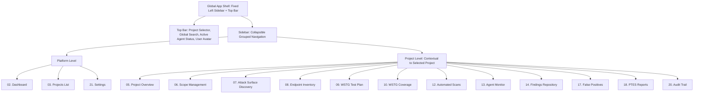

# Pentesa — UI/UX Specification & Design System

> **Document Identifier:** PENTESA-UIUX-SPEC-V1.0  
> **Status:** Approved for Implementation  
> **Frontend Stack:** React 18 + TypeScript + Tailwind CSS + Shadcn UI (Radix Primitives)  
> **Theme:** Dark Mode First (Security Operations Center Style)  
> **Target Release:** v1.0  

---

## Table of Contents

1. [Design Philosophy & Aesthetic Direction](#1-design-philosophy--aesthetic-direction)
2. [Design System Foundations](#2-design-system-foundations)
   - [2.1 Color Palette & Severity Tokens](#21-color-palette--severity-tokens)
   - [2.2 Typography Scale](#22-typography-scale)
   - [2.3 Elevation, Borders & Surface System](#23-elevation-borders--surface-system)
   - [2.4 Iconography & Status Glyphs](#24-iconography--status-glyphs)
3. [Global Navigation Architecture & Layouts](#3-global-navigation-architecture--layouts)
4. [Exhaustive Page Inventory (Pages 1 to 24)](#4-exhaustive-page-inventory-pages-1-to-24)
5. [Granular Wireframe Specifications (Key Screens)](#5-granular-wireframe-specifications-key-screens)
   - [5.1 Screen 02: Global Platform Dashboard](#51-screen-02-global-platform-dashboard)
   - [5.2 Screen 04: Project Creation Wizard](#52-screen-04-project-creation-wizard)
   - [5.3 Screen 06: Scope Management & Target Matrix](#53-screen-06-scope-management--target-matrix)
   - [5.4 Screen 08: Centralized Endpoint Inventory](#54-screen-08-centralized-endpoint-inventory)
   - [5.5 Screen 10: WSTG Coverage Dashboard](#55-screen-10-wstg-coverage-dashboard)
   - [5.6 Screen 13: Live AI Agent Activity Monitor](#56-screen-13-live-ai-agent-activity-monitor)
   - [5.7 Screen 15: Finding Detail & Evidence Diff Viewer](#57-screen-15-finding-detail--evidence-diff-viewer)
   - [5.8 Screen 19: PTES Interactive Report Preview](#58-screen-19-ptes-interactive-report-preview)
6. [Interactive Components & Specialized Widgets](#6-interactive-components--specialized-widgets)
7. [Accessibility, Responsiveness & State Handlers](#7-accessibility-responsiveness--state-handlers)

---

## 1. Design Philosophy & Aesthetic Direction

Security professionals spend hundreds of hours inside testing tools. Most legacy offensive security software suffers from cluttered Java Swing or Win32 interfaces with poor readability.

**Pentesa embraces a high-density, dark-mode-first aesthetic:**
- **Clarity under Pressure:** High-contrast severity accents, unambiguous status badges, and forensic typography.
- **Real-Time Responsiveness:** WebSockets power live terminal logs and agent thought streams with zero layout shifts.
- **Evidence-Centric:** Request/response comparisons, diff inspectors, and reproducible `curl` commands take center stage.

---

## 2. Design System Foundations

### 2.1 Color Palette & Severity Tokens

The design system is based on Tailwind CSS with custom slate and zinc neutral foundations:

```css
/* Core Color Tokens */
:root {
  --bg-canvas: #090d16;          /* Deep void background */
  --bg-surface-1: #0f172a;       /* Card & sidebar background */
  --bg-surface-2: #1e293b;       /* Elevated cards, modals, table headers */
  --border-subtle: #334155;      /* Dividers and borders */
  --text-primary: #f8fafc;       /* Crisp white high-contrast text */
  --text-secondary: #94a3b8;     /* Muted metadata and labels */
  --text-muted: #64748b;         /* Disabled or background details */

  /* Standard Severity Accent Tokens */
  --sev-critical: #ef4444;       /* Red 500: RCE, SQLi, Auth Bypass */
  --sev-high: #f97316;           /* Orange 500: IDOR, SSRF, Stored XSS */
  --sev-medium: #f59e0b;         /* Amber 500: CSRF, Reflected XSS */
  --sev-low: #3b82f6;            /* Blue 500: Clickjacking, Header Flaws */
  --sev-info: #64748b;           /* Slate 500: Version Disclosure */

  /* Operational Status Accents */
  --status-passed: #10b981;      /* Emerald 500 */
  --status-failed: #ef4444;      /* Red 500 */
  --status-running: #06b6d4;     /* Cyan 500 */
  --status-review: #a855f7;      /* Purple 500 */
}
```

### 2.2 Typography Scale
- **Display & Interface:** Inter / Geist Sans (`font-sans`) for clean UI readability.
- **Code, Payload & Raw HTTP:** JetBrains Mono (`font-mono`) for requests, responses, and terminal outputs.

### 2.3 Elevation, Borders & Surface System
- Subtle 1px solid borders (`border-slate-800`) rather than heavy drop shadows to preserve screen real estate.
- Consistent border radii: `rounded-lg` (8px) for cards and modals, `rounded-md` (6px) for inputs and buttons.

### 2.4 Iconography & Status Glyphs
- Standardized on **Lucide React** icons.
- Severity glyphs: `AlertOctagon` (Critical), `AlertTriangle` (High), `AlertCircle` (Medium), `Info` (Low), `HelpCircle` (Info).

---

## 3. Global Navigation Architecture & Layouts



---

## 4. Exhaustive Page Inventory (Pages 1 to 24)

| # | Page Name | Route | Role / Permissions | Core Purpose |
|---|---|---|---|---|
| **01** | **Login** | `/login` | Public | Operator authentication and JWT generation. |
| **02** | **Global Dashboard** | `/` | All Users | High-level portfolio risk overview, recent activity, active scans. |
| **03** | **Project List** | `/projects` | All Users | List, filter, and archive pentest engagements. |
| **04** | **Create Project Wizard**| `/projects/new` | Lead_Tester, Admin | 4-step wizard: Metadata $\to$ Scope $\to$ Auth $\to$ RoE. |
| **05** | **Project Overview** | `/projects/:id` | Project Members | Executive summary card, status timeline, quick actions. |
| **06** | **Scope Management** | `/projects/:id/scope` | Lead_Tester, Admin | In-scope targets, exclusion regexes, real-time URL tester. |
| **07** | **Discovery Dashboard** | `/projects/:id/discovery`| Project Members | Visual attack surface tree, subdomain list, tech stack badges. |
| **08** | **Endpoint Inventory** | `/projects/:id/endpoints`| Project Members | Central inventory table of all discovered routes and parameters. |
| **09** | **WSTG Test Plan** | `/projects/:id/wstg` | Project Members | Complete 12-category matrix with test case statuses and notes. |
| **10** | **Coverage Dashboard** | `/projects/:id/wstg/coverage` | All Users | Mathematical coverage gauge, category charts, test health. |
| **11** | **Test Execution** | `/projects/:id/tests` | Tester, Lead | Individual test runner, execution history, manual overrides. |
| **12** | **Automated Scanning** | `/projects/:id/scans` | Tester, Lead | Nuclei and crawler runner, tool configs, rate limit settings. |
| **13** | **Agent Monitor** | `/projects/:id/agents` | Project Members | Real-time LangGraph agent visualization, thought feed, approvals. |
| **14** | **Findings List** | `/projects/:id/findings`| Project Members | Findings table with severity filter, deduplication, search. |
| **15** | **Finding Detail** | `/projects/:id/findings/:fid` | Project Members | Technical defect sheet, CVSS calculator, remediation advice. |
| **16** | **Evidence Viewer** | `/projects/:id/findings/:fid/evidence` | Project Members | Side-by-side raw HTTP request/response diff viewer, copy curl. |
| **17** | **False Positives** | `/projects/:id/false-positives` | Project Members | Refuted candidates ledger with documented justifications. |
| **18** | **Reports Hub** | `/projects/:id/reports` | Project Members | List generated reports, download PDF/HTML, export history. |
| **19** | **Report Preview** | `/projects/:id/reports/:rid` | Project Members | Interactive in-browser preview of final PTES deliverable. |
| **20** | **Audit Trail** | `/projects/:id/audit` | Project Members | Append-only chronological log of all actions taken in project. |
| **21** | **Global Settings** | `/settings` | Admin | System preferences, database retention, storage paths. |
| **22** | **User Management** | `/settings/users` | Admin | User CRUD, password resets, platform role assignments. |
| **23** | **Tool Configuration** | `/settings/tools` | Admin | Tool paths, binary health check, default template suites. |
| **24** | **LLM Configuration** | `/settings/llm` | Admin | Local Ollama endpoint vs OpenAI API keys, model selections. |

---

## 5. Granular Wireframe Specifications (Key Screens)

---

### 5.1 Screen 02: Global Platform Dashboard

```
+----------------------------------------------------------------------------------------------------+
|  [Pentesa Logo]   Project: [Acme Corp Staging v]   [Search /]   [Live Agent: 3 Running]  [User (Admin)]|
+----------------------------------------------------------------------------------------------------+
| SIDEBAR      |  PORTFOLIO SECURITY OVERVIEW                                                        |
|              |  +--------------------+ +--------------------+ +--------------------+ +-------------+ |
| Dashboard    |  | Active Engagements | | Total Findings     | | WSTG Global Avg    | | High/Crit   | |
| Projects     |  |         4          | | 128 (12 New Today) | | 78.4% Coverage     | | 14 Verified | |
| Scope        |  +--------------------+ +--------------------+ +--------------------+ +-------------+ |
| Endpoints    |                                                                                     |
| WSTG Matrix  |  ACTIVE SCANS & AGENT TELEMETRY                     RECENT CONFIRMED FINDINGS       |
| Coverage     |  +------------------------------------------------+ +-----------------------------+ |
| Findings     |  | [AGT-08: Input Validation] Testing /api/search | | [CRIT] SQLi in /api/order/pay | |
| Reports      |  | Target: https://app.acme.com (Rate: 15 RPS)    | | Endpoint: POST /api/order/pay| |
| Agents       |  | Progress: [=========>            ] 45%         | | Discovered: 12 mins ago (AGT) | |
| Settings     |  +------------------------------------------------+ +-----------------------------+ |
|              |  | [AGT-04: Crawler] katana parsing app.js        | | [HIGH] BOLA / IDOR in Doc API | |
|              |  | Found 32 new API endpoints                     | | Endpoint: GET /api/docs/1042  | |
|              |  +------------------------------------------------+ +-----------------------------+ |
+----------------------------------------------------------------------------------------------------+
```

---

### 5.2 Screen 04: Project Creation Wizard

```
+----------------------------------------------------------------------------------------------------+
|  PROJECT INITIALIZATION WIZARD                                                        [Cancel / Exit]|
|  Step 1: General Details  --->  [Step 2: Scope & Boundaries]  --->  Step 3: Auth  --->  Step 4: RoE   |
+----------------------------------------------------------------------------------------------------+
|                                                                                                    |
|  DEFINE AUTHORIZED TARGET SCOPE                                                                    |
|  Configure exact hostnames, wildcards, and CIDR ranges authorized in client contract.              |
|                                                                                                    |
|  In-Scope Target Definition:                                                                       |
|  Target Type: [ Wildcard Domain (*.domain.tld)      v ]                                            |
|  Target Host: [ *.acme-staging.com                     ]   Port: [ 443 ]   [ + Add Target ]         |
|                                                                                                    |
|  CURRENT TARGETS WHITELIST:                                                                        |
|  * *.acme-staging.com (HTTPS / 443)                           [ Verified Resolvable: Yes ] [Delete]|
|  * 192.168.10.0/24 (Internal VPC Range)                       [ 254 Hosts in Range       ] [Delete]|
|                                                                                                    |
|  EXCLUDED PATHS & HOSTS (BLACK-LIST):                                                              |
|  Pattern Regex: [ ^/admin/purge-db.*                 ]   [ + Add Exclusion ]                        |
|  * /logout (Prevent crawler from dropping session)                                         [Delete]|
|  * /api/v1/billing/charge (Prevent automated financial transactions)                       [Delete]|
|                                                                                                    |
|  [ Back: General ]                                                  [ Next: Configure Authentication ]|
+----------------------------------------------------------------------------------------------------+
```

---

### 5.3 Screen 06: Scope Management & Target Matrix

```
+----------------------------------------------------------------------------------------------------+
|  SCOPE GOVERNANCE & NETWORK ENFORCEMENT                                [ + Add Scope ] [Audit Log] |
+----------------------------------------------------------------------------------------------------+
|  DUAL-LAYER SCOPE STATUS: [ ACTIVE - ENFORCING (Egress Proxy + App Layer) ]                        |
|                                                                                                    |
|  INTERACTIVE SCOPE TESTER:                                                                         |
|  Test Target URL: [ https://api.acme-staging.com/v1/users/export ]   [ Test Scope Clearance ]     |
|  >> RESULT: [ ALLOWED ] - Resolved IP: 192.168.10.14 - Rule: Matches *.acme-staging.com            |
|                                                                                                    |
|  IN-SCOPE TARGETS (5)                         | EXCLUSION RULES (3)                                |
|  +------------------------------------------+ | +------------------------------------------------+ |
|  | Target              | Protocol | Status  | | | Pattern           | Type       | Scope Action   | |
|  |---------------------|----------|---------| | |-------------------|------------|----------------| |
|  | *.acme-staging.com  | HTTPS    | Active  | | | ^/admin/purge.*   | PATH_REGEX | Hard Block     | |
|  | api.acme.com        | HTTPS    | Active  | | | /logout           | PATH_REGEX | Drop Crawl     | |
|  | 192.168.10.0/24     | TCP/All  | Active  | | | dev.acme.com      | HOST_EXCL  | Drop All       | |
|  +------------------------------------------+ | +------------------------------------------------+ |
+----------------------------------------------------------------------------------------------------+
```

---

### 5.4 Screen 08: Centralized Endpoint Inventory

```
+----------------------------------------------------------------------------------------------------+
|  CENTRAL ENDPOINT INVENTORY                                        [Filter Method v] [Search Path] |
|  Total Discovered: 142 Endpoints | Tested: 88 | In Progress: 12 | Untested: 42   [Export CSV/JSON]  |
+----------------------------------------------------------------------------------------------------+
| Method | Endpoint Path             | Parameters     | Auth Required | Tech Stack     | Findings    |
|--------|---------------------------|----------------|---------------|----------------|-------------|
| [POST] | /api/v1/auth/login        | user, pass, mfa| No            | Express, JWT   | None        |
| [GET]  | /api/v1/users/{id}/profile| id (path)      | Yes (Bearer)  | Node, PG       | [1 High]    |
| [GET]  | /api/v1/documents/search  | q, filter, page| Yes (Cookie)  | Node, Elastic  | [1 Med]     |
| [POST] | /api/v1/orders/checkout   | cart_id, token | Yes (Bearer)  | Node, Stripe   | [Under Test]|
| [PUT]  | /api/v1/admin/settings    | config (json)  | Yes (Admin)   | Express        | [Untested]  |
+----------------------------------------------------------------------------------------------------+
```

---

### 5.5 Screen 10: WSTG Coverage Dashboard

```
+----------------------------------------------------------------------------------------------------+
|  OWASP WSTG v4.2 COMPLIANCE & COVERAGE ENGINE                           [Export PTES Coverage Sheet]|
+----------------------------------------------------------------------------------------------------+
|  OVERALL TEST COVERAGE: [ 84.3% ]    (86 Applicable Tests Evaluated / 102 Master Tests)             |
|  [=========================================================>          ]                            |
|                                                                                                    |
|  CATEGORY BREAKDOWN:                                                                               |
|  Category                         | Total | Passed | Failed | Review | N/A | Coverage Progress     |
|  ---------------------------------|-------|--------|--------|--------|-----|-----------------------|
|  01. Information Gathering (INFO) | 10    | 10     | 0      | 0      | 0   | [================]100%|
|  02. Configuration Testing (CONF) | 11    | 9      | 1      | 0      | 1   | [================]100%|
|  04. Authentication (ATHN)        | 10    | 7      | 2      | 1      | 0   | [================]100%|
|  05. Authorization (ATHZ)         | 4     | 2      | 2      | 0      | 0   | [================]100%|
|  07. Input Validation (INPV)      | 19    | 14     | 3      | 1      | 1   | [================]100%|
|  10. Business Logic (BUSL)        | 9     | 4      | 0      | 3      | 2   | [=========>      ] 77%|
|  12. API Testing (APIT)           | 10    | 6      | 1      | 1      | 2   | [============>   ] 80%|
+----------------------------------------------------------------------------------------------------+
```

---

### 5.6 Screen 13: Live AI Agent Activity Monitor

```
+----------------------------------------------------------------------------------------------------+
|  AI MULTI-AGENT ORCHESTRATION MONITOR                               [Pause Graph] [Emergency Stop]|
+----------------------------------------------------------------------------------------------------+
|  ACTIVE SUPERVISOR WORKFLOW: Phase 3: Vulnerability Validation & Evidence Collection               |
|                                                                                                    |
|  AGENT TOPOLOGY STATUS:                                                                            |
|  [AGT-01: Plan (Done)] -> [AGT-04: Crawl (Done)] -> [AGT-08: Input (Done)] -> [AGT-11: Validating] |
|                                                                                                    |
|  LIVE AGENT REASONING STREAM (AGT-11: Vulnerability Validation Agent)                              |
|  +-----------------------------------------------------------------------------------------------+ |
|  | [16:15:02] [THOUGHT] Analyzing candidate SQL injection on /api/v1/search?q=                  | |
|  | [16:15:04] [PLAN] Crafting benign 5-second sleep probe: ' AND (SELECT 1 FROM pg_sleep(5))--   | |
|  | [16:15:05] [EXEC] Dispatched probe through Scope Egress Proxy (Socket: 192.168.10.14:443)     | |
|  | [16:15:10] [RECV] Response returned in 5,082ms (Baseline: 110ms). Confidence: 96%            | |
|  | [16:15:11] [ACTION] Confirmed vulnerability. Handing off to AGT-13 for Evidence Packaging.   | |
|  +-----------------------------------------------------------------------------------------------+ |
|                                                                                                    |
|  HUMAN-IN-THE-LOOP APPROVAL QUEUE: (0 Pending Actions)                                             |
+----------------------------------------------------------------------------------------------------+
```

---

### 5.7 Screen 15: Finding Detail & Evidence Diff Viewer

```
+----------------------------------------------------------------------------------------------------+
|  FINDING #FIND-8042: Time-Based Blind SQL Injection                               [Edit] [Retest]  |
|  Severity: [ CRITICAL (CVSS 9.8) ]   Status: [ CONFIRMED ]   WSTG: [ WSTG-INPV-05 ]  CWE: [ CWE-89 ] |
+----------------------------------------------------------------------------------------------------+
|  Endpoint: POST /api/v1/analytics/query     Parameter: `filter_date`                               |
|  Discovered By: AGT-08 (Input Agent)        Validated By: AGT-11 (Validation Agent)                |
|                                                                                                    |
|  REPRODUCTION COMMAND (SELF-CONTAINED CURL):                                                       |
|  $ curl -X POST 'https://api.acme-staging.com/api/v1/analytics/query' \                            |
|     -H 'Content-Type: application/json' -H 'Authorization: Bearer [REDACTED]' \                    |
|     -d '{"filter_date": "2026-01-01' AND (SELECT 1 FROM pg_sleep(5))--"}'                         |
|                                                                                                    |
|  FORENSIC EVIDENCE (SHA-256: 4b227777d4dd1fc61c6f884f48641d02b4d121d3fd328cb08b5531fcacdabf8a)     |
|  +------------------------------------------+  +-------------------------------------------------+ |
|  | RAW HTTP REQUEST SENT                    |  | RAW HTTP RESPONSE RECEIVED (5,082 ms)           | |
|  |------------------------------------------|  |-------------------------------------------------| |
|  | POST /api/v1/analytics/query HTTP/1.1    |  | HTTP/1.1 200 OK                                 | |
|  | Host: api.acme-staging.com               |  | Content-Type: application/json                  | |
|  | Authorization: Bearer [REDACTED]         |  | Date: Tue, 03 Nov 2026 16:15:10 GMT             | |
|  | {"filter_date": "2026-01-01'..."}        |  | {"status": "success", "results": []}            | |
|  +------------------------------------------+  +-------------------------------------------------+ |
|                                                                                                    |
|  REMEDIATION GUIDANCE:                                                                             |
|  Utilize parameterized prepared statements via SQLAlchemy ORM. Avoid string concatenation.         |
+----------------------------------------------------------------------------------------------------+
```

---

### 5.8 Screen 19: PTES Interactive Report Preview

```
+----------------------------------------------------------------------------------------------------+
|  PTES REPORT PREVIEW: Acme_Corp_Penetration_Test_2026.pdf             [Download PDF] [Download HTML]|
+----------------------------------------------------------------------------------------------------+
|  +-----------------------------------------------------------------------------------------------+ |
|  |                                                                                               | |
|  |                                         PENTESA                                               | |
|  |                       PENETRATION TESTING EXECUTION REPORT                                    | |
|  |                                                                                               | |
|  |  Client: Acme Corp                              Date: November 3, 2026                         | |
|  |  Target: *.acme-staging.com                     Methodology: PTES / OWASP WSTG v4.2            | |
|  |  Classification: STRICTLY CONFIDENTIAL         Status: Final Version 1.0                      | |
|  |                                                                                               | |
|  |  1. EXECUTIVE SUMMARY                                                                         | |
|  |  During the authorized testing window (Nov 3 - Nov 10, 2026), Pentesa conducted an autonomous | |
|  |  web application penetration test against the designated staging infrastructure...          | |
|  |                                                                                               | |
|  |  FINDINGS BY SEVERITY:                                                                        | |
|  |  [ Critical: 1 ]  [ High: 3 ]  [ Medium: 5 ]  [ Low: 8 ]  [ Informational: 12 ]               | |
|  +-----------------------------------------------------------------------------------------------+ |
+----------------------------------------------------------------------------------------------------+
```

---

## 6. Interactive Components & Specialized Widgets

1. **Monaco Editor / Syntax Diff Viewer:** For side-by-side comparison of baseline HTTP responses vs anomaly responses with line highlights.
2. **Terminal Log Streamer:** Virtualized terminal emulator (`xterm.js` or custom React list) handling up to 50,000 log lines with zero DOM latency.
3. **WSTG Coverage Interactive Heatmap:** 12-category grid allowing one-click filtering to all tests and findings under that category.

---

## 7. Accessibility, Responsiveness & State Handlers

- **WCAG 2.1 AA Compliance:** Minimum 4.5:1 text-to-background contrast ratio on all text and UI elements.
- **Empty States:** Clear illustrations and calls-to-action for projects with zero discovered endpoints, zero findings, or empty scope.
- **Responsive Layout:** Fluid layout down to 1280px minimum resolution (optimized for security workstation displays).
