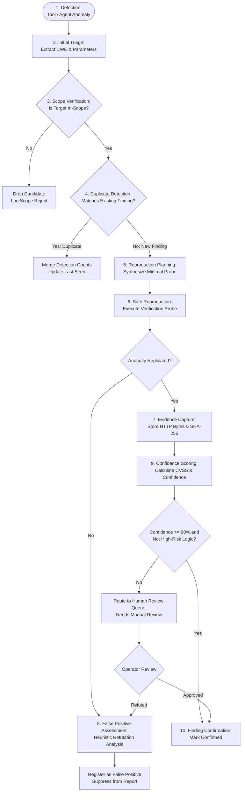
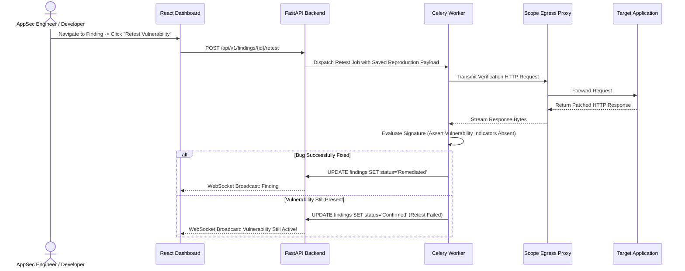

# Pentesa — Evidence Collection & Findings Management

> **Document Identifier:** PENTESA-FINDINGS-SPEC-V1.0  
> **Status:** Approved for Implementation  
> **Core Guarantee:** 100% Reproducible Evidence for Every Confirmed Finding  
> **Target Release:** v1.0  

---

## Table of Contents

1. [Evidence Philosophy: The Burden of Proof](#1-evidence-philosophy-the-burden-of-proof)
2. [Granular Finding Data Model](#2-granular-finding-data-model)
3. [Forensic Evidence Capture & Integrity Subsystem](#3-forensic-evidence-capture--integrity-subsystem)
   - [3.1 Raw HTTP Stream Serialization](#31-raw-http-stream-serialization)
   - [3.2 Deterministic `curl` Command Generation](#32-deterministic-curl-command-generation)
   - [3.3 Cryptographic Hashing (SHA-256)](#33-cryptographic-hashing-sha-256)
   - [3.4 Automated Sensitive Data Masking & PII Redaction](#34-automated-sensitive-data-masking--pii-redaction)
   - [3.5 Headless DOM Screenshot Capture](#35-headless-dom-screenshot-capture)
4. [The 10-Step Vulnerability Validation Lifecycle](#4-the-10-step-vulnerability-validation-lifecycle)
5. [Intelligent Deduplication & Finding Clustering](#5-intelligent-deduplication--finding-clustering)
6. [False Positive Triage & Suppression Engine](#6-false-positive-triage--suppression-engine)
7. [Remediation Verification & One-Click Retesting](#7-remediation-verification--one-click-retesting)

---

## 1. Evidence Philosophy: The Burden of Proof

In conventional security scanning, reports are flooded with hundreds of unverified "potential" issues. Development teams waste countless hours attempting to reproduce vague scanner claims, breeding cynicism toward security findings.

**Pentesa enforces the Burden of Proof Rule:**
$$\text{No Evidence} \implies \text{No Confirmed Finding}$$
A security issue cannot be marked `Confirmed` unless it is accompanied by:
1. The exact raw HTTP request transmitted.
2. The exact raw HTTP response received from the server.
3. A self-contained, working reproduction command (`curl` or Python script) that reproduces the behavior on demand.
4. SHA-256 integrity hashes of the raw request and response streams.

---

## 2. Granular Finding Data Model

Each finding stored in Pentesa satisfies the following schema:

```json
{
  "$schema": "http://json-schema.org/draft-07/schema#",
  "title": "PentesaFinding",
  "type": "object",
  "required": [
    "id", "project_id", "title", "severity", "status", "confidence",
    "cwe_id", "wstg_id", "endpoint_url", "http_method", "detection_source"
  ],
  "properties": {
    "id": { "type": "string", "format": "uuid" },
    "project_id": { "type": "string", "format": "uuid" },
    "title": { "type": "string" },
    "description": { "type": "string" },
    "severity": { "type": "string", "enum": ["Critical", "High", "Medium", "Low", "Informational"] },
    "status": { 
      "type": "string", 
      "enum": ["Detected", "Triaged", "Validating", "Confirmed", "False Positive", "Needs Manual Review", "Remediated", "Retested", "Accepted Risk"] 
    },
    "confidence": { "type": "string", "enum": ["Confirmed", "High", "Medium", "Low"] },
    "cvss_v31": {
      "type": "object",
      "properties": {
        "score": { "type": "number", "minimum": 0.0, "maximum": 10.0 },
        "vector": { "type": "string" }
      }
    },
    "cwe_id": { "type": "string" },
    "owasp_top10": { "type": "string" },
    "wstg_id": { "type": "string" },
    "endpoint_url": { "type": "string", "format": "uri" },
    "http_method": { "type": "string", "enum": ["GET", "POST", "PUT", "DELETE", "PATCH", "HEAD", "OPTIONS"] },
    "affected_parameter": { "type": "string" },
    "parameter_location": { "type": "string", "enum": ["query", "body", "header", "path", "cookie"] },
    "detection_source": { "type": "string" },
    "detection_timestamp": { "type": "string", "format": "date-time" },
    "reproduction_curl": { "type": "string" },
    "evidence_hash": { "type": "string" },
    "remediation_guidance": { "type": "string" },
    "business_impact": { "type": "string" }
  }
}
```

---

## 3. Forensic Evidence Capture & Integrity Subsystem

### 3.1 Raw HTTP Stream Serialization
When a vulnerability is detected, the raw network transmission is captured byte-for-byte. Both headers and bodies are preserved to ensure complete forensic validity:

```http
POST /api/v1/analytics/query HTTP/1.1
Host: api.acme-staging.com
User-Agent: Pentesa-Security-Scanner/1.0
Authorization: Bearer [REDACTED_AUTH_TOKEN]
Content-Type: application/json
Content-Length: 68

{"filter_date":"2026-01-01' AND (SELECT 1 FROM pg_sleep(5))--"}
```

### 3.2 Deterministic `curl` Command Generation
Every confirmed finding automatically synthesizes a self-contained, reproducible `curl` command:
```bash
curl -i -s -X POST 'https://api.acme-staging.com/api/v1/analytics/query' \
  -H 'Content-Type: application/json' \
  -H 'Authorization: Bearer [REDACTED]' \
  -d '{"filter_date":"2026-01-01'\'' AND (SELECT 1 FROM pg_sleep(5))--"}'
```

### 3.3 Cryptographic Hashing (SHA-256)
To prove evidence has not been tampered with or modified post-assessment:
$$\text{Hash}_{\text{evidence}} = \text{SHA-256}(\text{RawRequestBytes} \parallel \text{RawResponseBytes} \parallel \text{CapturedTimestamp})$$
The resulting 64-character hexadecimal digest is stored in `finding_evidence.request_hash_sha256` and printed in the final PTES report.

### 3.4 Automated Sensitive Data Masking & PII Redaction
Prior to persisting request and response data to PostgreSQL or embedding in reports, an asynchronous redactor scrub matches patterns:
- Authorization Bearer tokens (`Bearer [a-zA-Z0-9_\-\.]{20,}` $\to$ `Bearer [REDACTED]`).
- Passwords (`"password"\s*:\s*"[^"]+"` $\to$ `"password": "[REDACTED]"`).
- Credit card PAN numbers (Luhn-matching 13-16 digit strings).
- Session cookies (`Set-Cookie: sessionid=...` $\to$ `sessionid=[REDACTED]`).

### 3.5 Headless DOM Screenshot Capture
For client-side vulnerabilities (DOM XSS, Clickjacking, HTML Injection), the Evidence Collection Agent launches headless Chromium via Playwright, renders the proof-of-concept URL in a dedicated container, captures a full-page PNG screenshot, and saves it to `/var/pentesa/evidence/{finding_id}.png`.

---

## 4. The 10-Step Vulnerability Validation Lifecycle



---

## 5. Intelligent Deduplication & Finding Clustering

When running multiple tools (e.g. Katana + Nuclei + custom checks + Ffuf), the same underlying vulnerability is often triggered dozens of times across different URLs.

### Deduplication Tuple Hashing
The platform clusters findings by computing an identity signature:
$$\text{Signature} = \text{SHA-256}(\text{project\_id} \parallel \text{normalized\_path} \parallel \text{http\_method} \parallel \text{parameter\_name} \parallel \text{cwe\_id})$$

- If a candidate finding matches an existing signature:
  - It does **not** create a new finding sheet.
  - It increments the `occurrence_count` on the parent finding.
  - It records the new URL in `affected_instances`.
  - It prevents report bloating (e.g., preventing 200 separate findings for a single global missing CSRF token).

---

## 6. False Positive Triage & Suppression Engine

When an anomaly is flagged by a scanner but refuted by the reproduction engine:
1. **Contextual Analysis:** AGT-12 evaluates if the reflection occurred within static documentation, error templates, or educational mockups.
2. **False Positive Ledger:** The finding status is updated to `False Positive`, and a record is created in `false_positives` with explicit justification.
3. **Suppression:** Suppressed findings are excluded from client executive summaries and PTES reports, but remain accessible in the UI under **False Positives** for auditability.

---

## 7. Remediation Verification & One-Click Retesting


