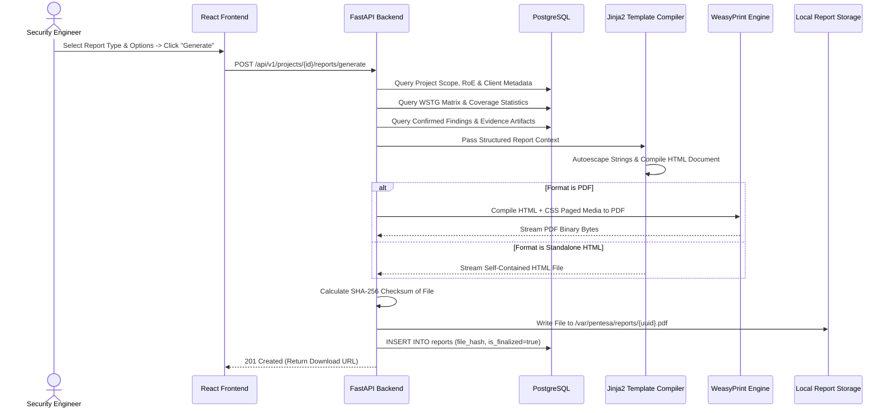

# Pentesa — PTES Reporting Engine Specification

> **Document Identifier:** PENTESA-REPORT-SPEC-V1.0  
> **Status:** Approved for Implementation  
> **Methodology Compliance:** Penetration Testing Execution Standard (PTES) & OWASP WSTG v4.2  
> **Rendering Technology:** WeasyPrint (HTML+CSS to PDF) + Standalone Interactive HTML  
> **Target Release:** v1.0  

---

## Table of Contents

1. [Reporting Philosophy: Actionable, Professional & Verifiable](#1-reporting-philosophy-actionable-professional--verifiable)
2. [Catalog of Report Deliverables](#2-catalog-of-report-deliverables)
3. [The Complete 17-Section PTES Report Structure](#3-the-complete-17-section-ptes-report-structure)
4. [Report Generation Pipeline Architecture](#4-report-generation-pipeline-architecture)
5. [Jinja2 Template Data Binding & Variable Context](#5-jinja2-template-data-binding--variable-context)
6. [CSS Paged Media & Print Styling Specifications](#6-css-paged-media--print-styling-specifications)
7. [Report Customization, White-Labeling & Section Filtering](#7-report-customization-white-labeling--section-filtering)
8. [Report Publication, Freezing & Cryptographic Integrity](#8-report-publication-freezing--cryptographic-integrity)

---

## 1. Reporting Philosophy: Actionable, Professional & Verifiable

A penetration test report is the tangible deliverable that represents the entire assessment engagement. Poorly structured reports filled with scanner dumps create confusion, overwhelm development teams, and fail to satisfy compliance auditors.

**Pentesa adheres strictly to the Penetration Testing Execution Standard (PTES):**
- **Executive Value:** High-level narrative summaries and risk posture visual charts for executive leadership and CISOs.
- **Engineering Precision:** Exhaustive technical sheets, reproduction steps, raw evidence, and code-level remediation for software developers.
- **Forensic Traceability:** Cryptographic SHA-256 evidence hashes and WSTG coverage tracking for compliance auditors.

---

## 2. Catalog of Report Deliverables

Pentesa supports multiple report deliverables depending on audience needs:

1. **Comprehensive PTES Report (Default):** Complete 17-section deliverable covering all executive, tactical, and technical findings.
2. **Executive Summary Report:** 3–5 page high-level brief for executives, board members, and clients.
3. **Developer Remediation Guide:** Filterable technical bug list with exact reproduction `curl` commands and code remediation snippets.
4. **WSTG Compliance Matrix:** Auditable checklist showing test execution status across all 12 OWASP categories for SOC 2, ISO 27001, and PCI-DSS compliance.
5. **Retest Verification Report:** Diff-based report documenting which vulnerabilities were verified as remediated versus those still active.

---

## 3. The Complete 17-Section PTES Report Structure

---

### Section 1: Cover Page
- Project Name and Target Scope.
- Assessment Dates (Testing Window).
- Client Organization Name and Logo.
- Lead Tester Name and Contact.
- Classification Notice: `STRICTLY CONFIDENTIAL`.
- Document Version and Publication Timestamp.

### Section 2: Table of Contents & Document Metadata
- Dynamically generated table of contents with page references.
- Document revision history and distribution list.

### Section 3: Executive Summary
- **Business Posture Assessment:** High-level narrative evaluating the application's overall security posture.
- **Risk Distribution Chart:** Visual bar/pie chart of confirmed findings by severity (Critical, High, Medium, Low, Informational).
- **Key Vulnerability Highlights:** Top 3–5 critical risks impacting business continuity.
- **Strategic Recommendations:** Long-term architectural improvements (e.g., implementing an API gateway, enforcing CSP).

### Section 4: Assessment Scope & Boundaries
- In-scope hostnames, domains, wildcard boundaries, and CIDR ranges.
- Explicitly excluded paths, hosts, and third-party APIs.
- Testing environment details (Staging vs. Production).

### Section 5: Testing Methodology & Tooling Disclosure
- Methodology framework: OWASP WSTG v4.2 and PTES.
- Deterministic tools utilized: Nuclei, Katana, Httpx, Ffuf.
- AI Agent System disclosure: Transparently explains the role of AI agents in hypothesis planning and triage.

### Section 6: Rules of Engagement (RoE)
- Written client authorization references and signer credentials.
- Permitted testing hours and rate limit boundaries (RPS limits).
- Emergency communication channels and escalation procedures.

### Section 7: Attack Surface Overview
- Summary of discovered subdomains and network entry points.
- Endpoint inventory summary: total endpoints discovered, authenticated vs. public routes.
- Technology stack fingerprints (Server, Framework, Language, Client Libraries).

### Section 8: Testing Coverage & WSTG Matrix
- Comprehensive coverage table listing all 12 WSTG categories.
- Total tests evaluated, passed, failed, and marked not applicable.
- Calculated Mathematical Coverage Score ($84.3\%$).

### Section 9: Findings Summary Matrix
- Summary table sorted by severity:
  | Finding ID | Title | Severity | CVSS v3.1 | Status | WSTG Category |
  |---|---|---|---|---|---|
  | FIND-01 | Time-Based Blind SQL Injection | Critical | 9.8 | Confirmed | WSTG-INPV-05 |
  | FIND-02 | Broken Object Level Authorization (IDOR) | High | 8.6 | Confirmed | WSTG-ATHZ-04 |

### Section 10: Detailed Technical Findings
For every confirmed vulnerability, a full technical sheet:
- **Title, Vulnerability Class (CWE), and CVSS v3.1 Score / Vector.**
- **Affected Endpoint URI and Controllable Parameter.**
- **Vulnerability Explanation:** What the flaw is and why it exists.
- **Technical Reproduction Steps:** Step-by-step instructions.
- **Business & Operational Impact:** Worst-case exploitation scenario.
- **Specific Remediation Guidance:** Code examples and defensive configuration patterns.

### Section 11: Reproduction Procedures & Self-Contained Scripts
- Direct, working `curl` command lines for every issue.
- Python reproduction snippets where multi-step cookies or state are involved.

### Section 12: Forensic Evidence Dumps
- Side-by-side or stacked raw HTTP request and response bytes.
- Embedded full-page DOM screenshots for client-side flaws.
- SHA-256 cryptographic hashes verifying evidence authenticity.

### Section 13: Business Impact Analysis
- Aggregated financial, regulatory, and reputational risk analysis.
- GDPR / HIPAA / PCI-DSS compliance failure mapping.

### Section 14: Risk Rating Methodology
- Explanation of the CVSS v3.1 scoring system: Base Metrics (AV, AC, PR, UI, S, C, I, A).
- Severity threshold definition scale (Critical: 9.0–10.0, High: 7.0–8.9, Medium: 4.0–6.9, Low: 0.1–3.9).

### Section 15: Prioritized Remediation Roadmap
- Grouped by immediate (1–7 days), near-term (30 days), and long-term (90 days) action items.
- Estimated level of effort (Low, Medium, High).

### Section 16: Assessment Limitations & Caveats
- Constraints encountered during testing (e.g., specific staging components offline).
- Out-of-scope third-party infrastructure (e.g., Auth0, Stripe).

### Section 17: Appendices
- Full Discovered Endpoint Catalog.
- Raw tool scan summaries.
- Glossary of cybersecurity terms and acronyms.

---

## 4. Report Generation Pipeline Architecture



---

## 5. Jinja2 Template Data Binding & Variable Context

The Jinja2 rendering pipeline receives a strongly-typed Pydantic model:

```python
class ReportContext(BaseModel):
    project_name: str
    client_name: str
    target_scope: List[str]
    start_date: str
    end_date: str
    lead_tester: str
    coverage_score: float
    findings_summary: Dict[str, int]
    findings: List[FindingDetailModel]
    wstg_categories: List[WSTGCategoryModel]
    executive_narrative: str
    generated_at: str
    report_sha256: Optional[str]
```

All data bindings in Jinja templates use auto-escaping to ensure target HTML strings cannot trigger template injection or styling corruption.

---

## 6. CSS Paged Media & Print Styling Specifications

PDF generation via WeasyPrint uses standard W3C CSS Paged Media module rules:

```css
@page {
  size: A4 portrait;
  margin: 20mm 15mm 25mm 15mm;
  @top-right {
    content: "PENTESA STRICTLY CONFIDENTIAL";
    font-size: 8pt;
    color: #64748b;
  }
  @bottom-right {
    content: "Page " counter(page) " of " counter(pages);
    font-size: 8pt;
    color: #64748b;
  }
}

@page :first {
  margin: 0;
  @top-right { content: normal; }
  @bottom-right { content: normal; }
}

.page-break {
  page-break-before: always;
}

pre, code {
  font-family: 'JetBrains Mono', monospace;
  font-size: 8pt;
  background-color: #0f172a;
  color: #f8fafc;
  padding: 8px;
  border-radius: 4px;
  white-space: pre-wrap;
  word-break: break-all;
}
```

---

## 7. Report Customization, White-Labeling & Section Filtering

- **Branding:** Support for uploading custom client or consultant PNG logos embedded on the cover page.
- **Section Toggles:** Operators can exclude specific sections (e.g. omitting the raw endpoint inventory from the executive presentation).
- **Severity Filtering:** Ability to generate reports containing only High and Critical vulnerabilities for urgent remediation standups.

---

## 8. Report Publication, Freezing & Cryptographic Integrity

Once an operator reviews and publishes a report:
1. **Freezing:** The project state at that exact moment is serialized as an immutable JSON snapshot.
2. **Cryptographic Sealing:** The compiled PDF file's SHA-256 hash is computed and permanently stored in the `reports` table.
3. **Audit Verification:** Anyone with the PDF file can verify its authenticity by submitting it to `/api/v1/reports/verify`, which checks the file's hash against the project's historical database records.

