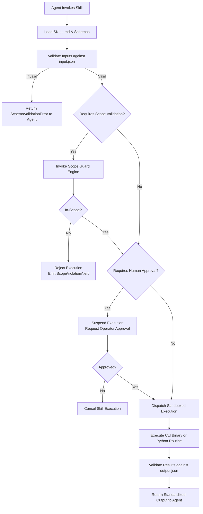

# Pentesa — Reusable Skill System Architecture

> **Document Identifier:** PENTESA-SKILL-SPEC-V1.0  
> **Status:** Approved for Implementation  
> **Skill Standard:** Modular Agent Capability Units (SKILL.md + JSON Schema)  
> **Target Release:** v1.0  

---

## Table of Contents

1. [Skill System Philosophy: Reusable Offense with Guardrails](#1-skill-system-philosophy-reusable-offense-with-guardrails)
2. [Skill Directory Structure & Anatomy](#2-skill-directory-structure--anatomy)
3. [The SKILL.md Specification Format](#3-the-skillmd-specification-format)
4. [Master Catalog of 18 Security Skills](#4-master-catalog-of-18-security-skills)
   - [Skill 01: `scope-validation`](#skill-01-scope-validation)
   - [Skill 02: `subdomain-discovery`](#skill-02-subdomain-discovery)
   - [Skill 03: `web-crawling`](#skill-03-web-crawling)
   - [Skill 04: `endpoint-extraction`](#skill-04-endpoint-extraction)
   - [Skill 05: `parameter-discovery`](#skill-05-parameter-discovery)
   - [Skill 06: `hidden-path-discovery`](#skill-06-hidden-path-discovery)
   - [Skill 07: `technology-fingerprinting`](#skill-07-technology-fingerprinting)
   - [Skill 08: `wstg-info-gathering`](#skill-08-wstg-info-gathering)
   - [Skill 09: `wstg-auth-testing`](#skill-09-wstg-auth-testing)
   - [Skill 10: `wstg-authz-testing`](#skill-10-wstg-authz-testing)
   - [Skill 11: `wstg-input-validation`](#skill-11-wstg-input-validation)
   - [Skill 12: `wstg-session-testing`](#skill-12-wstg-session-testing)
   - [Skill 13: `controlled-fuzzing`](#skill-13-controlled-fuzzing)
   - [Skill 14: `nuclei-scanning`](#skill-14-nuclei-scanning)
   - [Skill 15: `vulnerability-validation`](#skill-15-vulnerability-validation)
   - [Skill 16: `evidence-collection`](#skill-16-evidence-collection)
   - [Skill 17: `false-positive-analysis`](#skill-17-false-positive-analysis)
   - [Skill 18: `ptes-reporting`](#skill-18-ptes-reporting)
5. [Skill Execution Pipeline & Sandboxed Runtime](#5-skill-execution-pipeline--sandboxed-runtime)
6. [Safety Controls & Authorization Interceptors](#6-safety-controls--authorization-interceptors)

---

## 1. Skill System Philosophy: Reusable Offense with Guardrails

In the Pentesa platform, a **Skill** represents a self-contained, composable, and reusable unit of security testing capability. Rather than hardcoding tool behaviors into monolithic agent scripts, skills encapsulate:
- Clear instructional guidance for the AI agent (`SKILL.md`).
- Strongly-typed JSON Schemas for inputs and outputs.
- Specific tool and binary dependencies (`katana`, `nuclei`, `ffuf`).
- Explicit scope enforcement and rate-limit guardrails.
- Deterministic validation criteria.

Skills can be loaded dynamically by agents during execution depending on the target technology and testing phase.

---

## 2. Skill Directory Structure & Anatomy

Every skill resides in the `skills/` directory adhering to the following structure:

```
skills/<skill-name>/
├── SKILL.md                  # Main instruction manual & YAML frontmatter
├── schema/
│   ├── input.json            # JSON Schema validating input arguments
│   └── output.json           # JSON Schema validating output results
├── scripts/                  # Optional helper scripts (Python)
├── templates/                # Jinja2 templates or scan configurations
└── wordlists/                # Curated skill-specific wordlists
```

---

## 3. The SKILL.md Specification Format

Every `SKILL.md` file begins with standardized YAML frontmatter followed by required markdown sections:

```markdown
---
name: skill-name
version: 1.0.0
description: Clear, one-sentence description of what this skill does.
category: reconnaissance | discovery | testing | validation | reporting
requires_scope_validation: true
requires_human_approval: false
risk_tier: low | medium | high | critical
tool_dependencies: [nuclei, httpx]
agent_compatibility: [AGT-08, AGT-11]
---

# Skill Name

## 1. Purpose & Objective
What this skill accomplishes and its security objective.

## 2. Execution Prerequisites
What data must exist in the project prior to running (e.g. validated scope, endpoint URL).

## 3. Authorized Scope Requirements
Specific assertions made against the Scope Enforcement Engine before any action.

## 4. Input & Output Contract
Explanation of input parameters and expected output structure.

## 5. Step-by-Step Execution Instructions
Detailed procedural instructions for the agent and tool execution runner.

## 6. Safety Constraints & Rate Limiting
Hard boundaries (max RPS, banned payloads, circuit breakers).

## 7. Evidence Requirements
What raw HTTP traces, status codes, or artifacts must be captured.

## 8. Error Handling & Fallbacks
How to react to timeouts, connection resets, or soft-404 pages.

## 9. Validation Criteria
Deterministic conditions required to consider the skill execution successful.
```

---

## 4. Master Catalog of 18 Security Skills

---

### Skill 01: `scope-validation`
- **Category:** Governance
- **Purpose:** Asserts whether a given target domain, IP, or URL path resides within the authorized boundaries of the project.
- **Dependencies:** Internal DNS resolver, CIDR matcher.
- **Agent Compatibility:** AGT-02 (Scope Validation Agent), All Agents.
- **Risk Tier:** Low (Read-only check).

---

### Skill 02: `subdomain-discovery`
- **Category:** Reconnaissance
- **Purpose:** Enumerates passive subdomains via Certificate Transparency and search engines using `subfinder`.
- **Dependencies:** `subfinder` binary.
- **Agent Compatibility:** AGT-03 (Reconnaissance Agent).
- **Risk Tier:** Low (Zero target packet transmission).

---

### Skill 03: `web-crawling`
- **Category:** Discovery
- **Purpose:** Spiders authorized web applications to discover links, form actions, and DOM routes to a specified depth.
- **Dependencies:** `katana` binary.
- **Agent Compatibility:** AGT-04 (Attack Surface Mapping Agent).
- **Risk Tier:** Low (Standard HTTP browsing).

---

### Skill 04: `endpoint-extraction`
- **Category:** Discovery
- **Purpose:** Analyzes downloaded JavaScript files, HTML source comments, and OpenAPI/Swagger specifications to extract hidden API routes.
- **Dependencies:** Python AST analyzer, OpenAPI parser.
- **Agent Compatibility:** AGT-04.
- **Risk Tier:** Low (Offline parsing).

---

### Skill 05: `parameter-discovery`
- **Category:** Discovery
- **Purpose:** Identifies URL query parameters, JSON body keys, and headers accepted by endpoints.
- **Dependencies:** `katana`, `ffuf`.
- **Agent Compatibility:** AGT-04, AGT-10.
- **Risk Tier:** Low.

---

### Skill 06: `hidden-path-discovery`
- **Category:** Discovery
- **Purpose:** Discovers unlinked admin routes, backup files (`.bak`, `.env`), and sensitive paths using rate-limited wordlists.
- **Dependencies:** `ffuf` binary.
- **Agent Compatibility:** AGT-10 (Fuzzing Agent).
- **Risk Tier:** Medium (Generates traffic; capped at 25 RPS).

---

### Skill 07: `technology-fingerprinting`
- **Category:** Discovery
- **Purpose:** Identifies web servers, frameworks, programming languages, and third-party widgets via HTTP headers and response body signatures.
- **Dependencies:** `httpx` binary.
- **Agent Compatibility:** AGT-03, AGT-04.
- **Risk Tier:** Low.

---

### Skill 08: `wstg-info-gathering`
- **Category:** Testing
- **Purpose:** Executes OWASP WSTG-INFO-01 through 10, inspecting robots.txt, sitemaps, server banners, and application architecture.
- **Dependencies:** `httpx`, `katana`.
- **Agent Compatibility:** AGT-03, AGT-05.
- **Risk Tier:** Low.

---

### Skill 09: `wstg-auth-testing`
- **Category:** Testing
- **Purpose:** Tests authentication mechanics (WSTG-ATHN-01 to 10), checking lockout mechanisms, password policies, remember-me cookies, and token transport.
- **Dependencies:** `http_client`, token entropy analyzer.
- **Agent Compatibility:** AGT-06 (Authentication Testing Agent).
- **Risk Tier:** Medium (Rate-limited; max 10 failed login attempts).

---

### Skill 10: `wstg-authz-testing`
- **Category:** Testing
- **Purpose:** Tests for IDOR / BOLA and privilege escalation (WSTG-ATHZ-01 to 04) by replaying authorized requests across multiple user session tokens.
- **Dependencies:** `multi_identity_prober`.
- **Agent Compatibility:** AGT-07 (Authorization Testing Agent).
- **Risk Tier:** Medium.

---

### Skill 11: `wstg-input-validation`
- **Category:** Testing
- **Purpose:** Injects benign polyglot test strings to identify SQLi, XSS, Command Injection, SSTI, and SSRF (WSTG-INPV-01 to 19).
- **Dependencies:** `payload_evaluator`, differential timing prober.
- **Agent Compatibility:** AGT-08 (Input Validation Agent).
- **Risk Tier:** High (Potential application errors; timing capped at 5s).

---

### Skill 12: `wstg-session-testing`
- **Category:** Testing
- **Purpose:** Evaluates session management (WSTG-SESS-01 to 09): cookie security attributes (`HttpOnly`, `Secure`, `SameSite`), session fixation, and timeout behavior.
- **Dependencies:** `http_client`, cookie parser.
- **Agent Compatibility:** AGT-06.
- **Risk Tier:** Low.

---

### Skill 13: `controlled-fuzzing`
- **Category:** Testing
- **Purpose:** Safe parameter value fuzzing to observe edge-case exceptions, boundary handling, and unhandled 500 errors.
- **Dependencies:** `ffuf` binary.
- **Agent Compatibility:** AGT-10 (Fuzzing Agent).
- **Risk Tier:** High (Requires human approval if $> 5,000$ requests).

---

### Skill 14: `nuclei-scanning`
- **Category:** Testing
- **Purpose:** Runs curated, vetted community Nuclei templates for known CVEs and exposures against scope-validated endpoints.
- **Dependencies:** `nuclei` binary.
- **Agent Compatibility:** AGT-09 (Vulnerability Detection Agent).
- **Risk Tier:** Medium (Rate limited, DoS templates disabled).

---

### Skill 15: `vulnerability-validation`
- **Category:** Validation
- **Purpose:** Formulates minimal reproduction probes, dispatches them against target endpoints, and deterministically validates bug presence.
- **Dependencies:** `repro_harness`, `curl_builder`.
- **Agent Compatibility:** AGT-11 (Vulnerability Validation Agent).
- **Risk Tier:** Medium.

---

### Skill 16: `evidence-collection`
- **Category:** Validation
- **Purpose:** Captures raw HTTP request/response byte streams, calculates SHA-256 hashes, masks sensitive credentials, and captures Playwright screenshots.
- **Dependencies:** Playwright headless browser, SHA-256 hasher, PII redactor.
- **Agent Compatibility:** AGT-13 (Evidence Collection Agent).
- **Risk Tier:** Low.

---

### Skill 17: `false-positive-analysis`
- **Category:** Validation
- **Purpose:** Analyzes candidate anomalies that failed reproduction to document heuristic refutation and suppress noise.
- **Dependencies:** Response diff engine.
- **Agent Compatibility:** AGT-12 (False Positive Analysis Agent).
- **Risk Tier:** Low (Offline analysis).

---

### Skill 18: `ptes-reporting`
- **Category:** Reporting
- **Purpose:** Compiles project findings, evidence dumps, WSTG coverage metrics, and executive summaries into professional PDF and HTML reports.
- **Dependencies:** WeasyPrint, Jinja2.
- **Agent Compatibility:** AGT-15 (Reporting Agent).
- **Risk Tier:** Low (Local document rendering).

---

## 5. Skill Execution Pipeline & Sandboxed Runtime



---

## 6. Safety Controls & Authorization Interceptors

- **Mandatory Scope Assertion:** The skill loader automatically checks `requires_scope_validation`. If `true`, the target parameter is validated against the database before any process or network socket is initialized.
- **Human Approval Interceptor:** If `requires_human_approval` is `true` or dynamically triggered by high request volumes, the execution queue halts and requires a signed operator approval via WebSocket.
- **Non-Bypassable Constraint:** Skills have no ability to disable egress proxy routing or bypass rate limiting.

