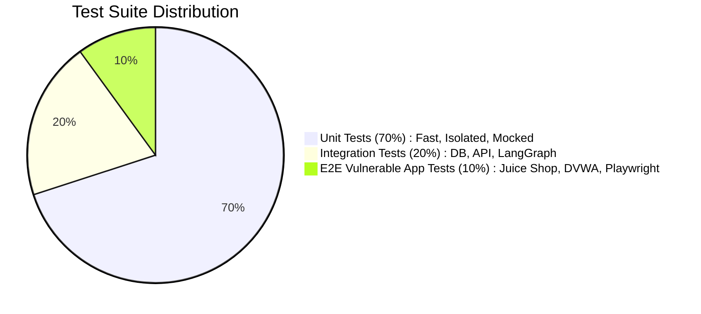
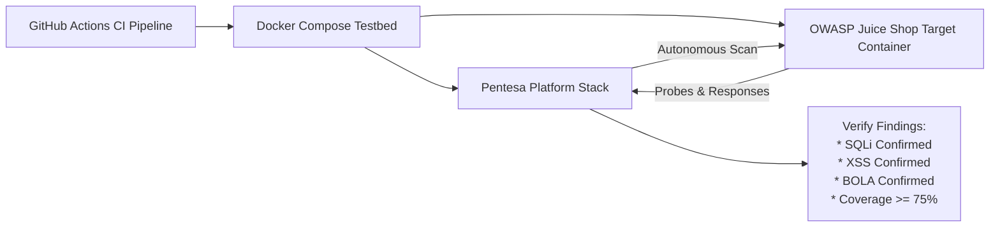
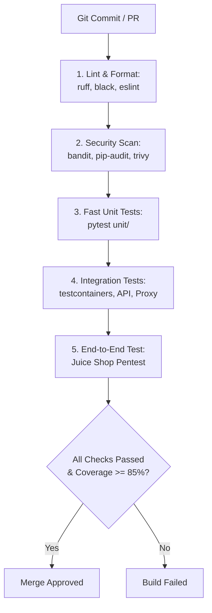

# Pentesa — Platform Quality Assurance & Testing Strategy

> **Document Identifier:** PENTESA-TEST-STRAT-V1.0  
> **Status:** Approved for Implementation  
> **Target Code Coverage:** $\ge 85\%$ Unit & Integration Coverage  
> **Target Release:** v1.0  

---

## Table of Contents

1. [Quality Engineering Philosophy & Principles](#1-quality-engineering-philosophy--principles)
2. [The Pentesa Testing Pyramid](#2-the-pentesa-testing-pyramid)
3. [Unit Testing Strategy (70% Volume)](#3-unit-testing-strategy-70-volume)
   - [3.1 Critical Unit Test Suites](#31-critical-unit-test-suites)
   - [3.2 Mocking Patterns for LLMs & Security Binaries](#32-mocking-patterns-for-llms--security-binaries)
4. [Integration Testing Strategy (20% Volume)](#4-integration-testing-strategy-20-volume)
   - [4.1 Database Testing with Testcontainers (PostgreSQL 16)](#41-database-testing-with-testcontainers-postgresql-16)
   - [4.2 FastAPI HTTP & WebSocket Endpoint Tests](#42-fastapi-http--websocket-endpoint-tests)
   - [4.3 Egress Proxy Socket Interception Tests](#43-egress-proxy-socket-interception-tests)
   - [4.4 LangGraph State Machine Graph Tests](#44-langgraph-state-machine-graph-tests)
5. [End-to-End (E2E) Testing Against Vulnerable Testbeds (10% Volume)](#5-end-to-end-e2e-testing-against-vulnerable-testbeds-10-volume)
   - [5.1 OWASP Juice Shop Autonomous Pentest Verification](#51-owasp-juice-shop-autonomous-pentest-verification)
   - [5.2 DVWA (Damn Vulnerable Web App) Regression Suite](#52-dvwa-damn-vulnerable-web-app-regression-suite)
   - [5.3 Frontend Browser Automation with Playwright](#53-frontend-browser-automation-with-playwright)
6. [Security Testing of the Platform Itself (Self-Audit)](#6-security-testing-of-the-platform-itself-self-audit)
7. [Continuous Integration & Quality Gates](#7-continuous-integration--quality-gates)

---

## 1. Quality Engineering Philosophy & Principles

When building software that executes offensive security tests, defects have catastrophic consequences:
- A bug in the scope validation engine can cause out-of-scope packet transmission.
- A bug in the validation engine can produce false positives, degrading trust.
- A bug in process sandboxing can expose the tester's machine to code execution.

**Pentesa enforces rigorous quality gates:**
- **Zero Scope Bugs Permitted:** Scope validation logic must have 100% path coverage.
- **Deterministic Mocking:** Testing must not rely on live internet connections or commercial LLM API availability.
- **Forensic Verification:** Real vulnerable test applications (Juice Shop, DVWA) serve as continuous integration test targets.

---

## 2. The Pentesa Testing Pyramid

---

## 3. Unit Testing Strategy (70% Volume)

- **Framework:** `pytest` + `pytest-asyncio` + `pytest-cov`.
- **Target Coverage:** Minimum 85% overall, 100% on Scope & Validation modules.

### 3.1 Critical Unit Test Suites
1. `tests/unit/test_scope_engine.py`:
   - Exact domain matching (`app.example.com`).
   - Wildcard domain matching (`*.example.com`, multi-level subdomains).
   - IPv4 and IPv6 CIDR parsing and inclusion checks.
   - Exclusion regex matching (`/admin/purge.*`, `/logout`).
   - RFC 3986 URL path normalization and traversal stripping.
2. `tests/unit/test_wstg_status_machine.py`:
   - State transition assertions (`NotStarted` $\to$ `Planned` $\to$ `Running` $\to$ `Passed`).
   - Coverage percentage calculation logic.
   - Applicability override rules.
3. `tests/unit/test_tool_parsers.py`:
   - Parsing Nuclei JSONL streams into `NucleiFinding` objects.
   - Parsing Katana crawler output into `Endpoint` records.
   - Handling corrupted, truncated, or empty tool output streams.
4. `tests/unit/test_evidence_hashing.py`:
   - SHA-256 byte digest consistency.
   - PII and authorization token redaction regexes.

### 3.2 Mocking Patterns for LLMs & Security Binaries
- **LLM Mocking:** Use LangChain's `FakeListChatModel` or custom mock handlers to return predetermined JSON function calls without network inference.
- **Subprocess Mocking:** Mock `asyncio.create_subprocess_exec` to return pre-recorded JSONL fixtures simulating tool discoveries.

---

## 4. Integration Testing Strategy (20% Volume)

### 4.1 Database Testing with Testcontainers (PostgreSQL 16)
- Uses `testcontainers-python` to spin up a genuine PostgreSQL 16 Docker container for every test run.
- Runs Alembic migrations (`alembic upgrade head`) from scratch to verify migration validity.
- Tests foreign key cascade rules, unique constraints, and encrypted column read/write cycles.

### 4.2 FastAPI HTTP & WebSocket Endpoint Tests
- Uses `httpx.AsyncClient` with `app=app` to test REST routes.
- Tests JWT authentication headers, role-based access control rejections, and Pydantic validation error envelopes.
- WebSocket testing via `pytest-asyncio` to assert event emissions (`SCAN_LOG`, `AGENT_THOUGHT`, `FINDING_CONFIRMED`).

### 4.3 Egress Proxy Socket Interception Tests
- Spins up a local test HTTP server on `127.0.0.1:9090` and an out-of-scope dummy server on `127.0.0.1:9091`.
- Configures the test worker with `HTTP_PROXY` pointing to the `EgressProxy`.
- Asserts that requests to the in-scope host succeed while requests to the out-of-scope host trigger socket disconnection and scope error events.

### 4.4 LangGraph State Machine Graph Tests
- Executes multi-node agent graphs through full phase transitions.
- Verifies PostgreSQL checkpoint state persistence and resumption from pause states.

---

## 5. End-to-End (E2E) Testing Against Vulnerable Testbeds (10% Volume)

### 5.1 OWASP Juice Shop Autonomous Pentest Verification
- An automated test pipeline launches an instance of `bkimminich/juice-shop`.
- Pentesa initiates a project targeting `http://juice-shop:3000`.
- The test asserts that Pentesa autonomously:
  1. Crawls and registers Juice Shop endpoints.
  2. Identifies and validates known vulnerabilities: SQL injection in search, Reflected XSS in tracking, and BOLA in customer feedback.
  3. Produces confirmed findings with raw HTTP evidence and working `curl` commands.
  4. Generates a valid PTES report in PDF format.

### 5.2 DVWA (Damn Vulnerable Web App) Regression Suite
- Used for testing authentication brute-force protection, file inclusion (LFI/RFI), and command injection validation.

### 5.3 Frontend Browser Automation with Playwright
- Headless browser automation testing key user flows:
  - User login and dashboard load.
  - Project creation wizard execution.
  - Scope configuration and interactive tester.
  - Findings list filtering and evidence modal inspection.
  - Report download action.

---

## 6. Security Testing of the Platform Itself (Self-Audit)

To ensure Pentesa cannot be exploited:
1. **Static Application Security Testing (SAST):** Run `bandit -r backend/` in CI; fail build on any High/Medium severity alert.
2. **Dependency Vulnerability Scanning:** Run `pip-audit` for Python and `npm audit` for frontend libraries.
3. **Container Image Scanning:** Run `trivy image` on built Docker images; zero Critical/High CVEs permitted.
4. **Second-Order XSS Assertion:** Inject payloads like `` into mock tool outputs; verify that the React UI renders them as escaped strings and never executes them.

---

## 7. Continuous Integration & Quality Gates

