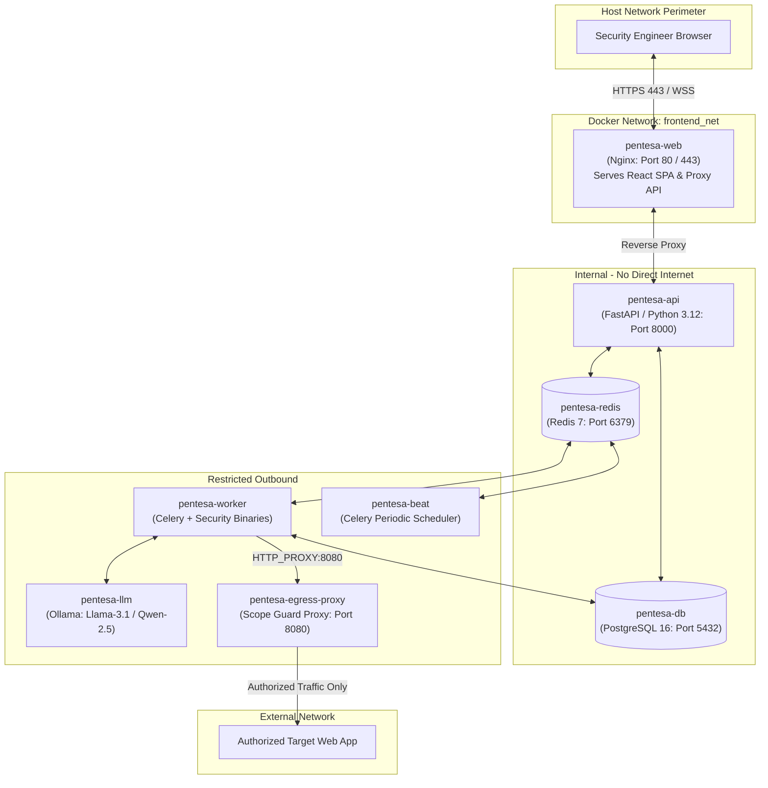

# Pentesa — Deployment Architecture & Infrastructure Guide

> **Document Identifier:** PENTESA-DEPLOY-ARCH-V1.0  
> **Status:** Approved for Implementation  
> **Deployment Pattern:** Local-First, Sovereign Docker Compose Composition  
> **Target Release:** v1.0  

---

## Table of Contents

1. [Deployment Philosophy: Self-Hosted & Sovereign](#1-deployment-philosophy-self-hosted--sovereign)
2. [Docker Compose Service Topology](#2-docker-compose-service-topology)
3. [Service Specifications & Resource Allocations](#3-service-specifications--resource-allocations)
4. [Internal Network Segmentation & Isolation](#4-internal-network-segmentation--isolation)
5. [Storage Architecture, Persistent Volumes & Backups](#5-storage-architecture-persistent-volumes--backups)
6. [Environment Configuration & Secrets Provisioning](#6-environment-configuration--secrets-provisioning)
7. [Hardware Requirements & Hardware Acceleration (GPU)](#7-hardware-requirements--hardware-acceleration-gpu)
8. [Production Deployment vs. Developer Setup](#8-production-deployment-vs-developer-setup)
9. [Health Checks, Monitoring & Recovery Runbook](#9-health-checks-monitoring--recovery-runbook)

---

## 1. Deployment Philosophy: Self-Hosted & Sovereign

Pentesa is engineered strictly as a **local-first, self-hosted system**. Security assessment data constitutes sensitive corporate intelligence: vulnerability details, application source snippets, active test credentials, and architecture diagrams must never leave the organization's control.

### Core Tenets
- **Zero Cloud Dependence:** The entire platform functions completely offline when utilizing a local Ollama LLM.
- **Single-Command Startup:** `docker compose up -d` boots all backend databases, task queues, proxies, workers, and frontend web applications.
- **Hermetic Isolation:** Outbound scan traffic routes exclusively through the scope-enforcing proxy; internal application databases cannot reach the public internet.

---

## 2. Docker Compose Service Topology



---

## 3. Service Specifications & Resource Allocations

| Service Name | Base Container Image | Role / Responsibility | Min CPU | Min RAM | Recommended RAM |
|---|---|---|---|---|---|
| `pentesa-web` | `nginx:alpine` | TLS termination, reverse proxy, React static asset delivery. | 0.5 Core | 256 MB | 512 MB |
| `pentesa-api` | `python:3.12-slim` | FastAPI ASGI application, REST routes, WebSocket manager. | 1.0 Core | 512 MB | 1 GB |
| `pentesa-worker` | Custom Ubuntu-based | Celery execution worker, Nuclei, Katana, Ffuf, LangGraph. | 2.0 Cores | 2 GB | 4 GB |
| `pentesa-beat` | `python:3.12-slim` | Celery beat scheduler for cron scans and retention cleanup. | 0.5 Core | 256 MB | 512 MB |
| `pentesa-db` | `postgres:16-alpine` | Relational datastore with `pgcrypto` extension. | 1.0 Core | 1 GB | 2 GB |
| `pentesa-redis` | `redis:7-alpine` | Task broker, rate limit cache, pub/sub log streaming. | 0.5 Core | 256 MB | 512 MB |
| `pentesa-egress-proxy` | `python:3.12-slim` | Scope filtering forward proxy with DNS pinning. | 0.5 Core | 256 MB | 512 MB |
| `pentesa-llm` (Opt) | `ollama/ollama:latest` | Local LLM inference runner (Llama 3.1 8B / Qwen 2.5 14B). | 4.0 Cores | 8 GB | 16 GB (or GPU) |

---

## 4. Internal Network Segmentation & Isolation

Pentesa defines three distinct Docker bridge networks to enforce least-privilege network communication:

1. `frontend_net`: Connects `pentesa-web` and `pentesa-api`. Exposes port 443 to the host workstation.
2. `backend_net`: Connects `pentesa-api`, `pentesa-db`, `pentesa-redis`, and `pentesa-worker`. **Completely internal (`internal: true`)**; containers on this network have zero direct internet access.
3. `worker_net`: Connects `pentesa-worker`, `pentesa-llm`, and `pentesa-egress-proxy`. Outbound internet access is permitted **only through the egress proxy**.

---

## 5. Storage Architecture, Persistent Volumes & Backups

```yaml
volumes:
  pentesa_postgres_data:
    driver: local
  pentesa_redis_data:
    driver: local
  pentesa_evidence_data:
    driver: local
  pentesa_reports_data:
    driver: local
  pentesa_llm_models:
    driver: local
```

- `pentesa_postgres_data`: Persistent database storage.
- `pentesa_evidence_data`: Forensic request/response dumps and Playwright screenshots (`/var/pentesa/evidence`).
- `pentesa_reports_data`: Generated PDF and HTML deliverables (`/var/pentesa/reports`).
- `pentesa_llm_models`: Stored GGUF model weights for Ollama (`/root/.ollama`).

### Automated Backup Script
```bash
#!/bin/bash
# scripts/backup.sh
BACKUP_DIR="/var/backups/pentesa/$(date +%Y%m%d_%H%M%S)"
mkdir -p "$BACKUP_DIR"
docker compose exec -T pentesa-db pg_dump -U postgres pentesa > "$BACKUP_DIR/database.sql"
tar -czf "$BACKUP_DIR/evidence.tar.gz" -C /var/lib/docker/volumes/pentesa_evidence_data/_data .
echo "Backup complete: $BACKUP_DIR"
```

---

## 6. Environment Configuration & Secrets Provisioning

All sensitive configuration is ingested via a `.env` file mounted into containers:

```ini
# Core Platform Secrets
PENTESA_MASTER_KEY=base64_32_byte_aes_gcm_master_key_here
JWT_SECRET_KEY=super_secure_random_jwt_secret_key_minimum_64_chars
POSTGRES_USER=postgres
POSTGRES_PASSWORD=generate_strong_postgres_password_here
POSTGRES_DB=pentesa

# Network & Egress Controls
EGRESS_PROXY_HOST=pentesa-egress-proxy
EGRESS_PROXY_PORT=8080
DEFAULT_MAX_RPS=20

# AI Model Configuration
LLM_PROVIDER=ollama                  # ollama | openai | anthropic
LLM_BASE_URL=http://pentesa-llm:11434/v1
LLM_MODEL=llama3.1:8b-instruct-q8_0
LLM_API_KEY=not_required_for_local_ollama
```

---

## 7. Hardware Requirements & Hardware Acceleration (GPU)

### Minimum Workstation (Cloud API / Hybrid Mode)
- **CPU:** 4 Cores (x86_64 or Apple Silicon M-series).
- **RAM:** 16 GB.
- **Disk:** 50 GB NVMe SSD.

### Recommended Workstation (100% Local Offline LLM Mode)
- **CPU:** 8 Cores (Intel i7/i9, AMD Ryzen 7/9, or Apple M2/M3 Pro).
- **RAM:** 32 GB.
- **GPU Acceleration (NVIDIA):** RTX 3060 / 4070 / 4080 (12GB+ VRAM) with NVIDIA Container Toolkit installed.
- **Docker GPU Passthrough Configuration:**
  ```yaml
  pentesa-llm:
    image: ollama/ollama:latest
    deploy:
      resources:
        reservations:
          devices:
            - driver: nvidia
              count: 1
              capabilities: [gpu]
  ```

---

## 8. Production Deployment vs. Developer Setup

### Developer Setup:
- Runs `docker compose -f docker-compose.dev.yml up` with hot-reloading for FastAPI and Vite React server.
- Uses mock LLM responses or small local 3B model.

### Production Enterprise Deployment:
- Runs hardened production compose with pre-compiled static assets served by Nginx.
- Valid TLS certificates provisioned via Let's Encrypt or corporate internal PKI.
- PostgreSQL configured with connection pooling (`pgbouncer`).

---

## 9. Health Checks, Monitoring & Recovery Runbook

Every service implements a Docker native health check:
- `pentesa-db`: `pg_isready -U postgres` (interval: 10s, timeout: 5s).
- `pentesa-redis`: `redis-cli ping` (interval: 10s).
- `pentesa-api`: `curl -f http://localhost:8000/health` (interval: 15s).
- `pentesa-egress-proxy`: `curl -f http://localhost:8080/health` (interval: 15s).

If a Celery worker container crashes during an active scan, Celery's `acks_late=True` combined with LangGraph's PostgreSQL checkpoint saver guarantees that tasks resume from the last saved state upon worker container auto-restart.
