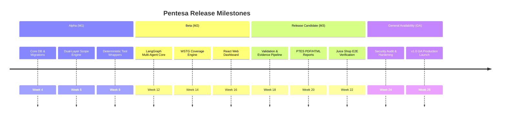
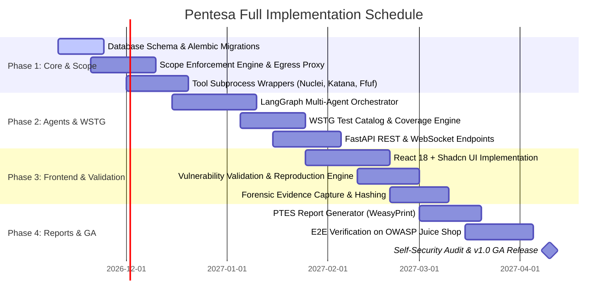

# Pentesa — Implementation Roadmap & Delivery Plan

> **Document Identifier:** PENTESA-ROADMAP-V1.0  
> **Status:** Approved for Implementation  
> **Execution Strategy:** Agile 2-Week Sprints (6 Months to General Availability)  
> **Target Release:** v1.0 GA (March 2027)  

---

## Table of Contents

1. [Development Strategy & Execution Philosophy](#1-development-strategy--execution-philosophy)
2. [Release Milestones & Capability Gates](#2-release-milestones--capability-gates)
3. [Master Gantt Chart & Critical Path Analysis](#3-master-gantt-chart--critical-path-analysis)
4. [Sprint-by-Sprint Work Package Breakdown (Sprints 1 to 12)](#4-sprint-by-sprint-work-package-breakdown-sprints-1-to-12)
   - [Phase 1: Foundations, Scope Engine & Core Tooling (Sprints 1–3)](#phase-1-foundations-scope-engine--core-tooling-sprints-13)
   - [Phase 2: Multi-Agent System & WSTG Test Engine (Sprints 4–6)](#phase-2-multi-agent-system--wstg-test-engine-sprints-46)
   - [Phase 3: Validation, Evidence & React Frontend (Sprints 7–9)](#phase-3-validation-evidence--react-frontend-sprints-79)
   - [Phase 4: Reporting, Hardening, E2E Testing & GA (Sprints 10–12)](#phase-4-reporting-hardening-e2e-testing--ga-sprints-1012)
5. [Resource Allocation & Team Topology](#5-resource-allocation--team-topology)
6. [Acceptance Criteria for General Availability (GA)](#6-acceptance-criteria-for-general-availability-ga)

---

## 1. Development Strategy & Execution Philosophy

Building an autonomous penetration testing platform requires balancing rapid feature velocity with unwavering safety guarantees. A failure in scope enforcement or an uncontrolled exploit loop is catastrophic.

**We adhere to an 8-phase development strategy:**
1. **Phase 1: Product Discovery & Requirements Engineering** (Completed in `docs/00`, `01`, `02`).
2. **Phase 2: System Architecture & Technical Decisions** (Completed in `docs/03`, `04`, ADRs).
3. **Phase 3: Data Model & API Contracts** (Completed in `docs/10`, `11`).
4. **Phase 4: UI/UX Design & User Workflows** (Completed in `docs/06`, `12`).
5. **Phase 5: Agent & Skill Specifications** (Completed in `docs/05`, `16`).
6. **Phase 6: Security & Safety Architecture** (Completed in `docs/08`, `13`, `14`).
7. **Phase 7: Implementation Roadmap & Risk Register** (This document & `docs/20`).
8. **Phase 8: Development, Testing & Verification** (Execution phase post-approval).

---

## 2. Release Milestones & Capability Gates

---

## 3. Master Gantt Chart & Critical Path Analysis

### Critical Path Analysis
The **Critical Path** runs through:
$$\text{Scope Engine} \to \text{Tool Wrappers} \to \text{LangGraph Agents} \to \text{Validation Engine} \to \text{Juice Shop E2E} \to \text{GA}$$
A delay in the Scope Enforcement Engine or Tool Wrappers directly pushes back the agent integration and validation milestones.

---

## 4. Sprint-by-Sprint Work Package Breakdown (Sprints 1 to 12)

---

### Phase 1: Foundations, Scope Engine & Core Tooling (Sprints 1–3)

#### Sprint 1: Project Scaffolding & Relational Persistence
- Initialize FastAPI backend structure with async SQLAlchemy 2.0.
- Implement 33 PostgreSQL tables and baseline Alembic migration.
- User management, bcrypt authentication, and JWT token issue/refresh.
- Unit tests with `testcontainers-python`.
- *Effort:* 10 Person-Days.

#### Sprint 2: Dual-Layer Scope Enforcement Engine
- Implement Layer 1 Application URL filter with domain wildcard and path regex matching.
- Implement Layer 2 Python Asyncio Egress Proxy with DNS resolution caching and IP pinning.
- Unit tests covering DNS rebinding, CIDR membership, and redirect interception.
- *Effort:* 10 Person-Days.

#### Sprint 3: Deterministic Tool Wrappers & Subprocess Sandbox
- Implement `BaseToolRunner` with typed Pydantic input/output contracts.
- Wrappers for `subfinder`, `httpx`, `katana`, `nuclei`, and `ffuf`.
- Enforce non-root execution, timeout monitors, and real-time JSONL stream parsing.
- *Effort:* 10 Person-Days.

---

### Phase 2: Multi-Agent System & WSTG Test Engine (Sprints 4–6)

#### Sprint 4: LangGraph Multi-Agent Orchestrator
- Implement hierarchical supervisor graph using LangGraph.
- State persistence using `PostgresSaver`.
- Implement AGT-01 (Planning), AGT-02 (Scope Guard), AGT-03 (Recon), and AGT-04 (Discovery).
- Context window packing and prompt vault management.
- *Effort:* 12 Person-Days.

#### Sprint 5: OWASP WSTG Test Catalog & Coverage Engine
- Ingest master WSTG v4.2 catalog (100+ tests across 12 categories).
- Test planning agent (AGT-05) mapping endpoints to test cases.
- Implement mathematical coverage calculation engine and status state machine.
- *Effort:* 10 Person-Days.

#### Sprint 6: Specialized Security Testing Agents
- Implement AGT-06 (AuthN), AGT-07 (AuthZ / IDOR), AGT-08 (Input Validation), and AGT-09 (Nuclei Runner).
- Implement multi-identity token swapping harness for BOLA testing.
- *Effort:* 12 Person-Days.

---

### Phase 3: Validation, Evidence & React Frontend (Sprints 7–9)

#### Sprint 7: React 18 SPA Core & Design System
- Setup Vite + React 18 + TypeScript + Tailwind CSS + Shadcn UI.
- Implement global navigation shell, Dark Mode theme, and Page 01 to 08 (Dashboard, Projects, Scope, Inventory).
- WebSocket integration for live terminal log streaming.
- *Effort:* 12 Person-Days.

#### Sprint 8: Vulnerability Validation & False Positive Triage
- Implement AGT-11 (Validation Agent) with minimal reproduction probe synthesis.
- Implement AGT-12 (False Positive Agent) with contextual refutation heuristics.
- Implement 10-step finding lifecycle state machine in backend.
- *Effort:* 10 Person-Days.

#### Sprint 9: Forensic Evidence Capture & Findings Dashboard
- Implement AGT-13 (Evidence Agent): SHA-256 hashing, PII redactor, and Playwright screenshot runner.
- Build Pages 14–17 (Findings List, Finding Detail, Side-by-Side Evidence Diff Viewer, False Positives).
- One-click reproduction command copying.
- *Effort:* 10 Person-Days.

---

### Phase 4: Reporting, Hardening, E2E Testing & GA (Sprints 10–12)

#### Sprint 10: PTES Report Generator
- Implement Jinja2 report templates and CSS Paged Media styling.
- Integrate WeasyPrint for headless HTML-to-PDF compilation.
- Build Report Preview modal (Page 19) and PDF download endpoint.
- Report freezing and cryptographic verification.
- *Effort:* 10 Person-Days.

#### Sprint 11: End-to-End Testbed Verification (Juice Shop & DVWA)
- Deploy automated CI testbed with OWASP Juice Shop and DVWA.
- Verify autonomous discovery, vulnerability validation, and report generation.
- Stress testing: 10,000 endpoint inventory simulation with Locust.
- *Effort:* 10 Person-Days.

#### Sprint 12: Security Self-Audit, Packaging & v1.0 GA
- Run Bandit, pip-audit, and Trivy container vulnerability scans.
- Hardening container images (`no-new-privileges`, read-only root).
- Finalize documentation, user guides, and Docker Compose single-command installer.
- **General Availability (GA) Milestone.**
- *Effort:* 8 Person-Days.

---

## 5. Resource Allocation & Team Topology

| Role | Primary Allocation / Responsibility |
|---|---|
| **Principal Software Architect** | System integration, LangGraph topology, database architecture. |
| **Application Security Architect** | Scope engine, tool sandboxing, dual-layer proxy, self-defense. |
| **Senior Penetration Tester** | WSTG catalog mapping, reproduction recipes, PTES reporting templates. |
| **Frontend Engineer (React)** | Shadcn UI implementation, WebSocket log streamer, evidence diff viewer. |
| **DevSecOps Engineer** | Docker Compose orchestration, CI/CD pipeline, Testcontainers harness. |

---

## 6. Acceptance Criteria for General Availability (GA)

1. **Scope Defense:** Zero out-of-scope HTTP packets transmitted across 10,000 automated test iterations.
2. **Deterministic Reproduction:** 100% of confirmed findings include reproducible `curl` commands and SHA-256 evidence hashes.
3. **WSTG Coverage:** Comprehensive coverage calculation working across all 12 OWASP categories.
4. **Local-First Operation:** Complete execution running offline using local Ollama instance with zero external network leakage.
5. **Report Quality:** Pixel-perfect PTES PDF report compiles in $< 15$ seconds.

