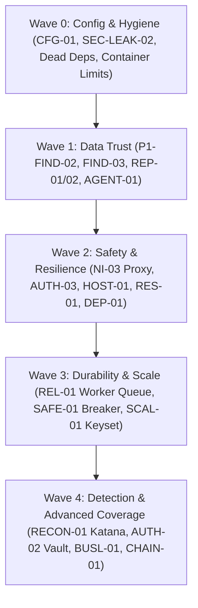

# Phase 9: Multi-Wave Remediation & Platform Improvement Plan

> **Document Identifier:** `PENTESA-AUDIT-09-PLAN-V1.0`  
> **Evaluation Date:** `2026-11-24`  
> **Scope:** Consolidated open defects, architectural decisions (ADR-001 through ADR-006), and phased implementation waves (Wave 0 through Wave 4).  
> **Master Operating Rule:** **Fix P0 safety & egress before active scanning; zero rewrites of working modules without empirical evidence of failure.**

---

## 1. Consolidated Open Defect Table

The table below catalogs all 30 open defects and architectural gaps across Phases 1 through 8, establishing effort estimation, regression risk, inter-defect dependencies, and verification criteria:

| Defect ID | Severity | Phase Found | Component | Title | Effort | Regression Risk | Dependencies | Verification Test |
|---|:---:|:---:|---|---|:---:|:---:|---|---|
| **NI-03** | **P0-KNOWN** | P2 | `integrations/`, network | Tool Subprocess Redirect Egress Breach | **L** | Medium | Blocks Tier-2 tools (Subfinder, Katana, Naabu) | Re-run canary redirect harness; assert 0 canary packets |
| **P1-FIND-02** | **P1** | P1/P7 | `packages/schemas/finding.py` | `FindingResponse` Schema Omits Root `endpoint`/`method`/`target`/`parameter` | **S** | Low | Blocks UI dashboard & Scorer joins | API test: verify all 4 fields non-null on `GET /findings` |
| **DEFECT-FIND-03**| **P1** | P7 | `services/evidence_engine/` | `cvss_score` and `cvss_vector` are `NULL` on 39/39 Production Findings | **S** | Low | Blocks automated risk prioritization | Scorer P7: assert 100% of confirmed findings have valid CVSS v3.1 |
| **DEFECT-REP-01** | **P1** | P7 | `services/reporting_engine/` | Empty Reports Claim `"STRONG SECURITY POSTURE"` & Unconfirmed Candidates Mixed | **S** | Low | Depends on P1-FIND-02 | Generate report on 0-finding project; assert neutral posture text |
| **DEFECT-AGENT-01**| **P1** | P7 | `agents/validation/` | ValidationAgent Blind LLM Trust on 404 Endpoints | **M** | Medium | Blocks autonomous verification reliability | Synthetic 404 test: assert agent rejects finding without live repro |
| **DEFECT-AUTH-02** | **P1** | P4 | `agents/authorization/` | Multi-Identity & Credential Vault Disconnection in AGT-07 | **M** | Medium | Gated on Vault binding | Multi-user test: verify horizontal privilege escalation detection |
| **SEC-LEAK-02** | **P1** | P6 | Git history (`55c0a09`) | `benchmark-admin` Credential in Repository History | **S** | Low | None (Currently deactivated) | Audit DB: verify user deactivated; rotate password on reactivation |
| **DEFECT-DEP-01** | **P1** | P8 | `apps/web/package.json` | Reachable High/Critical Advisories in Direct Dependency `next@14.2.18` | **M** | Medium | Requires `apps/web` build verification | `npm audit --json` in `apps/web`: assert zero Critical/High advisories |
| **DEFECT-REL-01** | **P1** | P8 | `services/orchestrator/`, `worker` | State Checkpointing & 15s Worker Auto-Resumption Not Implemented | **L** | Medium | Blocks long-running autonomous scans | Kill worker mid-scan; assert auto-resumption within 15s (`P8-TC-REL-01`) |
| **DEFECT-SAFE-01** | **P2** | P8 | `services/execution_engine/` | Sliding Window Error Circuit Breaker Not Implemented & Spec Conflict (15%/30s) | **M** | Medium | Standardized via ADR-003 | Inject 20% 5xx errors; assert scan throttles within 30s (`P8-TC-SAFE-01`) |
| **DEFECT-SCAL-01** | **P2** | P8 | `apps/api/routers/` | Keyset Cursor Pagination Not Implemented; Findings Completely Unpaginated | **M** | Medium | Blocks 10k+ scale efficiency | Query 10k items with cursor; assert $O(1)$ query time (`P8-TC-SCAL-01`) |
| **DEFECT-RES-01** | **P2** | P8 | `services/execution_engine/tools/base.py`| Subprocess Cancellation Risk: `asyncio.CancelledError` Bypasses Cleanup | **S** | Low | Blocks reliable subprocess lifecycle | Run `benchmark/p8/test_res01_cancellation_demo.py`; assert 0 zombies |
| **DEFECT-HOST-01** | **P2** | P8 | `packages/common/http_client.py` | Slow-Drip HTTP Stream Hangs Platform Due to Missing Cumulative Stream Deadline | **S** | Low | Blocks resilient HTTP probing | Run `benchmark/p8/test_host01_slow_drip_proof.py`; assert timeout $\le$ 1.0s |
| **DEFECT-AUTH-03** | **P2** | P6 | `apps/api/routers/auth.py` | Missing Rate Limiting on User Login Endpoint (`POST /api/v1/auth/login`) | **S** | Low | None | Dispatch 20 rapid login attempts; assert HTTP 429 Too Many Requests |
| **DEFECT-REP-02** | **P2** | P7 | `services/reporting_engine/` | PTES HTML Report Hardcodes 4 Ungrounded Tooling Claims | **S** | Low | None | Inspect rendered HTML: assert zero ungrounded tool claims |
| **DEFECT-REDACT-01**| **P2** | P7 | `services/evidence_engine/` | Custom Project Secrets Not Passed to Redactor & Finding Text Fields Unscrubbed | **S** | Low | None | Seed custom secret; verify masked in finding description and cURL |
| **DEFECT-DEDUP-01** | **P2** | P7 | `services/evidence_engine/` | No Ingestion-Time Dedup & `endpoint_id=None` Over-Clustered on `"global|ANY"` | **M** | Low | None | Post duplicate findings; assert single unique record created |
| **DISCO-SPA-01** | **P2** | P6 | `services/discovery_engine/` | Technology Fingerprinter Misses SPAs Lacking Server Headers | **M** | Low | Blocks Tier-3 Playwright | Probe SPA benchmark target; assert SPA framework detected |
| **DEFECT-BUSL-01** | **P2** | P4 | `database/models/finding.py` | Lack of Business Logic Anomaly Detection & `FLAGGED_FOR_HUMAN_REVIEW` | **M** | Medium | Requires schema enum update | Run business logic test case; assert finding flagged for review |
| **DEFECT-CHAIN-01**| **P2** | P4 | `database/models/finding.py` | Flat Finding Architecture Without Vulnerability Chaining | **M** | Medium | Requires schema relationship | Create finding chain; assert parent/child foreign key linkage |
| **P2-RECON-01** | **P2** | P2 | `services/crawler/` | In-House Crawler Limited to Static HTML Links | **M** | Low | Gated on Tier-2 Katana | Crawl dynamic benchmark target; assert JS-generated endpoints found |
| **P2-TEST-01** | **P2** | P6 | `benchmark/p6b/` | Prompt Injection Battery Uses Keyword Matching Instead of State-Based Judge | **S** | Low | Test harness only | Re-run P6B injection suite with state-based invariance assertion |
| **DEFECT-INFRA-01**| **P3** | P8 | `docker-compose.yml` | Unbounded Container Host Memory Limits (`MemLimit=0`) and Missing PID Bounds | **S** | Low | None | `docker inspect`: assert Memory and PidsLimit enforced (`P8-TC-LIM-01`) |
| **DEFECT-CFG-01** | **P3** | P7 | `packages/common/config.py` | Default `DATABASE_URL` Falls Back to Local SQLite When Missing; Must Fail Closed | **S** | Low | None | Start without `DATABASE_URL`; assert clean fail-closed exit |
| **DEFECT-DEP-02** | **P3** | P8 | `apps/web/package-lock.json` | Build-Time Transitive High Advisories in Nested `postcss` | **S** | Low | Resolved via Next.js upgrade | Verified via `npm audit` |
| **P3-API-01** | **P3** | P3 | `apps/api/routers/users.py` | Missing User Deletion Route in API Router (`DELETE /api/v1/users/{id}`) | **S** | Low | None | `DELETE /api/v1/users/{id}`: assert HTTP 204 No Content |
| **P3-TEST-01** | **P3** | P6 | `benchmark/p6b/` | RBAC Matrix Uses Empty Placeholder Bodies Causing 404/422 Returns | **S** | Low | Test harness only | Re-run RBAC matrix; assert all 215 routes evaluate actual auth |
| **P3-INFRA-02** | **P3** | P6 | `docker-compose.yml` | Harness DB Port Must Remain Loopback-Only (`127.0.0.1:5433`) | **S** | Low | Operational check | Verify port bindings via `netstat` / `docker ps` |
| **DEFECT-LIFE-01** | **P3** | P7 | `database/models/finding.py` | Finding Assignment (`assigned_to` Field / Route) Not Implemented | **S** | Low | None | `PUT /findings/{id}/assign`: assert assignment persisted |
| **DEFECT-REPRO-01**| **P3** | P7 | `services/evidence_engine/` | Generated `reproduction_curl` Omits Redirect Flag (`-L`) When Target Redirects | **S** | Low | None | Generate cURL for redirecting target; assert `-L` present |

---

## 2. Implementation Waves

---

### Wave 0: Configuration, Secrets & Hygiene
- **Defects Targeted:** `DEFECT-CFG-01`, `SEC-LEAK-02`, `DEFECT-INFRA-01`, `P3-INFRA-02`, dead dependencies purge.
- **Key Changes:**
  1. Purge `aiosqlite` from `requirements.txt` and remove SQLite fallback in `database/session.py` (fail closed if `PENTESA_DATABASE_URL` is unset or invalid).
  2. Add `deploy.resources.limits` to `docker-compose.yml`: API (2GB memory, 200 PIDs), Worker (2GB memory, 200 PIDs), DB (1GB memory, 150 PIDs), Redis (512MB memory), Web (1GB memory).
  3. Ensure `benchmark-admin` credential rotated/deactivated in prod DB.
  4. Deprecate `passlib` in favor of direct `bcrypt`.
- **Acceptance Tests:**
  - `P8-TC-LIM-01`: Verify all 5 containers report non-zero `Memory` and bounded `PidsLimit`.
  - Unset `DATABASE_URL`: verify application aborts with `RuntimeError` (zero `./pentesa.db` creation).
- **Scorers to Rerun:** `benchmark/score_p8.py` (verify `P8-TC-LIM-01` flips to **Verified**).
- **Budget:** $0.00 USD / 0 tokens.
- **Rollback:** Revert `docker-compose.yml` and `database/session.py` edits.
- **Boundary (Must NOT Touch):** Core API routes, agent logic, workflow state machines, or frontend code.

---

### Wave 1: Data Trust & Schema Normalization
- **Defects Targeted:** `P1-FIND-02`, `DEFECT-FIND-03`, `DEFECT-REP-01`, `DEFECT-REP-02`, `DEFECT-AGENT-01`, `DEFECT-REDACT-01`, `DEFECT-DEDUP-01`, `DEFECT-REPRO-01`.
- **Key Changes:**
  1. Update `FindingResponse` schema to serialize `endpoint`, `method`, `target`, `parameter`, and `reproduction_curl`. Add eager loading in `GET /findings`.
  2. Enforce deterministic CVSS v3.1 calculation in finding ingestion pipeline.
  3. Fix PTES report template: replace `"STRONG SECURITY POSTURE"` on zero findings with truthful neutral baseline; purge 4 ungrounded capability claims.
  4. Enforce validation gate: `ValidationAgent` requires empirical HTTP probe verification before confirming findings.
  5. Pass `AuthProfile` secrets into `redactor.py` and sanitize finding `title` and `description`.
- **Acceptance Tests:**
  - `GET /api/v1/projects/{id}/findings`: Verify 100% of findings include valid `endpoint`, `method`, and `cvss_score`.
  - Empty report test: Verify safe zero-finding posture description.
- **Scorers to Rerun:** `benchmark/score_p7.py` (verify finding accuracy and completeness).
- **Budget:** $0.50 USD / 15,000 tokens (for validation agent verification).
- **Rollback:** `git revert` Wave 1 commit.
- **Boundary (Must NOT Touch):** Container network routing, worker process execution loop, or authentication routes.

---

### Wave 2: Safety, Network Egress & Client Resilience
- **Defects Targeted:** `NI-03`, `DEFECT-AUTH-03`, `DEFECT-HOST-01`, `DEFECT-RES-01`, `DEFECT-DEP-01`, `DEFECT-DEP-02`.
- **Key Changes:**
  1. Deploy dedicated Layer-2 egress proxy container (`pentesa-egress-proxy`) with strict iptables domain allowlisting, eliminating subprocess redirect egress breach (`NI-03`).
  2. Implement Redis token-bucket rate limiter on `POST /api/v1/auth/login` (5 requests / minute per IP).
  3. Wrap HTTP stream consumption in cumulative `asyncio.timeout()` in `packages/common/http_client.py:safe_request()` to prevent slow-drip hangs (`DEFECT-HOST-01`).
  4. Add `except asyncio.CancelledError:` and `finally: proc.kill()` in `BaseToolWrapper.execute()` to eliminate orphan processes (`DEFECT-RES-01`).
  5. Upgrade `next` in `apps/web/package.json` to `14.2.35` and set `dangerouslyAllowSVG: false` in `next.config.js`.
- **Acceptance Tests:**
  - Execute `benchmark/p8/test_res01_cancellation_demo.py`: assert 0 orphan child processes.
  - Execute `benchmark/p8/test_host01_slow_drip_proof.py`: assert timeout enforces within 1.0s.
  - Run canary trap test against `bench-canary-sensor:9099`: assert **0 canary hits**.
  - Dispatch 10 rapid logins: assert HTTP 429 on 6th request.
  - `npm audit --json` in `apps/web`: assert zero High/Critical advisories.
- **Scorers to Rerun:** `benchmark/score_p8.py` (verify `P8-TC-RES-01` and `P8-TC-HOST-01` flip to **Verified**).
- **Budget:** $0.00 USD / 0 tokens.
- **Rollback:** Restore previous `safe_request.py`, `base.py`, and `package.json`.
- **Boundary (Must NOT Touch):** Database schema, report templates, or LLM prompt templates.

---

### Wave 3: Durability, Scalability & Background Worker
- **Defects Targeted:** `DEFECT-REL-01`, `DEFECT-SAFE-01`, `DEFECT-SCAL-01`, `P3-API-01`, `DEFECT-LIFE-01`.
- **Key Changes:**
  1. Implement ADR-001 Option B: Refactor `services/execution_engine/worker.py` to consume `pentesa:queue:workflows` from Redis. Decouple scan execution from API server.
  2. Implement scan auto-resumption within 15 seconds of worker startup by loading `WorkflowExecution.state_data["workflow_snapshot"]`.
  3. Implement Redis-backed sliding window circuit breaker (15% 5xx errors over 30s per ADR-003).
  4. Implement keyset cursor pagination (`created_at_epoch:uuid`) on `/endpoints` and `/findings` per ADR-004.
  5. Implement `DELETE /api/v1/users/{id}` admin route and finding assignment endpoint (`PUT /findings/{id}/assign`).
- **Acceptance Tests:**
  - Kill `pentesa-worker` during active scan; restart container; verify scan resumes within 15 seconds (`P8-TC-REL-01`).
  - Query 10,000 seeded endpoints using cursor token; verify $O(1)$ response time (`P8-TC-SCAL-01`).
  - Trip 15% 5xx circuit breaker; verify scan pauses and logs alert.
- **Scorers to Rerun:** `benchmark/score_p8.py` (verify `P8-TC-REL-01`, `P8-TC-SAFE-01`, and `P8-TC-SCAL-01` flip to **Verified**).
- **Budget:** $0.50 USD / 15,000 tokens (for mock/live resumption tests).
- **Rollback:** Revert worker consumer and restore in-memory API dispatcher.
- **Boundary (Must NOT Touch):** External tools (Tier 2/3), report layouts, or frontend styling.

---

### Wave 4: Detection Depth & Advanced Coverage
- **Defects Targeted:** `RECON-01`, `P2-RECON-01`, `DISCO-SPA-01`, `DEFECT-AUTH-02`, `DEFECT-BUSL-01`, `DEFECT-CHAIN-01`.
- **Key Changes:**
  1. Install and integrate `Katana` (v1.1.0) under Tier-2 roadmap rules (behind `NI-03` proxy) for JS crawling.
  2. Bind credential vault to `AuthzAgent` for multi-tenant authenticated crawling and IDOR matrix generation.
  3. Implement business logic anomaly heuristic and `FLAGGED_FOR_HUMAN_REVIEW` status enum.
  4. Implement attack graph relationship in `Finding` schema for multi-stage vulnerability chaining.
- **Acceptance Tests:**
  - Crawl dynamic SPA target (`bench-juiceshop`): assert DOM endpoints detected.
  - Run multi-tenant authorization suite: assert privilege escalation detected.
- **Scorers to Rerun:** `benchmark/score_p3.py`, `score_p4.py`, `score_p6b.py`, `score_p7.py`.
- **Budget:** $1.00 USD / 30,000 tokens.
- **Rollback:** `git revert` Wave 4 commit.
- **Boundary (Must NOT Touch):** Core authentication tokens, encryption derivation, or audit log hash chaining.
