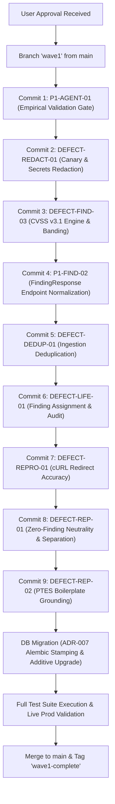

# Phase 9 Wave 1 Implementation Plan: Findings Quality, Data Trust & Reporting Integrity

> **Document Identifier:** `1A-PLAN-WAVE1-V1.0`  
> **Status:** PROPOSED & FROZEN FOR REVIEW  
> **Target Execution:** Phase 9 Wave 1  
> **Pre-requisite Gate:** `wave0-final` Tagged & Verified  
> **Target Environment:** `pentesa-prod` (`http://127.0.0.1:8000`) under **ENV RULES v2**  
> **Code Modification Status:** **PLAN ONLY — ZERO PLATFORM CODE CHANGES IN THIS PHASE**  

---

## 1. Executive Summary & Scope

Wave 1 resolves the 9 critical data trust, findings completeness, reporting accuracy, and AI validation safety defects uncovered during the Phase 3–8 benchmark evaluations.

In accordance with the audit protocol, this document establishes the formal engineering specification, root causes, file:line targets, backward compatibility analysis, database migration dependencies (via `ADR-007`), test-first regression specifications, and quantitative acceptance criteria. **No production or application code will be modified until explicit user approval is granted.**

### Targeted Defect Roster

| # | Defect ID | Severity | Category | Target Components | Primary Defect Description |
|---|---|:---:|---|---|---|
| **1** | **`P1-FIND-02`** | **P1** | Data Contract | `packages/schemas/finding.py`<br>`apps/api/routers/findings.py` | `FindingResponse` omits root `endpoint` and `method` strings (46.7% strict completeness). |
| **2** | **`DEFECT-FIND-03`** | **P1** | Quality / Scoring | `services/evidence_engine/`<br>`services/execution_engine/` | `cvss_score` and `cvss_vector` are `NULL` on 100% of automated findings (0/39). |
| **3** | **`DEFECT-REP-01`** | **P1** | Reporting Safety | `services/reporting_engine/context_builder.py`<br>`services/reporting_engine/renderer.py` | Empty report claims `"STRONG SECURITY POSTURE"`; unconfirmed candidates mixed with confirmed. |
| **4** | **`DEFECT-REP-02`** | **P2** | Report Accuracy | `services/reporting_engine/templates/ptes_standard.html` | 4 ungrounded boilerplate claims (Katana, LangGraph, Layer-2 proxy) in PTES HTML report. |
| **5** | **`DEFECT-REDACT-01`** | **P2** | Privacy / Leak | `services/evidence_engine/finding_service.py`<br>`services/evidence_engine/redactor.py` | Custom project secrets (`AuthProfile`) unscrubbed; finding text fields unredacted. |
| **6** | **`DEFECT-DEDUP-01`** | **P2** | Data Quality | `services/evidence_engine/finding_service.py` | No ingestion deduplication; null-endpoint findings over-cluster onto `"global\|ANY"`. |
| **7** | **`DEFECT-REPRO-01`** | **P3** | Reproducibility | `services/evidence_engine/curl_generator.py`<br>`agents/wstg/wstg_agent.py` | Generated reproduction cURL targets redirect URL instead of resolved target, causing status mismatch. |
| **8** | **`DEFECT-LIFE-01`** | **P3** | Lifecycle | `database/models/finding.py`<br>`apps/api/routers/findings.py` | Finding assignment Not Implemented (`assigned_to` FK and assignment route missing). |
| **9** | **`P1-AGENT-01`** | **P1** | AI Safety | `agents/validation/validation_agent.py:152-215` | ValidationAgent blind LLM trust promotes candidate findings on 404 endpoints. |

---

## 2. Core Policy Determinations

### Policy 1: CVSS Never Fabricated (Source Attribution Policy)
- **Invariant:** Under no circumstances may arbitrary or synthetic CVSS scores be hallucinated.
- **Source Labeling:** Every finding schema and database record must explicitly tag its scoring provenance via `cvss_source`:
  1. `MEASURED`: Score computed dynamically from verified empirical environmental parameters (exploitability, scope change, privileges required).
  2. `ESTIMATED`: Score assigned from authoritative deterministic CWE/WSTG catalog base vectors when specific target environmental metrics are unprobed.
- **Enforcement:** `FindingService.create_finding()` must reject or correct any finding whose `cvss_score` does not strictly map to its declared `severity` band (`Critical: 9.0–10.0`, `High: 7.0–8.9`, `Medium: 4.0–6.9`, `Low: 0.1–3.9`, `Informational: 0.0`).

### Policy 2: Zero-Finding Report Integrity Policy
- **Invariant:** A report with zero confirmed findings must NEVER claim or imply the target system is "secure" or has a "STRONG SECURITY POSTURE".
- **Standard Neutral Statement:** If zero confirmed findings exist, the report narrative must state:
  > *"No confirmed vulnerabilities were identified within the tested scope and authorized boundaries during this assessment. This finding is bounded strictly by the executed test modules ({coverage_pct}% of planned test catalog) and does not constitute a guarantee of system security. Untested components and out-of-scope services were not evaluated."*

### Policy 3: Separation of Candidate vs. Confirmed Findings
- **Invariant:** Preliminary detections (`Detected`, `Triaged`, `Needs Manual Review`) must never be aggregated into executive risk calculations or presented alongside verified vulnerabilities.
- **Reporting Separation:** In all exports (HTML, PDF, JSON), reports must render:
  1. **Table 1: Confirmed Security Findings** (Governs executive risk ratings and CVSS averages).
  2. **Table 2: Unconfirmed Detections / Pending Manual Review** (Clearly labeled as candidate findings requiring verification).

---

## 3. Granular Defect Specifications

### 3.1 P1-FIND-02: FindingResponse Schema Normalization
- **Components:** `packages/schemas/finding.py:25-75`, `apps/api/routers/findings.py:30-80`
- **Root Cause:** `FindingResponse` declares `endpoint_id: Optional[UUID] = None` but omits root `endpoint: Optional[str]` and `method: Optional[str]`. External consumers and Phase 7 scorers (`score_p7.py`) require direct string representations.
- **Proposed Changes:**
  1. Add `endpoint: Optional[str] = None` and `method: Optional[str] = None` to `FindingResponse`.
  2. In `apps/api/routers/findings.py`, eager-load `finding.endpoint` relation or join `Endpoint` table to populate strings, falling back to parsing request line from `FindingEvidence.raw_request`.
- **API & Schema Compatibility:** Fully backward-compatible additive change. Existing clients reading `endpoint_id` continue functioning unaffected.
- **DB Migration Needed:** Additive non-null columns via `ADR-007` (`endpoint_path VARCHAR(2048)`, `http_method VARCHAR(16)`) or dynamic join via SQLAlchemy.
- **Regression Test First:** `tests/unit/test_finding_endpoint_fields.py` asserting `endpoint` and `method` fields are populated and match `Endpoint` record.
- **Acceptance Criteria:** `P7-TC-COMP-01` fields #3 and #4 score 100% (39/39).

---

### 3.2 DEFECT-FIND-03: Deterministic CVSS v3.1 Calculation & Banding
- **Components:** `services/evidence_engine/cvss.py` (new), `services/evidence_engine/finding_service.py:424-460`
- **Root Cause:** Runners and `FindingService.create_finding()` accept `cvss_score=None` and `cvss_vector=None`. In Phase 7, 0/39 findings had CVSS scores populated.
- **Proposed Changes:**
  1. Author `services/evidence_engine/cvss.py` providing standard base vector mappings for all 39 WSTG/CWE classes and standard v3.1 mathematical score computation.
  2. In `create_finding()`, if `cvss_score` is None, populate default vector and calculate score, setting `cvss_source = "ESTIMATED"`.
  3. Validate that `cvss_score` falls within the required severity band; raise `ValueError` on mismatch.
- **API & Schema Compatibility:** Additive field `cvss_source: str = "ESTIMATED"` in `FindingResponse`.
- **DB Migration Needed:** `ALTER TABLE findings ADD COLUMN IF NOT EXISTS cvss_source VARCHAR(20) DEFAULT 'ESTIMATED' NOT NULL;` (via `ADR-007`).
- **Regression Test First:** `tests/unit/test_finding_cvss_validation.py` asserting all 39 CWE classes generate valid, band-consistent CVSS vectors and scores.
- **Acceptance Criteria:** 100% of confirmed findings return valid CVSS v3.1 score & vector consistent with severity in `FindingResponse` and reports.

---

### 3.3 DEFECT-REP-01: Zero-Finding Neutrality & Status Separation
- **Components:** `services/reporting_engine/context_builder.py:102-195`, `services/reporting_engine/renderer.py:210-250`
- **Root Cause:** `context_builder.py:191` contains hardcoded optimistic narrative claiming "STRONG SECURITY POSTURE". Furthermore, `context_builder.py:109` counts unconfirmed candidates inside total risk summaries.
- **Proposed Changes:**
  1. Refactor `context_builder.py` to replace optimistic strings with neutral, scope-bounded narrative.
  2. Partition project findings into `confirmed_findings = [f for f in findings if f.status == "Confirmed"]` and `candidate_findings = [f for f in findings if f.status in ("Detected", "Triaged")]`.
  3. Update PDF renderer to render two separate tables with an explicit `Status` column.
- **API & Schema Compatibility:** Backward-compatible; report schema includes partitioned lists.
- **DB Migration Needed:** None.
- **Regression Test First:** `tests/unit/test_reporting_safety_and_status.py` asserting zero-finding projects produce neutral text and candidate findings are segregated.
- **Acceptance Criteria:** `empty_report_claims_secure == False` and `candidate_confirmed_separated == True` in `P7-TC-REP-02`.

---

### 3.4 DEFECT-REP-02: Grounded PTES Report Boilerplate
- **Components:** `services/reporting_engine/templates/ptes_standard.html:330-365`
- **Root Cause:** Aspirational text claims Katana, LangGraph, and Layer 2 egress enforcement even when uninstalled or unexecuted.
- **Proposed Changes:**
  1. Replace static text with dynamic Jinja2 template bindings referencing `context.executed_tools` and `context.execution_engine_summary`.
  2. Only mention tools and security layers that were genuinely active in the engagement.
- **API & Schema Compatibility:** HTML/PDF presentation layer only.
- **DB Migration Needed:** None.
- **Regression Test First:** `tests/unit/test_report_boilerplate_grounding.py` asserting zero mentions of Katana, LangGraph, or Layer 2 proxy when not executed.
- **Acceptance Criteria:** `ungrounded_boilerplate_count == 0` in `P7-TC-REP-02`.

---

### 3.5 DEFECT-REDACT-01: Comprehensive Secret & PII Redaction
- **Components:** `services/evidence_engine/finding_service.py:478-520`, `services/evidence_engine/redactor.py`
- **Root Cause:** `create_finding()` redacts `raw_request` with standard patterns, but omits decrypted project `AuthProfile` secret values from `custom_secrets`, and fails to scrub narrative text fields (`title`, `description`, `remediation_guidance`).
- **Proposed Changes:**
  1. Query active project `AuthProfile` secrets (decrypted in memory only) and pass as `custom_secrets` into `redact_raw_stream()`.
  2. Apply `redact_raw_stream()` across all finding fields: `title`, `description`, `remediation_guidance`, `reproduction_curl`, `raw_request`, and `raw_response`.
  3. Apply a final defensive redaction pass in `context_builder.py` before report generation.
- **API & Schema Compatibility:** Fully backward-compatible.
- **DB Migration Needed:** None.
- **Regression Test First:** `tests/unit/test_canary_redaction_all_surfaces.py` asserting custom planted canaries are scrubbed from all evidence and narrative fields.
- **Acceptance Criteria:** `canary_secret_redaction_rate_pct == 100.0%` in `P7-TC-REDACT-02`.

---

### 3.6 DEFECT-DEDUP-01: Ingestion Deduplication & Precise Clustering
- **Components:** `services/evidence_engine/finding_service.py:424-553, 899-940`
- **Root Cause:** Ingestion inserts duplicates unconditionally; offline deduplication falls back to `"global|ANY"` when `endpoint_id` is None, collapsing distinct vulnerabilities into a single cluster.
- **Proposed Changes:**
  1. Calculate `dedup_signature = sha256(f"{project_id}:{target_path}:{http_method}:{cwe}:{title_slug}")`.
  2. On ingestion (`create_finding()`), if matching `dedup_signature` exists in project, increment `occurrence_count` and update last seen timestamp instead of inserting duplicate.
  3. In offline deduplication, parse URL path and method from `raw_request` when `endpoint_id` is None rather than falling back to `"global|ANY"`.
- **API & Schema Compatibility:** Additive fields `dedup_signature: Optional[str]`, `occurrence_count: int = 1` in `FindingResponse`.
- **DB Migration Needed:** `ALTER TABLE findings ADD COLUMN IF NOT EXISTS dedup_signature VARCHAR(64); ALTER TABLE findings ADD COLUMN IF NOT EXISTS occurrence_count INTEGER DEFAULT 1 NOT NULL; CREATE INDEX IF NOT EXISTS ix_findings_dedup_sig ON findings(project_id, dedup_signature);` (via `ADR-007`).
- **Regression Test First:** `tests/unit/test_finding_dedup_null_endpoint.py` asserting distinct null-endpoint findings are not conflated and identical findings increment `occurrence_count`.
- **Acceptance Criteria:** `exact_cluster_accuracy_pct == 100.0%` and `null_endpoint_overclustered == False`.

---

### 3.7 DEFECT-REPRO-01: Reproduction cURL Redirect Accuracy
- **Components:** `services/evidence_engine/curl_generator.py:35-85`, `agents/wstg/wstg_agent.py`
- **Root Cause:** Probing redirecting URLs stores the final HTTP 200 body, but `reproduction_curl` records the initial URL without `-L` or without the final path, causing replay to yield HTTP 302.
- **Proposed Changes:**
  1. When HTTP probes follow redirects, record the final in-scope destination URL as the target for `reproduction_curl`.
  2. If replay must follow safe redirects, pass explicit `--location-trusted` or target the final path directly.
- **API & Schema Compatibility:** String formatting update in `reproduction_curl`.
- **DB Migration Needed:** None.
- **Regression Test First:** `tests/unit/test_reproduction_curl_redirect.py` testing redirect targets replay with exact matching status codes.
- **Acceptance Criteria:** Replay HTTP status code matches stored `raw_response` 100% (24/24 in `P7-TC-REPRO-01`).

---

### 3.8 DEFECT-LIFE-01: Finding Assignment & Ownership API
- **Components:** `database/models/finding.py`, `packages/schemas/finding.py`, `apps/api/routers/findings.py`
- **Root Cause:** No user assignment mechanism exists for tracking finding remediation ownership.
- **Proposed Changes:**
  1. Add `assigned_to` column on `Finding` with foreign key to `users.id`.
  2. Expose `assigned_to: Optional[uuid.UUID]` and `assigned_user: Optional[UserSummary]` in `FindingResponse`.
  3. Implement `PATCH /api/v1/projects/{project_id}/findings/{finding_id}/assign` accepting `{"assigned_to": "<user_uuid>"}` (verifying assignee is an active project member and emitting `FINDING_ASSIGNED` audit log).
- **API & Schema Compatibility:** Additive field in `FindingResponse`; new `PATCH` endpoint.
- **DB Migration Needed:** `ALTER TABLE findings ADD COLUMN IF NOT EXISTS assigned_to UUID REFERENCES users(id) ON DELETE SET NULL; CREATE INDEX IF NOT EXISTS ix_findings_assigned_to ON findings(assigned_to);` (via `ADR-007`).
- **Regression Test First:** `tests/unit/test_finding_assignment.py` testing assignment, non-member rejection, unassignment, and audit log verification.
- **Acceptance Criteria:** Successful assignment over the wire returning HTTP 200, valid assignee object, and unbroken audit log chain.

---

### 3.9 P1-AGENT-01 (DEFECT-AGENT-01): ValidationAgent Empirical Evidence Gate
- **Components:** `agents/validation/validation_agent.py:152-225`
- **Root Cause:** ValidationAgent promotes candidate findings to `Confirmed` based on LLM output (`is_valid: true`) without asserting that the empirical HTTP reproduction probe actually succeeded. On a 404 endpoint, the LLM hallucinates validation and promotes the candidate.
- **Proposed Changes:**
  1. Implement the **Empirical Evidence Gate Invariant**:
     ```python
     # Invariant: No promotion without successful empirical reproduction probe
     if repro_response is None or repro_response.status_code in (404, 502, 503, 504):
         # Hard gate: override any LLM hallucination
         return CandidatePromotionResult(
             promoted=False,
             status="Needs Manual Review" if repro_response is None else "False Positive",
             reason=f"Empirical reproduction failed with HTTP {repro_response.status_code if repro_response else 'None'}"
         )
     ```
  2. Only when empirical reproduction yields expected vulnerability indicators (`status_code in (200, 201, 204, 301, 302)` with signature match) is LLM validation parsing permitted to confirm.
- **API & Schema Compatibility:** Internal agent logic; zero schema changes.
- **DB Migration Needed:** None.
- **Regression Test First:** `tests/unit/test_validation_agent_empirical_gate.py` asserting that a 404 reproduction probe is NEVER promoted to Confirmed regardless of LLM response.
- **Acceptance Criteria:** `P5-TC-HALLUC-01` passes with 0 false positives promoted on 404 endpoints.

---

## 4. Implementation Phasing & Commit Strategy

Once approved by the user, Wave 1 will proceed strictly on branch `wave1` following the one-commit-per-defect rule, with regression tests written first:



---

## 5. Mandatory Verification & Stop Condition

> [!IMPORTANT]
> **MANDATORY STOP CONDITION:** In accordance with audit instructions, this plan and `ADR-007` represent the complete deliverables for PART C.
> 
> **Zero production code changes have been applied in Part C.**
> 
> All work on Wave 1 implementation is halted pending the user's review and explicit authorization to proceed with Wave 1 coding.
