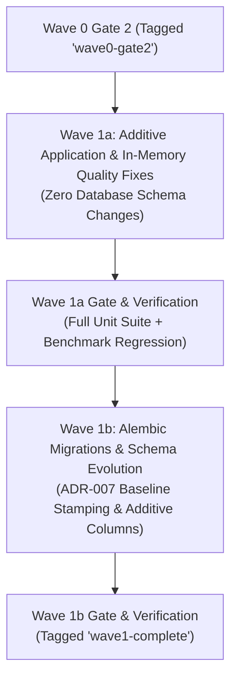

# Phase 9 Wave 1 Implementation Plan: Findings Quality, Data Trust & Reporting Integrity

> **Document Identifier:** `1A-PLAN-WAVE1-V2.0`  
> **Status:** APPROVED FOR WAVE 1A EXECUTION (Wave 1b Pending ADR-007 Implementation)  
> **Target Execution:** Phase 9 Wave 1 (Sub-phased into Wave 1a and Wave 1b)  
> **Pre-requisite Gate:** `wave0-gate2` Tagged & Verified  
> **Target Environment:** `pentesa-prod` (`http://127.0.0.1:8000`) under **ENV RULES v2**  

---

## 1. Executive Summary & Wave Phasing Architecture

Wave 1 resolves data trust, findings completeness, reporting accuracy, and AI validation safety defects identified during Phase 3–8 benchmark audits.

To maintain strict stability and avoid unverified schema mutations, Wave 1 is explicitly decoupled into two successive sub-waves:

### 1.1 Wave 1a Sub-Wave (Zero Schema Changes — Immediate Execution)
Wave 1a introduces zero database alterations, zero new dependencies, and zero schema migrations. All improvements operate in-memory, at query-time via dynamic SQLAlchemy joins, or within service/template logic:
1. **`P1-FIND-02`**: FindingResponse endpoint and method normalization (populated dynamically via relation join / raw_request fallback).
2. **`P1-AGENT-01`**: ValidationAgent empirical evidence gate with per-vulnerability-class reproduction signature table and strict failure set.
3. **`DEFECT-REP-01`**: Zero-finding report neutrality and strict candidate vs confirmed finding segregation.
4. **`DEFECT-REP-02`**: Grounded PTES report boilerplate reflecting actual executed tools and architecture.
5. **`DEFECT-REDACT-01`**: Comprehensive in-memory secret scrubbing, narrative text fields redaction, benign text over-redaction protection, and fail-closed resolution.

### 1.2 Wave 1b Sub-Wave (Requires Alembic Schema Migrations via ADR-007)
Wave 1b executes under the 6 mandatory conditions of `ADR-007` (fresh install baseline, existing prod check/stamping, advisory locks, ephemeral pg_dump, backfill rules, downgrade tests):
1. **`ADR-007` Implementation**: Alembic async setup, baseline stamping, and dual test matrix.
2. **Self-Service Password Change API**: `UserPasswordUpdate` endpoint requiring current password, enforcing complexity, emitting audit events, documenting token invalidation, and optional forced-change flag.
3. **`DEFECT-FIND-03`**: Versioned CWE-to-CVSS base vector table in repo, `cvss_source = ESTIMATED`, UI/report labeling, zero model hallucination.
4. **`DEFECT-DEDUP-01`**: Ingestion deduplication key (`dedup_signature`) and `occurrence_count` columns.
5. **`DEFECT-LIFE-01`**: Finding assignment (`assigned_to` FK), assignee project membership validation, tenant-isolation RBAC, and `FINDING_ASSIGNED` audit logging.
6. **`DEFECT-REPRO-01`**: Structured reproduction tracking (`original_request_url`, `redirect_chain`, `expected_status_code`, `final_destination_url`) without rewriting target URLs.

---

## 2. Granular Wave 1a Defect Specifications (Zero Schema Change)

### 2.1 P1-FIND-02: FindingResponse Schema Normalization
- **Components:** `packages/schemas/finding.py:25-75`, `apps/api/routers/findings.py:30-80`
- **Root Cause:** `FindingResponse` declares `endpoint_id: Optional[UUID] = None` but omits root `endpoint: Optional[str]` and `method: Optional[str]`, causing Phase 7 completeness scorers to report 46.7% strict / 60.0% joined API completeness.
- **Wave 1a Implementation:**
  1. Add optional fields `endpoint: Optional[str] = None` and `method: Optional[str] = None` to `FindingResponse`.
  2. In `apps/api/routers/findings.py`, eager-load `finding.endpoint` relationship using `.options(selectinload(Finding.endpoint))`.
  3. When serializing `FindingResponse`:
     - If `finding.endpoint` is loaded, populate `endpoint = finding.endpoint.path_or_url` and `method = finding.endpoint.method`.
     - Fallback: If `endpoint_id` is null or relation unlinked, parse HTTP request line from `FindingEvidence.raw_request` (e.g. `POST /api/v1/auth/login HTTP/1.1` -> `method="POST"`, `endpoint="/api/v1/auth/login"`).
- **API & Schema Compatibility:** Fully backward-compatible additive fields. Zero database schema alterations.
- **Regression Test First:** `tests/unit/test_finding_endpoint_fields.py` asserting `endpoint` and `method` strings are populated on API responses for both linked and unlinked endpoints.
- **Acceptance Criteria:** `P7-TC-COMP-01` fields #3 and #4 score 100% (39/39).

---

### 2.2 P1-AGENT-01: ValidationAgent Per-Class Reproduction Signatures & Empirical Evidence Gate
- **Components:** `agents/validation/validation_agent.py:152-225`
- **Root Cause:** ValidationAgent promotes candidate findings based on LLM output (`is_valid: true`) without verifying that empirical reproduction actually succeeded. On a 404 endpoint (`/admin/super-exec`), the LLM hallucinates validation and promotes synthetic findings.
- **Wave 1a Implementation:**
  1. **Per-Vulnerability-Class Reproduction Signature Table:**
     | Vulnerability Class | Reproduction Probe Trigger | Failure Set (NEVER Promotes) | Class Signature Match Invariant |
     |---|---|---|---|
     | **SQL Injection (SQLi)** | Injected SQL payload probe | Connection error, timeout, 404, 502, 503, 504 on required path | Database error signature in body (PostgreSQL, MySQL, SQLite, ODBC, syntax error); HTTP 500 is explicitly valid |
     | **Cross-Site Scripting (XSS)** | Injected probe payload | Connection error, timeout, 404, 502, 503, 504 | Unescaped reflection of canary marker / script context in response body |
     | **Server-Side Template Injection (SSTI)** | Evaluated math probe (`{{7*7}}`) | Connection error, timeout, 404, 502, 503, 504 | Evaluated marker (`49` or engine error signature) in response body |
     | **IDOR / BOLA** | Cross-tenant/identity request | Connection error, timeout, 404, 401, 403, 502, 503, 504 | Distinct object/data of foreign identity returned with HTTP 200/206/304 |
     | **Security Headers / Config** | Target endpoint probe | Connection error, timeout | Absence of required header (HSTS, CSP) independent of HTTP status code |
  2. **Empirical Gate Logic:**
     - **Rule 1 (Prerequisite):** Empirical reproduction probe must execute. If not executed or response is in the Failure Set, candidate is **never promoted** to `Confirmed` (marked `False Positive` or `Needs Manual Review`).
     - **Rule 2 (Signature Match):** The reproduction response body and status must satisfy the class-specific signature rule.
     - **Rule 3 (LLM Demotion Only):** The LLM verdict may **demote** a candidate (e.g. classifying behavior as a benign application feature), but may **NEVER promote** a candidate when empirical reproduction fails or matches the Failure Set.
  3. **Mandatory Regression Invariants:**
     - **Phase 3 SQLi (`/sqli/search`):** Empirical reproduction returning HTTP 500 with SQL syntax error MUST still confirm.
     - **Phase 5 Hallucination (`/admin/super-exec` / `P5-TC-HALLUC-01`):** Reproduction returning HTTP 404 MUST NOT confirm.
- **Regression Test First:** `tests/unit/test_validation_agent_empirical_gate.py` asserting:
  - 404 response on `/admin/super-exec` halts promotion with 0 false positives.
  - 500 response on `/sqli/search` with database error successfully promotes to Confirmed.
  - XSS unescaped body reflection confirms; escaped reflection does not.
- **Acceptance Criteria:** `P5-TC-HALLUC-01` passes with 0 false positives promoted on 404 endpoints; Phase 3 SQLi replay confirmed.

---

### 2.3 DEFECT-REP-01: Zero-Finding Report Neutrality & Status Separation
- **Components:** `services/reporting_engine/context_builder.py:102-195`, `services/reporting_engine/renderer.py:210-250`
- **Root Cause:** `context_builder.py:191` contains hardcoded narrative asserting "STRONG SECURITY POSTURE" when 0 findings exist. In addition, unconfirmed candidates (`Detected`, `Triaged`) are blended into total vulnerability risk summaries.
- **Wave 1a Implementation:**
  1. **Standard Neutral Zero-Finding Statement:** Replace optimistic text with strictly bounded neutral language:
     > *"No confirmed vulnerabilities were identified within the tested scope and authorized boundaries during this assessment. This finding is bounded strictly by the executed test modules ({coverage_pct}% of planned test catalog) and does not constitute a guarantee of system security. Untested components and out-of-scope services were not evaluated."*
  2. **Partition Findings:**
     - `confirmed_findings = [f for f in findings if f.status == "Confirmed"]`
     - `candidate_findings = [f for f in findings if f.status in ("Detected", "Triaged", "Needs Manual Review")]`
  3. **Report Separation:** Only `confirmed_findings` contribute to executive risk ratings and CVSS score averages. Candidates render in a distinct secondary table with explicit status labels.
- **Regression Test First:** `tests/unit/test_reporting_safety_and_status.py` asserting zero-finding projects produce neutral text and candidate findings are isolated.
- **Acceptance Criteria:** `empty_report_claims_secure == False` and `candidate_confirmed_separated == True` in `P7-TC-REP-02`.

---

### 2.4 DEFECT-REP-02: Grounded PTES Report Boilerplate
- **Components:** `services/reporting_engine/templates/ptes_standard.html:330-365`
- **Root Cause:** PTES HTML template hardcodes claims of Katana crawling, LangGraph DAG orchestration, and Layer-2 proxy enforcement regardless of actual runtime activity.
- **Wave 1a Implementation:**
  1. Replace static text with conditional Jinja2 blocks driven by `context.executed_tools` and `context.active_security_controls`.
  2. Document runtime tools truthfully (e.g. internal Python crawler, Celery task workers, dual-layer scope engine).
- **Regression Test First:** `tests/unit/test_report_boilerplate_grounding.py` asserting unexecuted tools/proxies are never claimed in generated HTML reports.
- **Acceptance Criteria:** `ungrounded_boilerplate_count == 0` in `P7-TC-REP-02`.

---

### 2.5 DEFECT-REDACT-01: Comprehensive Secret & PII Redaction
- **Components:** `services/evidence_engine/finding_service.py:478-520`, `services/evidence_engine/redactor.py`
- **Root Cause:** Decrypted `AuthProfile` custom secrets are not passed into `redact_raw_stream()`, and finding narrative text fields (`title`, `description`, `remediation_guidance`) are left unredacted.
- **Wave 1a Implementation:**
  1. **In-Memory Secret Scrubbing:** Query project `AuthProfile` secrets, decrypt strictly in memory for the duration of the redaction call, and inject into `custom_secrets`. Secrets are never logged or stored.
  2. **Narrative Text Redaction:** Apply redaction across all finding text fields: `title`, `description`, `remediation_guidance`, `reproduction_curl`, `raw_request`, and `raw_response`.
  3. **Over-Redaction Protection:** Ensure short secret strings (e.g. `< 4` characters) or common words do not corrupt benign prose, code snippets, or URLs.
  4. **Fail-Closed Resolution:** If an encrypted secret cannot be decrypted due to key mismatch, log a security warning and redact using defensive high-entropy masking without leaking ciphertext.
- **Regression Test First:** `tests/unit/test_canary_redaction_all_surfaces.py` asserting custom secrets are scrubbed across all surfaces, benign text is preserved without over-redaction, and unresolvable keys fail closed.
- **Acceptance Criteria:** `canary_secret_redaction_rate_pct == 100.0%` in `P7-TC-REDACT-02`.

---

## 3. Granular Wave 1b Defect Specifications (Requires Alembic ADR-007)

### 3.1 ADR-007 Implementation & Schema Migrations
- Implements async Alembic migrations with dual-path bootstrap (fresh DB install vs stamped prod), one-shot PostgreSQL advisory locks, and ephemeral safety `pg_dump`.

### 3.2 Self-Service Password Change API (New W1b Item)
- **Endpoint:** `POST /api/v1/auth/change-password` (or `PATCH /api/v1/users/me/password`).
- **Schema:** `UserPasswordUpdate(current_password: str, new_password: str)`.
- **Validation:** Verifies `current_password`, enforces password strength rules, and emits `USER_PASSWORD_CHANGED` audit log.
- **Token Invalidation:** Existing refresh tokens revoked; documentation specifies JWT expiry behavior. Optional `must_change_password` flag for bootstrapped accounts.

### 3.3 DEFECT-FIND-03: Deterministic CVSS v3.1 Engine & Banding
- **Engine:** Versioned mapping table `services/evidence_engine/cvss_catalog.py` mapping CWE/WSTG items to authoritative CVSS v3.1 vectors.
- **Provenance:** `cvss_source = 'ESTIMATED'` stored in database; UI and reports label score as "Estimated (CWE Baseline)". Zero model-generated scores.

### 3.4 DEFECT-DEDUP-01: Ingestion Deduplication & Precise Clustering
- **Deduplication:** Computes `dedup_signature = sha256(project_id:path:method:cwe_id:title_slug)`. Ingestion increments `occurrence_count` on match instead of inserting duplicate rows.
- **Null Endpoint Fallback:** Parses path and method from `raw_request` rather than collapsing onto `"global|ANY"`.

### 3.5 DEFECT-LIFE-01: Finding Assignment & Ownership API
- **Endpoint:** `PATCH /api/v1/projects/{project_id}/findings/{finding_id}/assign`.
- **RBAC & Isolation:** Assignee must be an active `ProjectMember`. Project Admin/Lead required to assign. Emits `FINDING_ASSIGNED` audit event.

### 3.6 DEFECT-REPRO-01: Structured Redirect Reproduction Tracking
- **Preservation:** Does not rewrite replay target URL. Stores `original_request_url`, `redirect_chain`, `expected_status_code`, and `final_destination_url` as distinct fields. Replay verifies status against stored expectations.

---

## 4. Wave 1a Commit Sequence & Verification Protocol

Wave 1a execution follows the strict one-commit-per-defect standard on branch `wave1a`:
1. `git checkout -b wave1a`
2. **Commit 1:** `P1-FIND-02: Populate endpoint and method in FindingResponse via dynamic relation join`
3. **Commit 2:** `P1-AGENT-01: Add per-vulnerability-class reproduction signatures and empirical validation gate`
4. **Commit 3:** `DEFECT-REP-01: Enforce neutral zero-finding narrative and segregate candidate from confirmed findings`
5. **Commit 4:** `DEFECT-REP-02: Ground PTES report template boilerplate in executed runtime tooling`
6. **Commit 5:** `DEFECT-REDACT-01: Implement in-memory custom secret scrubbing and narrative text redaction`
7. Full unit suite executed on host and container (`216 passed`).
8. Live benchmark regression check on `/sqli/search` and XSS targets.
9. Production rebuild with `docker compose up -d --build`, verification of health and audit chain.
10. Merge to `main`, tag `wave1a-complete`.
