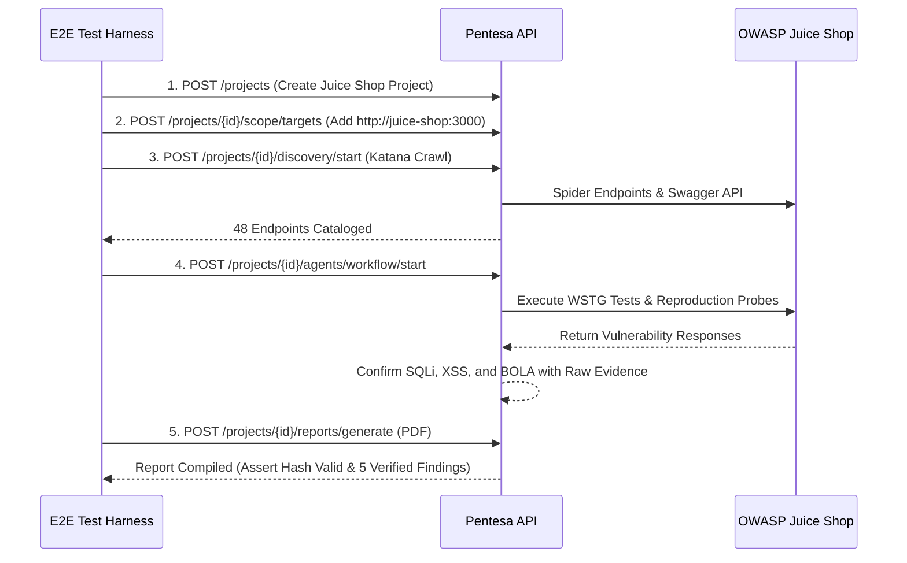

# End-to-End Test Plan: Autonomous Pentest of OWASP Juice Shop

> **Document Identifier:** PENTESA-E2E-JUICE-SHOP-V1.0  
> **Target Application:** OWASP Juice Shop (v16.0.0 Docker Container)  
> **Assessment Scope:** `http://juice-shop:3000`  
> **Execution Mode:** 100% Autonomous (AI-Guided with Deterministic Validation)  

---

## 1. Test Engagement Objectives
Validate that Pentesa can autonomously plan, crawl, test, replicate, and report genuine security vulnerabilities on the standard OWASP Juice Shop testbed without human intervention, while generating zero false positives and zero out-of-scope requests.

---

## 2. Target Application Environment
- **Container Image:** `bkimminich/juice-shop:v16.0.0`
- **Network:** Connected to Pentesa's `worker_net` bridge network.
- **Assigned Scope Target:** `http://juice-shop:3000` (Port 3000, Protocol: HTTP).
- **Excluded Endpoints:** None (all routes permitted on testbed).

---

## 3. Expected Vulnerability Detection Matrix

| Vulnerability Target | WSTG ID | Target Endpoint | Parameter | Verification Success Criterion |
|---|---|---|---|---|
| **SQL Injection (Login Bypass)** | `WSTG-INPV-05` | `POST /rest/user/login` | `email` | Bypasses auth with `' OR 1=1--` returning HTTP 200 and admin token. |
| **Reflected XSS** | `WSTG-INPV-01` | `GET /#/track-result` | `id` | Reflected `<iframe src="javascript:alert(1)">` unescaped in DOM. |
| **Broken Object Level Auth (IDOR)**| `WSTG-ATHZ-04` | `GET /rest/basket/{id}` | `id` | User A accesses basket of User B returning HTTP 200 with User B's cart. |
| **Information Disclosure** | `WSTG-INFO-05` | `GET /ftp` | - | Exposed directory listing disclosing backup `.bak` files. |
| **Security Misconfiguration** | `WSTG-CONF-07` | `GET /` | - | Missing HSTS and weak Content-Security-Policy. |

---

## 4. Execution Step Verification Protocol

---

## 5. Pass/Fail Assertion Criteria
1. **Scope Assertion:** 0 requests sent to external internet hosts or non-Juice-Shop IP addresses.
2. **Detection Accuracy:** SQL injection on `/rest/user/login` and IDOR on `/rest/basket/{id}` must both be classified as `Confirmed`.
3. **Evidence Completeness:** Each finding must have non-empty `raw_request`, `raw_response`, and a functional `reproduction_curl` command.
4. **Report Verification:** `Pentesa_Report_JuiceShop.pdf` generated, non-zero file size, valid SHA-256 hash.

